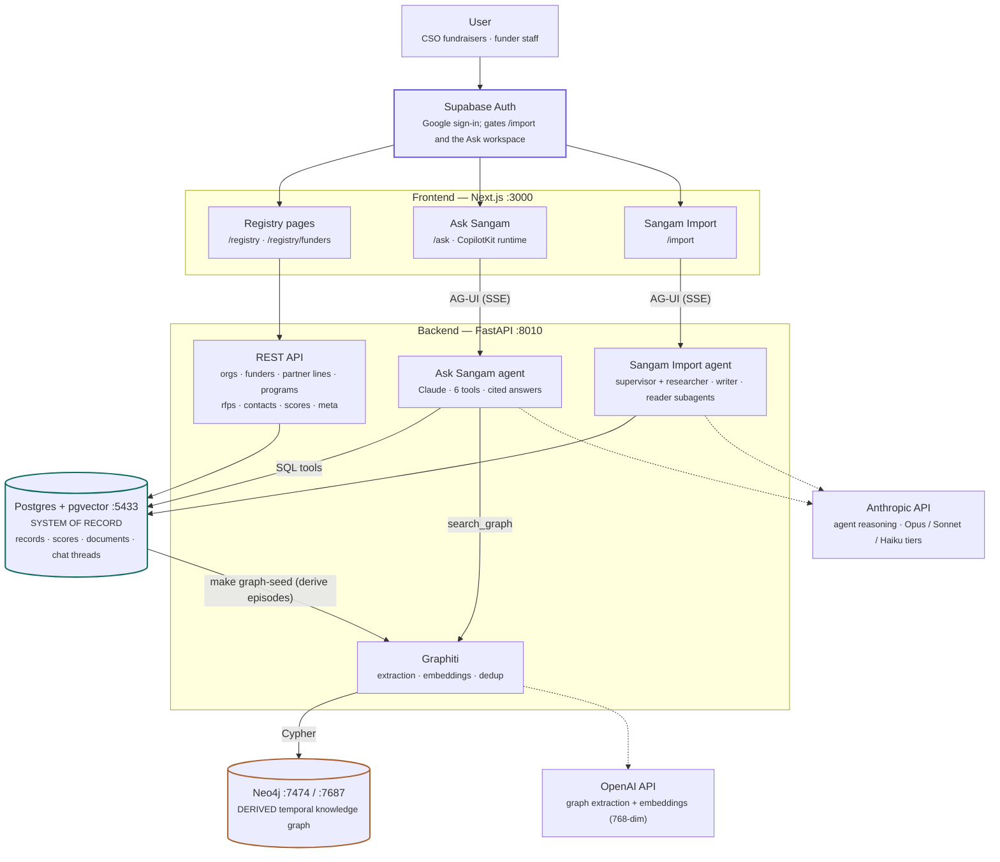

# Sangam


**Grant intelligence for Indian civil-society organisations and the funders who back them.**

Finding the right funder is slow, manual research: who gives in this state, to this sector, at
this size, and have they funded anyone like us before. Sangam keeps that research as structured,
sourced data and lets you interrogate it in plain language. Two agents sit on one database —
**Ask Sangam** answers questions about the registry, and **Sangam Import** pulls new funder data
in from public sources.

The commitment that shapes everything else: **Postgres is the system of record, and every fact
the agent states carries a citation back to a row.** No answer comes from the model's own
knowledge of an organisation.

## How it fits together



**The one rule that holds it together: data flows left to right.** Postgres is the source of
truth; the Neo4j graph is *derived* from it and can be wiped and rebuilt at any time without
losing anything. If the two disagree, Postgres wins.

| Store | Holds | Ask it |
|---|---|---|
| Postgres (typed tables) | registrations, identifiers, contacts, programs, **funder activity** (spend, partners — a grant is a partner line), rubric scores + audit log, news | facts, filters, joins, "what's the score and why" |
| Postgres (`documents`/`chunks`) | full document text; tsvector + pgvector indexes (chunks pipeline pending) | "what does the report actually say" |
| Neo4j (via Graphiti) | entities + temporal relationship edges with validity windows | "what *connects* X to Y", multi-hop paths |

External services are deliberately narrow: **Anthropic** powers agent reasoning (in model tiers,
provider-agnostic; see [Models](#models)), **OpenAI** powers only the graph's extraction and embeddings.

## Prerequisites

To run the stack you need **Docker Desktop**, an **Anthropic API key**, and a **Supabase
project**. The Supabase requirement is not optional and is the step people miss: the frontend
runs `lib/supabase/middleware.ts` on every request, and without its two keys every page returns
500. Create a free project, then copy the URL and the publishable key from **Project Settings →
API**. To reach `/ask` or `/import` you also need a sign-in method — enable the **Google**
provider under **Authentication → Providers**, or add a user by hand.

Give Docker Desktop at least **12 GB** of memory (Settings → Resources) if you run long Imports:
the Next.js dev server relays the whole stream and grows with it.

Everything else is optional. The knowledge graph needs `OPENAI_API_KEY`; without it the graph
disables itself cleanly and the agent is told to use the database tools instead.

Four `make` targets run on the **host**, not in Docker, and need their own tooling:

| Target | Needs |
|---|---|
| `make evals`, `make client-docs` | a backend virtualenv at `backend/.venv` — the image installs runtime dependencies only, so it has no pytest |
| `make dev-backend` | `uvicorn` on the host |
| `make dev-frontend` | Node 22 and `npm` on the host |

## Quickstart

```bash
cp .env.example .env     # set ANTHROPIC_API_KEY and the two NEXT_PUBLIC_SUPABASE_* values
make up                  # migrate, then build and start the whole stack
make seed                # load the cohort data — the app is empty without it
```

**Migrations are not automatic, and two steps above depend on them.** `db/init/` is only a
baseline; 7 of the 32 tables the agent's catalog expects arrive in `db/migrations/*.sql`, and
the backend refuses to boot when one is missing. The seeder needs migration `0002` too, or it
fails on `column "code" of relation "tags" does not exist`.

So `make up` now brings Postgres up, runs `make migrate`, and only then starts the backend; and
`make seed` runs `migrate` as well, which is a no-op the second time. You do not have to think
about it locally. Against a managed database both are deliberately off — run
`make migrate ENV=staging` yourself, after a backup.

Then:

| URL | What |
|---|---|
| http://localhost:3000 | Home |
| http://localhost:3000/registry | The registry — organisations and funders |
| http://localhost:3000/ask | **Ask Sangam** — *requires sign-in* |
| http://localhost:3000/import | **Sangam Import** — *requires sign-in* |
| http://localhost:8010/docs | FastAPI OpenAPI |
| http://localhost:7474 | Neo4j browser — `neo4j` / `sangamneo4j` |

`make graph-seed` builds the knowledge graph afterwards, if `OPENAI_API_KEY` is set.

## Verify the install

```bash
make smoke                      # backend, frontend and the chat wire
SMOKE_SKIP_LLM=1 make smoke     # same, minus the one real agent call
```

**One check is expected to fail on a fresh clone**: `documents: 96+ on file`. Those documents
were restored from a dump and `make seed` does not create them, so the table is empty until an
import run or a `make db-push-remote` from a database that has them. Every other check should
pass.

Then prove the loop the product is actually built on — that you can watch the agent query the
database and check its work. In the chat at `/ask`:

1. Ask **"Which organisations in the database work in Assam?"** A labelled `db_query` step
   appears in the trace *before* the answer streams, and the answer carries inline `[org:N]`
   markers — one per claim.
2. Pick an organisation from that answer and ask **"How well does it fit Axis Bank Foundation,
   and why did Eligibility lose points?"** The answer should cite a specific rubric criterion,
   and where a score was adjusted by hand it should say so and why. The numbers move as the
   data changes; the citation and the disclosed adjustment are the point.
3. Ask something the data cannot answer — **"What is this funder's 2027 budget?"** It should
   say it has no data rather than guess. This is the rule that makes the citations worth
   anything.
4. Refresh the page mid-conversation and keep going. Threads checkpoint into Postgres, so the
   conversation resumes.

## Configuration

`.env` is read by docker compose automatically; `.env.example` documents every variable and is
the fuller reference. The tiers:

| | Variables | Without them |
|---|---|---|
| **Required** | `ANTHROPIC_API_KEY` | the backend cannot answer anything |
| **Required (frontend)** | `NEXT_PUBLIC_SUPABASE_URL`, `NEXT_PUBLIC_SUPABASE_PUBLISHABLE_KEY` | every page returns 500 |
| **Optional** | `OPENAI_API_KEY` + `NEO4J_*` | the graph disables itself cleanly |
| **Optional** | `SUPABASE_URL`, `SUPABASE_SERVICE_KEY` | no document archive or Doc Vault; uploads return 503 |
| **Optional** | `MODEL`, `RESEARCH_MODEL`, `UTILITY_MODEL`, `SQL_AUDIT_MODEL` | the defaults in `backend/app/core/config.py`; see [Models](#models) |
| **Optional** | `RESEARCH_PAGE_LIMIT`, `RESEARCH_MODEL_CALL_LIMIT` | no limit on pages or model calls per Import researcher |
| **Optional** | `TAVILY_API_KEY` | the agents have no web-search tool |
| **Optional** | `LANGFUSE_*`, `LANGSMITH_*` | no tracing. Both can run at once |
| **Deployed only** | `ALLOWED_ORIGINS`, `ALLOWED_ORIGIN_REGEX`, `STAGING_DB_*` | irrelevant locally |

**`ENV` selects the database** for every DB-touching target. `ENV=local` (the default) uses the
bundled Postgres container; `ENV=staging` uses the `STAGING_DB_*` block via
`docker-compose.staging.yml`. `ENV=staging` deploys nothing — it points local tooling at the
managed database.

It is honoured by `up`, `down`, `logs`, `seed`, `migrate`, `migrate-status`, `psql`, `db-url`,
`client-docs` and the remote targets. It is **not** honoured by `frontend-reinstall` or the
`db-clean`/`db-reset`/`db-backup`/`db-upgrade` group, which are local-only by design.

`make up ENV=staging` is the one to think about before running: the containers are yours, but
the data is shared, so a research run from your machine writes into the database the deployed
app serves. It still deploys nothing, and it will not migrate for you — only `ENV=local`
bootstraps and migrates automatically.

**Ports are fixed in `docker-compose.yml`, not in `.env`.** The frontend is on 3000, the backend
publishes 8010 from the container's 8000, Postgres publishes 5433 from 5432, and Neo4j is on
7474/7687. The non-default host ports exist because 8000 and 5432 were already taken on the
machine this was built on. Changing them means editing `docker-compose.yml` — in two places for
the backend, since `NEXT_PUBLIC_API_URL` is set there too.

## Everyday commands

`make help` lists every target, grouped, with a one-line description. The ones you need first:

```bash
make up                  # start the whole stack
make down                # stop it, keeping the volumes
make logs                # follow every container
make frontend-reinstall  # force a frontend npm ci; make up installs only on a dep change
```

```bash
make seed                # load the cohort data (migrates first, locally)
make graph-seed          # build the Neo4j graph from Postgres; needs OPENAI_API_KEY
make migrate             # apply db/migrations/*.sql
make migrate-status      # show what would run
make psql                # interactive shell against whichever database ENV selects
```

```bash
make smoke               # end-to-end check
make evals               # golden questions through the real agent — COSTS MONEY
make evals TAG=canary    # the cheap subset
```

```bash
make dev-backend         # uvicorn on the host, against the compose Postgres on 5433
make dev-frontend        # next dev on the host, against a host backend on 8000
```

`make db-reset` is the scorched-earth option: it drops **every** volume, including the Neo4j
graph and any documents loaded by an import run, then rebuilds and reseeds. Fresh installs only.

## Tests and lint

Backend tests come in three tiers, and the distinction matters:

```bash
cd backend
pytest                        # unit tests — these never touch a database
pytest -m integration         # needs the compose Postgres on :5433
pytest tests/evals --run-evals  # real model calls, real money. `make evals` is the usual door
ruff check .                  # line-length 110, target py312
```

Unit tests build a router-only FastAPI app with no lifespan and a sentinel pool that raises on
any attribute access, so a test that reaches for a database fails loudly rather than quietly
connecting to one. Monkeypatch the `repositories/` function, not the pool. `asyncio_mode =
"auto"`, so async tests need no decorator.

Evals are gated behind `--run-evals` by a conftest flag rather than a marker filter in
`addopts`, on purpose: a command-line `-m` *replaces* addopts' `-m`, so `pytest -m integration`
would otherwise start billing model calls.

Frontend:

```bash
cd frontend
npm run lint             # eslint
npm run build            # next build
```

**Run `npm run build` before pushing.** Type errors surface there and never in `next dev`.

Linting is newly wired up and three rules are warnings rather than errors while the existing
findings get cleared — see the comment in `frontend/eslint.config.mjs`.

## Repository layout

```
backend/app/
  main.py          create_app() + the ASGI entrypoint — wiring only
  core/            config · security (Supabase JWT) · lifespan · logging
  db/              pool · checkpointer (LangGraph) · migrate (the runner)
  api/             router.py (one aggregate router) · deps · routes/<resource>.py
  repositories/    hand-written SQL, one module per resource
  schemas/         Pydantic, one module per resource
  agent/           Ask Sangam: build.py · tools/ · instructions.md · harness.py
  ingest/          Sangam Import: its own agent, tools, skills/ and adapters
  integrations/    graphiti (Neo4j lifecycle) · tracing

frontend/
  app/             routes ONLY — pages, layouts, route handlers
  features/        one folder per screen: ask · auth · home · ingest · registry · terms
  components/      ui/ (display primitives) · layout/ (site chrome)
  lib/             api/ (client + types) · supabase/ · format.ts

db/init/           baseline schema; runs once on a new database
db/migrations/     every change after the baseline — 0001 onward, applied by `make migrate`
seed/              vendored data + idempotent loaders (see seed/data/README.md for provenance)
scripts/           smoke.sh and the db-url resolver
```

Two rules keep this from eroding: **nothing that is not a route goes under `frontend/app/`**,
and **no new module goes flat at the top of `backend/app/`**. Cross-folder frontend imports use
the `@/` alias.

A REST resource is always three files — `api/routes/<r>.py`, `repositories/<r>.py`,
`schemas/<r>.py` — plus one line in `api/router.py`. There is no ORM and no Alembic;
`app/db/migrate.py` explains why.

Note that `seed/seed.py` loads the **v2** shape of the data model while migrations 0001–0019
carry v3. The seed data has not caught up; `docs/DATA_PLATFORM.md` has the full picture.

## How the agent answers

The intelligence is two LangGraph **deep agents** over one database, both exposed to the
frontend over the **AG-UI protocol** and both streaming their tool calls live, so you watch the
work rather than trusting a black box.

**Ask Sangam has exactly six tools** — `db_list_tables`, `db_describe_table`,
`db_profile_column`, `db_query`, `search_graph`, `fetch_url` — and that sentence is load-bearing.
`create_deep_agent` adds eight filesystem tools of its own plus a general-purpose subagent
carrying the whole tool list; `backend/app/agent/harness.py` removes both, and tests pin it.

Three conventions a new tool must not break:

- **Tools never raise.** A raised exception aborts the whole agent run, so every tool body
  returns `"<tool> failed: …"` instead and lets the model adapt.
- **Every row is cited.** Tool results embed `[org:N]`, `[funder:N]`, `[activity:N]`, `[score:N]`,
  `[graph:<uuid8>]`, and `instructions.md` requires the model to repeat them inline. A tool
  returning uncited rows produces uncitable answers.
- **The model writes its own SQL, behind four layers.** An allowlist catalog of 32 tables, a
  pure validator that regenerates the statement from a parsed AST so the model's string never
  executes, a read-only transaction with timeouts, and the extended protocol so the server
  itself refuses multi-command statements. `docs/SQL_AGENT.md` has the design.

**Sangam Import is a supervisor with three kinds of subagent.** The supervisor plans the run and
pauses for staff. It launches one `entity-researcher` per organisation (up to
`MAX_PARALLEL_RESEARCH` at once), a `catalog-writer` to move approved research into the catalog,
and a `workbook-reader` for staff spreadsheets. Each subagent runs in its own context window and
hands back a structured summary, not its reading.

**Prompts and skills are both markdown, loaded differently.**
- A **prompt** is an agent's system prompt, sent on every model call: `backend/app/ingest/instructions.md` for the supervisor and `backend/app/ingest/prompts/*.md` for each subagent. It holds what applies every turn: rules, access limits, how to save.
- A **skill** (`backend/app/ingest/skills/<name>/SKILL.md`) puts only its name and description in the prompt. The supervisor reads the full file when a request needs it, for example a report format or a playbook for one kind of research. Only the supervisor has skills; [`docs/SKILLS.md`](docs/SKILLS.md) explains why.

### Models

Each agent runs on a model matched to how hard its work is (`backend/app/core/config.py`):

| Variable | Default | Runs |
|---|---|---|
| `MODEL` | `anthropic:claude-opus-5-5` | Ask Sangam; the Import supervisor |
| `RESEARCH_MODEL` | `anthropic:claude-sonnet-5-5` | Import's entity-researchers |
| `UTILITY_MODEL` | `anthropic:claude-haiku-4-5` | catalog-writer, workbook-reader, article extraction, the research grader, long-run summaries |
| `SQL_AUDIT_MODEL` | `anthropic:claude-haiku-4-5` | Ask's audit of each SQL answer; `off` disables it |

- A blank or unset variable always means the default above, and `config.py` is the only place defaults are written.
- To run a tier on the main model, set it to the same value as `MODEL`.
- A deployed backend reads these from its Vercel env, which overrides the defaults.

**Import's middleware** (`backend/app/ingest/middleware.py`, LangChain and deepagents middleware):
- Each tier falls back to another model when a call fails.
- A researcher has no page or model-call limit unless `RESEARCH_PAGE_LIMIT` / `RESEARCH_MODEL_CALL_LIMIT` is set; then it stops reading and saves what it has, or is stopped outright.
- After a malformed save, the rest of a researcher's run moves to `MODEL`.
- A Haiku grader checks each researcher's save and summary against `prompts/research_rubric.md` and allows one revision.

**Auth.** The frontend signs in with Supabase, and the backend verifies the access token against
the project's JWKS (`backend/app/core/security.py`); queries then run as that caller, under RLS.
With `SUPABASE_URL` unset every request is the seeded dev user, and `Bearer dev` works only with
`DEV_AUTH=1`, for local use.

## Deployment

Docker is local development only. Deployed, the stack splits across three hosts:

| Piece | Runs on |
|---|---|
| Next.js frontend | Vercel project `sangam` (root directory `frontend`) |
| FastAPI backend | Vercel project `sangam-backend` (root `backend`, preset `fastapi`) |
| Postgres | Supabase |
| Neo4j | Neo4j Aura, or omitted |

**Nothing deploys automatically.** Run Actions → Deploy → Run workflow on `master` to deploy
both projects; a merge deploys nothing. Both `vercel.json` files set
`git.deploymentEnabled: false`, so no push builds anything either. There are no preview
deployments by design.

Two traps worth knowing before touching this:

- **Use Supabase's session pooler, not the direct host.** `db.<ref>.supabase.co` is IPv6-only,
  which containers cannot reach — connections hang rather than fail. The transaction pooler on
  6543 breaks `pg_restore`; use session mode on 5432.
- **`NEXT_PUBLIC_*` is inlined at build time.** Changing one needs a fresh deploy, not an env
  edit.

## Troubleshooting

| Symptom | Cause | Fix |
|---|---|---|
| `column "code" of relation "tags" does not exist` while seeding | migrations not applied — `0002_taxonomy.sql` adds that column | `make migrate`, then `make seed`. Locally both `make up` and `make seed` now do this for you |
| Every page returns 500 | `NEXT_PUBLIC_SUPABASE_*` empty; the proxy throws on every request | set both in `.env`, then `make up` — `docker compose restart` will **not** help, since a container's environment is fixed when it is created |
| `/ask` bounces to `/auth/login` | working as designed — `/ask`, `/import` and `/protected` are gated | sign in, or enable a Supabase auth provider |
| Postgres container never starts | `COMPOSE_PROFILES=localdb` missing from `.env` | the one line you cannot drop and still use the bundled database |
| `make smoke` fails only on `documents: 96+` | `make seed` does not create those documents | expected on a fresh clone |
| `Module not found` after a `package.json` change | the install stamp in `frontend/docker-entrypoint.sh` is stale | `make frontend-reinstall` |
| A staging connection hangs instead of failing | `db.<ref>.supabase.co` is IPv6-only | use the session pooler on 5432 |
| Type errors appear only on deploy | `next dev` does not typecheck | `npm run build` before pushing |

## Documentation

| Doc | What it covers |
|---|---|
| [`CLAUDE.md`](CLAUDE.md) | Conventions and architecture decisions, in more depth than this file |
| [`docs/DATA_PLATFORM.md`](docs/DATA_PLATFORM.md) | The v2 → v3 data model: what changed, what is new, and why |
| [`docs/SQL_AGENT.md`](docs/SQL_AGENT.md) | The safe text-to-SQL design — the catalog, validator and executor |
| [`docs/INGEST.md`](docs/INGEST.md) | Sangam Import end to end: sources, matching, what it refuses to do |
| [`docs/SKILLS.md`](docs/SKILLS.md) | How the importer loads procedures from `SKILL.md` files, and the cost |
| [`docs/features/`](docs/features/) | One plan per change, e.g. `2026-10-09-model-tiers.md` and `2026-10-09-import-middleware.md` |
| [`docs/DEPLOY.md`](docs/DEPLOY.md) | Deployment detail. **Its premise that the backend cannot run on Vercel is out of date** — the Deployment section above is authoritative |
| [`db/migrations/README.md`](db/migrations/README.md) | Why migrations are plain SQL and how to add one |
| [`seed/data/README.md`](seed/data/README.md) | Provenance for every seeded record |
| [`docs/entities/`](docs/entities/) | Generated funder briefs — written by `make client-docs`, not by hand |

## Glossary

| Term | Meaning |
|---|---|
| **CSO** | Civil-society organisation. Used interchangeably with NGO here |
| **Darpan** | NGO Darpan, the Indian government's registry of voluntary organisations. A Darpan ID is the closest thing to a national identifier |
| **CSR-1** | The filing an organisation must have with the MCA to receive corporate CSR funding. Its absence is a hard eligibility blocker |
| **Schedule VII** | The Companies Act list of activities CSR money may fund. The taxonomy's top level |
| **Rubric v1 / v2** | Versioned scoring criteria for how well an organisation fits a funder. Scores carry `scored_by` and an adjustment audit log, so a hand-vetted override sits beside the computed score rather than replacing it |
| **Deep agent** | A `deepagents` preset over LangGraph — planning middleware and subagents around a tool-calling loop. Not an alternative to LangGraph |
| **Skill** | A `SKILL.md` procedure the agent reads only when a request needs it; only its name and description sit in the prompt |
| **Model tier** | Which model an agent runs on: strong (`MODEL`), research, or utility. See [Models](#models) |
| **AG-UI** | The protocol streaming agent events (tool calls, tokens) from the backend to the chat UI over SSE |

## Status

Pre-release and under active development. The schema moves, and the backend has **no
authentication** — see the auth note above before exposing it.

There is no `LICENSE` file yet, so default copyright applies and the code is not open source.
Resolve that before sharing the repository outside the organisation.
