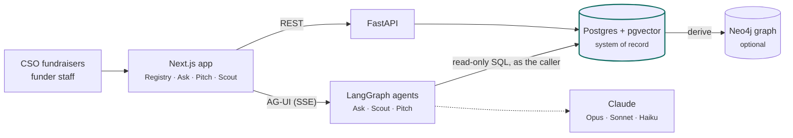

<div align="center">

# Sangam

**Grant intelligence for Indian civil-society organisations and the funders who back them.**

[Live app](https://sangam-six-beta.vercel.app) ·
[Docs](https://sangam-wiki.vercel.app) ·
[Contributing](CONTRIBUTING.md) ·
[Report a bug](https://github.com/project-tech4dev/sangam/issues/new/choose)

[](https://github.com/project-tech4dev/sangam/actions/workflows/ci.yml)
[](https://app.codecov.io/gh/project-tech4dev/sangam/flags?branch=master)
[](https://app.codecov.io/gh/project-tech4dev/sangam/flags?branch=master)
[](LICENSE)

</div>

## Why Sangam

Finding the right funder is slow, manual research: who gives in this state, to this cause, at this size,
and have they funded anyone like us before. Most of the answers are public, but scattered across CSR
filings, annual reports, funder websites and news. Sangam gathers them into one registry where every
fact links to its source, and puts AI agents on top that answer questions, research new organisations
and draft proposals without making anything up.

Two rules shape the whole system:

- **Postgres is the system of record.** Everything else, including the knowledge graph, is derived
  from it and can be rebuilt.
- **Every fact carries a citation.** An agent's answer cites the row behind each claim, such as
  `[org:12]` or `[funder:4]`. No answer comes from a model's own knowledge of an organisation.

## Features

| | What it does for you |
|---|---|
| **Registry** | Profiles of CSOs and funders: registrations, programmes, places, money given and received, news, each field with its source |
| **Ask Sangam** | Ask the registry anything in plain language. The agent writes its own read-only SQL, shows each step as it works, and cites every row it uses |
| **Funder Match** | Ranks funders for an organisation on seven criteria (theme, geography, population, eligibility, relationship, funding size, capacity), judged in code, with what would raise the score |
| **Sangam Pitch** | Drafts a proposal to a funder from facts on record and the files you choose. Every figure, place and name traces to a source or is refused, and it exports to Word |
| **Sangam Scout** | For staff and stewards: researches an organisation or a whole list from public sources, Sangam's library and your Doc Vault, and saves cited findings once a person approves |
| **Media & Signals** | News about the organisations and funders in the registry, classified and shown on their profiles |
| **RFP Watch** | Open calls for proposals from funders' own pages, matched to your organisation's themes |

## How it works



- **The frontend** is Next.js on Vercel. Sign-in is Supabase Auth, and the app's reads and Ask's SQL run as the
  signed-in person under Postgres row-level security.
- **The agents** are LangGraph deep agents that stream their tool calls to the screen, so you watch the
  work instead of trusting a black box. Ask Sangam has exactly six tools, four of them for SQL behind an
  allowlist, a validator and a read-only transaction ([how](docs/SQL_AGENT.md)).
- **Models come in tiers** by how hard the work is: Opus reasons, Sonnet researches, Haiku does fixed-shape work.

The [architecture guide](docs/ARCHITECTURE.md) covers each subsystem and the decisions behind it.

## Quickstart

You need Docker Desktop, an [Anthropic API key](https://console.anthropic.com/) and a free
[Supabase](https://supabase.com/) project.

```bash
git clone https://github.com/project-tech4dev/sangam.git && cd sangam
cp .env.example .env     # set ANTHROPIC_API_KEY and the two NEXT_PUBLIC_SUPABASE_* values
make up                  # start Postgres, migrate, then the backend and frontend
make seed                # load the cohort data
make smoke               # check the stack end to end
```

Open http://localhost:3000. The [contributing guide](CONTRIBUTING.md) covers configuration, tests,
troubleshooting and how to open a pull request.

## Built with

Next.js 16 · React 19 · FastAPI · Python 3.12 · LangGraph and deepagents · Claude · Postgres 17 with
pgvector · Supabase · Neo4j and Graphiti (optional) · Langfuse · Vercel

## Documentation

| Doc | What it covers |
|---|---|
| [Wiki](https://sangam-wiki.vercel.app) | Generated reference: tools, routes, tables, settings, each claim linked to source |
| [`docs/ARCHITECTURE.md`](docs/ARCHITECTURE.md) | How every subsystem works and why |
| [`docs/SQL_AGENT.md`](docs/SQL_AGENT.md) | The safe text-to-SQL design: catalog, validator, executor |
| [`docs/INGEST.md`](docs/INGEST.md) | Sangam Scout end to end: sources, matching, what it refuses to do |
| [`docs/DATA_PLATFORM.md`](docs/DATA_PLATFORM.md) | The data model and why it is shaped this way |
| [`docs/SKILLS.md`](docs/SKILLS.md) | How the agents load procedures from `SKILL.md` files |
| [`docs/CHANGELOG.md`](docs/CHANGELOG.md) | What shipped, by subsystem, and what is not finished |
| [`seed/data/README.md`](seed/data/README.md) | Where every seeded record comes from |

## Glossary

| Term | Meaning |
|---|---|
| **CSO** | Civil-society organisation, used interchangeably with NGO |
| **CSR** | Corporate social responsibility: Indian companies above a size must spend 2% of profit on it |
| **Darpan** | NGO Darpan, the government's registry of voluntary organisations; its ID is the closest to a national one |
| **CSR-1** | The MCA filing an organisation needs to receive CSR money; without it, it is ineligible |
| **Schedule VII** | The Companies Act list of activities CSR money may fund, and the top of Sangam's taxonomy |

## Status

Sangam is pre-release and under active development by [Project Tech4Dev](https://projecttech4dev.org).
The schema still moves, and `master` is what runs in production. [`docs/CHANGELOG.md`](docs/CHANGELOG.md)
lists what is not finished.

## Contributing

Bug reports, ideas and pull requests are welcome. Start with the [contributing guide](CONTRIBUTING.md),
and report security problems privately as [`SECURITY.md`](SECURITY.md) describes. Everyone taking part
agrees to the [Code of Conduct](CODE_OF_CONDUCT.md).

## License

[MIT](LICENSE) © 2026 Project Tech4Dev.
