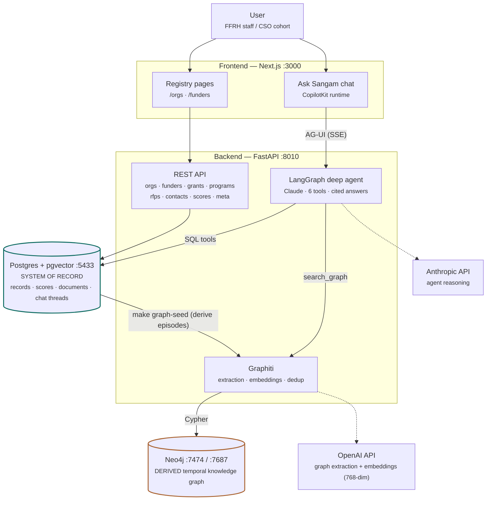

# Sangam

Grant intelligence for Indian CSOs and the funders who back them. Local dev scaffold:
**Next.js + CopilotKit** → **FastAPI + LangGraph** (via the AG-UI protocol) → **Postgres + pgvector**,
seeded with real cohort data (NGO Darpan registry records, GDELT news monitoring, and
hand-vetted KABIL funder-fit scores on rubric v1/v2).

```
browser ── Next.js (:3000) ── /api/copilotkit (CopilotKit v2 runtime)
                │                    │ AG-UI (SSE)
                │ REST               ▼
                └────────── FastAPI (:8010) ── LangGraph deep agent
                                     │           │ tools: db_list_tables · db_describe_table
                                     │           │        db_profile_column · db_query
                                     │           │        search_graph · fetch_url
                                     ▼           ▼
                    Postgres + pgvector (:5433)   Neo4j (:7474/:7687)
                    records · scores · documents  temporal knowledge graph
                    chat checkpoints (truth)      (derived via Graphiti)
```

## Quickstart

Requirements: Docker Desktop.

```bash
cp .env.example .env        # set ANTHROPIC_API_KEY (or another provider's key + MODEL)
make up                     # postgres + neo4j + backend + frontend (frontend runs `next dev`)
make migrate                # apply db/migrations/*.sql on top of the baseline schema
make seed                   # loads orgs, funders, rubrics, scores, news
```

**`make migrate` is not optional, and nothing runs it for you.** `db/init/` only gives a new
database the *baseline* schema, and it only runs on the Postgres container's first boot;
every change since then lives in `db/migrations/`. Skip it and `make seed` fails partway —
`seed.taxonomy_seed` writes `tags.code`/`status`/`sort_order`, columns that
`0002_taxonomy.sql` adds. (Same for `make db-reset`, which recreates the volume but does not
migrate: run `make migrate` before `make seed`.)

Open:

- http://localhost:3000 — **Ask Sangam** chat (agent tool calls render inline)
- http://localhost:3000/orgs — cohort registry (10 orgs: 8 Darpan + KABIL + BDF)
- http://localhost:3000/funders — funders with KABIL fit scores (v1/v2)
- http://localhost:8010/docs — FastAPI OpenAPI

Prove the agent → Postgres → citation loop in the chat:

1. *“Which NGOs in our database work in Assam?”* → visible `db_query` call, answer cites `[org:N]`.
2. *“How well does KABIL fit Axis Bank Foundation, and why did Eligibility lose points?”*
   → `db_query` over the rubric tables; the answer should cite the CSR-1 gap (16/20 on criterion 2, rubric v1)
   and mention the hand-vetting adjustment (Relationship 10 → 7, grant concluded ~March 2022).
3. Refresh mid-conversation and continue — threads persist in Postgres (LangGraph checkpointer).

## Layout

```
db/init/        # BASELINE schema for a new database; runs once on the container's first boot
db/migrations/  # every schema change after the baseline, applied by `make migrate`
seed/           # vendored data + idempotent seed script (see seed/data/README.md for provenance)
backend/        # FastAPI + LangGraph deep agent, AG-UI endpoint at /agent
frontend/       # Next.js App Router + CopilotKit
```

Useful targets: `make logs`, `make psql`, `make db-reset` (drop volume, recreate, re-seed —
then `make migrate`), `make dev-backend` / `make dev-frontend` (run either outside docker
against compose Postgres).

## After pulling

Three things a teammate's commit can change under you. The fixes are different because the
backend's dependencies live in its image and the frontend's live in a named volume.

**A migration landed** — `db/migrations/` gained a file:

```bash
make migrate-status    # what would run; prints "nothing pending" when you are current
make migrate           # apply it
```

Both work against any `ENV`: `make migrate ENV=staging` targets the managed database.
Writing one is `db/migrations/README.md` — forward-only, `NNNN_short_name.sql`, never edit an
applied file (the runner checksums them and reports drift).

**A frontend dependency landed** — `frontend/package.json` changed:

```bash
docker compose exec frontend npm install
docker compose restart frontend
```

`make up` will *not* fix this, and neither will `--build`. Compose mounts
`frontend_node_modules` over `/app/node_modules`, and a named volume **shadows the image
layer underneath it** — so the container reads your new `package.json` through the bind mount
while still resolving imports against the `node_modules` from whenever the volume was first
populated. The symptom is `Module not found: Can't resolve '<the new package>'` for a package
that is sitting right there in `package.json`. Use `npm install`, not `npm ci`: `ci` starts by
deleting `node_modules`, cannot delete a mount point, and leaves the volume empty — which
takes the container down with it. If that happens, or the volume is otherwise wedged:

```bash
docker compose rm -sf frontend
docker volume rm sangam_frontend_node_modules sangam_frontend_next
docker compose up -d --build frontend
```

**A backend dependency landed** — `backend/pyproject.toml` changed:

```bash
make up                # already passes --build; deps install into the image
```

No volume is involved here, so rebuilding is enough. Only `backend/app/` is bind-mounted.

One piece of churn to ignore: `frontend/next-env.d.ts` flips between `./.next/types/...` and
`./.next/dev/types/...` depending on whether `next build` or `next dev` touched it last. The
committed version is the `build` one. Don't commit the flip — `git checkout -- frontend/next-env.d.ts`.

## Architecture (high level)



**The one rule that holds it together: data flows left to right.** Postgres is the source of
truth; the Neo4j graph is *derived* from it (episodes generated from Postgres rows, entities
and time-bounded relationship facts extracted by an LLM) and can be wiped and rebuilt at any
time without losing anything. If the two ever disagree, Postgres wins.

| Store | Holds | Ask it |
|---|---|---|
| Postgres (typed tables) | registrations, identifiers, contacts, programs, **grants**, rubric scores + audit log, news | facts, filters, joins, "what's the score and why" |
| Postgres (`documents`/`chunks`) | full document text; tsvector + pgvector indexes (chunks pipeline pending) | "what does the report actually say" |
| Neo4j (via Graphiti) | entities + temporal relationship edges with validity windows | "what *connects* X to Y", multi-hop paths |

External services are deliberately narrow: **Anthropic** powers the agent's reasoning
(`MODEL`, provider-agnostic), **OpenAI** powers only the graph's extraction/embeddings
(`OPENAI_API_KEY`). Auth is a dev-stub pending Supabase JWT; everything runs locally via
docker compose (`make up`).

## Agentic layer (how the chat actually works)

The "intelligence" is one LangGraph **deep agent** (`deepagents` + Claude, built in
`backend/app/agent/build.py`), exposed to the frontend over the **AG-UI protocol**
(`add_langgraph_fastapi_endpoint` at `/agent`; the Next.js CopilotKit runtime proxies it).
Design principles, in priority order:

1. **Tools are the only source of truth.** The agent answers exclusively from tool results —
   never from the model's own knowledge of an org or funder. No data → it says so.
   The system prompt enforcing this lives in `backend/app/agent/instructions.md`.
2. **Every fact is cited.** Tool results embed markers — `[org:9]`, `[funder:1]`, `[grant:2]`,
   `[score:1]`, `[graph:ab12cd34]` — and the agent must repeat them inline next to each claim,
   so every sentence traces to a Postgres row or a graph edge.
3. **Routing by question type** (the agent picks tools; nothing is hardcoded):

   | Question | Tool | Backing store |
   |---|---|---|
   | "Which NGOs work in Assam?" | `db_query` | Postgres (orgs + tags/locations) |
   | "Tell me about SBI Foundation" | `get_funder` | Postgres (funders + contacts + grants summary) |
   | "Who has funded KABIL?" | `db_query` | Postgres `grants` (authoritative record) |
   | "How well does KABIL fit ABF, and why?" | `db_query` | Postgres rubric family + adjustment audit log |
   | "What *connects* KABIL to Tata Trusts?" | `search_graph` | Neo4j via Graphiti (temporal facts) |
   | Fetch a page the user links | `fetch_url` | live web |

4. **Tools never raise.** Errors return as strings so the agent can see the failure and adapt
   (`backend/app/agent/tools/sql_tools.py` / `graph_tools.py`). If the graph is unconfigured, the agent
   is told so and falls back to SQL tools, disclosing the limitation in its answer.
5. **Conversations persist.** Threads checkpoint into Postgres (`AsyncPostgresSaver` on the
   shared connection pool, `backend/app/db/checkpointer.py`) — refresh mid-chat and continue.
6. **Adding a tool** = write an async function with the citation-marker + error-as-string
   conventions in `backend/app/agent/tools/`, register it in `agent/build.py`, and mention its marker
   in `agent/instructions.md`. The chat UI renders new tool calls automatically (wildcard renderer
   in `frontend/app/page.tsx`).

Model and keys: the agent's reasoning model is `MODEL` (default `anthropic:claude-sonnet-5`,
provider-agnostic via `agent/models.py`); Graphiti's extraction/embeddings use `OPENAI_API_KEY`
independently. Tool calls stream live into the chat (AG-UI events), so users watch the agent
query the databases rather than trusting a black box.

## Knowledge graph (Graphiti + Neo4j)

Relationship facts extracted from source text live in a temporal graph (Neo4j; browser at
http://localhost:7474, login `neo4j` / `sangamneo4j`, bolt on 7687). The agent's
`search_graph` tool answers connection questions — "what links KABIL to Tata Trusts?" —
with time-bounded facts.

- Requires `OPENAI_API_KEY` in `.env` (Graphiti's extraction LLM + embeddings; Anthropic has
  no embedding models). Without it the stack runs fine and the tool reports the graph as off.
- `make graph-seed` builds the graph **from Postgres** (funder/org profiles, grants, the
  hand-vetting adjustment log). Postgres stays the system of record; the graph is derived
  and rebuildable — safe to wipe (`docker compose down -v` clears it along with everything else).
- Embeddings are pinned at 768 dims (`EMBEDDING_DIM` in compose) — keep any external
  ingestion tooling on the same value.

## Design notes

- **Auth is a stub** (`backend/app/core/security.py` returns a seeded dev user; the frontend already
  sends `Authorization: Bearer dev`). Swapping to Supabase JWT later changes only that function.
- **Provenance discipline**: every scraped-fact table carries `source_url/source_name/fetched_at/
  content_hash/extractor_version`; scores carry `scored_by/scored_at` and a manual-override audit
  log (`score_adjustments`). The agent's system prompt requires inline `[org:N]`-style citations.
- **Rubrics are versioned** (`rubrics`/`rubric_criteria` with self-referencing sub-criteria), so a
  future model-based rubric judge writes `fit_scores` rows with `scored_by='model:<name>'` next to
  the human baseline rather than overwriting it.
- **Migrations**: `db/init/02_schema.sql` is the baseline a brand-new database gets; every change
  after it is a forward-only file in `db/migrations/`, applied by `make migrate` and recorded in a
  ledger with a checksum. The baseline is deliberately not rewritten as `0000`, so a fresh install
  stays one fast `CREATE TABLE` pass instead of a replay of every historical change.
  See `db/migrations/README.md`.
