# SANGAM data model v3: changes from the v2 baseline

There is no production database, so the model is built by wiping and reseeding. v3 is one baseline file, `db/init/02_schema.sql`, which replaces the v2 baseline. There are no migrations; `db/migrations/` holds only its README. This document lists every change from v2, table by table in v2 order, then covers new tables, views, functions, access rules, reference data, taxonomy, funder data from CSR reports and the knowledge graph. It ends with the work still needed.

v3 was built on an empty Postgres 16 database with pgvector and seeded with `make seed`, the reference data and the taxonomy loader. Its tables, columns, constraints and access policies were then compared with the same model built step by step on top of v2, and they matched.

## Summary

| Area | Result |
|---|---|
| v2 tables | 30 |
| Unchanged | 7 (`chunks`, `extraction_log`, `rubrics`, `rubric_criteria`, `fit_scores`, `fit_score_items`, `score_adjustments`) |
| Changed | 23 |
| Dropped | 0 |
| New tables | 14 (`org_members`, `org_financials`, `metrics`, `grant_locations`, `credential_events`, `funder_csr_years`, `funder_csr_spend`, `funder_footprints`, `funder_partners`, `location_designations`, `reference_figures`, `proposal_templates`, `template_items`, `proposals`) |
| v3 tables | 44 |
| New views | 5 (`location_paths`, `tag_paths`, `credential_status`, `funder_district_presence`, `impact_chains`) |
| New functions | 6: five in schema `app` for access, and `check_template()` |
| Row level security | on for every table; policies on 43 of 44 (`extraction_log` has none) |

## How a database is built

| Step | Command | What it does |
|---|---|---|
| 1 | `make down` then remove the `sangam_pgdata` volume, or drop the Supabase schema | Wipes the database. Run `make db-backup` first if you want to keep the 96 research documents. |
| 2 | `make up` | Runs `db/init/01_extensions.sql`, `02_schema.sql` and `03_dev_user.sql` on the empty database. On Supabase use `make db-init-remote`. |
| 3 | `make seed` | Loads Darpan orgs, funders, programmes, grants, rubrics, scores and news. |
| 4 | `psql -f db/seed/reference_data.sql` | Loads CSR Schedule VII sectors, geographic priority tags, the 112 aspirational districts, the 8 North East states, government schemes and reference figures. Must run after step 3. |
| 5 | `python -m seed.taxonomy_seed` | Loads SDGs, sectors, population groups and the livelihoods tree, and re-labels Darpan and free-text tags. |
| 6 | `psql -f db/seed/funders/axis_bank.sql` then `psql -f db/seed/funders/axis_bank_disclosures.sql` | Loads Axis Bank Limited and Axis Bank Foundation from the CSR impact reports, then from the statutory annual report and BRSR. Other funders get their own files in `db/seed/funders/`. |
| 7 | `psql -f db/seed/funders/sbi_foundation_gramseva.sql` and `psql -f db/seed/orgs/kabil_impact.sql` | Loads the SBI Foundation Gram Seva RFP with its template, and KABIL's programmes, results chains and credential findings. `db/seed/examples/` holds test-only rows, such as an example proposal. |
| 8 | Restore `documents.sql` from the backup (optional) | Brings back the 96 research documents. Document rows point at orgs and funders by id, and the seed order keeps those ids the same. |

Every step can be run again without creating duplicates.

## Model rules

**Provenance.** One row is one fact from one source. Every fact row carries `source_url` (a link, the page is not cached), `source_name`, `fetched_at` (the date it was sourced), `as_of` (the date or period the source describes, such as `FY2023-24`) and `document_id` (the content file it was read from, when there is one). A second source for the same fact is a second row. Conflicts go in `notes`. When a fact is recorded, a web archive snapshot (for example the Wayback Machine) can be taken and its link stored in `archive_url`, so the evidence survives if the page is edited or taken down.

**Access.** Registry data is public. Private data is limited to five things: documents with `is_public = false`, identifier values with `is_public = false`, unvetted news, RFP matches, and threads that are not shared. Users belong to orgs through `org_members` with a role of `admin`, `member` or `steward`. An ecosystem player such as Node gets `steward` rows on each org it supports, and deleting the row removes access. FFRH staff have `users.is_staff`.

**Rubrics.** The five rubric and scoring tables stay exactly as in v2. They hold the recorded rubric versions, the hand-vetted KABIL scores and the adjustment log. The agent's scoring logic lives in its code.

**Geography.** Places form one tree in `locations`: country, region, state, district, block, village. Villages are stored only when a source names them; otherwise reach is a count in `metrics`. An org's places come from three links: the org itself (`org_locations`), its programmes (`program_locations`) and its grants (`grant_locations`). A funder's stated geography is `funder_locations` with role `priority`; where it actually funded comes from `grant_locations`. Every link has its own source and dates.

**Credentials.** A registration's number lives in `org_identifiers` or `funder_identifiers`, and can be private. What happened to it lives in `credential_events`: registered, renewed, checked, expired, suspended, cancelled, and so on, each dated and sourced. The events hold no number, so status and history can be public while the number stays private. `credential_status` gives the current status from the latest verified event.

**Funder activity.** A funder's own themes, programmes and phases are rows in `programs` owned by the funder. What it did each fiscal year is recorded separately: where each theme ran (`funder_footprints`), whom it named as partners (`funder_partners`), its CSR obligation and spend (`funder_csr_years`), and spend by CSR sector and place (`funder_csr_spend`). A company and its foundation are linked through `funders.parent_id`.

**Priorities on places.** `location_designations` marks places that funders prioritise, such as NITI Aayog aspirational districts and the North East states. A funder's stated priority is a tag on its theme (for example `geo-aspirational-districts`) whose `meta.designation` names the designation it refers to.

**Taxonomy.** All vocabularies live in `tags`. SDGs, formal sectors, population groups and CSR Schedule VII sectors are shared across domains. Each domain (livelihoods today, health and education later) has one root row and a tree of cells, loaded from `seed/data/taxonomy/<domain>.json`.

## What is stored

Public sources are not copied. Volume grows with embeddings more than with files: every 1,000-character chunk carries about 6 KB of vectors, so a 100-page annual report is roughly 1 MB of text and embeddings in Postgres.

| What | Stored | Example |
|---|---|---|
| Any public web page or file | `source_url`, `fetched_at`, `content_hash`, and optionally `archive_url` | Funder website pages, news articles, Darpan records |
| Public documents that feed facts or agent answers | Cleaned text in `documents.content_md`, plus `chunks` and embeddings. Not the raw PDF or HTML. | Annual reports, funder programme pages, RFP text |
| Original file in Supabase Storage | Private vault uploads, and a few public files likely to vanish | Audited accounts; RFP PDFs with a deadline; funder guidelines |

When a public source's `content_hash` changes, its old text, chunks and embeddings are replaced, not kept. The link, hash and archive link show what the page said when the fact was recorded.

Graphiti stores each episode's text again in Neo4j, so only documents whose facts should become graph edges are sent to the graph. Neo4j Aura Free caps the graph at 200,000 nodes and 400,000 relationships.

## Relationships after the change

New tables and the main new links are shown. Unchanged v2 relationships (locations, identifiers, contacts) are left out to keep the diagram readable.

```mermaid
erDiagram
  users ||--o{ org_members : "belongs to"
  orgs ||--o{ org_members : "has"
  users ||--o{ threads : "creates"
  orgs ||--o{ threads : "scopes (shared threads)"
  orgs ||--o{ documents : "owns"
  documents ||--o{ chunks : "split into"
  orgs ||--o{ org_financials : "reports"
  orgs ||--o{ metrics : "reports"
  programs ||--o{ metrics : "measures"
  grants ||--o{ metrics : "measures"
  orgs ||--o{ programs : "runs"
  funders ||--o{ programs : "runs"
  programs ||--o{ programs : "parent_id"
  funders ||--o{ grants : "funds"
  orgs ||--o{ grants : "receives"
  orgs ||--o{ fit_scores : "scored"
  funders ||--o{ fit_scores : "against"
  tags ||--o{ tags : "parent_id"
  tags ||--o{ program_tags : "applied as"
  programs ||--o{ program_tags : "tagged"
  documents ||--o{ org_financials : "document_id"
  documents ||--o{ metrics : "document_id"
  documents ||--o{ grants : "document_id"
  locations ||--o{ locations : "parent_id"
  orgs ||--o{ org_locations : "works in"
  programs ||--o{ program_locations : "runs in"
  grants ||--o{ grant_locations : "spent in"
  funders ||--o{ funder_locations : "prioritises"
  orgs ||--o{ credential_events : "credential history"
  funders ||--o{ credential_events : "credential history"
  locations ||--o{ org_locations : "place"
  locations ||--o{ program_locations : "place"
  locations ||--o{ grant_locations : "place"
  locations ||--o{ funder_locations : "place"
  funders ||--o{ funders : "parent_id"
  funders ||--o{ funder_csr_years : "per year"
  funders ||--o{ funder_csr_spend : "per year, sector, place"
  funders ||--o{ funder_footprints : "per year, theme, place"
  funders ||--o{ funder_partners : "per year, theme"
  programs ||--o{ funder_footprints : "theme"
  programs ||--o{ funder_partners : "theme"
  orgs ||--o{ funder_partners : "partner (when in registry)"
  locations ||--o{ funder_footprints : "place"
  locations ||--o{ location_designations : "designated"
  tags ||--o{ funder_csr_spend : "csr_sector"
  orgs ||--o{ proposals : "prepares"
  funders ||--o{ proposals : "to"
  rfps ||--o{ proposals : "answers"
  proposal_templates ||--o{ proposals : "follows"
  proposal_templates ||--o{ template_items : "has"
  funders ||--o{ proposal_templates : "publishes"
  rfps ||--o{ proposal_templates : "has"
  threads ||--o{ proposals : "discussed in"
  fit_scores ||--o{ proposals : "scored as"
  grants ||--o{ proposals : "awarded as"
  tags ||--o{ reference_figures : "applies to"
```



## Changed tables, in v2 order

How to read the tables: every change is an added column. No v2 column is removed.

### users

| Column | Type | Default | Change | Why |
|---|---|---|---|---|
| `auth_user_id` | uuid, unique | | Added | Links the row to Supabase Auth `auth.users(id)`. No foreign key, so the local container (no `auth` schema) can run the file. |
| `is_staff` | boolean | `false` | Added | FFRH and platform staff see everything. The seeded dev user is set to `true`. |

### threads

| Column | Type | Default | Change | Why |
|---|---|---|---|---|
| `title` | text | | Added | Label in the left rail |
| `use_case` | text | `'ask'` | Added | `ask`, `proposal`, `signals`, `rfp_watch`; groups conversations in the rail |
| `org_id` | bigint, FK `orgs` | | Added | The org a conversation is about; required for shared threads |
| `context` | jsonb | `'{}'` | Added | The item a conversation started from, e.g. `{"news_mention_id": 12}` or `{"rfp_id": 3}` |
| `updated_at` | timestamptz | `now()` | Added | Sort order in the rail |
| `visibility` | text | `'private'` | Added | `private`, `team`, `team_and_stewards` |
| `updated_by` | uuid, FK `users` | | Added | Who last posted, shown on shared threads |

New constraint `threads_shared_needs_org`: a thread can only be shared if `org_id` is set.

| Visibility | Who can open and continue it |
|---|---|
| `private` | The creator |
| `team` | The creator plus the org's `admin` and `member` users |
| `team_and_stewards` | Also the org's `steward` users, e.g. Node |

### locations

| Column | Type | Default | Change | Why |
|---|---|---|---|---|
| `lgd_code` | text | | Added | Local Government Directory code. Unique within a kind, so districts and villages can be matched across sources. |
| `aliases` | text[] | `'{}'` | Added | Other spellings, e.g. `CHIRANG`, `Kamrup (Metro)` |

Constraint change: `locations_kind_check` adds `village`. New indexes on `(kind, lgd_code)`, `aliases` and `parent_id`.

### tags

| Column | Type | Default | Change | Why |
|---|---|---|---|---|
| `code` | text | | Added | Short code: `SDG 8`, `01.A`, `01.A.informal` |
| `level` | text | | Added | Tree level: `goal`, `macro_sector`, `sub_sector`, `track`, `domain` |
| `description` | text | | Added | Notes from the taxonomy file |
| `meta` | jsonb | `'{}'` | Added | Crosswalk on cells (`sdgs`, `sectors`, `adds`); `maps_to` on Darpan sectors; domain settings on domain rows |
| `domain` | text | | Added | `livelihoods`, `health`, ... Required for `domain` and `cell` rows |
| `status` | text | `'active'` | Added | `draft`, `active`, `deprecated` |
| `replaced_by` | bigint, FK `tags` | | Added | Successor of a renamed or split cell |
| `sort_order` | int | | Added | Display order within a parent |

Constraint changes: `tags_kind_check` now allows `sdg`, `sector`, `population`, `darpan_sector`, `theme`, `domain`, `cell`, `csr_sector` (was `sector`, `population`, `theme`). New `tags_domain_required`. New indexes on `(kind, domain)` for active rows and on `parent_id`.

Data change: the loader moves the 40 existing tags into their proper kinds. Labels from NGO Darpan become `darpan_sector` (26 rows) with a `maps_to` list; free-text research labels become `theme` (14 rows).

### orgs

| Column | Type | Default | Change | Why |
|---|---|---|---|---|
| `registry_status` | text | `'in_vetting'` | Added | `placeholder`, `in_vetting`, `full_profile`, `hidden`. Drives the Registry status chip; `hidden` rows are visible to staff only. |
| `as_of` | text | | Added | Date the profile data describes |
| `archive_url` | text | | Added | Web archive snapshot of the source, taken when the fact was recorded |

### org_identifiers

| Column | Type | Default | Change | Why |
|---|---|---|---|---|
| `is_public` | boolean | `true` | Added | `false` shows "on file, number not published". Only org members, stewards and staff can read the value. |
| `source_name` | text | | Added | Provenance |
| `fetched_at` | timestamptz | | Added | Provenance |
| `as_of` | text | | Added | Provenance |
| `document_id` | bigint, FK `documents` | | Added | Content file the value was read from |
| `notes` | text | | Added | Findings such as "CSR-1 Not Available per give.do" |
| `archive_url` | text | | Added | Web archive snapshot of the source, taken when the fact was recorded |
| `is_current` | boolean | `true` | Added | `false` for a superseded number, e.g. an old 12A or 80G number after re-registration |

A missing credential has no row here. Its status and history, including findings such as "not available", are in `credential_events`.

### funders

| Column | Type | Default | Change | Why |
|---|---|---|---|---|
| `registry_status` | text | `'in_vetting'` | Added | Same values as `orgs`. [Funder B]-style placeholders use `placeholder`. |
| `as_of` | text | | Added | Provenance |
| `archive_url` | text | | Added | Web archive snapshot of the source, taken when the fact was recorded |
| `parent_id` | bigint, FK `funders` | | Added | The company a foundation belongs to, e.g. Axis Bank Foundation under Axis Bank Limited |

Grant-shape flags (multi-year, core costs, FCRA not required, unsolicited accepted) stay in the existing `profile` jsonb.

### funder_identifiers

| Column | Type | Default | Change | Why |
|---|---|---|---|---|
| `source_name` | text | | Added | Provenance |
| `fetched_at` | timestamptz | | Added | Provenance |
| `archive_url` | text | | Added | Web archive snapshot of the source, taken when the fact was recorded |
| `is_current` | boolean | `true` | Added | `false` for a superseded number |

### contacts

| Column | Type | Default | Change | Why |
|---|---|---|---|---|
| `as_of` | text | | Added | When the person held the role, per the source |
| `document_id` | bigint, FK `documents` | | Added | Content file |
| `archive_url` | text | | Added | Web archive snapshot of the source, taken when the fact was recorded |
| `is_public` | boolean | `false` | Added | Office bearers are always public; other contacts, such as funder staff emails, are shown only to signed-in users unless marked public |

### programs

| Column | Type | Default | Change | Why |
|---|---|---|---|---|
| `as_of` | text | | Added | Provenance |
| `document_id` | bigint, FK `documents` | | Added | Content file |
| `parent_id` | bigint, FK `programs` | | Added | Hierarchy, e.g. SBI Foundation CONSERW to Jaldhara |
| `is_enabler` | boolean | `false` | Added | Enabler programs carry the domain tag and SDG and sector tags, with no cell |
| `archive_url` | text | | Added | Web archive snapshot of the source, taken when the fact was recorded |
| `kind` | text | `'programme'` | Added | `theme`, `programme`, `phase`, `project`. A funder's themes ("Lives & Livelihoods"), programmes ("Axis DilSe") and phases ("Mission 4 Million") are funder-owned rows linked by `parent_id`. |

### grants

| Column | Type | Default | Change | Why |
|---|---|---|---|---|
| `as_of` | text | | Added | Provenance |
| `document_id` | bigint, FK `documents` | | Added | Content file |
| `archive_url` | text | | Added | Web archive snapshot of the source, taken when the fact was recorded |

### rfps

| Column | Type | Default | Change | Why |
|---|---|---|---|---|
| `as_of` | text | | Added | Provenance |
| `document_id` | bigint, FK `documents` | | Added | Content file |
| `archive_url` | text | | Added | Web archive snapshot of the source, taken when the fact was recorded |

Rolling calls, term and core-cost details stay in the existing `details` jsonb.

### rfp_matches

| Column | Type | Default | Change | Why |
|---|---|---|---|---|
| `week_of` | date | | Added | Week of the RFP watch batch that flagged the match |

### news_mentions

| Column | Type | Default | Change | Why |
|---|---|---|---|---|
| `kind` | text | `'news'` | Added | `news`, `press`, `social` |
| `platform` | text | | Added | `linkedin`, `x`, `youtube`, ... for manually checked social items |
| `summary` | text | | Added | Short description shown on the Signals tab |
| `sentiment` | text | | Added | `positive`, `neutral`, `negative` |
| `review_status` | text | `'pending'` | Added | `pending`, `vetted`, `rejected`. Only `vetted` items are public. |
| `reviewed_by` | uuid, FK `users` | | Added | Reviewer |
| `reviewed_at` | timestamptz | | Added | Review date |
| `archive_url` | text | | Added | Web archive snapshot of the source, taken when the fact was recorded |

### rubrics

Unchanged. Readable by anyone through the API.

### rubric_criteria

Unchanged. Readable by anyone through the API.

### fit_scores

Unchanged. Readable by anyone through the API.

### fit_score_items

Unchanged. Readable by anyone through the API.

### score_adjustments

Unchanged. Readable by anyone through the API.

### documents

| Column | Type | Default | Change | Why |
|---|---|---|---|---|
| `is_public` | boolean | `true` | Added | Vault uploads are inserted with `false` |
| `status` | text | `'read'` | Added | `requested`, `received`, `read`, `scored`, `verified`. A requested document is a row with no content. |
| `storage_path` | text | | Added | Supabase Storage key, `<org_id>/<filename>` in bucket `vault` |
| `uploaded_by` | uuid, FK `users` | | Added | Uploader |
| `is_ai_generated` | boolean | `false` | Added | e.g. a saved readiness check |
| `as_of` | text | | Added | Date the document describes |
| `created_at` | timestamptz | `now()` | Added | Upload or load time |
| `archive_url` | text | | Added | Web archive snapshot of the source, taken when the fact was recorded |

The v2 columns are unchanged, so the 96 research documents can be restored from a backup into v3. The backup restore uses `pg_dump --data-only`, which names its columns, so the new columns take their defaults when rows are restored.

### chunks

Unchanged. A chunk is readable when its document is.

### extraction_log

Unchanged. Not exposed through the Supabase API.

### org_tags, funder_tags, program_tags, rfp_tags

The same three columns are added to each table.

| Column | Type | Default | Change | Why |
|---|---|---|---|---|
| `is_inferred` | boolean | `false` | Added | `true` when a person or model inferred the tag; `false` when the source states it |
| `tagged_by` | text | | Added | `darpan`, `manual`, `model:<name>`, `rule:derive_tags` |
| `note` | text | | Added | Finer detail, e.g. "Informal: small & marginal farmers" |

### org_locations, funder_locations, program_locations, rfp_locations

The same columns are added to each table.

| Column | Type | Default | Change | Why |
|---|---|---|---|---|
| `valid_from` | date | | Added | When work in this place started, per the source |
| `valid_to` | date | | Added | When it ended; empty means ongoing or unknown |
| `note` | text | | Added | What runs there, shown on map pins |
| `source_url`, `source_name`, `fetched_at`, `as_of`, `document_id`, `archive_url` | | | Added | Provenance for the link itself |

The primary keys stay `(entity, location)`, so one role per link. An org's registered place is `orgs.registered_location_id`, and a funder's actual funding places are in `grant_locations`, so a second role is not needed.

`funder_locations` only: the role check adds `priority` and the default becomes `priority`. The 14 seeded rows came from the hand-vetting funder profiles' `geographies` lists, which describe stated focus, so they are re-labelled from `funds` to `priority` with a note to review them.

## New tables

### org_members

Many users per org, and one user in many orgs.

| Column | Type | Null | Default | Notes |
|---|---|---|---|---|
| `user_id` | uuid, FK `users` | No | | Primary key part |
| `org_id` | bigint, FK `orgs` | No | | Primary key part |
| `role` | text | No | `'member'` | `admin`, `member`, `steward` |
| `added_by` | uuid, FK `users` | Yes | | |
| `added_at` | timestamptz | No | `now()` | |

| Role | Read private org data | Upload to vault | Open `team` threads | Open `team_and_stewards` threads |
|---|---|---|---|---|
| `admin` | Yes | Yes | Yes | Yes |
| `member` | Yes | Yes | Yes | Yes |
| `steward` | Yes | No | No | Yes |

### org_financials

One row per org per fiscal year. Feeds the Financials tab.

| Column | Type | Null | Notes |
|---|---|---|---|
| `id` | bigint identity | No | Primary key |
| `org_id` | bigint, FK `orgs` | No | Unique with `fiscal_year` |
| `fiscal_year` | text | No | `FY2023-24` |
| `total_income` | numeric | Yes | INR |
| `program_spend` | numeric | Yes | INR |
| `non_program_spend` | numeric | Yes | INR |
| `foreign_contribution` | numeric | Yes | INR |
| `is_audited` | boolean | Yes | |
| `notes` | text | Yes | |
| `source_url`, `source_name`, `fetched_at`, `as_of`, `document_id`, `archive_url` | | Yes | Provenance |

### metrics

Impact metrics and reach figures (villages, families, districts) for an org or a funder, in one table. Rows sharing a `chain_key` form a results chain, e.g. trained, adopted, income up, sustained after two years, compared with similar households, SROI. Feeds the Impact and Geography tabs, and a funder's scale (for example families reached by Axis Bank Foundation's livelihoods programme).

| Column | Type | Null | Notes |
|---|---|---|---|
| `id` | bigint identity | No | Primary key |
| `org_id` | bigint, FK `orgs` | Yes | Exactly one of `org_id` and `funder_id` is set |
| `funder_id` | bigint, FK `funders` | Yes | |
| `program_id` | bigint, FK `programs` | Yes | When the metric belongs to a program |
| `grant_id` | bigint, FK `grants` | Yes | When the metric belongs to a grant |
| `location_id` | bigint, FK `locations` | Yes | When the metric is for one place |
| `name` | text | No | "Women mobilised into SHGs", "Villages reached" |
| `value` | numeric | Yes | Empty for a planned figure; `value` or `target` must be set |
| `target` | numeric | Yes | For "65% of target", or the target of a planned outcome |
| `unit` | text | Yes | |
| `period` | text | Yes | `FY2023-24`, `cumulative to 2026` |
| `stage` | text | Yes | `input`, `output`, `adoption`, `outcome`, `sustained_outcome`, `impact`, `sroi` |
| `chain_key` | text | Yes | Groups one results chain, e.g. `kabil-apf-mazbat` |
| `sequence` | int | Yes | Position in the chain |
| `baseline` | numeric | Yes | Value before the intervention |
| `comparison_value` | numeric | Yes | Value for comparable households |
| `method` | text | Yes | `self_reported`, `monitoring_data`, `survey`, `comparison_study`, `third_party_evaluation`, `estimate` |
| `is_self_reported` | boolean | No, default `true` | |
| `notes` | text | Yes | |
| `source_url`, `source_name`, `fetched_at`, `as_of`, `document_id`, `archive_url` | | Yes | Provenance |

### grant_locations

Where a grant is actually spent. This is the source of a funder's actual geography.

| Column | Type | Null | Notes |
|---|---|---|---|
| `grant_id` | bigint, FK `grants` | No | Primary key part |
| `location_id` | bigint, FK `locations` | No | Primary key part |
| `note` | text | Yes | e.g. "ABF project district" |
| `source_url`, `source_name`, `fetched_at`, `as_of`, `document_id`, `archive_url` | | Yes | Provenance |

### credential_events

One row per thing that happened to a registration. It holds no number.

| Column | Type | Null | Notes |
|---|---|---|---|
| `id` | bigint identity | No | Primary key |
| `org_id` | bigint, FK `orgs` | Yes | Exactly one of `org_id` and `funder_id` is set |
| `funder_id` | bigint, FK `funders` | Yes | |
| `credential` | text | No | `pan`, `12a`, `80g`, `fcra`, `csr1`, `darpan`, `cin`, `reg_no` |
| `event` | text | No | See the table below |
| `event_date` | date | No | When it happened, per the source |
| `valid_until` | date | Yes | Validity end, for FCRA and for 12A and 80G since 2021 |
| `verified` | boolean | No, default `false` | Only verified events set the current status |
| `notes` | text | Yes | e.g. "Single source, not checked against MCA register" |
| `source_url`, `source_name`, `fetched_at`, `as_of`, `document_id`, `archive_url` | | Yes | Provenance |
| `recorded_by` | uuid, FK `users` | Yes | |
| `recorded_at` | timestamptz | No, default `now()` | |

| Event | Status it sets |
|---|---|
| `registered`, `renewed`, `checked_active`, `restored` | `active` |
| `expired`, `suspended`, `cancelled`, `surrendered` | The same word |
| `superseded` | `superseded` (a new number replaced this one) |
| `not_available`, `not_found` | The same word (a source says it does not exist) |
| `check_blocked` | None. Kept in history only, e.g. the NGO Darpan CAPTCHA blocked a lookup. |

Example history for KABIL, as loaded in the test:

| event_date | credential | event | verified | source |
|---|---|---|---|---|
| 2026-09-10 | fcra | checked_active | yes | give.do |
| 2026-09-10 | csr1 | not_available | yes | give.do, single source |
| 2026-09-10 | darpan | check_blocked | yes | ngodarpan.gov.in, CAPTCHA |
| 2026-09-20 | fcra | cancelled | no | news item (test data) |

### funder_csr_years

A funder's CSR obligation and spend per fiscal year. Also holds Section 135 status by year.

| Column | Type | Null | Notes |
|---|---|---|---|
| `funder_id` | bigint, FK `funders` | No | Primary key part |
| `fiscal_year` | text | No | Primary key part, `FY2025-26` |
| `section_135_applicable` | boolean | Yes | Whether the CSR obligation applied that year |
| `average_net_profit` | numeric | Yes | Item 5(a) of the statutory Annual Report on CSR Activities, INR |
| `prescribed_csr` | numeric | Yes | 5(b), the 2% obligation |
| `spent_on_projects`, `admin_overheads`, `impact_assessment_cost`, `total_spent` | numeric | Yes | 6(a) to 6(d) |
| `unspent_transferred` | numeric | Yes | 6(e), moved to the Unspent CSR Account for ongoing projects |
| `excess_spent` | numeric | Yes | 6(f), available for set-off in later years |
| `impact_assessment_done` | boolean | Yes | |
| `notes` | text | Yes | |
| `source_url`, `source_name`, `fetched_at`, `as_of`, `document_id`, `archive_url` | | Yes | Provenance |

### funder_csr_spend

CSR spend per fiscal year. A row is either an aggregate or a single project:

- **Aggregate** (`project_name` empty): a total by sector and/or place, as published on csr.gov.in; a theme total stated in a report, such as ₹8 crore on sports in FY2024-25; or BRSR spend in aspirational districts per state, marked with `designation`.
- **Project**: one project with its sector, place, amount, whether it is ongoing, whether it was implemented directly, and the implementing agency with its CSR-1 number. Since the statutory annual CSR report now gives totals only, project rows come from csr.gov.in (Form CSR-2 data) or a company's board-approved annual action plan.

| Column | Type | Null | Notes |
|---|---|---|---|
| `id` | bigint identity | No | Primary key |
| `funder_id` | bigint, FK `funders` | No | |
| `fiscal_year` | text | No | |
| `program_id` | bigint, FK `programs` | Yes | The funder's theme, when known |
| `csr_sector_id` | bigint, FK `tags` | Yes | A `csr_sector` tag, group or sector |
| `state_location_id`, `district_location_id` | bigint, FK `locations` | Yes | Either or both |
| `designation` | text | Yes | The total covers only places with this designation, e.g. `aspirational_district` |
| `project_name` | text | Yes | Empty for aggregate rows |
| `implementing_agency` | text | Yes | As printed |
| `agency_csr1` | text | Yes | The agency's CSR-1 number, which matches `org_identifiers` with `id_type = 'csr1'` |
| `agency_org_id` | bigint, FK `orgs` | Yes | Set when the agency is in the registry |
| `via_agency` | boolean | Yes | `false` when the company implemented it directly |
| `is_ongoing` | boolean | Yes | Ongoing multi-year project |
| `amount` | numeric | No | INR |
| `project_count` | int | Yes | |
| `notes` and provenance columns | | Yes | |

Unique on funder, year, theme, sector, state, district, designation and project name, with empty values treated as equal.

### funder_footprints

Where a funder's theme ran in a fiscal year. This is the strongest geographic matching signal: actual presence, by theme and year.

| Column | Type | Null | Notes |
|---|---|---|---|
| `id` | bigint identity | No | Primary key |
| `funder_id` | bigint, FK `funders` | No | |
| `program_id` | bigint, FK `programs` | Yes | The funder's theme or programme |
| `fiscal_year` | text | No | |
| `location_id` | bigint, FK `locations` | No | A district, or a state when the source gives nothing finer |
| `name_as_printed` | text | Yes | e.g. `Kamrup Metropolitan` |
| `notes` and provenance columns | | Yes | |

Unique on funder, theme, year and place.

### funder_partners

Organisations a funder names as partners, per theme and fiscal year. Repeated names across years show renewals; the kind of partner shows who the funder works with.

| Column | Type | Null | Notes |
|---|---|---|---|
| `id` | bigint identity | No | Primary key |
| `funder_id` | bigint, FK `funders` | No | |
| `program_id` | bigint, FK `programs` | Yes | The funder's theme |
| `fiscal_year` | text | No | |
| `partner_name` | text | No | As printed |
| `partner_canonical` | text | Yes | One spelling per partner, so renewals can be counted when the partner is not in the registry (e.g. "Peepul Trust" and "Peepul") |
| `org_id` | bigint, FK `orgs` | Yes | Set when the partner is in the registry |
| `partner_funder_id` | bigint, FK `funders` | Yes | Set when the partner is itself a funder, e.g. Axis Bank Foundation |
| `partner_csr1` | text | Yes | The partner's CSR-1 number, when the source gives it |
| `partner_kind` | text | Yes | `ngo`, `foundation`, `university`, `research`, `government`, `armed_forces`, `hospital`, `network`, `company`, `other` |
| `notes` and provenance columns | | Yes | |

Unique on funder, theme, year and partner name.

### location_designations

Designations on places that funders use as priorities.

| Column | Type | Null | Notes |
|---|---|---|---|
| `location_id` | bigint, FK `locations` | No | Primary key part |
| `designation` | text | No | Primary key part: `aspirational_district`, `north_east`; later `aspirational_block` and others |
| `programme` | text | Yes | e.g. "Transformation of Aspirational Districts Programme (NITI Aayog)" |
| `list_rank` | int | Yes | Position in the source list |
| `name_as_listed` | text | Yes | e.g. `Mewat`, now Nuh |
| `valid_from`, `valid_to` | date | Yes | |
| `notes` and provenance columns | | Yes | |

### reference_figures

External numbers for budgets and secondary research.

| Column | Type | Null | Notes |
|---|---|---|---|
| `id` | bigint identity | No | Primary key |
| `kind` | text | No | `cost_per_beneficiary`, `overhead_norm`, `salary_benchmark`, `unit_cost`, `outcome_rate`, `sroi_ratio`, `district_indicator`, `state_indicator`, `other` |
| `name` | text | No | |
| `value`, `value_text` | numeric, text | Yes | One must be set |
| `unit` | text | Yes | e.g. `INR per household`, `% of CSR spend` |
| `tag_id` | bigint, FK `tags` | Yes | Sector, cell, scheme or SDG it applies to |
| `location_id` | bigint, FK `locations` | Yes | |
| `funder_id` | bigint, FK `funders` | Yes | A funder-specific norm |
| `period`, `notes` and provenance columns | | Yes | |

Loaded so far: the CSR Rules cap on a company's CSR admin overheads (5% of CSR spend).

### proposal_templates

A funder's application form, RFP, due diligence checklist, budget format, report format or site visit checklist.

| Column | Type | Null | Notes |
|---|---|---|---|
| `id` | bigint identity | No | Primary key |
| `funder_id`, `rfp_id` | bigint | Yes | FKs to `funders` and `rfps` |
| `name` | text | No | Unique with funder and RFP |
| `kind` | text | No | `application`, `rfp`, `due_diligence`, `budget`, `reporting`, `site_visit` |
| `version`, `notes` and provenance columns | | Yes | `document_id` points to the template file |

### template_items

One section, question, criterion, eligibility gate or required document of a template.

| Column | Type | Null | Notes |
|---|---|---|---|
| `id` | bigint identity | No | Primary key |
| `template_id` | bigint, FK `proposal_templates` | No | |
| `ord` | int | No | Order; unique with the template |
| `item_kind` | text | No | `section`, `question`, `criterion`, `eligibility`, `document` |
| `code` | text | Yes | The template's own numbering, e.g. `A7` |
| `heading`, `guidance` | text | | |
| `word_limit`, `char_limit` | int | Yes | |
| `points` | numeric | Yes | Marks, when published |
| `required` | boolean | No, default `true` | |
| `check_rule` | jsonb | Yes | A rule `check_template()` can test; empty means a person or the agent checks it |

Rule types:

| `type` | Tests |
|---|---|
| `credential` | `credential_status`, then whether a current number is on file |
| `document` | Documents of the given `doc_types` in the org's vault, at least `min_count` |
| `min_years_registered` | Years since `orgs.registration_date` |
| `min_income` | Total income over the last N fiscal years in `org_financials` |
| `min_office_bearers` | Office bearers in `contacts` |
| `in_rfp_geography` | Whether the org's registered or operating places fall in the RFP's `rfp_locations` (district or state) |
| `has_stage` | Whether the org has measured `metrics` at a stage, e.g. `outcome` |

### proposals

A proposal an org is preparing or has sent. Private to the org's members and staff.

| Column | Type | Null | Notes |
|---|---|---|---|
| `id` | bigint identity | No | Primary key |
| `org_id` | bigint, FK `orgs` | No | |
| `funder_id`, `rfp_id`, `template_id` | bigint | Yes | FKs |
| `title` | text | No | |
| `status` | text | No | `drafting`, `ready`, `submitted`, `shortlisted`, `awarded`, `declined`, `withdrawn` |
| `requested_amount`, `duration_months` | numeric, int | Yes | |
| `thread_id` | text, FK `threads` | Yes | The shared proposal conversation |
| `draft_document_id`, `budget_document_id` | bigint, FK `documents` | Yes | Drafts in the vault |
| `fit_score_id` | bigint, FK `fit_scores` | Yes | The score given to this proposal; the rubric tables are unchanged |
| `submitted_at`, `decided_at`, `decision_notes` | | Yes | Outcome tracking |
| `grant_id` | bigint, FK `grants` | Yes | Set when awarded |
| `created_by`, `created_at`, `updated_at` | | | |

## New views

### impact_chains

One row per results chain: the stages with data, the stages with a target only, the stages missing, and whether a baseline or comparison exists. Defined with `security_invoker`.

### funder_district_presence

Per funder and district: the themes that ran there, the fiscal years, the latest year, and whether the district is aspirational. Defined with `security_invoker`.

| Column | Notes |
|---|---|
| `funder_id`, `location_id` | |
| `path`, `state_id` | From `location_paths` |
| `themes` | Theme names, e.g. `{Education, "Lives & Livelihoods"}` |
| `fiscal_years`, `latest_fiscal_year` | |
| `is_aspirational` | The district is an aspirational district |

### credential_status

Current status per org or funder and credential. It is defined with `security_invoker`.

| Column | Notes |
|---|---|
| `org_id`, `funder_id`, `credential` | One row for each credential that has any event |
| `status` | From the latest verified event; `unknown` when there is none |
| `last_event`, `status_date`, `valid_until` | From that event |
| `past_validity` | Active, but `valid_until` has passed |
| `pending_change` | A newer unverified event exists, e.g. news of a cancellation awaiting review |
| `source_url`, `source_name`, `fetched_at`, `archive_url`, `event_id` | Source of the current status |

Test result for KABIL: FCRA `active` with `pending_change` true for a KABIL member and false for an anonymous user, who cannot see the unverified news item. CSR-1 was `not_available`, Darpan `unknown`, and 80G `active` with `past_validity` true. After the cancellation was marked verified, FCRA became `cancelled`.

### location_paths

Every place with its full path, plus the state and district above it. It is defined with `security_invoker`.

| Column | Notes |
|---|---|
| `id`, `kind`, `name`, `lgd_code`, `parent_id` | From `locations` |
| `path` | e.g. `India / Assam / Darrang / Pachim Mangaldai / Kharupetia` |
| `depth` | 1 for root rows |
| `state_id`, `district_id` | The state and district this place sits in, for roll-ups |

### tag_paths

Every tag with its full path, for the Taxonomy page, filters and agent answers. It is defined with `security_invoker`, so the caller's access rules apply.

| Column | Notes |
|---|---|
| `id`, `slug`, `label`, `kind`, `domain`, `code`, `level`, `status`, `parent_id` | From `tags` |
| `path` | e.g. `Livelihoods / Retail, commerce & craft / Creative & traditional trades / Creative & traditional trades (Informal (eShram / Vishwakarma))` |
| `depth` | 1 for root rows |

## Functions

The access functions live in schema `app`, which the Supabase API does not expose. They are `SECURITY DEFINER` with a fixed `search_path`. `check_template()` is an ordinary function in the public schema.

| Function | Returns | Used by |
|---|---|---|
| `app.user_id()` | The caller's `users.id`, found through `auth.uid()` | Policies |
| `app.is_staff()` | Whether the caller is staff | Policies |
| `app.my_org_ids()` | Orgs the caller belongs to, any role | Policies for private reads |
| `app.my_writable_org_ids()` | Orgs where the caller is `admin` or `member` | Vault upload, `team` threads |
| `app.can_open_thread(thread_id, user_id)` | Whether a user may open and post to a thread | The backend `/agent` check, before it loads or writes LangGraph checkpoints |
| `check_template(org_id, template_id)` | One row per template item: pass, fail, missing or manual, with a detail | The agent's missing-information check. Public schema; runs with the caller's access |

The schema also creates the `anon` and `authenticated` roles and an `auth.uid()` stub, but only when they are missing. This lets the local container run the same file as Supabase.

## Access rules (row level security)

The schema turns on row level security for every table it creates. A table with no policy cannot be read through the Supabase API; `extraction_log` is kept that way. Tables that tooling creates later (`schema_migrations`, `graph_ingest_log`, the LangGraph checkpoint tables) need row level security turned on when they appear. The FastAPI backend and the agent connect as the table owner and are not restricted, so they must apply the same rules in their own queries.

| Table | Anonymous | Signed in | Org member, admin or steward | Staff |
|---|---|---|---|---|
| `orgs`, `funders` | Rows not `hidden` | Rows not `hidden` | Rows not `hidden` | All |
| `locations`, `tags`, all `*_tags`, all `*_locations`, `programs`, `grants`, `rfps`, `org_financials`, `metrics`, `funder_identifiers`, `grant_locations`, `location_designations`, `funder_csr_years`, `funder_csr_spend`, `funder_footprints`, `funder_partners`, `fit_scores`, `rubrics`, `rubric_criteria`, `fit_score_items`, `score_adjustments`, `reference_figures`, `proposal_templates`, `template_items` | All | All | All | All |
| `contacts` | Office bearers and `is_public` rows | All | All | All |
| `proposals` | None | Their orgs only | Their orgs | All |
| `org_identifiers` | `is_public` only | `is_public` only | Their orgs' private values too | All |
| `news_mentions` | `vetted` only | `vetted` only | Their orgs' unvetted items too | All |
| `documents` | `is_public` only | `is_public` only | Their orgs' private documents; admin and member can upload private documents | All |
| `chunks` | Follows `documents` | Follows `documents` | Follows `documents` | Follows `documents` |
| `credential_events` | Verified only | Verified only | Their orgs' unverified events too | All |
| `rfp_matches` | None | Their orgs only | Their orgs | All |
| `threads` | None | Own threads | Plus shared threads per visibility | Own threads |
| `org_members` | None | Own rows | Rows for their orgs | All |
| `users` | None | Own row | Own row | All |

Storage: bucket `vault` is private and uses paths of the form `<org_id>/<filename>`. Org members and stewards can read files for their orgs. Admins and members can upload. This section only runs where `storage.objects` exists.

Test results on seed data: an anonymous user saw no private documents or private identifiers. On The ANT, a member and a steward both saw the private document, and a stranger saw none. A steward's upload was refused, and a member's upload succeeded. For threads, the creator saw 3, a colleague 2, the steward 1 and a stranger 0.

## Reference data

Two lists from the uploaded PDFs are stored as JSON in `seed/data/reference/`, the files people review and edit. `db/seed/reference_data.sql` is generated from them and loads them into the database.

### CSR Schedule VII sectors

Source: "Development Sectors in CSR" (MCA CSR Exchange), which follows Schedule VII of the Companies Act 2013 as amended. The 14 groups are the ones csr.gov.in uses for sector-wise CSR spend. Each group holds the finer development sectors used in MCA CSR filings. They load as `csr_sector` tags: groups have level `group`, sectors have level `sector` and point to their group.

| Group | Schedule VII | Sectors | Open to NGOs |
|---|---|---|---|
| Health, Eradicating Hunger, Poverty and Malnutrition, Safe Drinking Water, Sanitation | (i) | Health Care; Poverty, Eradicating Hunger, Malnutrition; Safe Drinking Water; Sanitation | Yes |
| Swachh Bharat Kosh | (i) | Swachh Bharat Kosh | No (government fund) |
| Education, Differently Abled, Livelihood | (ii) | Education; Special Education; Vocational Skills; Livelihood Enhancement Projects | Yes |
| Gender Equality, Women Empowerment, Old Age Homes, Reducing Inequalities | (iii) | Gender Equality; Women Empowerment; Setting Up Homes And Hostels For Women; Setting Up Orphanage; Senior Citizens Welfare; Socio-Economic Inequalities | Yes |
| Environment, Animal Welfare, Conservation of Resources | (iv) | Environmental Sustainability; Animal Welfare; Agro Forestry; Conservation Of Natural Resources | Yes |
| Clean Ganga Fund | (iv) | Clean Ganga Fund | No (government fund) |
| Heritage Art and Culture | (v) | Heritage Art And Culture | Yes |
| Other Sectors (Technology Incubator, Armed Forces, Admin Overheads) | (vi), (ix)(a) | Technology Incubators; Armed Forces Veterans, War Widows And Dependents; Admin Overheads | Armed forces only |
| Encouraging Sports | (vii) | Training To Promote Sports | Yes |
| Prime Minister's National Relief Fund | (viii) | Prime Minister's National Relief Fund | No (government fund) |
| Any Other Fund | (ix)(b) | Any Other Fund | No (public research bodies) |
| Rural Development | (x) | Rural Development Projects | Yes |
| Slum Area Development | (xi) | Slum Area Development | Yes |
| Disaster Management | (xii) | Disaster Management | Yes |

Each sector's `meta` carries:

- **`sdgs`:** the SDGs the sector maps to.
- **`maps_to`:** the SANGAM `sector-*` and `pop-*` tags it matches, so a funder spending on "Livelihood Enhancement Projects" meets an NGO tagged `sector-livelihoods`.
- **`open_to_ngos`:** whether an NGO can receive the money at all.

The SDG and tag mapping is SANGAM's, not part of the law. Three sectors (`water-sanitation`, `sports`, `disaster-management`) and one population group (`elderly`) were added to `taxonomy/common.json` so every mapping has a target.

The group names and descriptions come from the source PDF. The sector labels follow MCA reporting, and I confirmed several against published CSR spend tables. Check the full list against csr.gov.in before loading spend data.

### Aspirational districts and North East states

Source: the uploaded list of 112 districts in NITI Aayog's Transformation of Aspirational Districts Programme, launched in January 2018. Its five focus areas are health and nutrition, agriculture and water, education, financial inclusion and skills, and basic infrastructure.

Each district is stored with the name printed in the list and its current name. Renamed districts keep the old name as an alias, for example Mewat (now Nuh), Osmanabad (now Dharashiv), West Sikkim (now Gyalshing) and Ribhoi (Ri Bhoi). The loader matches existing districts by name or alias without regard to case, so `GOALPARA` from NGO Darpan is reused, not duplicated. It never renames an existing row.

The North East has 14 aspirational districts:

| State | Districts |
|---|---|
| Arunachal Pradesh | Namsai |
| Assam | Goalpara, Barpeta, Hailakandi, Baksa, Darrang, Udalguri, Dhubri |
| Manipur | Chandel |
| Meghalaya | Ri Bhoi |
| Mizoram | Mamit |
| Nagaland | Kiphire |
| Sikkim | Gyalshing (West Sikkim) |
| Tripura | Dhalai |

The eight North East states are designated `north_east`. The later Aspirational Blocks Programme is not included.

### Geographic priority tags

Six `theme` tags with level `geo_priority` record the places funders say they prioritise:

| Tag | Linked designation |
|---|---|
| `geo-aspirational-districts` | `aspirational_district` |
| `geo-north-east` | `north_east` |
| `geo-tribal-areas` | None loaded yet |
| `geo-rainfed-regions` | None loaded yet |
| `geo-conflict-affected` | None loaded yet |
| `geo-himalayan` | None loaded yet |

A funder's theme tagged `geo-aspirational-districts` scores higher for an NGO working in an aspirational district.

## Taxonomy

### Kinds and slugs

| Kind | Scope | Slug pattern | Loaded from | Count after load |
|---|---|---|---|---|
| `sdg` | All domains | `sdg-8` | `taxonomy/common.json` | 17 |
| `sector` | All domains | `sector-agriculture-livelihoods` | `taxonomy/common.json` | 24 |
| `population` | All domains | `pop-women` | `taxonomy/common.json` | 10 |
| `darpan_sector` | All domains | existing slugs | Existing Darpan tags, re-labelled | 26 |
| `theme` | All domains | existing slugs; `geo-*` | Existing free-text tags, re-labelled; geographic priorities from `reference_data.sql` | 14 + 6 |
| `scheme` | All domains | `scheme-mgnrega`, `scheme-asrlm` (under `scheme-day-nrlm`) | `reference/government_schemes.json` via `reference_data.sql` | 19 |
| `csr_sector` | All domains | `csr-g-education-differently-abled-livelihood`, `csr-livelihood-enhancement` | `reference/csr_schedule_vii.json` via `reference_data.sql` | 14 groups, 30 sectors |
| `domain` | One per domain | `domain-livelihoods`, `domain-health`, `domain-education` | `taxonomy/<domain>.json` | 3 |
| `cell` | Inside a domain | `livelihoods-01-a-informal`, `health-03-c-community`, `education-02-a` | `taxonomy/<domain>.json` | 221 (63 livelihoods, 128 health, 30 education) |

```mermaid
flowchart LR
  D[domain-livelihoods] --> M[livelihoods-01<br/>Agritech & allied]
  M --> S[livelihoods-01-a<br/>Cultivation & sourcing]
  S --> T1[livelihoods-01-a-formal]
  S --> T2[livelihoods-01-a-gig]
  S --> T3[livelihoods-01-a-informal]
  S -. meta.sdgs .-> G[sdg-1, sdg-2, sdg-8]
  S -. meta.adds.informal .-> G2[sdg-10]
  S -. meta.adds.climate_smart .-> G3[sdg-13]
```

### Domain file format

| Key | Meaning |
|---|---|
| `domain`, `label`, `version` | Identity and version of the tree |
| `status` | `draft` loads the tree hidden for review; `active` shows it |
| `levels` | Name of each tree depth, top first |
| `variants` | Children added under every node at one level. Livelihoods uses this for the three tracks. |
| `modifiers` | Conditions that add SDGs, e.g. `climate_smart`, `women_led` |
| `enabler_kinds` | Kinds of program that get the domain tag but no cell |
| `sources` | Every source the file draws on, each with an `id`, name, publisher, URL (when known) and what it was used for. Stored in the domain row's `meta`. |
| `nodes` | The tree. Each node has `code`, `label`, `sdgs`, `sectors`, `adds`, `note`, `children`, `replaces` and `refs` |
| `refs` (per node) | The source ids and standard codes behind the node, stored in the cell's `meta.refs`: `sdg_targets`, `crs` (OECD DAC purpose codes), `isced`, `nic2008`, `vishwakarma` trades, `india_programmes`, and `csr` (slugs of `csr_sector` tags) |

### Lifecycle

The loader never deletes. A cell missing from its file becomes `deprecated`. A node that lists old slugs in `replaces` sets `replaced_by` on them, and on their track children too. A domain whose file is removed is deprecated as a whole. All of this was tested by renaming a livelihoods sub-sector and by loading and removing a draft health domain.

### The three domains

| Domain | Status | Levels | Cells | Built from |
|---|---|---|---|---|
| Livelihoods | Active | Macro-sector, sub-sector, track (formal, gig, informal) | 7 + 14 + 42 | The Sangam occupation taxonomy, now with NIC 2008 / ISIC Rev.4 divisions on every sub-sector, all 18 PM Vishwakarma trades placed, and track definitions from e-Shram, the Code on Social Security 2020 and ILO informality guidelines |
| Health | Draft | Area, sub-area, care level (community, primary, secondary and tertiary) | 8 + 30 + 90 | SDG 3 targets, OECD CRS health codes, WHO health system building blocks, ICD-11 groupings, and India's RMNCH+A strategy, national disease programmes, POSHAN 2.0, Ayushman Bharat and IPHS 2022 care levels |
| Education | Draft | Area, sub-area | 8 + 22 | SDG 4 targets, ISCED 2011 levels, OECD CRS education codes, INEE standards, and NEP 2020's 5+3+3+4 stages, RTE Act, NIPUN Bharat, Samagra Shiksha, EMRS, ULLAS and UDISE+ |

Health areas:

1. Reproductive, maternal, newborn, child and adolescent health
2. Nutrition
3. Communicable diseases
4. Non-communicable diseases
5. Mental health and substance use
6. Disability, rehabilitation, elderly and palliative care
7. Health systems strengthening
8. Environmental health and One Health

Education areas:

1. Early childhood care and education
2. Foundational literacy and numeracy
3. School education
4. Inclusive and equitable education
5. Vocational education and skills
6. Higher education
7. Adult and lifelong learning
8. Education technology and data

Some cells point at each other where a programme spans domains. For example, health-worker training also fits the livelihoods care-work cell, and school meals appear in both health and education.

Health and education load as `draft`, so they stay hidden in the product until FFRH reviews them. To activate one, set `"status": "active"` in its file and run `python -m seed.taxonomy_seed`.

Where a source URL was not certain, the file gives the source by name only. OECD CRS codes carry a note to check them against the current CRS list before using them in any report.

`derive_tags(cur, cell_slug, conditions)` in `seed/taxonomy_seed.py` returns the domain, SDGs and sectors a cell implies. For example, `derive_tags(cur, 'livelihoods-01-a-informal', ('climate_smart',))` returns `domain-livelihoods`, `sdg-1`, `sdg-2`, `sdg-8`, `sdg-10`, `sdg-13` and `sector-agriculture-livelihoods`.

## Funder data from CSR reports: Axis Bank

Three Axis Bank CSR impact reports (FY2023-24, FY2024-25 and FY2025-26) were read and loaded to test what a CSR report adds to matching and whether the schema holds it. CSR obligation and spend by year come from Axis Bank's annual report figures as reported by India CSR. The extraction is in `seed/data/funders/axis-bank-csr-fy2023-24-to-fy2025-26.json`, and every item links to the report URL and the date it was read.

What the reports contain, and where each item goes:

| In the report | Example | Goes to |
|---|---|---|
| The company and the foundation that runs one theme | Axis Bank Limited; Axis Bank Foundation runs Lives & Livelihoods | `funders`, `funders.parent_id` |
| Themes, whose names change across years | "Livelihoods" became "Lives & Livelihoods"; "Disaster Relief" became "Humanitarian & Relief"; Sports added in FY2024-25 | `programs` with `kind = 'theme'`, one row per theme, tagged with CSR sectors |
| Named programmes and phases | Sustainable Livelihood Programme (since 2011) with phases Mission 1, 2 and 4 Million; Axis DilSe (since 2017); Mission 8 Million trees | `programs` with `kind = 'programme'` or `'phase'`, linked by `parent_id` |
| District lists per theme per year | FY2025-26 Lives & Livelihoods: 9 Assam districts including Udalguri | `funder_footprints` |
| Partner lists per theme per year | Education partners include Ayang Trust (Majuli), Sunbird Trust (Manipur) and NIEDO | `funder_partners`, with one canonical spelling per partner |
| Stated priorities | Aspirational districts, rainfed and tribal areas; the North East, Himalayan and conflict-affected regions | `program_tags` to `geo-*` and `pop-*` tags |
| Yearly figures | 0.71 million families reached in FY2025-26; ₹8 crore on sports in FY2024-25 | `metrics` (with `funder_id`); the sports total goes to `funder_csr_spend` |

The impact reports give no amounts by project or place. The section below covers what the statutory disclosures and csr.gov.in add.

### Statutory disclosures and csr.gov.in

**csr.gov.in was not pulled.** The National CSR Portal refused the request with HTTP 403 (Access Denied), in line with the earlier research note that it serves Indian IP addresses only. Its company pages give CSR spend by development sector and by state and district, and the project list companies file on Form CSR-2. That data needs a run from an Indian network or a manual export; the schema is ready for it (`funder_csr_spend` aggregate and project rows).

**The statutory annual CSR report no longer lists projects.** In the FY2024-25 annual report (Board's report, Annexure 4), the form gives totals only: average net profit, the 2% obligation, spend on projects, admin overheads, impact assessment cost, and the transfer to the Unspent CSR Account. No project names, districts, agencies or CSR-1 numbers appear. It does name the partners behind the five projects that had impact assessments.

**BRSR gives the one district-level money signal outside csr.gov.in.** Principle 8, Leadership Indicator 2, lists the CSR projects in aspirational districts: each state, the aspirational districts covered, and the amount spent in that state. Axis Bank's BRSRs for FY2023-24, FY2024-25 and FY2025-26 were downloaded and parsed.

| Year | States | Districts covered | Amount (₹ crore) |
|---|---|---|---|
| FY2023-24 | 17 | 86 | 38.90 |
| FY2024-25 | 19 | 76 | 67.79 |
| FY2025-26 | 21 | 82 | 102.33 |

The parsed state amounts add up to the printed totals within ₹0.01 crore of rounding. Every one of the 244 district entries matched an aspirational district loaded from the reference list, including names printed differently, such as "Dantewada (Dakshin Bastar Dantewada)", "Purbi Singbhum (East Singhbhum)" and "Firozpur (Ferozepur)". The load stops if a district cannot be matched.

North East rows:

| State | FY2023-24 | FY2024-25 | FY2025-26 | Districts |
|---|---|---|---|---|
| Assam | 0.48 | 0.72 | 0.91 | Baksa, Barpeta, Darrang, Goalpara; Dhubri and Udalguri from FY2024-25 |
| Meghalaya | 0.34 | 0.56 | 0.49 | Ri Bhoi |
| Mizoram | | 0.02 | 0.15 | Mamit |
| Nagaland | 0.42 | 0.02 | 1.58 | Kiphire |
| Tripura | | | 0.27 | Dhalai |

Where it goes, in `db/seed/funders/axis_bank_disclosures.sql` (generated from `seed/data/funders/axis-bank-statutory-disclosures.json`):

| Data | Table |
|---|---|
| FY2024-25 obligation and spend from the annexure | `funder_csr_years`, replacing the news figure for that year |
| Aspirational-district spend per state | `funder_csr_spend` with `designation = 'aspirational_district'`; the districts covered are listed in `notes` |
| Each aspirational district covered | `funder_footprints` with no theme, because the BRSR does not give one |
| FY2025-26 beneficiaries by theme (about 16 lakh in education, 7,12,879 livelihood households) | `metrics` |
| Partners in the impact-assessed projects (CSC Academy, Sri Sathya Sai Health and Education Trust, The Akshaya Patra Foundation, Sunbird Trust) | `funder_partners`, FY2022-23 |

Two schema changes came from this:

- **`funder_csr_spend.designation`.** It marks a total that covers only places with a designation, here the aspirational districts. The unique key now includes it.
- **`funder_csr_years` follows the statutory form.** New columns `average_net_profit`, `spent_on_projects` (replacing `spent_on_ongoing`, since the form now combines ongoing and other projects), `impact_assessment_cost` and `excess_spent`.

With both files loaded, Axis Bank is present in 98 of the 112 aspirational districts across the three years. Udalguri shows three signals in FY2024-25 and FY2025-26: Education and Lives & Livelihoods from the impact reports, and aspirational-district spending from the BRSR.


### Loaded result

`db/seed/funders/axis_bank.sql` and `axis_bank_disclosures.sql` load the extraction. I rebuilt the database from empty with all the build steps, then ran both Axis files twice; the second run added nothing.

| Table | Rows for Axis Bank |
|---|---|
| `funders` | 2 (Axis Bank Limited; Axis Bank Foundation with `parent_id` pointing to it) |
| `programs` | 7 themes, 3 programmes, 3 phases |
| `program_tags` | 26 (CSR sectors marked inferred; geographic and population priorities marked stated) |
| `documents` | 11 source links (3 impact reports, 1 annual report, 3 BRSRs, 4 news articles), no content cached |
| `funder_csr_years` | 4 (FY2019-20, FY2022-23, FY2024-25 from the annual report, FY2025-26) |
| `funder_csr_spend` | 58 (sports ₹8 crore in FY2024-25; 57 state rows of aspirational-district spend) |
| `metrics` | 9 (families reached, households and villages under Mission 4 Million, saplings planted, and 4 BRSR beneficiary counts) |
| `funder_footprints` | 705 (461 from the impact reports: 223 North East districts and 238 states elsewhere; 244 aspirational districts from the BRSRs) |
| `funder_partners` | 114 rows, 56 distinct partners (4 rows from impact assessments, one of them a new partner) |

CSR obligation and spend by year, in ₹ crore:

| Year | Obligation | Spent | To Unspent CSR Account |
|---|---|---|---|
| FY2019-20 | 100.62 | | |
| FY2022-23 | 199.46 | 201.92 | |
| FY2024-25 | 425.92 | 286.92 | 139.65 |
| FY2025-26 | 529.49 | 421.66 | 108.45 |

FY2024-25 comes from the annual report's statutory annexure: average net profit ₹21,296.18 crore, spend on projects ₹284.86 crore, admin overheads ₹1.73 crore and impact assessment ₹0.33 crore, plus ₹139.65 crore moved to the Unspent CSR Account. The other years come from India CSR news articles citing the annual reports; replacing them with the annexures is listed under Still needed.

Checks on the loaded data:

| Check | Result |
|---|---|
| Every footprint, partner, CSR year, spend and metric row has a source link and date | Yes, and each links to its source report in `documents` |
| Theme names that change across years | One row per theme; the names by year sit in `programs.details.labels_by_year` |
| A grant traces up to the company | KABIL's Udalguri grant links to Axis Bank Foundation's Sustainable Livelihoods Programme, then to the Lives & Livelihoods theme, then to Axis Bank Limited |
| Contradictions inside a report | Recorded in `notes` on the affected footprints; e.g. FY2024-25 Humanitarian & Relief lists 4 states but maps districts in 6 |
| Places reused, not duplicated | Districts matched by name or alias without regard to case; report spellings such as "Jammu & Kashmir" added as aliases |
| Anonymous read through the API | All funder tables and `funder_district_presence` are readable |
| Partner renewals | 17 partners appear in all three years once spellings are unified, against 7 by exact printed name |

The load found two problems, both now fixed in the schema or the data:

- **The same programme under two names.** The hand-vetting record calls it "Sustainable Livelihoods Programme" and the reports print "Sustainable Livelihood Programme". The load now reuses the existing record and keeps the printed name in `details.names_as_printed`.
- **Partner spellings.** Spellings vary across years, for example "Peepul" and "Peepul Trust", or "Balipara Foundation" and "Balipara Tract & Frontier Foundation". This added `funder_partners.partner_canonical`.

Two further schema changes came from the reports and statutory disclosures:

- **Funder-level figures.** The reports give funder figures such as families reached, but the metrics table only held org figures. `metrics` now takes an org or a funder.
- **Project-level CSR rows.** The statutory annual CSR report lists projects with an implementing agency and its CSR-1 number. `funder_csr_spend` now holds project rows, and `funder_partners` has `partner_csr1`.

Axis Bank's presence in the cohort orgs' registered districts:

| Org | District | Axis themes there | Years | Aspirational |
|---|---|---|---|---|
| KABIL | Udalguri | Education, Lives & Livelihoods | FY2024-25, FY2025-26 | Yes |
| BDF | Udalguri | Education, Lives & Livelihoods | FY2024-25, FY2025-26 | Yes |
| Ajagar Social Circle | Goalpara | Education, Financial Inclusion & Literacy | FY2023-24 to FY2025-26 | Yes |
| Snehpad | Jorhat | Education, Financial Inclusion & Literacy, Lives & Livelihoods | FY2023-24 to FY2025-26 | No |
| Projonmo | Kamrup Metro | Education, Financial Inclusion & Literacy, Lives & Livelihoods, Sports | FY2023-24 to FY2025-26 | No |
| Diya Foundation | Kamrup | Financial Inclusion & Literacy, Lives & Livelihoods, Sports | FY2023-24, FY2025-26 | No |
| The ANT | Chirang | Financial Inclusion & Literacy | FY2023-24 | No |
| Better Life Foundation | Dimapur, but filed under Assam | None | | |
| PESCH | Tamenglong, but filed under Assam | None | | |
| PRDA | Bishnupur, but filed under Assam | None | | |

The last three rows show the seed bug. Axis worked in Dimapur (Nagaland) and Bishnupur (Manipur). The load created those districts under their correct states, so the database now holds two Dimapurs and two Bishnupurs. Fixing `seed.py` removes the duplicates and gives Better Life Foundation and PRDA their matches.

In FY2025-26 Axis Bank worked in 10 North East aspirational districts: Baksa, Barpeta, Darrang, Dhubri, Goalpara and Udalguri in Assam, Ri Bhoi, Mamit, Kiphire and Dhalai.

These signals combine into a match for an NGO:

1. **Place:** the funder worked in the NGO's district in the last two fiscal years (`funder_district_presence`), or in its state (`funder_csr_spend`).
2. **Theme:** the funder's theme is tagged with CSR sectors whose `maps_to` overlaps the NGO's sector and population tags.
3. **Priority:** the district is aspirational or in the North East, and the funder's theme carries the matching `geo-*` tag.
4. **Partner fit:** the funder already works with similar NGOs in the region, and names them again year after year.
5. **Eligibility and size:** Section 135 status and CSR budget from `funder_csr_years`; the NGO's CSR-1 status from `credential_status`.

## Proposal support: the nine-step workflow

The Tech4Dev post "Understanding the Fundraising Challenge for Grassroots CSOs" (September 2026) sets out nine steps from finding a funder to submitting a proposal. Each step maps to the model as follows.

| Step | Where it lives |
|---|---|
| 1. Funder discovery | `funder_footprints`, `funder_partners`, funder tags, `funder_district_presence` |
| 2. Funding trends | `funder_csr_years`, `funder_csr_spend`, footprints by year |
| 3. Thematic and geographic fit | Taxonomy, CSR sectors mapped to SANGAM sectors, place links, designations |
| 4. Funder contacts | `contacts` with `kind = 'grants'`; visible to signed-in users only |
| 5. CSO data and secondary research | `metrics` results chains, scheme tags on programmes, `reference_figures` |
| 6. Proposal preparation and AI checks | `proposals`, `proposal_templates`, `template_items`, `check_template()`, shared proposal threads, rubrics in agent code |
| 7. RFP–CSO fit | `rfps`, `rfp_locations`, `rfp_tags`, template eligibility items, `check_template()` |
| 8. Budgeting | `reference_figures` (cost and overhead benchmarks), `org_financials`, the template's budget items |
| 9. Impact and measurement | `metrics` with stage, chain, baseline, comparison and method; `impact_chains` |

### Tested with KABIL and the SBI Foundation Gram Seva RFP

The Gram Seva RFP (November 2024, now closed) was loaded from the copy in the data repo. It asked for ₹3 to 4 crore over 2 years in one listed district. Its Assam districts include Udalguri. Its template became 59 items:

| Item kind | Count | Examples |
|---|---|---|
| Eligibility | 12 | At least 10 years old; rejected if 3-year revenue is under ₹5 crore, the board has fewer than 3 members, or individual donors are among the top 3 |
| Section | 4 | Step-by-step implementation plan, log frame with means of verification, work plan, detailed financials |
| Criterion | 13 | A1 to A8 on the project (including overheads as a share of budget and exit strategy), B1 to B5 on experience |
| Document | 30 | The due diligence checklist, from the proposal form to Form CSR-1 |

KABIL got four programmes with scheme links (MGNREGA on the Axis Bank Foundation project, ASRLM and PM-KISAN on DWIMU). It also got four results chains, using only figures its research file states, and a verified "CSR-1 not available" finding from give.do.

`impact_chains` shows where each chain stops:

| Chain | Stages with data | Target only | Missing |
|---|---|---|---|
| Axis Bank Foundation, Udalguri | Output (24,765 families against a target of 15,000) | | Adoption, outcome, sustained outcome, impact, SROI |
| Azim Premji Foundation, Mazbat | Output (2,000 farmers trained; 2,417 households against a target of 2,000), adoption (1,163 under rain shelters, 931 using trellises) | | Outcome, sustained outcome, impact, SROI |
| Mazbat, 2024 onward | Output (15 SHGs with plans) | Outcome (income up 50% for 2,000 households) | Everything past output |
| DWIMU | Output (4,000 of 10,000 households with plans submitted) | | Everything past output |

No chain has a baseline or a comparison group. That is the gap the post describes: the data stops at "we trained" and "we reached".

`check_template(KABIL, Gram Seva)` returns:

| Result | Items | Examples |
|---|---|---|
| Pass | 9 | 13 years since registration; works in Udalguri, which is on the RFP list; 12A, 80G, FCRA, PAN and registration number on file |
| Fail | 1 | Form CSR-1: not available (give.do, verified) |
| Missing | 27 | Three years of income (the ₹5 crore gate), board members, outcome figures (criterion B3), and 24 checklist documents not in the vault |
| Manual | 22 | Sections and criteria a person or the agent judges, e.g. log frame quality, exit strategy, political or religious links |

The "missing" list is what SANGAM needs from KABIL before a Gram Seva-type application: audited accounts and ITRs for three years, the board list, and at least one measured outcome. The example proposal row is visible to a KABIL member and hidden from other signed-in users.

## Answering "where does this org or funder work"

One query covers an org's own places, its programmes' places and its grants' places. Tested on seed data with one added programme and grant location:

```sql
SELECT 'org' AS via, NULL AS item, lp.path
FROM org_locations ol JOIN orgs o ON o.id = ol.org_id
JOIN location_paths lp ON lp.id = ol.location_id WHERE o.slug = 'kabil'
UNION ALL
SELECT 'program', p.name, lp.path
FROM program_locations pl JOIN programs p ON p.id = pl.program_id JOIN orgs o ON o.id = p.org_id
JOIN location_paths lp ON lp.id = pl.location_id WHERE o.slug = 'kabil'
UNION ALL
SELECT 'grant', f.name || ': ' || g.title, lp.path
FROM grant_locations gl JOIN grants g ON g.id = gl.grant_id JOIN funders f ON f.id = g.funder_id
JOIN orgs o ON o.id = g.org_id JOIN location_paths lp ON lp.id = gl.location_id WHERE o.slug = 'kabil';
```

| via | item | path |
|---|---|---|
| org | | India / Assam / Udalguri |
| program | Traditional irrigation (dong bandh) | India / Assam / Darrang / Pachim Mangaldai / Kharupetia |
| grant | Axis Bank Foundation: Sustainable livelihoods project, Udalguri (with ASRLM) | India / Assam / Udalguri |

For a funder, the same shape gives stated and actual places side by side: `funder_locations` with role `priority` for what it says, and `grant_locations` for where it funded. For Axis Bank Foundation this returns stated India, Assam and Udalguri, and funded Udalguri.

## Knowledge graph (Neo4j with Graphiti)

There are no schema changes on the graph side. The graph is rebuilt from Postgres, and every graph object carries the Postgres row it came from.

| Input | How it enters the graph | Temporal fields | Link back |
|---|---|---|---|
| Rows (`orgs`, `funders`, `programs`, `grants`, `contacts`, `locations`, `tags`, tag links, and the `*_locations` and `grant_locations` links) | Written directly as nodes and edges with fixed IDs (uuid5 of `sangam:<table>:<id>`), no LLM | `valid_at` and `invalid_at` from row dates, e.g. grant start and end, or `valid_from` and `valid_to` on a location link | Attributes `pg_table`, `pg_id`, `source_url`, `fetched_at` |
| Content files (`documents`, `chunks`) | Graphiti `add_episode` per chunk; Graphiti extracts entities and facts | `reference_time` = the document's `as_of` or `fetched_at` | Episode name `doc:<document_id>:<chunk_index>`, `source_description` = `source_url` |

| Node | Source table | Main edges |
|---|---|---|
| Organisation | `orgs` | OPERATES_IN, IMPLEMENTS, TAGGED_AS |
| Funder | `funders` | FUNDS (dates from `grants`), PRIORITISES (from `funder_locations`), ANNOUNCED |
| Grant | `grants` | SPENT_IN (from `grant_locations`), SUPPORTS_PROGRAM |
| Person | `contacts` | LEADS |
| Program | `programs` | PART_OF, TAGGED_AS, OPERATES_IN (from `program_locations`) |
| Location | `locations` | PART_OF (village to block to district to state) |
| Credential | `credential_events` | HOLDS from org or funder, `valid_at` from the event that made it active, `invalid_at` from the event that ended it |
| Tag | `tags` | PART_OF |
| RFP | `rfps` | ANNOUNCED (incoming) |
| Episode | `documents`, `chunks` | MENTIONS (created by Graphiti) |

Privacy is handled with `group_id`. Public content goes into `sangam`, and private vault documents go into `org_<id>`. `search_graph` passes `sangam` plus the caller's own orgs.

## Still needed

| Item | Why | Effort |
|---|---|---|
| Call `app.can_open_thread()` in the `/agent` thread check | Thread messages sit in LangGraph checkpoints, which only the backend reads, so row level security does not protect them | 30 minutes |
| Add `is_public OR org_id = ANY(<user's orgs>)` to agent document and chunk search | The backend is not subject to row level security | 1 hour |
| Enable row level security on tables created outside the schema file | `schema_migrations`, `graph_ingest_log` and the LangGraph checkpoint tables are created by tooling | 5 minutes each |
| Rewrite `seed/graph_seed.py` with the two inputs above | The current script turns rows into prose and makes the LLM extract them again | 1 day |
| Fix the geography loading in `seed.py` | It files every district under Assam: Dimapur (Nagaland), and Tamenglong and Bishnupur (Manipur), are wrong today. This already costs matches: Axis Bank worked in Dimapur and Bishnupur, but Better Life Foundation and PRDA do not match because their districts sit under the wrong state. It also ignores Darpan's operating areas, where five of eight orgs say `ALL` for their state, and it writes funder geographies as `funds` instead of `priority`. | Half a day, later |
| Pull csr.gov.in for Axis Bank and the other funders | Refused from outside India (HTTP 403). Needs a run from an Indian network, or a manual CSV export. Gives spend by development sector and by state and district, and the project list from Form CSR-2 | 1 day, later |
| Replace the news figures for FY2019-20, FY2022-23 and FY2025-26 with the annual reports' statutory annexures | Only FY2024-25 is from the primary source today | 1 hour |
| A small generator in the repo for the SQL seed files | Every file in `db/seed/` is generated from its JSON; the generator used here is not in the repo yet, so for now a JSON edit means regenerating by hand | Half a day, later |
| Load the non-North-East district lists from the Axis reports | Footprints outside the North East are state level only | Half a day, later |
| Load more funder templates, and add check rules | 45 templates sit in `deep-agent-app/downloads`; only Gram Seva is loaded. Items without a rule are checked by a person or the agent | 1 to 2 hours per template |
| Agree a `documents.doc_type` vocabulary | `check_template()` matches vault documents by type (`audited_accounts`, `itr`, `annual_report`, `board_minutes` and so on); uploads must use the same words | 30 minutes |
| Collect KABIL's income for three years, board list and one measured outcome | These are the gaps `check_template()` found against Gram Seva | With KABIL |
| Decide whether union territories need their own kind | Delhi, Chandigarh, Ladakh and other union territories are stored with `kind = 'state'` | 15 minutes |
| Retire `db/scripts/verify_migration.sql` and `tests/test_migration_integrity.py`, and update the migrations rule in `CLAUDE.md` | They check the old backup-and-restore upgrade path, which a wipe and reseed replaces | 30 minutes |
| Load `program_locations` and `grant_locations` during fact extraction | Both are empty today | Part of extraction |


## Files

| File | Contents |
|---|---|
| `db/init/02_schema.sql` | The whole v3 schema: tables, views, access functions, row level security, vault bucket |
| `db/init/03_dev_user.sql` | Local dev user, now marked as staff |
| `db/seed/reference_data.sql` | Generated from the reference JSON files; CSR sectors, geographic priority tags, aspirational districts, North East states, government schemes, reference figures |
| `seed/data/reference/csr_schedule_vii.json` | CSR Schedule VII groups and development sectors, with SDG and sector mapping |
| `seed/data/reference/aspirational_districts.json` | The 112 aspirational districts with current names and aliases |
| `seed/data/funders/axis-bank-csr-fy2023-24-to-fy2025-26.json` | Extraction from three Axis Bank CSR reports and CSR totals by year |
| `db/seed/funders/axis_bank.sql` | Generated from that JSON; loads Axis Bank into the funder tables |
| `seed/data/funders/axis-bank-statutory-disclosures.json` | Axis Bank statutory CSR annexure FY2024-25 and BRSR aspirational-district spend FY2023-24 to FY2025-26 |
| `db/seed/funders/axis_bank_disclosures.sql` | Generated from that JSON; loads the disclosures |
| `seed/data/reference/government_schemes.json` | 19 national schemes and one state mission, with ministry and sector mapping |
| `seed/data/reference/reference_figures.json` | Reference figures (overhead norms, benchmarks) |
| `seed/data/templates/sbi-foundation-gramseva-2024.json` | SBI Foundation Gram Seva RFP and its 59-item template |
| `db/seed/funders/sbi_foundation_gramseva.sql` | Generated from that JSON |
| `seed/data/orgs/kabil-impact.json` | KABIL programmes, results chains and credential findings |
| `db/seed/orgs/kabil_impact.sql` | Generated from that JSON |
| `db/seed/examples/kabil_gramseva_proposal.sql` | Test-only example proposal |
| `seed/taxonomy_seed.py` | Taxonomy loader and `derive_tags`; now keeps each file's sources and each node's refs in `tags.meta` |
| `seed/data/taxonomy/common.json` | SDGs, formal sectors, population groups, Darpan map |
| `seed/data/taxonomy/livelihoods.json` | Livelihoods occupation tree, with sources and per-node codes |
| `seed/data/taxonomy/health.json` | Health programme areas (draft), with sources and per-node codes |
| `seed/data/taxonomy/education.json` | Education programme areas (draft), with sources and per-node codes |
| `seed/data/taxonomy/_template.json` | Starting point for a new domain |

---

*This document was structured and edited with AI assistance but the frameworks, insights, and approaches presented are the author's own.*
