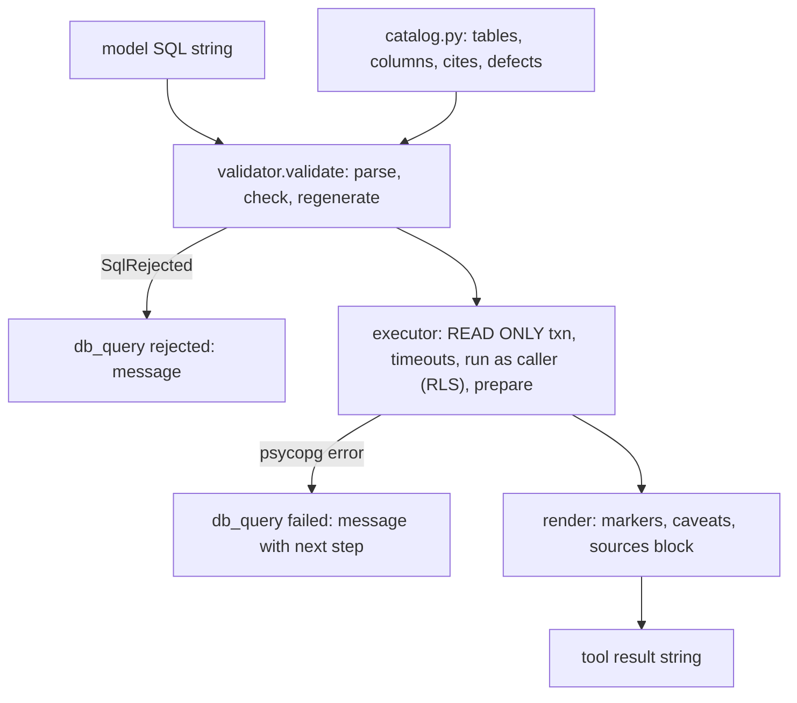

# Ask Sangam

Ask Sangam answers staff and cohort questions about organisations, funders and fit by writing its own SQL against a curated catalog of tables. Every fact in an answer must carry a citation marker. The agent is a single LangGraph deep agent assembled in `backend/app/agent/build.py`. It has no subagents, no `task` tool and no write capability. For the request-level flow (streaming, threads, checkpoints) see [Ask turn](../workflows/ask-turn.md). For the funder-fit tool see [Funder Match](funder-match.md).

Ask is one of three agents the backend serves. `AGENT_NAMES` in `app/core/lifespan.py` registers `/agent` (Ask, `sangam_agent`), `/ingest` (Import / Scout, `sangam_ingest`) and `/proposal` (the proposal copilot, `sangam_proposal`). The third agent, `/proposal`, is covered in [Proposal copilot](proposal-copilot.md). It reuses `harness.install()` and `harness.filesystem()` from this page's agent package, but has its own tools. The frontend's `toolLabels.ts` carries labels for its tools too (see "Adding an Ask tool").

## Responsibilities and shape

| Concern | Owner |
|---|---|
| Wiring: model, tools, backend, skills, middleware, prompt, tracing | `build_agent()` in `app/agent/build.py` |
| Taking back what the deepagents preset adds | `app/agent/harness.py` |
| Retry budget, model-call cap, `compare_fit` budget, context trimming, post-answer audit | `app/agent/middleware.py`, `app/agent/audit.py` (fallback and summarizer helpers come from `app/ingest/middleware.py`) |
| Schema discovery and SELECT execution | `app/agent/tools/sql_tools.py` plus `app/agent/tools/sql/` |
| System prompt | `app/agent/instructions.md`, loaded by `app/agent/prompt.py` |
| Procedures loaded on demand | `app/agent/skills/<name>/SKILL.md` |

`build_agent()` calls `harness.install()` first, because deepagents reads the harness profile while the graph is built. It then builds the middleware list, calls `create_deep_agent(...)` and wraps the result with `trace_config(name="sangam_ask")` and `recursion_limit` (default 200 graph steps). The limit counts graph steps rather than tool calls, because every middleware hook is its own node.

## The fixed tool list

`TOOLS` in `build.py` is the whole tool surface, and `tests/test_harness.py` pins it:

| Tool | Purpose |
|---|---|
| `db_list_tables`, `db_describe_table`, `db_profile_column`, `db_query` | Discover the catalog, then run one model-written SELECT (`tools/sql_tools.py`). |
| `search_graph` | Graphiti relationship search with `[graph:<uuid8>]` markers and validity dates. It returns a "not available, answer from the database tools" string when the graph is not configured. |
| `compare_fit` | Funder Match in one call: fixed queries, rules in code, the match-v2 rubric, replied as line-per-fact text (see "compare_fit's reply" below). It reads through the shared pool directly (the owner pool, not the caller-scoped SQL path), so it refuses callers who may not run a match for the organisation itself, using `chat_user_id` and `matching.may_run`. |
| `read_file`, `ls` | Skill reading only, supplied by `harness.filesystem(keep=SKILL_READING_TOOLS)`. |

The agent used to have hand-written lookup tools (`search_orgs`, `get_funder`, and others). They were removed, and `db_query` is now the only route to the database. `compare_fit` is the one deliberate exception, because matching is a fixed checklist and its queries are fixed too.

**Ask has no web tool.** `fetch_url` was removed in the Ask efficiency M4 work (#247), so Ask fetches no model-supplied URL and a page it read cannot steer query results out to a URL. `app/agent/tools/web.py` now holds only `make_web_search` (Tavily), which Sangam Import uses. The frontend still labels `fetch_url` so old chats render.

**Tools never raise.** Each tool body is wrapped in `try/except` and returns an error string (`"db_list_tables failed: ..."`, `"db_profile_column failed: ..."`, `"compare_fit failed: ..."`). A raised tool exception would abort the whole run, whereas a string lets the model see the failure and adapt. The failure and rejection prefixes in `sql/errors.py` (`db_query rejected:`, `db_query failed:`, `db_profile_column rejected:`, `db_profile_column failed:`) are a wire format. The retry limiter matches on them. Every database row a tool returns carries a citation marker. As a backstop for a tool that forgets, `tool_errors()` (a `ToolErrorMiddleware`, on every agent and subagent) turns a raised exception into `"<tool> failed: <ExceptionType>. Try another way..."`, giving the exception type and never its message, which can carry SQL, paths or keys (`tests/test_tool_errors.py`).

### compare_fit's reply

`compare_fit` returns **text, one fact per line**, not JSON. An earlier version returned every scored funder at full detail as a single JSON line. For an organisation with 26 scored funders that reply passed deepagents' 20k-token eviction threshold, was moved to a file the model could not page, and led the model to call the tool again (the trace behind this is in `docs/features/2026-10-16-ask-efficiency.md`). `render()` in `matching_tools.py` now shapes the reply by mode:

- **`compare_fit(org_id)` (shortlist).** A header names the rubric version and funders checked, then `scored N: <per-tier counts> · not scored N`, then an `unknown across the N scored:` line counting which criteria were unknown. The top strong and medium fits, up to `FULL_DETAIL_MAX = 10`, come in full (card lines, the seven criteria with points, status, note and cites, `not judged:` and `to raise the score:` lines, with no `summary:`). Every other scored funder is one line: its score, tier and first `!` gap line. The funders not scored come last, split into "nothing in common recorded" and "the funder has nothing recorded (unknown, not a poor fit)".
- **`compare_fit(org_id, funder_ids)`.** Exactly those funders, each in full with a `summary:` line, in score order. A named funder with nothing shared stays in the list with a null score and counts as "not scored" in the header.

`tests/test_compare_fit.py` pins the shape: a worst case with 37 funders stays under 60,000 characters (a 15k-token budget under the 20k eviction limit) and spans more than 50 lines so it pages cleanly if evicted; only ten funders get full detail; named funders carry every criterion and `summary:`; "unknown" is never folded into "weak".

### Taking back the preset (`harness.py`)

`create_deep_agent` brings two things Ask does not want:

- **Eight filesystem tools** (`ls`, `read_file`, `write_file`, `edit_file`, `delete`, `glob`, `grep`, `execute`). `harness.filesystem()` returns a `FilesystemMiddleware` restricted to `keep`. It is passed in `middleware=`, so it replaces the stack's own by name. An excluded tool is never registered, not merely hidden. Ask keeps `read_file` and `ls`. `read_file` is the floor, since `FilesystemMiddleware` refuses to be built without it.
- **A `general-purpose` subagent** that would inherit the main tool list. `harness.install()` registers a `HarnessProfile` that disables it for every provider in `PROVIDERS` (`anthropic`, `openai`, `google`, `google_genai`). It is global per provider and idempotent.

`test_ask_sangam_has_no_subagents` asserts there is no `task` tool. `test_ask_sangam_holds_its_six_tools_and_the_skill_readers` asserts the exact tool set (the six above plus `read_file` and `ls`). `test_neither_agent_can_write_a_file_or_run_a_command` asserts that no writing tool, `glob` or `grep` exists on Ask or Import.

## Skills

Four skills live in `app/agent/skills/`: `funder-matching`, `funder-comparison`, `funder-shortlist-brief` and `news-brief`. Their descriptions are advertised to the model on every request, and each begins with "Use when ...". The body is loaded only when the model chooses it, by calling `read_file` on the SKILL.md. There is no dedicated skill-loading tool, and `ls` is how the model recovers from a stale path.

- The backend is a `CompositeBackend`. Everything is virtual `StateBackend`, except `/skills/`, which routes to a `FilesystemBackend(root_dir=SKILLS_DIR, virtual_mode=True)`. `virtual_mode` roots the route so `/skills/../../etc/passwd` cannot read the host. Ask has no write tool, so the real-disk route is read-only in practice.
- `instructions.md` rule 13 maps intents to skills. Funders for an org use `funder-matching`, named funders use `funder-comparison`, a write-up uses `funder-shortlist-brief`, and an org's or funder's news uses `news-brief`.
- `news-brief` is `db_query` only. It reads `news_story_entities` joined to `news_stories` (public visibility, `is_news`, the last 30 days by default), writes three to five lines each ending in `[news:N]`, and for a negative, `fcra` or `governance` story gives the main link (`news_links.url` where `id = main_link_id`) as it is beside the line. It no longer fetches that page, because Ask has no `fetch_url`, so it never says what the article cites. Zero stories is reported as "Nothing on <name> in Sangam's news since <date>", never "no news".
- The skills are written against `compare_fit`'s text reply. `funder-matching` documents the shortlist layout (header counts, the `unknown across` line, numbered full entries, `- ` one-liners, the two not-scored lists) and tells the model to call `compare_fit` again only as `compare_fit(org_id, [id])` for one one-line funder. `funder-shortlist-brief` writes strong and medium fits in the reply's order and weak ones as one line each, past the first ten as one line too. `funder-comparison` calls `compare_fit(org_id, funder_ids)` once for the named funders and lays them out one by one or as a table. All three tell the model to relay `compare_fit failed` and `compare_fit refused` and never judge fit from `db_query`.
- Skills hold procedure only. The judging itself is `compare_fit`'s, in code (`app/matching/rules.py`), so none of the skills carries a matching rule. Constraints that must hold on every run stay in the prompt. See `docs/SKILLS.md` for the design rationale. That doc's header corrects its older body, which still lists three Ask skills.

## Middleware order

`build_agent()` passes, in order:

1. `filesystem(backend, keep=("read_file", "ls"))`. It only adds tools, so its position does not matter.
2. `tool_errors()`, the `ToolErrorMiddleware` backstop described under "Tools never raise".
3. `sql_retry_limiter`, a `before_model` hook with `can_jump_to=["end"]`. `count_failed_sql_attempts` counts `ToolMessage`s since the latest `HumanMessage` whose content starts with a failure or rejection prefix: `db_query failed:` / `db_query rejected:` for `db_query`, and `db_profile_column failed:` / `db_profile_column rejected:` for `db_profile_column`, because a wrong column there is the same wasted attempt. At `MAX_SQL_ATTEMPTS = 5` it appends a fixed "couldn't get a working result, rephrase or tell me the table" `AIMessage` and jumps to the end.
4. `model_call_cap(settings.ask_model_call_limit)`, another `before_model` hook that can jump to the end. It counts `AIMessage`s since the latest human message and, at the limit (`ASK_MODEL_CALL_LIMIT`, default 25), appends a fixed "spent the steps I allow myself, ask a narrower question" message and ends the turn. A runaway question therefore stops here, well before `recursion_limit` (200 graph steps). The jump to the end leaves through the `after_agent` hooks (the audit, when enabled) or straight to the graph end, which `tests/test_ask_budgets.py` checks.
5. `CompareFitBudget`, a `wrap_tool_call` middleware that enforces rule 14 in code. Counting this turn's `compare_fit` calls from the message history, it refuses a repeat with the same `org_id` and the same set of `funder_ids` ("refused a repeat ... answer from that result") and any call past `MAX_COMPARE_FIT_CALLS = 3` per question, returning an error `ToolMessage` instead of running the tool. A shortlist call followed by `compare_fit(org_id, [ids])` for named funders is a different call and runs; a new human message starts the count again.
6. `clear_old_tool_results()`, a `ContextEditingMiddleware` holding one `SteppedClearToolUsesEdit`. Past `TOOL_RESULT_CLEAR_TRIGGER_TOKENS = 60_000` it clears old tool output but keeps the latest `TOOL_RESULTS_KEPT = 5` results, so follow-up questions can still refer back. It reclaims whole steps of `TOOL_RESULTS_CLEAR_STEP = 20_000` tokens (`ceil(over / step) * step`), so what is sent stays under the trigger and the cleared set, and with it the prompt-cache prefix, moves once per step rather than on every call. `compare_fit` is in `NEVER_CLEARED`: its reply is bounded and the write-up reads it, and clearing it made the model call it again. The earlier setting (trigger 40,000, no stepping) cleared a different oldest result on every call and broke the cache each time. Ask, Import and the proposal copilot all call this function, so they share the behaviour.
7. `fallback(settings.model, settings.research_model)`, which yields one `ModelFallbackMiddleware` on `RESEARCH_MODEL` when a model call fails, or nothing when the two tiers are the same model.
8. `cheap_summarizer(strong, resolve_model(settings.utility_model), backend)`, which replaces deepagents' own summarizer by name: the same thresholds as the strong model gets, but the summary is written by the `UTILITY_MODEL` tier. Import and the proposal copilot already used both helpers (they live in `app/ingest/middleware.py`).
9. `answer_audit(settings.sql_audit_model)`, appended last and only when that setting is non-empty.

`app/agent/middleware.py` also defines `StaffLastLock` and `SaveQuestions`, but Ask does not use them. Only Import does (see [Sangam Import / Scout](sangam-import-scout.md)); `ingest/agent.py` is the sole caller of `staff_last_lock()` and `save_questions()`.

`tests/test_agent_middleware.py` pins the clearing: the cleared set changes at most once per 20k step as a turn grows, what is sent never exceeds the trigger however long the turn, nothing is cleared below the trigger, `compare_fit` output survives while the latest five results stay, and the old 40,000/no-step setting is shown to break the cache on most calls.

`tests/test_ask_budgets.py` pins the `compare_fit` budget (first call runs, same arguments refused, a different funder set allowed, a fourth call refused, a new question starts again), the model-call cap, and that the built stack contains the fallback (on `RESEARCH_MODEL`, absent when both tiers match), the summarizer (on `UTILITY_MODEL`) and `CompareFitBudget`. `tests/test_agent_middleware.py` also pins that failed `db_profile_column` calls count toward the five attempts like `db_query`'s do.

The prompt says "After 5 failed attempts" and the middleware enforces 5. `test_retry_budget_in_the_prompt_matches_the_middleware` pins the two together.

### Answer audit

`audit.py` is an `after_agent` hook. It runs once on the finished answer, not after every model call. The default `sql_audit_model` is `anthropic:claude-haiku-4-5`, and the value `off` (any case) disables it. `docs/SQL_AGENT.md` section 5d still says "off by default". The code and `config.py` default say otherwise. `test_the_defaults_are_strong_mid_cheap` asserts the Haiku default and `test_off_disables_the_sql_audit` asserts the switch.

- `collect_turn` extracts the question, the `executed:` SQL lines from `db_query` results, the last result block and the final non-caveat AI answer. If no SQL ran or there is no answer, it returns `None` and spends no model call, so a turn that used only `compare_fit`, `search_graph` or skills is never audited.
- A cheap model checks four things: grain, filters, false zero and numbers. It returns JSON `{"verdict": "ok"}` or `{"verdict": "warn", "caveat": ...}`.
- On `warn` the hook appends a **second** `AIMessage` prefixed with `CAVEAT_PREFIX` ("⚠️"). The answer has already streamed, so nothing can be edited in place. Anything that reads "the final answer" must skip messages with that prefix, and `collect_turn` does.
- Both `ok` and `warn` are scored as `answer_audit` (1.0 or 0.0) through `score_answer`, so a dashboard can see the rate and not just the failures.
- The audit **fails open**. Any exception, unparseable reply or disabled model returns `None` and the turn continues unaudited. It never blocks.

## The four SQL layers

The full design record is [docs/SQL_AGENT.md](../../docs/SQL_AGENT.md). It predates several catalog changes, so its table counts are historical, and its "reader role" section is marked superseded by the caller's role (#114). This section gives only the architecture.

Caption: a `db_query` call either becomes a rejection, a failure explanation, or a cited result string. Only the regenerated SQL ever reaches Postgres.

1. **Catalog (`sql/catalog.py`).** An allowlist expressed as frozen dataclasses (`Table`, `Column`, `ForeignKey`). `catalog.py` is a security allowlist: `CATALOG` allowlists 37 tables, and `db_list_tables` reports the live count. A table or column not listed does not exist for the agent, and an unlisted column fails as "unknown column" with the allowed list attached. The catalog derives `TABLE_NAMES`, `COLUMNS`, `SQLGLOT_SCHEMA`, `STAR_COLUMNS` (heavy columns are selectable by name but excluded from `*`), `CITE_COLUMNS`, `DEFECTS` and `PROVENANCE_COLUMNS`. `CITE_COLUMNS` maps a table and column to a citation kind. `DEFECTS` are data caveats injected into every result that touches the table. `PROVENANCE_COLUMNS` is derived from tables that carry a `source_url` column (plus `source_name` and `fetched_at`). `KNOWN_EXCLUDED` names 22 live tables deliberately kept out: the four checkpoint tables, `users`, `threads`, `org_members`, `proposals`, `funder_matches` and `funder_match_details`, `vault_research`, the media pipeline state (`news_link_scores`, `news_watch`), the import bookkeeping tables and the infrastructure tables. `_self_check()` runs at import and raises on a dangling foreign key or an unknown cite kind.
2. **Validator (`sql/validator.py`).** Pure, sqlglot only, no I/O. It enforces one statement that parses to a query, rejects write nodes anywhere in the tree (a DELETE inside a CTE included), rejects `INTO`, locking clauses and `WITH RECURSIVE`, and rejects cross-schema references and table functions in `FROM`. Every table must be in the catalog, and CTEs may not shadow real tables. Non-standard functions are an allowlist (`ALLOWED_FUNCTIONS`, for example `similarity`), and `Set`, `Transaction` and `Command` nodes are write nodes, so a query cannot change its own role or settings. Session-identity and row-generating functions, placeholders and catalog casts are denied. Columns are resolved with `qualify` and then re-checked by scope. `SELECT *` is expanded and trimmed of heavy columns, duplicate output names are aliased, and `LIMIT` is clamped (default `sql_max_rows` 50, hard cap 200, plus one row to detect truncation). It also plans citations and provenance by appending hidden `__prov__` columns. The model's string never executes: `ValidatedQuery.sql` is the regenerated AST without comments.
3. **Executor (`sql/executor.py`).** `PsycopgExecutor` runs inside `conn.transaction()`, which is what emits `BEGIN` because the shared pool is autocommit. It issues `SET TRANSACTION READ ONLY` first (Postgres refuses it once a query has run), then `SET LOCAL statement_timeout` (`sql_timeout_ms`, default 5000), a `lock_timeout` of 1 s and an idle-in-transaction timeout of 10 s. Then it calls `set_caller` (`app/db/pool.py`), which runs `set_config('role', ...)` and `set_config('request.jwt.claims', ...)` transaction-locally, using the `(role, claims)` pair from the `agent_caller` context variable (`anon` with empty claims when unset). From that point the query runs as `authenticated` or `anon`, so row-level security applies exactly as it does for REST routes. The query goes through `traced_fetch(..., prepare=True)`, which forces the extended protocol so the server itself refuses multi-statement strings. A semaphore of `db_gate_slots` keeps tool concurrency under the pool size so the checkpointer can still write. All the settings are transaction-local, so the connection returns to the pool as the owner and nothing leaks onto the pooled connection that the checkpointer reuses.
4. **Render and errors (`sql/render.py`, `sql/errors.py`).** `render_rows` prefixes each row with markers such as `[org:12]`, built from the projected id columns the validator mapped. It drops source columns from the body, caps cells at 200 characters and output at 6,000, and says plainly when rows were truncated or no citable id column was projected. `render_sources` emits a deduplicated `sources:` block (at most 8 entries). Its grammar is a contract parsed by the frontend (`features/ask/lib/sources.ts`) and pinned by `tests/test_sql_render.py`. `explain_db_error` turns a Postgres SQLSTATE into the primary message, the executed SQL and a concrete "Next:" step. Connection errors are deliberately generic, because driver text can contain the DSN.

The `db_query` result header is: `N row(s). tables: ...`, then any `adjusted:` rewrites, `caveats:`, `executed: <sql>`, the `sources:` block, and finally the `columns:` body. The sources block sits above the `columns:` line on purpose, because tracing redaction cuts everything from `columns:` downward.

### The catalog and the caller's role are the security controls

Agent SQL runs **as the signed-in caller**, under row-level security. `ask_access`, the dependency on the `/agent` route (`app/core/security.py`), claims the thread and then sets `agent_caller` to the caller's `(role, claims)`. The executor applies it with `set_caller` inside the read-only transaction (see layer 3). RLS therefore hides other organisations' private documents, staff-only `funder_activity` lines and similar rows, and the server refuses `checkpoints` outright. Without a caller the query runs as `anon`. `/ingest` keeps the owner, because Import writes the catalog. The catalog and validator remain the first guard, and RLS is the second one underneath them. `tests/test_agent_rls.py` pins it against a real database: a member of org A reads its own private document but not org B's, a user with no organisation reads no private row, no caller means `anon`, and the connection goes back to the pool as the owner.

Two consequences follow for the model's answers. Counts and empty results cover only what this user can see, so the prompt (rule 10) says "none that you can see" rather than "none exist", and `db_query` and `db_profile_column` say so when they return zero rows. A user also needs `SELECT` on every catalogued column, or `SELECT *` fails with SQLSTATE 42501.

Not everything in Ask runs as the caller. Tools that go to the shared pool directly, like `compare_fit`, still use the owner connection and must check access themselves through `chat_user_id` or `chat_scope`. `compare_fit` does so first, before any query: `matching.may_run(get_pool(), chat_user_id.get(), org_id)` must pass (Sangam staff, or a steward or admin of the organisation), otherwise it returns `compare_fit refused: ...` and builds no output. See [Auth, roles and RLS](auth-roles-rls.md). Two docs lag the code: `docs/ARCHITECTURE.md` sections 3 and 8 still say Ask's SQL runs on the owner pool and that running it as the caller is the unmerged branch `fix/ask-sql-runs-as-caller`, and the CHANGELOG "Not finished" row for `auth-plan.md` repeats that. Treat the executor and `docs/SQL_AGENT.md` (which marks the reader-role section superseded) as the truth. The stale `sql_reader_role` comment in `config.py` and the "superuser until the reader role lands" comment in `validator.py` describe the old design.

**Adding a table to the catalog is still a security decision.** In practice this means the following:

- A new table in `CATALOG` makes every listed column available to the agent. What a caller actually sees is bounded by RLS, but review it like a permission change: the table needs its RLS policies, and `SELECT` for `authenticated`. Per-column exclusions (for example `contacts.email` and `contacts.phone`) are expressed by omission.
- At boot, `lifespan._verify_sql_catalog` runs `verify_against_db`. It **raises** if the catalog names a table or column the database lacks (drift). It also raises if the `authenticated` role cannot `SELECT` a catalogued column, or if `anon` can read only part of a table, since that would break `SELECT *`. A live table in neither the catalog nor `KNOWN_EXCLUDED` is only logged at INFO (via `undeclared_tables`), so a new table stays invisible until someone decides. `KNOWN_EXCLUDED` is the explicit "decided no" list. Migrations that add tables should land with that decision. See [Data and migrations](data-and-migrations.md).
- `tests/test_sql_catalog.py` asserts what must **not** be present. Checkpoint and user tables must be absent and declared in `KNOWN_EXCLUDED`. Contact email and phone, embeddings and similar columns must be absent. `STAR_COLUMNS` must not leak them. Cite kinds must stay within `{org, funder, activity, score, news}`, which is the frontend union. The `_self_check` guard must fire on a dangling foreign key.

## Prompt rules and citations

`instructions.md` is sent verbatim as the system prompt (`render_prompt` ignores settings). `prompt.py` fails at import if the file is empty. Its numbered rules fall into three groups.

- **Rules 1-5, answering.** Answer only from tool results. Cite every database fact inline with its marker. A sentence without a marker must not state a database fact, and the one exception is a figure computed from cited rows, which must be labelled as computed. Show freshness and say where a fact came from in words, without pasting URLs. Fit scores are single-rater rubric judgements. Keep answers short, with the direct answer first. Rule 2 also routes relationship questions (what connects an organisation to a funder) to `search_graph`, whose facts are time-bounded, and data questions to SQL.
- **Rules 6-11, SQL.** Discover before writing. Profile a text column before filtering on a literal. Project the id column, since `db_query` can only attach a marker if the row id is in the SELECT list. Read the error and fix the SQL, and stop after 5 failures (rule 9 says `db_profile_column`'s count too). Zero rows is an answer, a CAVEAT from a table is repeated, and because every query runs as the caller and row security hides what they may not read, an empty result is reported as "none that you can see". A registration is an `org_identifiers` row with a status.
- **Rules 12-16, matching.** `compare_fit` judges fit and the model never does. Call it once per question (rule 14; `CompareFitBudget` enforces it in code). Repeat its score, tier, points and cites exactly. "Not recorded" is never "poor fit", a `compare_fit refused` reply is relayed and the model stops, and the computed score is never merged with a stored `fit_scores` row.

**Citation markers** are `[org:N]`, `[funder:N]`, `[activity:N]`, `[score:N]`, `[news:N]` and `[graph:<uuid8>]`. SQL kinds come from `Column.cites` through the validator's `CitationPlan`. `[graph:...]` is written literally by `search_graph`, and `compare_fit` embeds `[org:N]`, `[funder:N]` and per-criterion cites in the text reply that `render()` produces (see above), not in JSON. The frontend turns markers into chips (`features/ask/lib/citations.ts`). `test_prompt_documents_every_marker_the_tools_emit` fails if a tool can emit a kind the prompt never mentions, because the model will not repeat markers it was not told about. `test_tools_emit_the_markers_we_think_they_do` guards that test against passing vacuously.

## Adding an Ask tool

Four edits, as documented in the repository-root `CLAUDE.md` (`docs/ARCHITECTURE.md` section 3 now holds only the rules behind them: the tool list is pinned by tests, and tools never raise and cite every row):

1. **The function** in `app/agent/tools/`, as a `@tool`. It must never raise and must return an error string on failure. Every database row it returns must carry a citation marker, and the marker kind must be one the prompt and frontend already know.
2. **A line in `TOOLS`** in `app/agent/build.py`.
3. **A mention in `instructions.md`**, naming the tool by its exact Python identifier. `test_prompt_names_every_registered_tool` iterates `TOOLS` and fails otherwise. A tool described only in a SKILL.md does not count, since skills load by choice and constraints must not sit behind a decision.
4. **A label** in `frontend/features/ask/lib/toolLabels.ts`, which the trace UI uses. The file holds one `TOOL_LABELS` map for every agent's tools: the Ask tools above, `read_file` and `ls`, and the proposal copilot's (`read_proposal`, `advance_step`, `write_section`, `ask_user` and others, see [Proposal copilot](proposal-copilot.md)). Each entry has a label and a `detail` function over the call's arguments (`db_query` shows its `purpose` rather than the raw SQL, because the rail shows the SQL that actually ran). It is the one edit nothing enforces, and skipping it is harmless: `humanizeTool` falls back to a humanised version of the tool name, so a label only improves the wording.

Because the tool set is pinned, also update the literal set in `test_ask_sangam_holds_its_six_tools_and_the_skill_readers` (`tests/test_harness.py`). Keep in mind that a tool taking a model-supplied URL must go through `guarded_client` (`app/core/egress.py`), and that Ask currently has none. If the tool emits a new citation kind, update the expectations in `tests/test_prompt.py` and `test_sql_catalog.py`, and update the frontend `citations.ts` link union.

## Failure semantics at a glance

- A bad query comes back as `db_query rejected:` (validator) or `db_query failed:` (database), each naming the problem and the next step. A failed or rejected `db_profile_column` is counted the same way, and five of these in one question end the turn with the fixed give-up message.
- A question that reaches 25 model calls ends with the fixed "ask a narrower question" message, and a repeated or fourth `compare_fit` in one question comes back as a refusal string.
- A failing model call falls back to `RESEARCH_MODEL` when it differs from `MODEL`.
- A database outage tells the model to stop and not retry. The message is generic and carries no DSN.
- A column or table the caller's role cannot read fails with SQLSTATE 42501, and the explanation sends the model back to `db_list_tables`.
- A missing graph, a refused match and a tool that raises anyway are all strings, never exceptions that end the run.
- The audit can only add a caveat. It cannot block or alter the answer, and it does nothing when no SQL ran.

## Unfinished plans

The CHANGELOG "Not finished" table and the Ask section of the CHANGELOG record what has not shipped. For Ask:

- **Ask efficiency plan** (`docs/features/2026-10-16-ask-efficiency.md`, Draft v2, branch `feat/ask-efficiency`). Part of it has shipped. M2 (the compact `compare_fit` shortlist and stepped clearing) is in the code, although the CHANGELOG still tags M1 (evals count tool calls, tokens and cost per case) and M2 as `(unmerged)`. M4 is in the code and the CHANGELOG records it as shipped (#247): `fetch_url` is out of `TOOLS`, so Ask has six tools, `db_profile_column` errors have their own prefix and count toward the five attempts, and prompt rules that restated a docstring shrank. The CHANGELOG also records the limits in code (`ASK_MODEL_CALL_LIMIT`, the `compare_fit` budget, fallback and cheap summarizer, #248 and #249), which the plan did not list. What is **not in the code** is M3: there is no `{{TABLE_MAP}}` in the prompt, no automatic `__cite__` id columns, no caveats-once-per-turn and no executed SQL moved to a tool artifact, and `render.py` still caps every cell at `MAX_CELL_CHARS = 200`. M5 is a proposal-copilot guard.
- **Ask SQL as the caller.** The code runs it as the caller, but the CHANGELOG's `auth-plan.md` row and `docs/ARCHITECTURE.md` still describe it as the unmerged branch `fix/ask-sql-runs-as-caller`.
- **Drop CopilotKit** (`2026-10-11-drop-copilotkit.md`). The CHANGELOG records that #178 removed `emit_raw_events=False`, so raw events stream again; M3 and M4 are not started. This touches the transport Ask streams over (see [Ask turn](../workflows/ask-turn.md)), not the agent.

## Key tests

| Test file | What it pins |
|---|---|
| `tests/test_compare_fit.py`, `tests/test_agent_middleware.py` | The `compare_fit` reply fits its budget, with ten full entries and one-liners for the rest; stepped, `compare_fit`-sparing tool-result clearing; `db_profile_column` failures counting toward the retry limit. |
| `tests/test_ask_budgets.py`, `tests/test_tool_errors.py` | The `compare_fit` repeat and three-call budget, the model-call cap, the fallback and summarizer in Ask's stack; a raising tool answers the model with its exception type only. |
| `tests/test_harness.py` | The exact Ask tool set, no `task` tool and no writing filesystem tools. The harness profile disables the general-purpose subagent. The `Settings` audit switch. |
| `tests/test_prompt.py` | Every registered tool and every emitted marker kind is named in the prompt. The retry budget matches the middleware. |
| `tests/test_sql_catalog.py` | Withheld tables and columns, derived indexes, citation kinds, defect wording and the self-check. |
| `tests/test_sql_validator.py`, `test_sql_errors.py`, `test_sql_render.py` | Adversarial validation, error guidance and the `sources:` grammar contract. |
| `tests/test_sql_integration.py` | Execution against a real database. |
| `tests/test_agent_rls.py` | The executor runs as the caller: org A's member reads its own private row and not org B's, no caller means `anon`, the connection returns as the owner, and every catalogued column is readable by `authenticated`. |

See [Testing overview](../testing/overview.md) for how these suites are run.
