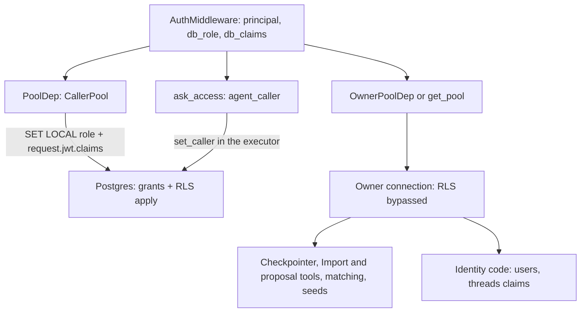
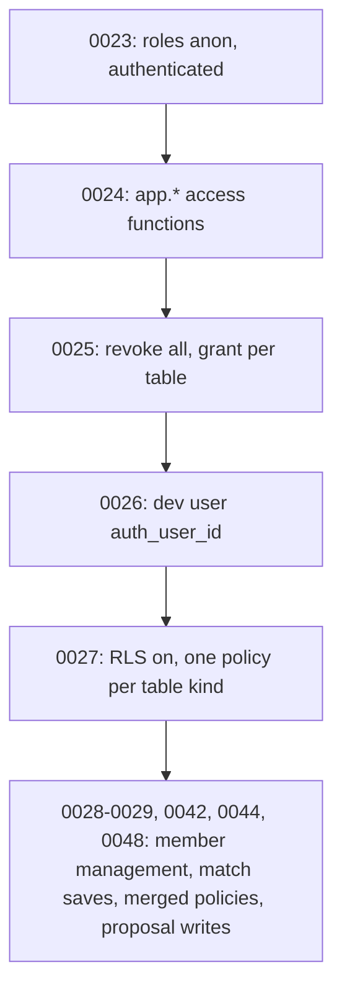

# Auth, Roles and RLS

Access in Sangam is enforced in two layers. **Python** decides who the caller is and exposes gates such as `require_staff`. **Postgres** then enforces what that caller may see, through the `anon` and `authenticated` roles, table grants, and row-level security (RLS) rules. Which layer does the work depends on which connection pool a piece of code uses. That is the most important thing to understand before changing anything here.

> Where the code lives: authentication is in `backend/app/core/security.py`, not in `backend/app/api/deps.py`. `deps.py` only holds pagination parameter models (`PageParams`, `LegacyPageParams`). The pools are in `backend/app/db/pool.py`. The SQL is in migrations `0023`–`0029`, `0042`, `0044` and `0048` under `db/migrations/`.

## Roles

There are two separate vocabularies.

| Layer | Values | Source of truth |
|---|---|---|
| Postgres role | `anon` (signed out), `authenticated` (signed in) | Set per request by `CallerPool` |
| Sangam role | anonymous, signed-in (no org), `member`, `admin`, `steward`, staff | `users.is_staff` and `org_members.role` |

- **Staff** is `users.is_staff = true`. It is global and needs no `org_members` row.
- **member** and **admin** belong to one org. A unique index (`org_members_one_org_per_person`, migration 0029) allows only one admin-or-member row per user. Both can read that org's private data and upload to its Doc Vault. Only an admin can manage the org's members. Since migration 0048, only the admin (not the member) can start or edit a proposal; see [Who can write proposals](#who-can-write-proposals).
- **steward** (called Group Admin in the plan docs) can read each org it supports and, since 0048, also edit that org's proposals and upload files to its vault. A steward can support any number of orgs, so the index leaves steward rows out of the one-org rule.
- A signed-in user with no `org_members` row sees exactly what an anonymous user sees. The access functions simply return no orgs for them.

## Request authentication

`AuthMiddleware` is a plain ASGI middleware, deliberately not `BaseHTTPMiddleware`, because that buffers responses and would break chat streaming. `create_app` adds it before `CORSMiddleware`, so CORS wraps it. Preflights are answered before it runs, and its own 401 responses carry CORS headers.

It skips non-HTTP scopes and the open paths `/health`, `/docs`, `/docs/oauth2-redirect`, `/redoc` and `/openapi.json` (nothing there reads data, and `/docs` must load before anyone can press Authorize). For every other request it calls `resolve_principal` once and stores three things in `scope["state"]`: `principal`, `db_role` and `db_claims`. A bad token raises `HTTPException` inside the middleware, so the middleware answers with its own JSON response. FastAPI exception handlers never see errors raised at that level.

### Auth modes

`resolve_principal` is driven by `SUPABASE_URL` and `DEV_AUTH` (`Settings.auth_enabled` is simply `bool(supabase_url)`).

| Configuration | Result |
|---|---|
| `SUPABASE_URL` unset | Every request is the seeded `DEV_USER` (staff). This is the local default. The one exception is a local test sign-in, below. |
| `SUPABASE_URL` unset, `DEV_AUTH` on, header `Bearer dev:<email>` | A seeded `@local.test` user looked up by email (it must already have an `auth_user_id`), so each role can be tried without Supabase. Any other email domain, or an unknown email, is 401. |
| Set, no `Authorization` header | `ANONYMOUS` (`id=None`) |
| Set, `Bearer dev` and `DEV_AUTH` on | `DEV_USER`. Local only: the setting comment says never to set it when deployed. `.env.example` ships `DEV_AUTH=false`. |
| Set, any other bearer token | Verified as a Supabase access token. A malformed header or invalid token is 401 (with `WWW-Authenticate: Bearer`). |

Token verification (`verify_token`) fetches the project's JWKS from `<SUPABASE_URL>/auth/v1/.well-known/jwks.json` through a cached `PyJWKClient`, run in a thread. It accepts `ES256` and `RS256`, requires audience `authenticated` and issuer `<SUPABASE_URL>/auth/v1`, and requires the `exp`, `sub`, `aud` and `iss` claims. Beyond that, `sub` must be a UUID and the token must carry an email. If not, the result is 401.

A verified token is then mapped to a `users` row by `users.resolve_auth_user`, which runs on the **owner pool** because it writes `users` rows no caller may write. The lookup order is:

1. Find the row by `auth_user_id`, and sync its email if it changed.
2. Link a staff-pre-created row with the same email and a null `auth_user_id`.
3. Insert a new row.

If the email is already linked to a different Supabase account, the result is `EmailTakenError` and a 409. The sign-up trigger from migration 0022 normally creates this row first. `resolve_auth_user` is the fallback for anyone the trigger missed. The trigger downgrades its own errors to warnings so a failure cannot block a Supabase sign-up.

The dev user has no Supabase account. Migration 0026 sets its `users.auth_user_id` to its own id, and the backend sends that as the `sub` claim, so the SQL access functions recognise it. In auth-off mode the dev user therefore still runs as the `authenticated` Postgres role under RLS, as a staff user. It does not bypass RLS.

### Gates

Routes read the principal the middleware left, never re-checking the token.

| Dependency | Behaviour |
|---|---|
| `get_principal` | The resolved `CurrentUser`, or `ANONYMOUS` if the middleware did not run |
| `get_current_user` | `users.id` or `None` |
| `require_user` / `require_principal` | 401 `Sign in required` when anonymous |
| `require_staff` | `require_principal`, then 403 `Staff only` when not staff |
| `require_scout` | Built on `request_scope`: 403 unless the caller is staff or a steward of at least one org. It guards the whole `/ingest` REST router and the `/ingest` chat route. |
| `chat_access` | Signed in, and the chat thread is new or yours. Someone else's thread is 404, staff included (see below). |
| `ask_access` | `chat_access`, and additionally sets `agent_caller` so Ask Sangam's SQL runs as this caller, and starts a fresh `caveats_given` set for the turn (which SQL tools use to give table caveats once per turn) |
| `proposal_chat_access` | Your own chat about a proposal you may edit; see [Who can write proposals](#who-can-write-proposals) |

`chat_access` runs `_own_thread`, which claims the thread through `threads.claim_thread` on the owner pool. If the thread belongs to someone else the answer is 404, **staff included**: a turn checkpoints rows read as that caller, which the owner's next turn would replay. It then sets two context variables for the run: `chat_user_id` and `chat_scope`. The tracing hook reads the first. Agent tools read the second.

The agent routes are wired in `app/core/lifespan.py` by the `AGENT_ACCESS` table: `/agent` gets `ask_access`, `/ingest` gets `require_scout` then `chat_access`, and `/proposal` gets `proposal_chat_access`. A path missing from the table fails at boot rather than falling back to another agent's check.

## The two pools

Caption: REST queries and Ask Sangam's SQL run as the caller and are filtered by Postgres. Everything else on the owner side must check scope itself.

There is one underlying `AsyncConnectionPool`, opened in the app lifespan and also assigned to `db_pool.pool`. It connects with whatever role `DATABASE_URL` names; the code and its comments call that role the owner and rely on it ignoring grants and RLS (the local compose database uses a superuser). The pool runs with `autocommit=True` and is shared by REST, the LangGraph checkpointer and the agent tools.

`make_pool` (`backend/app/db/checkpointer.py`) states the pool's limits, and the CLI pools built by `make match` and similar commands get the same ones:

- `timeout=db_pool_timeout_s` (default 10 s): how long a request waits for a free connection before the pool gives up.
- `connect_timeout=db_connect_timeout_s` (default 5 s), passed in the connection kwargs.
- `check=AsyncConnectionPool.check_connection` on every checkout and `max_idle=300`, so a thawed serverless instance does not hand out a socket the pooler already closed. The cost is one round trip per checkout.
- `max_size` defaults to `db_pool_max_size` (10).

The lifespan verifies instead of creating the checkpointer schema: `open_checkpointer` raises at boot, telling the operator to run `make migrate`, when `checkpoint_migrations` is missing or its `max(v)` differs from `CHECKPOINT_VERSION`. No DDL runs on a cold start, so concurrent instances cannot race. `/health` is an open path and adds a `pool` block of counts only (`pool_max`, `pool_size`, `pool_available`, `requests_waiting`, `requests_errors`, `connections_errors`), or no block before the lifespan has opened the pool.

The access paths over the pool are:

**`CallerPool` (via `PoolDep`).** This is what every router takes. Each `connection()` opens a transaction and first runs one statement that sets `role`, `request.jwt.claims` and `statement_timeout` with `set_config(…, true)`. All three are transaction-local (`SET LOCAL` semantics), so they end with the transaction even on error. The timeout is `db_statement_timeout_ms` (default 15000), so a runaway REST query is cancelled rather than holding a connection. The connection returns to the pool as the owner, so the checkpointer and tools sharing the pool never inherit a caller. The plain `set_caller` helper sets only role and claims, because Ask's executor calls it after its own lower timeout and it must not raise that back to REST's. `db_role` and `db_claims` come from `_db_identity`:

- anonymous gives role `anon` and empty claims
- signed in gives role `authenticated` and claims `{"sub": <auth_user_id>, "role": "authenticated", "email": …}`

`get_caller_pool` falls back to `anon` if the middleware left nothing on the request. A new route that takes `pool: PoolDep` runs as its caller without asking.

**Ask Sangam's SQL executor.** Agent tools run outside any request, so they cannot take `PoolDep`. Instead `ask_access` stores the caller's `(role, claims)` pair in the `agent_caller` ContextVar, and `PsycopgExecutor.run` reads it. Inside one transaction (`conn.transaction()`, since the pool is autocommit) it first applies the hardening settings (`SET TRANSACTION READ ONLY`, statement, lock and idle timeouts) and then calls `set_caller`. If `agent_caller` is unset the query runs as `anon`, so the failure mode is seeing less, not more. The executor takes its connection from `get_pool()`, but the query itself is filtered by RLS like a REST route's. Import deliberately keeps the owner because it writes the catalog.

**Owner pool (`OwnerPoolDep` and `get_pool()`).** The owner ignores grants and RLS. It is used by:

- **Identity code:** `resolve_principal`, `_own_thread`, `request_scope`, the chat-access dependencies, and `threads.can_open`. `saved_messages` calls it because checkpoints are closed to callers, so access is decided before anything is read.
- **Agent tools that are not Ask Sangam's SQL:** `matching_tools`, all Import tools in `app/ingest/tools/*`, and the proposal agent's tools and context (`app/proposals/*`). They run outside any request and call `get_pool()`.
- **Import and its REST surface:** `routes/ingest.py` uses `OwnerPoolDep` for research listing, undo and delete. It also pairs it with `request_scope` to filter in Python. Import writes the catalog as the owner.
- **Matching:** `matching.may_run`, the matching writes in `funder_matches.create_run` (which takes both `PoolDep` and `OwnerPoolDep`), and the `make match` CLI. The CLI uses its own `make_pool` and saves runs with `run_by = NULL`.
- **Other owner reads or writes:** the news routes that read `ingest_runs` or hide stories, the proposal chat's saved-messages route, and the seeds.

**Because RLS does not apply on the owner pool, each of these paths has to check scope itself.** The mechanism is `CallerScope`.

### CallerScope: Python-side scope for owner-pool code

`caller_scope(pool, principal)` builds a frozen `CallerScope` of `user_id`, `is_staff`, `org_roles` (org id to `admin`, `member` or `steward`) and `org_names`. Staff and anonymous callers skip the membership query, because staff pass every check. Its predicates:

- `can_read_org(org_id)`: staff, or any role in that org.
- `can_research_org(org_id)`: staff, or a steward of that org. Members and admins research funders only.
- `can_save_funder()`: staff, or any signed-in user.
- `can_edit_proposal(org_id)`: staff, or an `admin` or `steward` of that org. This is the Python mirror of the 0048 proposal write policy.
- `steward_of`: the org ids where the caller is a steward.

Three entry points feed it:

- **Import chat runs** get it through `chat_access` into the `chat_scope` ContextVar. `app/ingest/caller.py` wraps it as `scope()`. Outside a chat request `scope()` is an empty, non-staff scope, so every gated tool refuses.
- **Proposal chat runs** get it through `proposal_chat_access`, which also sets `chat_proposal`, the proposal the run works on. The model never names a proposal; it comes from the thread id.
- **REST routes that read data Import keeps off RLS** use the `request_scope` dependency.

Import tools use it as follows:

- `staff_only(tool)` returns a `REFUSED: …` string for non-staff. It guards `plan_import`, `run_import_now`, `import_run_summary`, `pending_resolutions`, `read_source_rows`, `read_workbook`, `publish_brief` and `record_registry_check`.
- `can_read_org` guards vault documents.
- `can_research_org` guards saving NGO research.
- `without_private` strips staff-spreadsheet and vault findings from a row for non-staff callers.
- `caller_note` writes the supervisor's per-run line about who it works for.

See [Sangam Import and Scout](./sangam-import-scout.md) and [Ask Sangam](./ask-sangam.md) for those flows, and [Proposal Copilot](./proposal-copilot.md) for the proposal agent.

## Who can write proposals

Migration 0048 (proposal work) changed the proposals policies. `proposals_insert` and `proposals_update` now require `org_id IN (SELECT app.my_match_org_ids()) OR app.is_staff()`. `my_match_org_ids()` is the function from 0042 that returns orgs where the caller is an admin or steward. So:

| Caller | Read a proposal | Insert or update |
|---|---|---|
| Staff | yes | yes |
| Admin of the org | yes | yes |
| Steward of the org | yes | yes |
| Member of the org | yes (`proposals_read` is unchanged) | no (insert raises `InsufficientPrivilege`; an update changes no row) |
| Member or steward of another org, anonymous | no | no |

Before 0048 only members and admins of a writable org could write proposals, stewards could not, and staff had no proposal write rule. The same migration widens `documents_insert` to `app.my_org_ids()`, so every role in the org (members, stewards, admins) and staff can add files to its Doc Vault, because a steward adds the files a proposal draws on. It repeats 0027's guard that fails the migration if a readable table has no read rule. It also adds the `work` and `summary` JSON columns the proposal screen edits.

The rule is enforced in three places that must agree:

1. **Postgres RLS** on the caller pool. The proposals REST router takes `PoolDep`, and `repo.get` computes `can_edit` in SQL from `app.my_match_org_ids()` and `app.is_staff()`. `_editable` answers 403 (`You can read this proposal. Ask your organisation's admin to make changes.`) when it is false. Creating a proposal also requires `may_run` on the org (admin, steward or staff), else 403.
2. **`proposal_chat_access`** for the `/proposal` AG-UI route. The only valid thread id is `proposal-<proposal id>-<your user id>`, so each person has a private chat per proposal. It answers 404 when the thread id does not parse, names another user, or the proposal's org is unreadable to the caller (a stranger never learns it exists), and 403 when the caller can read but not edit (a member). Only then does it claim the thread (recording `use_case="proposal"` and the org) and set `chat_user_id`, `chat_scope` and `chat_proposal`.
3. **`require_edit`** in the proposal tools. The tools run on the owner pool and read the proposal fresh each call (`context.current`), with `can_edit` from `scope.can_edit_proposal`. Every tool that changes the proposal asks `require_edit` first and returns a `REFUSED` message for a reader. The comments in the proposals repository state it plainly: chat access and `require_edit` decide who gets there, not RLS. Tools that read documents also filter by the org id themselves.

The proposal chat's saved messages are read through `GET /proposals/{id}/messages`, which first reads the proposal on the caller pool (so RLS must allow the read) and then opens the thread on the owner pool only for the caller's own thread id.

## Database side

Caption: the order in which the Postgres access layer was built.

- **0023** creates `anon` and `authenticated` when missing (`NOLOGIN NOINHERIT`). The backend never connects as them. It switches into them with `set_config('role', …)`. The migration also grants them to the connecting role if it is not already a member.
- **0024** adds `auth.uid()` where Supabase does not provide it, reading the `sub` claim. It also adds the `SECURITY DEFINER` functions, each with a pinned `search_path`:
  - `app.user_id()` and `app.is_staff()`
  - `app.my_org_ids()`: any role, so stewards read.
  - `app.my_writable_org_ids()`: `member` and `admin` only.
  - `app.can_open_thread(thread, user)`: the owner, staff, or org roles by thread `visibility` (`team` for member and admin, `team_and_stewards` for all roles).

  The first four are executable by `anon` and `authenticated`. `can_open_thread` is deliberately granted to neither, because it takes the user as an argument for the owner-connected backend and answering about arbitrary users is a backend question.
- **0025** revokes everything on `public` tables and sequences from both roles (and the defaults for future tables). This stops Supabase's `/rest/v1` from exposing tables to every browser. It then grants back per table kind and writes. It raises an error if any table has no access decision, so new tables must be classified. Writes granted to `authenticated` only are contacts (insert and update), documents (insert), score adjustments (insert), `rfp_matches` (update), proposals (insert and update) and threads (insert). There is no DELETE anywhere.
- **0027** enables RLS on every `public` table, closed ones included, so an accidental grant still reads nothing. Rules by kind:
  - **Public:** 23 tables with `USING (true)`.
  - **Follows its parent:** `org_*` and `funder_*` children follow the org or funder, and `chunks` follows its document.
  - **Public unless hidden:** `orgs` and `funders`. An org's own people still see their hidden org, and staff see all.
  - **Public by flag:** `contacts`, `documents` and `org_identifiers` expose `is_public` rows to everyone, and the rest to that org's people and staff.
  - **Org-private:** `proposals` and `rfp_matches`.
  - **Own rows:** `users`, `org_members` and `threads`.
  - **Staff only:** the Import tables.
  - **Closed:** checkpoint and migration tables get no policy and no grant.

  Its write policies let a member or admin of the row's org (never a steward) write contacts, score adjustments and `rfp_matches` updates, with staff also allowed. The proposal and document-upload rules were later replaced by 0048 (above). Policies wrap `app.*` calls in `(SELECT …)` so Postgres evaluates them once per query. A final check fails the migration if a table readable by either role has no read policy, to avoid silent empty pages.
- **0028** and **0029** add org member management. Writes go through `SECURITY DEFINER` functions rather than table grants: `add_org_member`, `set_org_member_role` and `remove_org_member`. Each calls `app.can_manage_org` (staff or an admin of that org) first. They also enforce that an org always keeps an admin, that only someone who has signed in can be added, and that an admin or member belongs to one org. The `org_members_one_org_per_person` unique index backs the last rule even for the owner.
- **0042** adds `app.my_match_org_ids()` (admin and steward) and the `funder_matches` tables. Insert policies require `run_by = app.user_id()`, and there is no update grant. This is why only staff, stewards and admins can save a match run, and `matching.may_run` mirrors that rule on the owner pool. 0048 reuses the same function for proposals.
- **0044** folds the admin-visibility policies into single `users_read` and `org_members_read` policies, to avoid two permissive policies evaluated per row.
- **0048** changes proposal writes and vault uploads as described in [Who can write proposals](#who-can-write-proposals).

`InsufficientPrivilege` from a table a role has no grant on is mapped to a 403 `{"detail": "Not allowed"}` by an exception handler in `create_app`. Without that handler it would be a 500.

## Frontend edge

`frontend/proxy.ts` runs Supabase's `updateSession` (`lib/supabase/middleware.ts`) on every non-asset path. With no `NEXT_PUBLIC_SUPABASE_URL` or publishable key it passes every request through and gates nothing, so public pages and the `/ask` preview still render but nobody can sign in. Otherwise it refreshes the session cookie with `getClaims()` and redirects signed-out visitors on `/import` and its subpaths to `/auth/login?next=…`. `/ask` stays public: it shows a preview signed out and the workspace signed in.

The browser then sends credentials to the backend, which is where real enforcement happens. Two helpers build the header:

- `authHeaders()` (`lib/api/auth-headers.ts`, client side) returns `Authorization: Bearer <access token>` from the Supabase browser session, or no header when signed out.
- `serverAuthHeaders()` (`lib/api/auth-headers.server.ts`, server components) does the same from the server-side Supabase client's session.

Both switch to the local test login when `DEV_LOGIN` is true. `DEV_LOGIN` (`lib/devAuth.ts`) requires `NEXT_PUBLIC_SUPABASE_URL` to be unset and `NEXT_PUBLIC_DEV_AUTH=1`. In that mode they send `Bearer dev:<email>` from the `sangam-dev-as` cookie (one of the `admin`, `steward`, `member`, `stranger` `@local.test` users), or nothing if the cookie is not set. That header is only honoured by a backend that also has `SUPABASE_URL` unset and `DEV_AUTH` on. See [Frontend](./frontend.md).

## Not yet built

Treat these as unfinished, not as current behaviour:

- **Phase 2 items** (the plan's Part 2): a full per-route and per-table test matrix, grant and revoke functions with an audit log, screens for My organizations / org members / staff users, re-linking a recreated account with the same email, and email-domain matching or join requests. The `app.add_org_member`-style functions in 0028 exist and are tested, but the plan still lists the management screens as later work.
- Rollout (plan step 9) means running migrations first, then deploying the backend with `SUPABASE_URL` set and `DEV_AUTH` unset, then the frontend, then marking staff accounts. The plan is still marked draft.

Ask Sangam running as the caller (plan step 8) is now built via `ask_access`, `agent_caller` and the executor. Two caveats remain. The SQL catalog still tells the model that row security filters what it sees, so an empty result means "none you can see", never "none exist". And the other agents (Import, the proposal agent, matching tools) still use the owner pool and rely on `CallerScope` checks.

## Tests

- `backend/tests/test_security.py` runs `AuthMiddleware` in a small app with a locally generated ES256 key and a patched JWKS. It covers a valid token resolving the user row and role `authenticated`, an expired or malformed token returning 401, no header giving `anon`, auth off giving the dev user, and open paths skipping verification.
- `backend/tests/test_access.py` covers the route and chat gates with the principal and thread claims faked: signed-out saving is 401, Import routes need staff or steward (`require_scout`), a new thread is claimed and the run knows who asked, `chat_scope` carries the caller's org roles, `ask_access` sets `agent_caller` to `authenticated` while `chat_access` leaves it unset, someone else's thread is 404 even for staff, and `CallerScope` predicates for member, steward, staff and nobody.
- `backend/tests/test_proposal_agent.py` covers `proposal_chat_access`: admin and steward may run their own chat (the run learns the proposal id), a member gets 403, a stranger 404, malformed or other-proposal thread ids 404, and two editors get separate chats that neither can open from the other. It also checks that proposal tools refuse a reader before touching the database.
- `backend/tests/test_caller_pool.py` covers `_db_identity` and `get_caller_pool` (unit). The `InsufficientPrivilege` to 403 mapping is also unit-tested. The integration tests prove a `CallerPool` connection runs as `anon` and cannot read `proposals`, that the connection returns as the owner with no claims, and that the access functions recognise the dev user.
- `backend/tests/test_pool_limits.py` checks `make_pool`'s timeouts, `check` and `max_idle`; that `CallerPool` sends role, claims and `statement_timeout` in one statement (defaulting to the setting) while plain `set_caller` leaves the timeout alone; that boot refuses a checkpointer schema `make migrate` has not set and runs no DDL when it matches; and `/health`'s pool counts, which omit the DSN. An integration test shows a `CallerPool` query past a lowered timeout is cancelled and the timeout does not stick to the connection.
- `backend/tests/test_permission_table.py` ties the code to the "Who may do what" table in `docs/ARCHITECTURE.md`. It walks every route's dependencies and `AGENT_ACCESS`, and fails if a gate (`require_user`, `require_principal`, `require_staff`, `require_scout`, `chat_access`, `ask_access`, `proposal_chat_access`, `get_current_user`) is not named in the table, or if a route has no gate and is not in its deliberate open list (`/health`, `/me` and the two news routes). The table's columns must be anon, member, admin, steward, staff and gate.
- `backend/tests/test_first_org.py` (integration) sets the caller on one connection and checks that Funder Match and RFP Watch, given no org, read the caller's first organisation by name, as a steward of two orgs sees it. A signed-in caller with no membership finds nothing.
- `backend/tests/test_rls.py` is an integration suite against the compose Postgres on `localhost:5433`, in one rolled-back transaction. It builds orgs A and B, a hidden org, one person per role and private rows. It then asserts per-role visibility for contacts, documents, chunks, proposals, hidden orgs, threads and Import tables. For proposals it checks that members of other orgs and signed-out callers see nothing, that only admins, stewards and staff can insert or update (members are refused), and that every role in the org uploads to its Doc Vault. It also tests steward read-only behaviour elsewhere, member-write isolation, the org-member management functions, the last-admin rule, and match-run saving.

For running these suites, see [Testing overview](../testing/overview.md). For how migrations are applied, see [Data and Migrations](./data-and-migrations.md).

## Safe-change checklist

- A new REST route should take `PoolDep` and a gate such as `require_principal` or `require_staff`. Use `OwnerPoolDep` only for identity work, and when you do, filter with `CallerScope`.
- A new table needs a decision in `0025`'s lists, which fails the migration otherwise, and a read policy, which `0027`'s check requires for any table either role can read. Migrations such as 0041, 0042 and 0048 enable RLS and add or alter policies for their own tables.
- Changing who may edit a proposal means changing three things together: the RLS policy, `CallerScope.can_edit_proposal`, and the SQL `can_edit` expression in the proposals repository. `proposal_chat_access` and `require_edit` follow from them.
- A new agent or Import tool that touches private data on the owner pool must check `scope()` (or `chat_scope`) itself. A new agent route needs an entry in `AGENT_ACCESS`.
- A new gate dependency or an open route must also be reflected in the "Who may do what" table in `docs/ARCHITECTURE.md`, or `test_permission_table.py` fails.
- Do not raise `statement_timeout` inside a caller connection: Ask's executor and matching set a lower value after the pool's, and `set_caller` deliberately leaves the timeout alone.
- Never set `DEV_AUTH` in a deployed environment.
