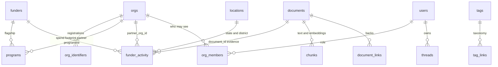
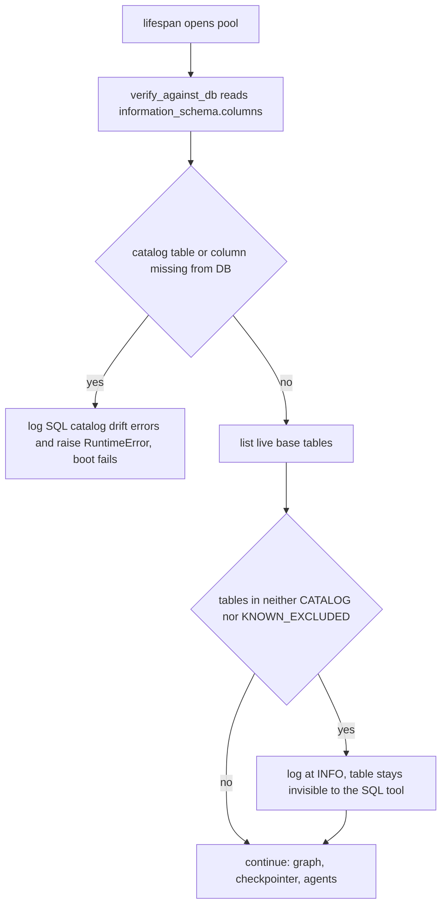

# Data and Migrations

Postgres is Sangam's system of record. Everything researched, imported, scored or saved ends up as rows there, and every other store is either derived from it (the Neo4j graph) or holds bytes that rows point at (Supabase Storage). This page covers the shape of the schema, how it changes, what stops the backend from booting against a mismatched schema, and how provenance ties facts back to sources.

Related pages: [Auth, roles and RLS](auth-roles-rls.md) (the policies and grants those migrations create), [Ask Sangam](ask-sangam.md) (the SQL tool whose catalog is checked at boot), [Sangam Import / Scout](sangam-import-scout.md) (the main writer of catalog rows and documents), and the how-to [Writing a migration](../workflows/writing-a-migration.md).

## Baseline plus forward-only migrations

There are two places SQL lives, and they have different jobs.

| Location | Role | When it runs |
|---|---|---|
| `db/init/01_extensions.sql`, `02_schema.sql`, `03_dev_user.sql` | The **baseline** (the "v2" schema): `pgvector` and `pg_trgm` extensions, the original ~30 tables, and the seeded dev user | Automatically on first boot of the bundled Postgres container, or once by hand with `make db-init-remote` against an empty managed database |
| `db/migrations/NNNN_name.sql` | Every schema change **after** the baseline | Only when someone runs `make migrate` |

The baseline is deliberately not rewritten as a "migration 0000", so a fresh install is one fast `CREATE TABLE` pass instead of a replay of history ([migrations README](../../db/migrations/README.md)). `02_schema.sql` still describes the v2 world (for example `grants`, `funder_identifiers`, `news_mentions`); the current table set exists only after the migrations are applied. The planning history of that decision, including why additive migrations were chosen over a wipe-and-reseed, is in `docs/DATA_PLATFORM.md`.

**Rule: schema changes go only in a new `db/migrations/*.sql` file** (`db/CLAUDE.md`). A new table also needs RLS policies, and reaching Ask needs an entry in `backend/app/agent/tools/sql/catalog.py`, which is a security decision, not a convenience.

### The runner

`backend/app/db/migrate.py` is a small forward-only runner, invoked as `make migrate` and `make migrate-status` (`python -m app.db.migrate [--status]` inside the backend container, reading `DATABASE_URL` and `MIGRATIONS_DIR`, default `/srv/db/migrations`, which compose mounts from `./db`).

- It creates a `schema_migrations(version, checksum, applied_at)` ledger if missing, then walks `*.sql` files in sorted **filename** order.
- A file's `version` is its stem; the checksum is the first 16 hex chars of a SHA-256 of its text.
- Each pending file runs in **its own transaction** together with its ledger insert. On any error the file is rolled back, the failure is printed to stderr, and the run stops: nothing later is attempted.
- If a recorded version's checksum differs from the file on disk, the runner prints `DRIFT: file changed after it was applied` but continues and does not fail. The convention is therefore: never edit an applied file, write a new one.
- `--status` lists applied, drifted and pending files without writing anything.

### Migrations are not automatic

Nothing applies migrations behind your back, with one local exception. `make up` runs `make migrate ENV=local` first, but only when `ENV=local` and the bundled `postgres` service exists, because the backend cannot boot against an unmigrated database (see the boot check below). `make seed` likewise depends on `migrate` locally. Against a managed database (`ENV=staging`) migrating is an explicit, separate decision, normally after a backup; `make up ENV=staging` only prints a reminder.

### Two files numbered `0044`

The directory holds 48 files and **two are numbered `0044`**: `0044_news.sql` (the Media & Signals tables) and `0044_one_read_policy_and_fk_indexes.sql` (folds duplicate `users`/`org_members` read policies and adds three FK indexes). Both landed in parallel branches; staging had already applied `0044_news`, and because the runner keys on the full file name (not the number), both were kept rather than renumbered. Order between them is alphabetical (`0044_news` before `0044_one_read…`). Do not "fix" this by renaming either file, as that would make the runner treat the renamed file as new and re-run it. `0045_drop_news_mentions.sql` follows.

### Conventions worth knowing

- One logical change per file; additive by default. A destructive change (`DROP`, type narrowing, new `NOT NULL`) should carry a comment explaining why the data makes it safe. Migrations that did drop tables copied rows first: `0031` consolidated nine funder tables into five (into `funders`, `funder_activity`, `documents`), `0033` folded `credential_events` into `org_identifiers.status`, and `0034` retired `grants` into `funder_activity` partner lines.
- `org_identifiers` is granted **by column** (`0033`), so a new column there needs an explicit `GRANT SELECT (col) … TO anon, authenticated` to be readable.
- Storage-related migrations are guarded: `0020` and `0032` skip bucket creation when there is no `storage` schema (the local Postgres container is not Supabase), recording themselves as applied so the ledgers still match.
- A migration that adds a table also needs it listed in `docs/CHANGELOG.md` and `docs/ARCHITECTURE.md` §7 in the same PR.
- `make db-clean` truncates all tables but keeps the ledger; `app.db.replicate` copies one database's rows into another with an **identical** schema (see below).

## Table groups

The model is grouped by what the tables mean; the exact column lists live in the migrations and in the SQL catalog.

Caption: a simplified slice of the entity relationships; every fact table also carries source columns that point back at `documents`.

| Group | Tables (as of the latest migration) |
|---|---|
| CSOs | `orgs`, `org_identifiers` (carries a status, validity dates and an evidence tier), `org_locations`, `org_tags`, `org_financials`, `metrics`, `programs`, `program_tags`, `contacts` |
| Funders | `funders`, `funder_activity` (one row per filing line, `kind` = spend / footprint / partner / programme; a grant is a partner line), `funder_csr_years`, `funder_locations`, `funder_tags` |
| Taxonomy and geography | `tags` (every vocabulary by `kind`), `tag_links`, `locations` (LGD codes), `location_designations` |
| Documents | `documents`, `chunks` (pgvector embeddings plus a generated `tsvector`), `document_links`, `extraction_log` |
| Import | `entity_research`, `vault_research`, `ingest_runs`, `ingest_run_items`, `resolution_queue`, `ingest_source_proposals`, `promotions`, `catalog_writes` |
| Scores and RFPs | `rubrics`, `rubric_criteria`, `fit_scores`, `fit_score_items`, `score_adjustments`, `rfps`, `rfp_*` link tables, `reference_figures` |
| Match | `funder_matches`, `funder_match_details` (saved runs, private to an org) |
| News | `news_stories`, `news_links`, `news_link_scores`, `news_story_entities`, `news_story_locations`, `news_story_tags`, `news_watch` (from `0044_news`; `news_mentions` was dropped in `0045`) |
| Access | `users`, `org_members`, `threads` |
| Infrastructure | `schema_migrations`, `graph_ingest_log`, and LangGraph's `checkpoints`, `checkpoint_blobs`, `checkpoint_writes`, `checkpoint_migrations` |

A few notes on specific groups:

- **Import bookkeeping.** `promotions` and `catalog_writes` (`0041`) are the undo log for saving Import research into the catalog. A trigger `app.log_catalog_write()` records old and new row JSON for a fixed list of catalog tables, but only while a save has set `sangam.promotion_id`; nothing else is logged. A newly added table that Import saves into must be given the same trigger, as `0047` does for `document_links`. See [Sangam Import / Scout](sangam-import-scout.md).
- **`resolution_queue`.** Names that identifiers, exact match and trigram similarity could not resolve wait here for a reviewer; a new name is never auto-merged into a registry org without an identifier or exact match.
- **Checkpoint tables** are not in any migration. `open_checkpointer` (`backend/app/db/checkpointer.py`) calls LangGraph's `AsyncPostgresSaver.setup()` on every boot, which issues idempotent DDL. They hold every user's serialized conversation history and are deliberately kept away from the SQL tool and from `app.db.replicate`.
- **`proposals` exists but is unused.** `0009_proposals` created the table, but no backend code reads or writes it; the SQL catalog lists it in `KNOWN_EXCLUDED`, and the only references are RLS and caller-pool tests. Proposals today live in the browser (`localStorage`), started from a Funder Match card. Do not assume it is a live data path.
- **RLS everywhere.** `0027` enables row-level security on every public table, and later migrations add their tables' policies; the grants and policies are covered in [Auth, roles and RLS](auth-roles-rls.md).

## Connection pools and the runtime view of the schema

`make_pool` (`backend/app/db/checkpointer.py`) builds the single `AsyncConnectionPool` shared by REST, agent tools and the checkpointer; it is opened in the FastAPI lifespan, set as `app.db.pool.pool`, and sized by `DB_POOL_MAX_SIZE` (default 10). It connects as the owner with `autocommit=True`, `prepare_threshold=0` and dict rows. `CallerPool` (`backend/app/db/pool.py`) wraps that pool so each REST connection starts a transaction with `SET LOCAL` role (`anon` or `authenticated`) and JWT claims; the connection returns to the pool as the owner. Agent tools, Import and seeds still use the owner pool through `get_pool()`.

## SQL catalog drift check at boot

Ask Sangam's SQL tool can only read what `backend/app/agent/tools/sql/catalog.py` lists: a hand-curated allowlist of tables and columns. Because that catalog is a security control, the backend compares it with the live database before serving anything.

Caption: the boot-time catalog gate in `_verify_sql_catalog` (`backend/app/core/lifespan.py`).

Semantics, which matter when you write a migration:

- **Fails boot** when the catalog lists a table that does not exist, or a column the table lacks. So a migration that drops or renames a catalogued table or column must update `catalog.py` in the same change, and an unmigrated database fails fast (this is why `make up` migrates first).
- **Does not fail** for extra live tables or extra live columns. New tables are logged at INFO as "not readable by the SQL tool and not declared as excluded" until someone either adds them to the catalog or to `KNOWN_EXCLUDED`. That means a migration can ship without making the agent see the table; exposing it is a deliberate, separate step.
- The catalog allowlists 37 tables. `KNOWN_EXCLUDED` names the 22 tables deliberately withheld (checkpoints, `users`, `threads`, `org_members`, `proposals`, Import bookkeeping, `vault_research`, `funder_matches`, `schema_migrations`, `graph_ingest_log`). `backend/tests/test_sql_catalog.py` asserts that the most sensitive of these are not in `TABLE_NAMES` and are declared excluded, and that withheld columns such as `contacts.email` are absent even from the `*` expansion.
- The catalog also validates itself at import (`_self_check`): every table needs columns and a primary key, and foreign keys must target catalogued tables and columns.
- `backend/app/ingest/expectations.py` derives Import's researchable fields from the same catalog, so it stays in sync with the schema without a second list.

## Provenance columns

Every table that holds a scraped or extracted fact carries the same provenance block. The baseline defined `source_url`, `source_name`, `fetched_at`, `content_hash`, `extractor_version`; `0001_provenance` and later migrations add `as_of` (the period the source describes, for example `FY2025-26`), `document_id` (a foreign key to `documents` when the text is stored) and `archive_url` (a web-archive snapshot).

- `source_url` is always set, even for pages never stored; `document_id` is set only when the content is in `documents`, which turns "show me the source" into a join. `as_of` is separate from `fetched_at` because one PDF can be the source for several fiscal years of facts.
- `documents` is the join target; `document_links` (`0047`) records what each document backs (owner, programme, fiscal year, cited pages) and is written by Import's promotion. It is as private as its document via an RLS policy that reads `documents`.
- Tag and location link tables use `is_inferred`, `tagged_by`, `note` and validity dates to separate what a source states from what a person or model inferred.
- Import fills provenance itself from a finding's evidence; researchers are never asked for it (`PROVENANCE` and `TIER` in `expectations.py`). The evidence tier (`source_type`, `evidence`) is paired by a CHECK constraint, and `aggregator` or `prior_research` sources may only be `claimed` (`0046`).
- The SQL tools derive which catalogued tables expose citations from the presence of `source_url`/`source_name`/`fetched_at` (`PROVENANCE_COLUMNS`), so a table that follows the convention gets its sources surfaced without another edit.

## Storage buckets

Documents' bytes live in Supabase Storage, not Postgres; `documents.storage_path` is `<bucket>/<key>` (`storage.qualify`/`split`). `backend/app/integrations/storage.py` is the only module that talks to Storage and uses the service-role key, which bypasses RLS and so stays server-side; the browser only receives short-lived signed URLs.

| Bucket | Created by | Holds | Key shape |
|---|---|---|---|
| `source-archive` | `0020` | Documents Import fetched, plus rendered briefs at `entities/<slug>.md`; 50 MB limit | at fetch `<sha256(url)[:12]>/<sha256(bytes)>-<name>`, after promotion `funders/<slug>/<year>-<name>` |
| `org-vault` | `0020` | What an organisation uploads to its Doc Vault, private by default; 50 MB limit | `<org_id>/<uuid4>-<name>` (the leading `org_id` is what the storage RLS policy reads) |
| `staff-sources` | `0032` | Staff-uploaded workbooks, readable only by staff; 100 MB limit | `<registry key>/<sha256(file name)[:12]>.xlsx` |

Behaviour to rely on:

- **Buckets are global, not per environment.** A local backend with Supabase keys writes into the same cloud buckets as staging or production. Local databases and cloud buckets can therefore disagree about which objects a row refers to.
- **Two keys for the archive.** At fetch time no funder id exists, so the key is derived from the URL and content hash (a republished PDF adds a version rather than overwriting what a finding was read from). At promotion the object is moved to a readable per-entity key (`move`/`catalog_key`); an object still under a hash folder was downloaded but never cited. `app/ingest/reshelve.py` re-runs the rename if the scheme changes.
- **Storage is optional and non-fatal.** With `SUPABASE_URL` or `SUPABASE_SERVICE_KEY` unset every call is a no-op that logs once; helpers return `None`/`False`/empty on any HTTP failure instead of raising, so an outage never aborts research or promotion and callers store a null `storage_path`. The exception is `read`, which raises on Storage errors and returns `None` only for a missing object.
- Uploads are checked against the bucket ceiling before the bytes go out; a duplicate key counts as success (Supabase reports it as HTTP 400 with a 409 body); `split` rejects empty, `.` or `..` path segments and unknown buckets so a stored path cannot be turned into a cross-bucket URL.
- Vault uploads go browser to Storage via `signed_upload_url` (valid two hours), keeping large files off the backend; `content_hash` is computed server-side afterwards from the bytes read back, and `stat` confirms an object landed before a `documents` row claims it.

## Neo4j graph: optional and rebuildable

Postgres is authoritative; Neo4j (via Graphiti, `backend/app/integrations/graphiti.py`) is a derived index. The graph is enabled only when both `NEO4J_URI` and `OPENAI_API_KEY` are set (`graph_status`); otherwise `open_graph` logs the reason and returns `None`, and `graphiti_core` is imported lazily so the app boots without it. The lifespan opens the graph after the catalog check and closes it on shutdown.

`make graph-seed` (`python -m seed.graph_seed`) rebuilds it: it reads funder profiles, two named orgs' registrations, `funder_activity` partner lines and the `score_adjustments` vetting log from Postgres, turns each into a deterministically named Graphiti episode, and ingests them with `add_episode`. Because episode names are deterministic and every episode comes from rows, the graph can always be dropped and recreated from the database. The invariant is that **nothing may live only in the graph**. `graph_ingest_log` is an infrastructure table kept out of the SQL catalog, and `make db-reset` also wipes Neo4j's volume.

## Copying data between databases

`python -m app.db.replicate` (sibling of `migrate.py`) copies contents, not shape: target is `DATABASE_URL`, source is `REPLICATE_SOURCE_URL`. It refuses to run if the two column sets differ ("run the migrations first"), orders tables parents-before-children from foreign keys, and, with `--yes` (otherwise it is a dry run), deletes the target's rows for those tables and binary-`COPY`s the source's rows in a single transaction, then resyncs identity sequences and compares counts. It excludes `schema_migrations` and the checkpoint tables. The source is authoritative and ids are preserved so no foreign key needs remapping.

## Tests that matter

- `backend/tests/test_migration_integrity.py` (marked `integration`, skips when the compose Postgres on port 5433 is unreachable) checks that restored research data survived: at least 96 `documents`, 29 `graph_ingest_log` rows, stable seed-order ids for the first orgs and funders, an advanced `documents` identity sequence, and seeded v2 content. It is a guard on preserved data rather than a schema check.
- `backend/tests/test_sql_catalog.py` guards what the catalog must not expose.
- `backend/tests/test_rls.py` and `test_caller_pool.py` exercise policies and the caller pool against a real database; see [Auth, roles and RLS](auth-roles-rls.md).
