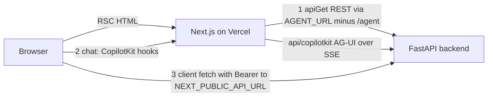

# Frontend

The frontend is a Next.js 16 / React 19 app (`frontend/`, deployed as the Vercel project `sangam`, region `bom1`; see `frontend/vercel.json`). It has **two separate paths to the FastAPI backend**, and which one a screen uses decides how auth, caching and failure behave. Backend counterparts are described in [Ask Sangam](ask-sangam.md), [Sangam Import / Scout](sangam-import-scout.md), [Funder Match](funder-match.md), [Proposal Copilot](proposal-copilot.md) and [Auth, roles and RLS](auth-roles-rls.md); the end-to-end turns are in [Ask turn](../workflows/ask-turn.md), [Import turn](../workflows/import-turn.md) and [Proposal lifecycle](../workflows/proposal-lifecycle.md).

> **The chat wire is still CopilotKit, despite the drop-CopilotKit plan.** `docs/features/2026-10-11-drop-copilotkit.md` plans to remove CopilotKit and have the browser speak AG-UI straight to the backend. `docs/CHANGELOG.md` ("Not finished") records that only M1 (restart policy) and M2 (slimmer events, later regressed by #178) shipped; **M3 (drop CopilotKit from the frontend) and M4 (backend package) have not started**. `package.json` still depends on `@copilotkit/react-core` and `@copilotkit/runtime` (both `~1.75.2`, beside `@ag-ui/client` pinned at `0.0.59`), `AgentProviders` still mounts `CopilotKitProvider`, and `app/api/copilotkit/[[...slug]]/route.ts` still exists. Everything below describes the current wire; the plan is summarised at the end.

## Layout and ownership rules

| Folder | Holds |
|---|---|
| `app/` | Routes only: pages, layouts, route handlers. Nothing that is not a route belongs here. |
| `features/` | One folder per screen: `ask`, `auth`, `home`, `ingest`, `registry`, `resources`, `settings`, `taxonomy`, `terms`. |
| `components/` | `ui/` display primitives (and the `ListPage.tsx` list pattern) and `layout/` site chrome (`Nav`, `NavBar`, `Footer`). |
| `lib/` | `api/` (server REST client, types, auth headers), `supabase/`, `devAuth.ts`, `AgentProviders.tsx`, `useAgentChat.ts`, the URL-state helpers (`url.ts`, `useUrlTab.ts`, `useUrlThread.ts`), `format.ts`, `safe-next-path.ts`. |

`docs/ARCHITECTURE.md` §9 states the rule: `app/` holds routes only and everything else goes in `features/`. Cross-folder imports use the `@/` alias. `frontend/CLAUDE.md` is only a pointer: to this page for facts, to `docs/ARCHITECTURE.md` §9 for rules and to `docs/DESIGN_SYSTEM.md` for any UI change.

Routes: `/` (home), `/ask` (workspace when signed in, preview when not), `/import` (Scout), `/registry`, `/registry/[slug]` and its `/brief`, `/registry/funders/[slug]` and its `/brief`, `/resources/[tab]` (methodology, taxonomy), `/settings`, `/terms`, `/auth/*`, plus `/api/copilotkit/[[...slug]]`. Several legacy paths are bare redirects: `/funders` → `/registry?type=funder`, `/orgs` → `/registry?type=cso`, `/methodology` and `/resources` → `/resources/methodology`, `/taxonomy` → `/resources/taxonomy` (keeping its anchor), `/privacy` → `/terms#t-collect`. The root layout (`app/layout.tsx`) loads Public Sans through `next/font` and only renders `NavBar`, `<main>` and `Footer`; there is no global provider, so the agent provider is mounted per screen.

### Screens live in the URL

A screen Back should undo is kept in the address, so Back, reload and a shared link all land on it. The helpers are small and pure where they can be:

- `lib/url.ts`: `withParams(href, patch)` applies a `ParamPatch` (a null, undefined or empty value drops the param); `setUrlParams(patch, mode)` writes it with the browser's own `history.pushState` (the default, a screen change that Back undoes) or `replaceState` (a filter or fill-in that Back skips), and does nothing when the address would not change. `idParam` reads a positive integer, `oneOf` falls back to the first of a list.
- `lib/useUrlTab.ts`: `useUrlTab(ids)` reads `?tab=`; the first tab is the bare URL and a pick is a push.
- `lib/useUrlThread.ts`: `useUrlThread(newId, {valid, active})` reads `?thread=`, ignoring anything `valid` rejects; with none the chat is an unsent draft held in state. `markSent()` names the draft in the address with a replace (no extra Back step) on its first send, `renew()` makes a fresh draft, and `resume` is true when the open thread came from the address, which tells the chat to load saved messages.

Native `history` calls are used instead of `router.push` on purpose: `/ask` is `force-dynamic`, so a router navigation would refetch it (`docs/ARCHITECTURE.md` §9). In-app back links name their parent URL instead of calling `history.back()`. Which params exist: Ask's `?view=`, `?thread=`, `?proposal=`, `?funder=` and `?org=`; Import's `?thread=`; a registry profile's `?tab=`; and the Registry list's filters. Pushes are used for screens (view, thread, proposal, profile tab); replaces for the Registry filters and Funder Match's `?org=`.

### Home page and navbar

`/` (`app/page.tsx`) just renders `features/home/HomePage.tsx`, a static server component: a hero ("Where funders and NGOs actually meet") with "Ask Sangam" (`/ask`) and "Explore the Registry" (`/registry`) buttons beside `HeroSlides` (a client component that cross-fades between "For NGOs / For funders / For ecosystem players" every 8 s and pauses on hover), the five-step "how the agent works" list, "What feeds the base" source cards, partner logos (a partner without a logo file renders a dashed placeholder) and a "Stay updated" card. The page makes no backend call, and the newsletter card's Subscribe button is a plain `type="button"` with no submit handler, so it stores nothing. Its copy is marketing text, so it says "NGO" rather than "CSO".

**The steps card.** The five steps ("You ask Sangam" through "Returns an answer") are a constant `STEPS` array rendered as one `<ol class="home-steps">` card, each `li.home-step` with a zero-padded number and a connector line (`.home-step-num`, `.home-step-line`). The layout is pure CSS in `globals.css`: below 900 px it is a single numbered vertical timeline; from 900 px up the same markup becomes five equal columns divided by hairlines, with the connector running horizontally from each number. There is no step state or script.

`components/layout/Nav.tsx` is the sticky, translucent sage navbar. It has exactly three destinations, Registry, Ask Sangam and Resources (`/registry`, `/ask`, `/resources`), plus the `SignInButton`.

**Phone menu.** Below 640 px the inline `.nav-links` are hidden and the bar reads wordmark, Sign in, then a 44 px menu button (`.nav-menu-button`, Lucide `Menu`/`X`, `aria-expanded`, `aria-controls="nav-menu"`). Opening it shows `.nav-menu` under the bar, a column of the same three `LINKS` with `aria-current` on the current section; from 640 px up the button and menu are hidden by CSS. `Nav` stores not a boolean but the pathname the menu was opened on (`openOn`), and the menu counts as open only while `openOn === pathname`, so any navigation closes it, and clicking a link also closes it explicitly. `/import` is deliberately absent: Scout is reached from the workspace sidebar's Tools section. `NavBar.tsx` picks the highlighted section by the first matching path prefix, so the legacy `/orgs`, `/funders`, `/methodology` and `/taxonomy` paths still highlight Registry or Resources, and any unmatched path (including `/`) counts as `home`.

## The two paths to the backend

Caption: server components call REST directly, chat goes through the Next proxy route, and client components also call REST straight from the browser.

1. **Server components, REST.** `lib/api/client.ts` exports `apiGet`, used by pages such as `/ask`, `/import`, `/registry` and the profile pages. Its base URL is `AGENT_URL` with the trailing `/agent` stripped, falling back to `NEXT_PUBLIC_API_URL`, then `http://localhost:8010`. It attaches the signed-in user's token (`serverAuthHeaders()` in `auth-headers.server.ts`: the Supabase session's access token, or the dev cookie in local dev-login mode) and throws `NotFoundError` on 404, which pages turn into `notFound()`.
2. **Chat, via the proxy route.** The chat UI never calls the backend itself. `AgentProviders` points CopilotKit at `/api/copilotkit`; the route's `CopilotRuntime` registers three `HttpAgent`s from `@ag-ui/client`: `sangam_agent` → `AGENT_URL` (Ask, `/agent`), `sangam_ingest` → the same URL with `/agent` replaced by `/ingest` (Import) and `sangam_proposal` → `/proposal` (the per-proposal Sangam Pitch chat). The route uses an `InMemoryAgentRunner` and declares `maxDuration = 1800` to match `backend/vercel.json`, because an Import turn streams for 15–20 minutes.
3. **Client-side REST.** Anything a browser component needs after load (thread lists, history, Import panels, Funder Match, proposals, vault, settings) is a plain `fetch` to `NEXT_PUBLIC_API_URL` (default `http://localhost:8010`) with `authHeaders()`. Many modules re-declare the `API` constant locally; `features/ask/lib/rest.ts` provides the shared `call()` helper (JSON in/out) that throws `ApiError` carrying `status` and `body`, so callers can act on a 409's detail.

### The `AGENT_URL` convention

`AGENT_URL` must **end in `/agent`** because the proxy route uses it verbatim for Ask and derives the Import and Proposal URLs by swapping the suffix; the REST client strips that suffix to get its base. `NEXT_PUBLIC_API_URL` has **no** `/agent` suffix and is the browser-side REST base. The asymmetry is deliberate (`CLAUDE.md`). In Docker compose `AGENT_URL=http://backend:8000/agent` (server-to-server) while `NEXT_PUBLIC_API_URL=http://localhost:8010` (what the browser can reach); `make dev-frontend` sets `AGENT_URL=http://localhost:8000/agent`. `AGENT_URL` is read only on the server; it is never exposed to the browser.

## Auth and headers

- **Session refresh and gating.** `proxy.ts` (the Next 16 replacement for middleware) runs `updateSession` from `lib/supabase/middleware.ts` on all paths except static assets and images. It creates a fresh Supabase server client per request, calls `getClaims()`, and redirects a signed-out visitor on `/import` (the only entry in `PROTECTED_PREFIXES`) to `/auth/login?next=…`. `/ask` is public by design.
- **Missing Supabase keys.** If `NEXT_PUBLIC_SUPABASE_URL` or `NEXT_PUBLIC_SUPABASE_PUBLISHABLE_KEY` is absent (a bare local run), `updateSession` returns `NextResponse.next` at once: the proxy passes every request through and does not redirect, so it never fails on its own. Nobody can sign in, and the failure shows up downstream, consistently as "signed out": `/ask` treats a failed Supabase client as signed out (`isSignedIn()` catches the error and returns false) and renders the preview; `/import` is no longer guarded by the proxy, but its `apiGet("/api/me")` rejects (no Supabase server client can be built, or the backend refuses the anonymous call), the page's `.catch` turns that into `null`, and it redirects to `/ask`; and the sign-in dialog (`features/auth/login-form.tsx`) says the Supabase keys are not set and hides the Google button.
- **Local dev login.** `DEV_LOGIN` in `lib/devAuth.ts` is true only when `NEXT_PUBLIC_SUPABASE_URL` is unset **and** `NEXT_PUBLIC_DEV_AUTH=1`. The navbar sign-in button then becomes a `<select>` of the seeded `admin`/`steward`/`member`/`stranger@local.test` users, which writes the `sangam-dev-as` cookie, and `/ask`, `serverAuthHeaders()`, `authHeaders()` and `AgentProviders` use `Bearer dev:<email>` instead of a Supabase token (no cookie means no header). A backend honours it only with `SUPABASE_URL` unset and `DEV_AUTH` on; see [Auth, roles and RLS](auth-roles-rls.md).
- **Where the token goes.** Server REST uses `serverAuthHeaders()`; browser REST uses `authHeaders()`; chat uses the token held by `AgentProviders`, which reads the session once, follows `onAuthStateChange`, and passes `Authorization: Bearer <token>` as the `CopilotKitProvider` `headers`. The backend validates this one bearer token everywhere.
- **Open-redirect guard.** `/auth/callback` exchanges the OAuth `code` for a session and uses `safeNextPath` so only same-origin paths are honoured.
- **Route-level role gate.** `/import` also calls `/api/me` on the server: a visitor who is neither staff nor a steward of any org (`canUseScout`) is redirected to `/ask`. The screen only shapes itself from this; the backend checks again.

## Caching

`apiGet` makes signed-out reads cacheable: in production (`NODE_ENV === "production"`), when no `Authorization` header exists, it fetches with `next: { revalidate: 300 }`, so anonymous registry pages come from Next's data cache and survive a cold backend. That request carries an `x-sangam-build` header (the Vercel deployment id or commit SHA) so the cache key changes on every deploy and a new deploy never renders the previous one's API shapes. Signed-in requests, and all development requests, use `cache: "no-store"`. Pages that depend on the session (`/ask`, `/import`) set `dynamic = "force-dynamic"`. Client-side fetches are always `no-store`. A profile page loads with one server-side backend call (`/api/funders/{slug}/profile` or `/api/orgs/{slug}/profile`); only the partner groups behind "show more" are fetched later from the browser (see [Registry profiles](#registry-profiles)).

## Registry list and rows

`/registry` (`app/registry/page.tsx`) makes one server `apiGet` of `GET /api/registry` (`RegistryOut`, a list of `RegistryRow`) and hands every row to the client component `RegistryClient`, which filters and pages entirely in the browser: bucket cards (All / CSOs / Funders), a `FilterRow`, a `SearchBox` and `useShowMore` (20 per page), the shared list pattern. The filters are held in the address: `features/registry/filtersUrl.ts` (`filtersFrom`, `filterParams`, `DEFAULTS`) maps `?type=cso|funder` to the bucket (the legacy `/orgs` and `/funders` redirects use it) and every other filter (`theme`, `population`, `sdg`, `where`, `reg`, `ftype`, `approach`, `q`) to a param of the same name, dropping a param when it is at its default. `RegistryClient` writes them with `setUrlParams(..., "replace")`, so Back from a profile returns to the same filtered list while Back never undoes each filter; typed search text stays in local state so the caret never waits on the address, and the address gets a copy. Switching bucket resets the type-specific filters. `features/registry/rows.ts` holds the presentation rules: `kindLine`, the one-line `signal`, `matches` (it re-exports `Filters` and `DEFAULTS` from `filtersUrl.ts`), which decides what each filter keeps (the Registrations filter applies only to CSOs; Funder type and How to approach only to funders; "Works in" can mean the eight North-East states).

A row (`Row` in `RegistryClient.tsx`) was reworked to carry more of what the filters read:

- **Domains first.** The tag line shows each theme domain the row reaches, in the backend's order (most programmes first), with "Others" forced last; a row with none shows an italic "Themes not tagged yet" gap tag. Domain tags and SDG chips share the line.
- **Theme filter explains itself.** With a Theme set, an extra "In <domain>:" line lists the sub-themes that put the row in the results (first three, then "+N more"), and the matching domain tag gets `data-active`.
- **Serves line.** Up to three population tags (`.reg-tag[data-tone="population"]`) with "+N more"; a filtered population is moved to the front and marked `data-active`.
- **Approach signals.** For funders, the one-line `signal` can read "open call now" and "invites partners" (from `RegistryRow.open_call` and `intake_mode === "invitation_only"`), and the "How to approach" filter (Open call now / Invites partners) is offered only when at least one loaded row has that property. The funder profile's Mandate tab lists `open_calls` from the single profile payload, or "No open call found".
- Styling for these (`.reg-row-line`, `.reg-row-label`, `.reg-more`, the `data-active` edge) is the `tokens/registry-row.css` slice of `globals.css`.

## Registry profiles

`/registry/[slug]` (CSO) and `/registry/funders/[slug]` (funder) are server components that fetch the single profile payload with `apiGet`, turn `NotFoundError` into `notFound()`, and `permanentRedirect` to the canonical slug when the profile was asked for by id. Each renders a shared `ProfileHero` (with an "Ask Sangam about…" link into `/ask?q=…` and a brief link when a brief exists). The hero draws the profile's tags as a facet list: `splitTags` (in `profile/shared.tsx`) separates themes (`theme` and `sub_theme` kinds, shown as "Theme › Sub-theme" in the tooltip), the population tags (labelled by `whoLabel`), and `lens` tags, and each group gets its own labelled line (Themes, who, **Lenses**, SDGs) rather than lenses being mixed into the population pills. It sits above a client tab component in `features/registry/profile/`: `OrgProfileTabs` (Overview, Programmes & places, Funding, News & social, Research & sources) or `FunderProfileTabs` (Mandate, Giving, Reach, News & social, Research & sources). The active tab is `?tab=` in the address (via `useUrlTab`, so a pick is a Back step and the first tab is the bare URL), the tab ids being `overview`/`work`/`funding`/`news`/`research` for an org and `mandate`/`giving`/`reach`/`news`/`research` for a funder; an unknown value falls back to the first tab. The tabs only receive slices of the already-loaded profile, so switching tabs makes no request. The one exception is the partner lists (an org's funders on the Funding tab, a funder's partners on the Giving tab): the profile carries only the first `PartnerGroupPage`, and `usePartnerGroups` (`profile/partnerGroups.ts`) fetches the next page from the browser with `authHeaders()` and the `next_cursor` (`/api/orgs/{slug}/funders?cursor=` or `/api/funders/{slug}/partners?cursor=`), appending groups and showing an error state if a page fails.

## Ask workspace

`/ask` (`app/(agent)/ask/page.tsx`) checks the session server-side (`getClaims()`, or the dev cookie in dev-login mode). Signed out, it renders `AskPreview`: canned sample answers that cost no agent call; asking anything opens sign-in and parks the question in `sessionStorage` (`lib/pendingQuestion.ts`, read-once) so the workspace prefills it, never auto-sends. `?view=import` redirects to `/import`; `?q=` (e.g. from a Registry "Ask Sangam about…" button) seeds a fresh chat and is stripped from the URL after mount. Signed in, the page fetches orgs, funders, scores, partner lines, stats and `/api/me` in parallel with `apiGet` and hands them to the workspace as an `IndexPayload`; the workspace uses it to resolve citations and show provenance without another round trip, `canScout` (from `/api/me`, failure treated as false) decides whether the sidebar offers Scout, and the payload also carries `me` itself (null when that call failed) so views need not ask `/api/me` again.

`WorkspaceLoader` wraps `SignedInWorkspace` in `next/dynamic`, so the workspace and the CopilotKit runtime under it download only when rendered; `SignedInWorkspace` mounts `AgentProviders` around `AskWorkspace`.

**The view is in the URL.** `features/ask/lib/workspaceUrl.ts` (pure, tested without a browser) declares `WORKSPACE_VIEWS` (`ask`, `chats`, `funder-match`, `proposals`, `rfpwatch`, `vault`, `media`) and the `WorkspaceView` type (re-exported from `Sidebar.tsx`), `viewFrom` (`?view=`, or the chat when it is missing or unknown), `viewParams(view)` (the chat is the bare URL, and clearing `proposal`, `funder` and `org` so another screen's ids do not follow you) and `isAskThreadId` (an Ask thread is a bare UUID; anything else in `?thread=` is ignored, never sent to the backend). `AskWorkspace` reads `view`, `proposal` and `funder` from `useSearchParams`, and the open chat from `useUrlThread` (active only while the view is `ask`); the thread list and the latest turn stay in state. Every sidebar pick, thread pick or "new chat" is a pushed `setUrlParams` write, so Back walks through screens; clicking the screen you are already on does nothing, except that Proposals inside one proposal goes back to the list. Each view is still a plain conditional in the render, so switching views unmounts the previous one and its local state. `ChatPane` is keyed by `threadId`, so picking or starting a chat remounts it (picking a thread or starting a new chat also switches back to `ask`); a draft chat enters `?thread=` on its first send through a replace, and the latest turn and any `?q=`/pending-question prefill are tagged with their thread so Back to another chat shows neither. The right-hand `EvidenceRail` (hidden on narrow screens via `.evidence-rail-slot`) shows the latest turn: the phases of work, the sources behind the answer, and the SQL each `db_query` ran. `lib/sources.ts` (`sourcesFor`) builds the source list from three grains and de-duplicates it by URL (or label when there is none): `fact` rows parsed from the `sources:` block that `db_query` appends to its result (a backend text contract), `web` entries from a `fetch_url` step's own `url` argument, and `entity` entries for the org, funder, activity or score that a citation marker in the answer points at, resolved through the `IndexPayload` (a score is labelled as Sangam's own rubric rather than a missing source). The rail shows at most `MAX_SOURCES` (10) and states the remainder as a count, and when a query carried no per-row source it says why and names the tables read. The sidebar shows the proposal count from `useProposals()`, and a Funder Match card can jump into Proposals with a `{id}` or `{funderId}` target, written as `?view=proposals&proposal=<id>` or `&funder=<id>`; `ProposalsView` reads them as `open` and `funder` props (the list is keyed by funder, the shell by proposal id) and "All proposals" simply clears `?proposal=`. Choosing "Proposals" in the sidebar opens it with no target. RFP Watch gets two hooks back into the workspace: `onAsk` starts a fresh chat seeded with a question (`newChat(q)`), and `onFunderMatch` switches to the Funder Match view.

### Sidebar and "coming soon" views

`features/ask/components/Sidebar.tsx` is the workspace rail. Expanded, it has a "+ New Chat" button and a scrolling area with three collapsible sections: **Recent Chats** (the first 5 threads, then "Show All N Chats →" which opens the `chats` view), **Use Cases** (Funder Match, Proposals, RFP Watch, Media & Signals) and **Context** (Doc Vault). Section open/closed state lives in the sidebar, not in each section, so the collapsed rail can reopen the sidebar already expanded at a chosen section. Collapsed (the default on viewports up to 768 px wide), it shows icon-only buttons (Lucide, styled by `.icon`). A **Tools** section pinned at the foot, with a link to `/import` ("Sangam Scout"), renders only when `canScout` is true; it is a real navigation, not an in-app view.

A feature that has not shipped is gated by the single set in `features/ask/lib/comingSoon.ts` (`COMING_SOON`, typed on `WorkspaceView`). A name in the set gets a "Soon" tag in the sidebar instead of its count, and `AskWorkspace` renders `ComingSoonView` (a title plus a "Coming soon" card) in place of the real view; deleting the name turns the feature on. **The set is currently empty** (`new Set<WorkspaceView>([])`): the mechanism and its branches remain, but nothing is gated. `proposals` was gated on 2026-10-15 and removed on 2026-10-16 ("Proposals are on for everyone", `docs/CHANGELOG.md`); `rfpwatch` was the last entry, and the RFP Watch screen (#232) is now the live view, so every signed-in user gets real Proposals and RFP Watch. The gate is still read in four places for Proposals: the `AskWorkspace` view branch, the sidebar tag, the Funder Match "Proposal" status filter (hidden while gated) and `MatchCard` (a disabled "Start a proposal" button with a "Coming soon" tag instead of `ProposalAction`), so re-adding `proposals` to the set switches all of them off together. RFP Watch is read in only two (the `AskWorkspace` branch and the sidebar tag). The signed-out `AskPreview` is static copy and still lists "RFP watch … Coming soon" by hand in its `SIGNED_IN_EXTRAS`; it does not read `COMING_SOON`, so that preview line is now out of date relative to the workspace.

**Threads.** Each chat has a client-generated UUID. The thread list comes from `GET /api/threads` (`fetchThreads`), with `localStorage` (`sangam_threads_v1`) kept only as a title fallback and to show a just-started chat before its first turn reaches the server. A reopened chat loads `GET /api/threads/{id}/messages`; a 404 means an empty chat.

**One chat hook, three agents.** `lib/useAgentChat.ts` is shared by Ask (`useSangamChat` → `sangam_agent`, local agent id `sangam-chat-<thread>`), Scout (`sangam_ingest`, `sangam-import-<thread>`) and the proposal chat (`sangam_proposal`, `proposal-chat-<thread>`). It takes `(threadId, runtimeAgentId, prefix, loadHistory?)`, wraps CopilotKit's `useAgent` (80 ms throttle) and returns `turns`, `send`, `stop`, `isRunning`, `isReady`, `isLoadingHistory`, `laneOwners`. Behaviour worth knowing:

- Messages are folded into `Turn`s: a user message opens a turn; assistant tool calls become `TraceStep`s whose result is the matching `tool` message (a step with no result while the run is live is "running"); assistant prose is the answer — **except** prose from a message with a `subagentRunId`, which is a subagent's working and is dropped from the answer.
- `laneOwners` maps a subagent run to the `task` tool call that spawned it, built from `onSubagentStartedEvent`; it exists only for live runs, not for reloaded threads.
- History is loaded only after the agent is `isReady` and only if it has no messages, because messages set on the provisional agent are dropped. Composers are disabled until ready and history loaded.
- `send` adds the user message locally and calls `copilotkit.runAgent`; `stop` calls `copilotkit.stopAgent`.

### Funder Match, RFP Watch, Vault, Media

These views use client REST (`call()`), not the agent. Both Funder Match and RFP Watch pick an organisation through `useOrgChoices(orgs, seed)` (`features/ask/lib/useOrgChoices.ts`): the workspace passes the page's `/api/me` result (`payload.me`) as `seed`, so `getMe()` is called only when there is no seed (once, with a failure shown as the view's problem); staff choose from every organisation in the payload, everyone else from their memberships, and a signed-in person with no organisation sees an explanatory card instead of data. A fixed name shows for one choice and a selector only when there is more than one.

**Funder Match** (`FunderMatchView`, `views/funder-match/api.ts`) calls `GET /api/funder-matches?org=` for the org's latest saved run, `GET /api/funder-matches/{id}/detail` when a card's "Why this score" disclosure opens, and `POST /api/funder-matches/runs?org=` to rerun it. The chosen organisation is `?org=` in the address (written with a replace), so Back from a proposal opened here returns to the same organisation; a slug that is not one of the person's choices is ignored and the first choice is used. (RFP Watch keeps its chosen organisation in local state.) The backend decides who may run it; the list's `may_run` flag shows the "Rerun match" / "Run the first match" button and becomes `mayStart` on each card, so members only view proposals. With no saved run the view shows a "No match saved yet" card. Matches in the `strong` and `medium` tiers are ranked as cards (buckets All fits / Strong "75 or more" / Medium "55–74", a funder-type filter, search over the funder name, type and reasons, plus the Proposal-status filter described above); `weak` and `not_scored` rows are folded into a "Weak or no fit" disclosure that only appears at the default filters. Each card shows the score bar, tier tag, the change since the last run, fit/gap reasons and `ProposalAction` (Start a proposal, Continue/View proposal, or "Proposals (N)" when a funder has several).

**RFP Watch** (`RfpWatchView`, `views/rfp-watch/`) is the Ask view for open calls for proposals, matched by the backend to the chosen organisation's theme domains. It loads `GET /api/rfps/feed?org=` and changes a call's state with `PATCH /api/rfps/{rfp_id}/matches/{org_id}` (`flagged`, `saved` or `dismissed`). The feed carries `can_act`, so people who cannot act (only the org's members and admins and staff can) see a read-only note instead of Save / "Not for us". Buckets are For you (open calls), Closing soon (deadline within `SOON_DAYS` = 30 days) and Saved (kept even after the deadline), narrowed by search and a theme filter and sorted soonest deadline first. A dismissed call, or an unsaved closed one, is removed locally; saved ones stay. Empty states point to Funder Match ("Most CSR money is given without an open call"), and an organisation with no theme domains is told no call can be matched. `CallCard` shows days left (urgent at 14 days), amount band, places and matching themes, only renders an `http(s)` link from model-extracted URLs (`safeHref`), and "Ask about this call" calls `onAsk` with a prepared question, opening a new Ask chat. Calls arrive in the feed from Scout's open-calls pull (see [Import / Scout UI](#import--scout-ui) and [RFP Watch](rfp-watch.md)).

Lists across the app use the pattern in `components/ui/ListPage.tsx`: `BucketCards`, one `FilterRow` of dropdowns, a `SearchBox`, and `ListMore` with `useShowMore` (client-side paging) or `useCursorList` (server keyset paging). `CLAUDE.md` and `docs/ARCHITECTURE.md` §9 require a new list page to reuse it rather than invent its own pills or stats.

### Proposals

Proposals are **server-backed**, shared by everyone in the organisation, and drafted through the `/proposal` agent; the earlier browser-only version (`store.ts`, `start.ts`, `localStorage`) no longer exists. The backend side is described in [Proposal Copilot](proposal-copilot.md) and [Proposal lifecycle](../workflows/proposal-lifecycle.md).

**State.** `views/proposals/api.ts` is the one client module. It keeps a module-level list of `ProposalItem` rows loaded from `GET /api/proposals` (every proposal the caller may read) behind `useSyncExternalStore`: the first subscriber triggers `reloadProposals()`, a failed load leaves an empty list, and every mutation (`startProposal`, `saveWork`, `rename`, `advance`, `saveVersion`) calls it again. The workspace count, Funder Match cards and the list all read this one cache. The only browser storage left is `hadBrowserProposals()`, which reads the legacy `sangam.proposals.v1` key; if it holds anything, `ProposalsView` shows a notice that those proposals are not shown and must be started again from Funder Match. Nothing is migrated.

**Start and list.** A proposal is started from a Funder Match card: `MatchCard` asks for a name and calls `startProposal(org, funderId, title)` (`POST /api/proposals`), then opens it. `ProposalList` filters the cached rows client-side (bucket All / In progress / Ready, funder, organisation, started-in-last-N-days, search) with `useShowMore`.

**The shell and its steps.** `ProposalShell` loads one proposal with `GET /api/proposals/{id}` and renders a **five-step** stepper (`steps.ts`: *Can you apply?*, *Your documents and style*, *Make a case*, *Make a plan*, *Before you send it*; `CASE_STEP` = 3 and `PLAN_STEP` = 4). The server owns the step number (`work.stage`); the screen never advances itself. Every edit is a `PATCH /api/proposals/{id}/work` with dotted keys (`gates.<key>`, `sources`, `style`, `sections.<code>.text`, `facts.<k>.status`, …) and the response replaces `work` and `summary`. "Continue to <next step>" calls `POST …/advance`; it is disabled while `summary.to_continue` is non-empty, and a 409 whose detail lists `missing` is shown as "To continue: …". A step button in the stepper is enabled only for editors and only up to `summary.furthest` (the last step every earlier step of which can be left): clicking an earlier step saves `stage` through the work PATCH, clicking a later one calls `advance(id, n)`, which the server can refuse.

- Step 1 (`GatesStep`): each funder requirement is answered Yes / We'll have it / No; a hard requirement answered No shows a stop line.
- Step 2 (`SourcesStep`): the funder's form (uploaded to the Doc Vault, or "use Sangam's usual order"), the org's vault files to tick, and the writing style. The `Reading` card lists each file's reader (running / done with a fact count / failed with "Try again", plus the funder's own reader); "Write the first draft" and "Read the files again" (shown as "Read the new files" once some files are read) are fixed messages (`WRITE_FIRST_DRAFT`, `READ_AGAIN`) sent to the proposal chat, which calls the reading tool. They are disabled while no send function is available (the chat is not ready, a turn is running or a question is open), and a failed reader's retry is also disabled while another reader runs.
- Steps 3 and 4 (`SectionsStep`): the funder template's tabs and parts for that step (`proposal.sections`/`tabs` carry a `step` field); each part is a text box with numbered `[1]` source marks that `PartEditor` maps back to fact keys (`⟦k7⟧`), autosaved about 1.5 s after typing together with the part's `rev`. A 409 means someone else (a teammate or Sangam Pitch) saved first: the box takes their text and the person's own is kept beneath it to copy from. Elsewhere in the shell a 409 shows "<name> changed this … Showing their version" and reloads the proposal. Facts for the part are in a disclosure (`FactList`); "Write <tab>" asks the agent to draft the tab, and the Summary part is locked until every other part is written, then offered through "Write the Summary". The Summary lock counts every other part across both steps (`waiting`), not just those on the open step.
- Step 3 only: the **Secondary research** card (`SecondaryResearch`, rendered below the parts). It shows no chat of its own; its state is the proposal's `work.readers.public` run, the facts with `found_by === "public"` and `work.research_asks` (a newest-first list of what was asked, its sites and how many facts each run added; the internal `plan` kind is hidden).
  - **Search.** "Search public sources" (or "Search again" once a run exists) sends the fixed chat message `SEARCH_PUBLIC` through the proposal chat, so it is disabled while no send function is available. A running search shows who started it and that the person may leave the page; a failed one shows its error.
  - **Brief and topics.** Once a run is not running, its `brief` (Markdown from the public researcher) is rendered by `ResearchBrief` in an open "Research brief" disclosure. Because the text comes from pages on the open web, it is rendered with `react-markdown` using `skipHtml` and the default URL transform (no raw HTML, no `javascript:` links), links open in a new tab with `noopener noreferrer`, and tables scroll in their own box. Below it, five topics (`problem`, `place`, `government`, `sdg`, `elsewhere`; a fact saved without a topic falls back to a topic by its section code) each show one summary whose `⟦kN⟧` fact marks are renumbered `[1]…[n]` by first citation, with the numbered sources under it (a link only when the URL is `http(s)`). One button per topic sets every live fact's status at once: "Use this" → `confirmed`, "Don't use" → `rejected`, and for a topic whose facts were all dropped "Use it after all" → `proposed`. All of these are ordinary `facts.<k>.status` saves.
  - **Start fresh / Delete.** After a run, "Start fresh" and "Delete research" ask for confirmation, then call `DELETE /api/proposals/{id}/research` (`deleteResearch`), which removes the brief, summaries, asks and the public facts that no part's text cites (facts a part already cites are kept); "Start fresh" then sends `SEARCH_PUBLIC` again. Neither is offered while a search is running.
  - **Research deeper.** `DeeperResearch` is offered only to editors and only after the Context (`A2`) and Problem (`A3`) parts are marked done; until then it tells the person which to mark. "Research deeper from your case" fetches editable angles from `GET /api/proposals/{id}/research/angles`; the person can remove angles, add their own (up to `ANGLES` = 8), and sees any the backend dropped because they name the organisation or a person. "Search these" sends the chat message `Research deeper: <angle>; <angle>.`, so that message is built from the edited angles rather than fixed, and only those words are searched, never the proposal text.
- Step 5 (`FinishStep`): *Fix first* and *Worth checking* lists, every fact the text uses with Confirm all, a "Rewrite those parts" chat message for parts flagged `needs_rewrite`, and `FinishCard`: "Smooth the language" (`POST …/polish`, refused with a 409 list of differences when a figure, place, name or gap changed) and "Download as a Word file" (`POST …/versions`, which saves the next version to the Doc Vault and opens a short-lived link from `/api/documents/{id}/file`). Sangam never sends anything to the funder.

**Concurrency and roles.** `can_edit` from the server turns the whole screen read-only for members ("Ask your organisation's admin…") and hides the chat. While any reader is running, or an editor is at step 2+ and the chat is not yet ready to send (`send === null`, because readers are claimed and parts saved mid-turn), the shell polls the proposal every 5 s so teammates see reading progress; `TellSangam` also reloads it when a chat turn ends, since a turn may have saved or moved the step. The chat floats over the page (open from the start at 900 px and wider, behind a "Sangam Pitch" button on a phone) and stays mounted while closed so a turn keeps streaming.

**The proposal chat (`TellSangam`, "Sangam Pitch").** It floats beside the steps and uses `useAgentChat(proposal.thread_id, "sangam_proposal", "proposal-chat", …)`. The thread id is per user (`proposal-<id>-<user id>`), so each editor has a private chat; history comes from `GET /api/proposals/{id}/messages` (404 → empty). It sends the current screen (step, selected text, open part) as AG-UI context under the exact description `"What the person is looking at"`, which the backend's `ProposalContext` looks up, and it hides `⟦k…⟧` fact marks in answers. `QuestionCard` answers the agent's interrupts through `useInterrupt` (`renderInChat: false`) for `proposal_question` and `proposal_suggestion` payloads; a reply comes from the card's buttons ("Later" frees the question) or from the chat box. Step buttons can send fixed messages only while the chat is ready, no turn is running and no question is open.

## Import / Scout UI

`/import` (`app/(agent)/import/page.tsx`) is `force-dynamic`, redirects people who may not use Scout to `/ask`, and renders `ImportLoader`, which lazy-loads `ImportPage` with `ssr: false` (it reads the screen width). The route no longer reads `?thread=`: `ImportPage` mounts `AgentProviders` and `ImportShell`, which gets the open thread from `useUrlThread(newImportId, { valid: isImportId })` (`import-<uuid>`, validated against `^import-[0-9a-f-]{36}$` in the browser; anything else is an unsent draft). Picking a past run or starting a new one is a pushed `setUrlParams({thread})` write (a new import is the bare `/import`), while the first send of a draft names it in the address with a replace. `ImportShell` lists past runs (`GET /api/ingest/threads`) and keeps a just-started thread listed until the server lists it (it re-fetches 3 s after the first send, since the server titles the thread when the run starts); on phones the run list starts collapsed.

`ImportView` loads the page's panels with **one** request, `GET /api/ingest/overview` (research done recently, sources, runs, queue, source proposals, access, vault files), because separate calls could each hit a cold backend instance. It derives `ImportAccess` (`{staff, stewardOf, orgs}`, built by `accessOf` in `lib/access.ts`) from the overview's `me` and passes it to `ScoutChat`; until the overview answers the access is empty (`NO_ACCESS`), so no task cards are offered. `lib/access.ts` is the one place the screen's role rules live, and it only shapes the screen (the backend refuses again): `canUseScout(me)` (staff, or a steward of any org) is the route and sidebar gate, and `tasksFor(access)` gives **staff four tasks (funder, NGO, news, calls), stewards funder / NGO, anyone else none**. `access.orgs` (every membership) drives the organisation selector in the source picker, which appears only with more than one organisation. Staff additionally see "Team tools" (source groups, run history, source proposals — unrelated to grant Proposals) and the `WaitingForYou` queue in the right rail.

`ScoutChat` is the one component that holds the Import conversation:

- **Task cards and pulls.** Before the first turn it shows task cards (research a funder, check an NGO, get the latest news, check open calls; filtered by `tasksFor(access)`) over the composer. Picking a card only writes `leadIn(task)` into the draft (`lib/composePrompt.ts`). `news` and `calls` are *pulls* (`isPull`): fixed pulls that read no chosen sources, so no source picker is required before sending, whereas funder and NGO research blocks Send until something is ticked (`nothingChosen`) and shows the picker in the right `ScoutRail` (inline on narrow screens). After the first turn the rail instead shows "Reading from" and, for staff, the waiting queue.
- **Start → Working → Review → Done.** Once a turn has started, the step shown in `ScoutRunPanel` is derived on the client: working while `isRunning` (stays on review once a review was answered, so the save does not rewind the bar), review while a review card is open or `DoneReport` reports organisations still pending, and done once something was saved or the run produced no organisations. A turn that researched organisations, or read a workbook, Doc Vault or ran `run_import_now`, gets a marker in the thread and the pinned panel. `WorkingBoard` renders researcher lanes from `boardOf(steps, …, laneOwners)`; refusals and failures are surfaced per turn by `failuresOf`.
- **Pause cards.** The backend pauses the run with an interrupt, and three components answer it via CopilotKit's `useInterrupt`: `SourcesCard` (`choose_sources`, or auto-answered from a `preset` chosen on the Start step), `SaveQuestions` (`promote_research`, rendering `ReviewCard`; it resolves with `{decisions, slug}` so several parallel writers paused at once can be addressed by slug), and `ImportApproval` (`run_import_now`). `ImportApproval` renders one of three cards chosen from the pause's `sources` argument: an open-calls card when it contains `funder_calls` ("Check open calls?", with a line naming the funders and the per-funder cost, and a note that the calls are added to RFP Watch), a news card when it contains `tavily_news` (with a plan line fetched from `/api/ingest/news-runs/plan`), and otherwise the generic "Write this import to the catalog?" card. All resolve with `{decisions: [{type: approve|reject}]}`. `toolLabels.ts` mirrors this in the trace: a `run_import_now` step whose sources include `funder_calls` is labelled "Importing — Open calls · <funders>". They render with `renderInChat: false` into a single DOM node that `ScoutChat` portals into whichever layout is visible, because a run keeps only the listeners it started with. Each card mounts `PauseSignal`, which tells the parent a question is open.
- **Stuck detection.** `useRunPause` subscribes to the agent for the interrupt custom event and `RunFinished` with outcome `interrupt`, recording the tool awaited (the record is cleared when a new run starts or fails). If the run is idle, no card reported itself open, and a pause is recorded, the composer disables itself with "waiting for you … but the card did not open. Start a new chat".
- **Ticked sources.** Sources ticked before the first message are sent as AG-UI context via `useAgentContext` with the exact description `"Sources the person ticked for this Import run"`; the backend's `TickedSources` middleware matches that string, so changing it silently makes the supervisor re-ask.
- **Mid-run questions.** While the run is going, a message is *not* sent to the agent: `askLive` POSTs `/api/ingest/threads/{id}/ask-live` with the question and the lane/tool state, and the backend answers from run state. If it classifies the text as an instruction, it is held and sent as the next message once the run has ended and no card is open (after a 300 ms settle).

## Design rules

- The Claude Design project "Sangam Design System v2" (built 8 Oct 2026, replacing the first "Sangam Design System" project) is the system of record: a new token, size, colour or component look is agreed there first, and the repo never invents one the design system lacks. A PR that changes `frontend/components/` or a screen its UI kit recreates updates the design system in the same PR. `docs/DESIGN_SYSTEM.md` still states there is **no automatic sync**: `/design-sync` does not fit a repo with no compiled component package, so the sync is done by hand (repo → design system in the same PR, or design system → repo after a decision made there), and the doc gives the procedure and mapping tables. Writing to the project needs its owner's agreement.
- **Tokens map one to one.** They are CSS variables in `app/globals.css` with the same names as the design system's token files, so a token change is a copy of values. `tokens/colors.css`, `typography.css` and `spacing.css` map to the `:root` ramps, `--fs-*`/`--font-*` and the radii/shadow/`--page-max`/`--page-pad`/`--nav-h` variables; `tokens/base.css` maps to the hand-written classes (`.btn`, `.card`, `.tag`, `.pill`, `.seg`, `.input`, `.dialog`, `.eyebrow`, `.page`, `.measure`, `.reading`, `.nav-link`). Four more files cover feature styling, imported in this order after `base.css`: `scout.css` (Sangam Scout's classes), `registry.css` (the Registry list's `.reg-*`, the profile `.profile-*` and brief `.brief-*` classes, the list-page classes, `.pill-tabs`, `.btn-ondark`), `registry-row.css` (the Registry row's population chips, `.reg-row-line`, `.reg-row-label`, `.reg-more` and the `data-active` tag edge) and `site.css` (the Nav's `.nav-links` and phone menu, Home's `.home-step*`). The design system also carries tokens the repo does not use yet (`--surface-*`, `--space-*`, motion, …). The `@theme inline` block at the end of `globals.css` re-exposes the repo's tokens as Tailwind utilities and changes only when a token is added or removed. Components, by contrast, are translated rather than copied: the design system holds plain-JSX references, the repo uses TypeScript on Radix and Tailwind, so a component change means matching look and behaviour on both sides. `ProfileHero` is the repo counterpart of the design system's `HeroFacets`; `Home.jsx`, `Registry.jsx` and `Profile.jsx` in its UI kit correspond to `HomePage`/`HeroSlides`, `RegistryClient` and the profile pages.
- Styles go in classes in `globals.css` rather than inline `style={{}}` (older code such as `AskWorkspace` and `AskPreview` still has inline styles). The workspace rail's classes (`.rail-*`, `.ask-sidebar`, `.soon-card`) live there too.
- Corners: pill for buttons/chips/single-line inputs, 14 px (`--radius-surface`) for cards and dialogs, 8 px (`--radius-row`) for rows. Type sizes only 12/14/16/20/24/36 (`--fs-*`). Text must meet WCAG AA; terracotta text is `--color-accent-750`. Icons are Lucide, styled by `.icon` classes. One `--page-max` (1160 px) column.
- Wording: "CSO" in data/registry UI, "NGO" in marketing copy, "vetted" not "hand-vetted".
- Reuse an existing token or component before asking the design system for a new one. Verification for UI changes is `npm run lint`, `npm test` (Vitest), `npm run build`, then `make smoke`. The frontend has a Vitest suite beside the code in `__tests__/` folders: `*.test.ts` run in node and `*.test.tsx` in jsdom with `frontend/tests/setup.ts` (jest-dom, mocked `next/navigation` and `next/link`), and CI runs it with coverage (`CLAUDE.md`). The pure helpers are where the focused tests live: `workspaceUrl.test.ts`, `lib/__tests__/url-hooks.test.tsx` (`useUrlTab`, `useUrlThread`), `registry/__tests__/filtersUrl.test.ts`, `rows.test.ts`, and the proposal `ProposalShell`/`api` tests.

## Planned change: dropping CopilotKit (not shipped)

The plan's motive is operational: the relay's `InMemoryAgentRunner` buffers every event of a running stream, and each event carries a copy of its LangGraph source event, so a 30-minute 8-organisation Import ran the Next.js process out of memory and the backend then cancelled the run on "client disconnected". M3 would add `lib/agui/{AgentProvider,useAgent,useInterrupt}` over `@ag-ui/client`'s `HttpAgent`, point it at `NEXT_PUBLIC_API_URL + "/agent"` or `"/ingest"`, keep `useAgentChat`'s return shape so Ask and Scout do not change, delete the proxy route and both CopilotKit packages, and send ticked sources as the `context` field of a run. The trade-off accepted: a reload mid-run shows the saved checkpoint instead of rejoining a relay buffer. `AGENT_URL` would remain only as the server REST base. The plan predates the proposal chat, so it does not cover `sangam_proposal`, `TellSangam` or `QuestionCard`, which also use CopilotKit hooks. Until M3 lands, any change to the chat path must account for the proxy route, its 1800 s `maxDuration` and the `AGENT_URL` suffix rule.

## Gotchas for changes

- A new route-level page needing the user's data should be `force-dynamic` and use `apiGet`; anonymous-cacheable pages must not depend on the session, because `revalidate: 300` is applied exactly when there is no `Authorization` header.
- New browser fetches should use `authHeaders()` with `NEXT_PUBLIC_API_URL`; never put the token in a server-cached request.
- Anything that wraps the agent hooks needs `AgentProviders` above it, and the agent must be registered (`isReady`) before `useInterrupt` cards are mounted — `ScoutChat` and `TellSangam` render them only once `isReady`.
- A new chat agent needs a registration in the proxy route, a matching `prefix`/`runtimeAgentId` pair for `useAgentChat`, and (if it reads screen context) an exact context description string shared with the backend.
- `@ag-ui/client` is pinned at `0.0.59` for CopilotKit's types; bumping it may change `subagentRunId` on messages or the `onSubagentStartedEvent` callback that the lane board depends on.
- A new screen-level choice (a view, tab, open item) belongs in the address through `setUrlParams` (push), a filter in a replace; use native history rather than `router.push` so `/ask` is not refetched, and add the new param to `viewParams` if it must not follow the person to another Ask screen.
- Thread ids differ by product: Ask uses a bare UUID, Import uses `import-<uuid>`, proposals use `proposal-<id>-<user id>`; the Import URL validator depends on the Import shape.
