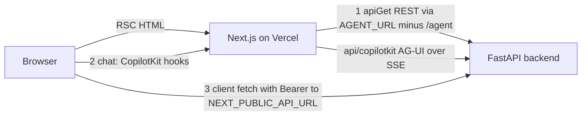

# Frontend

The frontend is a Next.js 16 / React 19 app (`frontend/`, deployed as the Vercel project `sangam`, region `bom1`; see `frontend/vercel.json`). It has **two separate paths to the FastAPI backend**, and which one a screen uses decides how auth, caching and failure behave. Backend counterparts are described in [Ask Sangam](ask-sangam.md), [Sangam Import / Scout](sangam-import-scout.md) and [Auth, roles and RLS](auth-roles-rls.md); the end-to-end turns are in [Ask turn](../workflows/ask-turn.md) and [Import turn](../workflows/import-turn.md).

> **The chat wire is still CopilotKit, despite the drop-CopilotKit plan.** `docs/features/2026-10-11-drop-copilotkit.md` plans to remove CopilotKit and have the browser speak AG-UI straight to `/agent` and `/ingest`. `docs/CHANGELOG.md` ("Not finished") records that only M1 (restart policy) and M2 (slimmer events, later regressed by #178) shipped; **M3 (drop CopilotKit from the frontend) and M4 (backend package) have not started**. `package.json` still depends on `@copilotkit/react-core` and `@copilotkit/runtime`, and `app/api/copilotkit/[[...slug]]/route.ts` still exists. Everything below describes the current wire; the plan is summarised at the end.

## Layout and ownership rules

| Folder | Holds |
|---|---|
| `app/` | Routes only: pages, layouts, route handlers. Nothing that is not a route belongs here. |
| `features/` | One folder per screen: `ask`, `auth`, `home`, `ingest`, `registry`, `resources`, `settings`, `taxonomy`, `terms`. |
| `components/` | `ui/` display primitives (and the `ListPage.tsx` list pattern) and `layout/` site chrome (`NavBar`, `Footer`). |
| `lib/` | `api/` (server REST client, types, auth headers), `supabase/`, `AgentProviders.tsx`, `useAgentChat.ts`, `format.ts`, `safe-next-path.ts`. |

`docs/ARCHITECTURE.md` §9 states the rule: `app/` holds routes only and everything else goes in `features/`. Cross-folder imports use the `@/` alias. `frontend/CLAUDE.md` is only a pointer to `docs/ARCHITECTURE.md` §9 and `docs/DESIGN_SYSTEM.md`.

Routes: `/` (home), `/ask` (workspace when signed in, preview when not), `/import` (Scout), `/registry`, `/registry/[slug]`, `/registry/funders/[slug]` and its `/brief`, `/resources/[tab]` (methodology, taxonomy), `/settings`, `/terms`, `/auth/*`, plus `/api/copilotkit/[[...slug]]`. The root layout only renders `NavBar`, `<main>` and `Footer`; there is no global provider, so the agent provider is mounted per screen.

## The two paths to the backend

Caption: server components call REST directly, chat goes through the Next proxy route, and client components also call REST straight from the browser.

1. **Server components, REST.** `lib/api/client.ts` exports `apiGet`, used by pages such as `/ask`, `/registry` and the profile pages. Its base URL is `AGENT_URL` with the trailing `/agent` stripped, falling back to `NEXT_PUBLIC_API_URL`, then `http://localhost:8010`. It attaches the signed-in user's Supabase token (`auth-headers.server.ts`) and throws `NotFoundError` on 404, which pages turn into `notFound()`.
2. **Chat, via the proxy route.** The chat UI never calls the backend itself. `AgentProviders` points CopilotKit at `/api/copilotkit`; the route's `CopilotRuntime` registers two `HttpAgent`s from `@ag-ui/client`: `sangam_agent` → `AGENT_URL` (Ask, `/agent`) and `sangam_ingest` → the same URL with `/agent` replaced by `/ingest` (Import). The route uses an `InMemoryAgentRunner` and declares `maxDuration = 1800` to match `backend/vercel.json`, because an Import turn streams for 15–20 minutes.
3. **Client-side REST.** Anything a browser component needs after load (thread lists, history, Import panels, Funder Match, vault, settings) is a plain `fetch` to `NEXT_PUBLIC_API_URL` (default `http://localhost:8010`) with `authHeaders()`. Many modules re-declare the `API` constant locally; `features/ask/lib/rest.ts` provides the shared `call()` helper that throws `ApiError` carrying `status` and `body`.

### The `AGENT_URL` convention

`AGENT_URL` must **end in `/agent`** because the proxy route uses it verbatim for Ask and derives the Import URL by swapping the suffix; the REST client strips that suffix to get its base. `NEXT_PUBLIC_API_URL` has **no** `/agent` suffix and is the browser-side REST base. The asymmetry is deliberate (`CLAUDE.md`). In Docker compose `AGENT_URL=http://backend:8000/agent` (server-to-server) while `NEXT_PUBLIC_API_URL=http://localhost:8010` (what the browser can reach); `make dev-frontend` sets `AGENT_URL=http://localhost:8000/agent`. `AGENT_URL` is read only on the server; it is never exposed to the browser.

## Auth and headers

- **Session refresh and gating.** `proxy.ts` (the Next 16 replacement for middleware) runs `updateSession` from `lib/supabase/middleware.ts` on all paths except static assets and images. It creates a fresh Supabase server client per request, calls `getClaims()`, and redirects a signed-out visitor on `/import` (the only entry in `PROTECTED_PREFIXES`) to `/auth/login?next=…`. `/ask` is public by design. If `NEXT_PUBLIC_SUPABASE_URL` or `NEXT_PUBLIC_SUPABASE_PUBLISHABLE_KEY` is absent (a bare local run), `updateSession` returns `NextResponse.next` at once and gates nothing, so the public pages and the `/ask` preview still render. Nobody can sign in: `/ask` treats a failed Supabase client as signed out, and the sign-in dialog (`features/auth/login-form.tsx`) says the Supabase keys are not set and hides the Google button.
- **Where the token goes.** Server REST uses `serverAuthHeaders()`; browser REST uses `authHeaders()`; chat uses the token held by `AgentProviders`, which reads the session once and follows `onAuthStateChange`, passing `Authorization: Bearer <token>` as CopilotKit `headers`. The backend validates this one bearer token everywhere (see [Auth, roles and RLS](auth-roles-rls.md)).
- **Open-redirect guard.** `/auth/callback` exchanges the OAuth `code` for a session and uses `safeNextPath` so only same-origin paths are honoured.
- The `/import` route additionally validates `?thread=` against `^import-[0-9a-f-]{36}$` before reopening a thread.

## Caching

`apiGet` makes signed-out reads cacheable: in production (`NODE_ENV === "production"`), when no `Authorization` header exists, it fetches with `next: { revalidate: 300 }`, so anonymous registry pages come from Next's data cache and survive a cold backend. Signed-in requests, and all development requests, use `cache: "no-store"`. Pages that depend on the session (`/ask`, `/import`) set `dynamic = "force-dynamic"`. Client-side fetches are always `no-store`. A profile page makes one backend call (`/api/funders/{slug}/profile`).

## Ask workspace

`/ask` (`app/(agent)/ask/page.tsx`) checks `getClaims()` server-side. Signed out, it renders `AskPreview`: canned sample answers that cost no agent call; asking anything opens sign-in and parks the question in `sessionStorage` (`lib/pendingQuestion.ts`, read-once) so the workspace prefills it, never auto-sends. `?view=import` redirects to `/import`; `?q=` (e.g. from a Registry "Ask Sangam about…" button) seeds a fresh chat and is stripped from the URL after mount. Signed in, the page fetches orgs, funders, scores, partner lines and stats in parallel with `apiGet` and hands them to the workspace as an `IndexPayload`; the workspace uses it to resolve citations and show provenance without another round trip.

`WorkspaceLoader` wraps `SignedInWorkspace` in `next/dynamic`, so the workspace and the CopilotKit runtime under it download only when rendered; `SignedInWorkspace` mounts `AgentProviders` around `AskWorkspace`.

**Views are in-app state, not URLs.** `AskWorkspace` holds a `view` of type `WorkspaceView` (`ask`, `chats`, `funder-match`, `proposals`, `rfpwatch`, `vault`, `media`), plus `threadId`, the thread list and the latest turn. `ChatPane` is keyed by `threadId`, so picking or starting a chat remounts it. `rfpwatch` is a placeholder card with no data. The right-hand `EvidenceRail` shows the latest turn.

**Threads.** Each chat has a client-generated UUID. The thread list comes from `GET /api/threads` (`fetchThreads`), with `localStorage` (`sangam_threads_v1`) kept only as a title fallback and to show a just-started chat before its first turn reaches the server. A reopened chat loads `GET /api/threads/{id}/messages`; a 404 means an empty chat.

**One chat hook, two agents.** `lib/useAgentChat.ts` is shared by Ask (`useSangamChat` → `sangam_agent`, local agent id `sangam-chat-<thread>`) and Scout (`sangam_ingest`, `sangam-import-<thread>`). It wraps CopilotKit's `useAgent` (80 ms throttle) and returns `turns`, `send`, `stop`, `isRunning`, `isReady`, `isLoadingHistory`, `laneOwners`. Behaviour worth knowing:

- Messages are folded into `Turn`s: a user message opens a turn; assistant tool calls become `TraceStep`s whose result is the matching `tool` message (a step with no result while the run is live is "running"); assistant prose is the answer — **except** prose from a message with a `subagentRunId`, which is a subagent's working and is dropped from the answer.
- `laneOwners` maps a subagent run to the `task` tool call that spawned it, built from `onSubagentStartedEvent`; it exists only for live runs, not for reloaded threads.
- History is loaded only after the agent is `isReady` and only if it has no messages, because messages set on the provisional agent are dropped. Composers are disabled until ready and history loaded.
- `send` adds the user message locally and calls `copilotkit.runAgent`; `stop` calls `copilotkit.stopAgent`.

### Funder Match, Proposals, Vault, Media

These views use client REST (`call()`), not the agent. Funder Match (`views/funder-match/api.ts`) lists matches, fetches a detail, and POSTs a saved run; the backend decides who may run it. Lists across the app use the pattern in `components/ui/ListPage.tsx`: `BucketCards`, one `FilterRow` of dropdowns, a `SearchBox`, and `ListMore` with `useShowMore` (client-side paging) or `useCursorList` (server keyset paging). `CLAUDE.md` and `docs/ARCHITECTURE.md` §9 require a new list page to reuse it rather than invent its own pills or stats.

**Proposals are browser-only and partly built.** `views/proposals/store.ts` keeps proposals in `localStorage` under `sangam.proposals.v1` with a module-level cache, a listener set and `useSyncExternalStore`, so tabs stay in sync via the `storage` event; a storage failure (private window, full disk) only loses persistence after reload. A `proposals` table exists (migration `0009`, with grants and RLS policies), but no backend code reads or writes it, and the SQL catalog keeps it in `KNOWN_EXCLUDED`. So proposals live only in this browser, and another person or device never sees them. A proposal is started from a Funder Match card by `start.ts`, which snapshots the saved match detail into its gates (G1/G2) and looks up a funder proposal template. `ProposalShell` implements stepper steps 1 (gates) and 2 (sources); step 3 (`SectionsStep`) is a read-only placeholder. Drafting, section editing and assembly are not built (`docs/CHANGELOG.md`: PRs 4–5 outstanding).

## Import / Scout UI

`/import` (`app/(agent)/import/page.tsx`) is `force-dynamic` and renders `ImportLoader`, which lazy-loads `ImportPage` with `ssr: false` (it reads the screen width). `ImportPage` mounts `AgentProviders` and `ImportShell`, which owns the open thread id (`import-<uuid>`), mirrors it into `?thread=` with `history.replaceState`, lists past runs (`GET /api/ingest/threads`), and keeps a just-started thread listed until the server lists it (it re-fetches 3 s after the first send, since the server titles the thread when the run starts).

`ImportView` loads the page's panels with **one** request, `GET /api/ingest/overview` (research done recently, sources, runs, queue, proposals, access, vault files), because separate calls could each hit a cold backend instance. It derives `ImportAccess` from `me` and passes it to `ScoutChat`; the signed-out-style default is "funders only". Staff additionally see "Team tools" (source groups, run history, proposals).

`ScoutChat` is the one component that holds the Import conversation:

- **Start → Working → Review → Done.** Before the first turn it shows task cards (research a funder, check an NGO, latest news; filtered by `tasksFor(access)`) over the composer. After that, the step shown in `StepBar`/`ScoutRunPanel` is derived from `isRunning`, whether a review card is open, and counts reported by `DoneReport`. `WorkingBoard` renders researcher lanes from `boardOf(steps, …, laneOwners)`.
- **Pause cards.** The backend pauses the run with an interrupt, and three components answer it via CopilotKit's `useInterrupt`: `SourcesCard` (`choose_sources`, or auto-answered from a `preset` chosen on the Start step), `SaveQuestions` (`promote_research`, rendering `ReviewCard`; it resolves with `{decisions, slug}` so several parallel writers paused at once can be addressed by slug), and `ImportApproval` (`run_import_now`, with a news-plan line from `/api/ingest/news-runs/plan`). They render with `renderInChat: false` into a single DOM node that `ScoutChat` portals into whichever layout is visible, because a run keeps only the listeners it started with. Each card mounts `PauseSignal`, which tells the parent a question is open.
- **Stuck detection.** `useRunPause` subscribes to the agent for the interrupt custom event and `RunFinished` with outcome `interrupt`, recording the tool awaited. If the run is idle, no card reported itself open, and a pause is recorded, the composer disables itself with "waiting for you … but the card did not open. Start a new chat".
- **Ticked sources.** Sources ticked before the first message are sent as AG-UI context via `useAgentContext` with the exact description `"Sources the person ticked for this Import run"`; the backend's `TickedSources` middleware matches that string, so changing it silently makes the supervisor re-ask.
- **Mid-run questions.** While the run is going, a message is *not* sent to the agent: `askLive` POSTs `/api/ingest/threads/{id}/ask-live` with the question and the lane/tool state, and the backend answers from run state. If it classifies the text as an instruction, it is held and sent as the next message once the run has ended and no card is open (after a 300 ms settle).

## Design rules

- The Claude Design project "Sangam Design System v2" is the system of record; a PR that changes `frontend/components/` or a screen the UI kit recreates updates it in the same PR. `docs/DESIGN_SYSTEM.md` maps design-system files to repo files and gives the manual sync procedure.
- Tokens are CSS variables in `app/globals.css` with the same names as the design system; styles go in classes there rather than inline `style={{}}` (older code such as `AskWorkspace` and `RfpWatchView` still has inline styles).
- Corners: pill for buttons/chips/single-line inputs, 14 px (`--radius-surface`) for cards and dialogs, 8 px (`--radius-row`) for rows. Type sizes only 12/14/16/20/24/36 (`--fs-*`). Text must meet WCAG AA; terracotta text is `--color-accent-750`. Icons are Lucide, styled by `.icon` classes. One `--page-max` (1160 px) column.
- Wording: "CSO" in data/registry UI, "NGO" in marketing copy, "vetted" not "hand-vetted".
- Reuse an existing token or component before asking the design system for a new one. Verification for UI changes is `npm run lint`, `npm run build`, then `make smoke`; there are no frontend unit tests.

## Planned change: dropping CopilotKit (not shipped)

The plan's motive is operational: the relay's `InMemoryAgentRunner` buffers every event of a running stream, and each event carries a copy of its LangGraph source event, so a 30-minute 8-organisation Import ran the Next.js process out of memory and the backend then cancelled the run on "client disconnected". M3 would add `lib/agui/{AgentProvider,useAgent,useInterrupt}` over `@ag-ui/client`'s `HttpAgent`, point it at `NEXT_PUBLIC_API_URL + "/agent"` or `"/ingest"`, keep `useAgentChat`'s return shape so Ask and Scout do not change, delete the proxy route and both CopilotKit packages, and send ticked sources as the `context` field of a run. The trade-off accepted: a reload mid-run shows the saved checkpoint instead of rejoining a relay buffer. `AGENT_URL` would remain only as the server REST base. Until that lands, any change to the chat path must account for the proxy route, its 1800 s `maxDuration` and the `AGENT_URL` suffix rule.

## Gotchas for changes

- A new route-level page needing the user's data should be `force-dynamic` and use `apiGet`; anonymous-cacheable pages must not depend on the session, because `revalidate: 300` is applied exactly when there is no `Authorization` header.
- New browser fetches should use `authHeaders()` with `NEXT_PUBLIC_API_URL`; never put the token in a server-cached request.
- Anything that wraps the agent hooks needs `AgentProviders` above it, and the agent must be registered (`isReady`) before `useInterrupt` cards are mounted — `ScoutChat` renders them only once `isReady`.
- `@ag-ui/client` is pinned at `0.0.59` for CopilotKit's types; bumping it may change `subagentRunId` on messages or the `onSubagentStartedEvent` callback that the lane board depends on.
- Thread ids differ by product: Ask uses a bare UUID, Import uses `import-<uuid>`; the Import URL validator depends on that.
