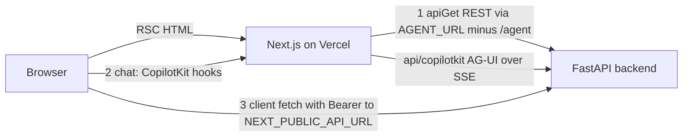

# Frontend

The frontend is a Next.js 16 / React 19 app (`frontend/`, deployed as the Vercel project `sangam`, region `bom1`; see `frontend/vercel.json`). It has **two separate paths to the FastAPI backend**, and which one a screen uses decides how auth, caching and failure behave. Backend counterparts are described in [Ask Sangam](ask-sangam.md), [Sangam Import / Scout](sangam-import-scout.md), [Funder Match](funder-match.md), [Proposal Copilot](proposal-copilot.md) and [Auth, roles and RLS](auth-roles-rls.md); the end-to-end turns are in [Ask turn](../workflows/ask-turn.md), [Import turn](../workflows/import-turn.md) and [Proposal lifecycle](../workflows/proposal-lifecycle.md).

> **The chat wire is still CopilotKit, despite the drop-CopilotKit plan.** `docs/features/2026-10-11-drop-copilotkit.md` plans to remove CopilotKit and have the browser speak AG-UI straight to the backend. `docs/CHANGELOG.md` ("Not finished") records that only M1 (restart policy) and M2 (slimmer events, later regressed by #178) shipped; **M3 (drop CopilotKit from the frontend) and M4 (backend package) have not started**. `package.json` still depends on `@copilotkit/react-core` and `@copilotkit/runtime`, `AgentProviders` still mounts `CopilotKitProvider`, and `app/api/copilotkit/[[...slug]]/route.ts` still exists. Everything below describes the current wire; the plan is summarised at the end.

## Layout and ownership rules

| Folder | Holds |
|---|---|
| `app/` | Routes only: pages, layouts, route handlers. Nothing that is not a route belongs here. |
| `features/` | One folder per screen: `ask`, `auth`, `home`, `ingest`, `registry`, `resources`, `settings`, `taxonomy`, `terms`. |
| `components/` | `ui/` display primitives (and the `ListPage.tsx` list pattern) and `layout/` site chrome (`NavBar`, `Footer`). |
| `lib/` | `api/` (server REST client, types, auth headers), `supabase/`, `devAuth.ts`, `AgentProviders.tsx`, `useAgentChat.ts`, `format.ts`, `safe-next-path.ts`. |

`docs/ARCHITECTURE.md` §9 states the rule: `app/` holds routes only and everything else goes in `features/`. Cross-folder imports use the `@/` alias. `frontend/CLAUDE.md` is only a pointer: to this page for facts, to `docs/ARCHITECTURE.md` §9 for rules and to `docs/DESIGN_SYSTEM.md` for any UI change.

Routes: `/` (home), `/ask` (workspace when signed in, preview when not), `/import` (Scout), `/registry`, `/registry/[slug]` and its `/brief`, `/registry/funders/[slug]` and its `/brief`, `/resources/[tab]` (methodology, taxonomy), `/settings`, `/terms`, `/auth/*`, plus `/api/copilotkit/[[...slug]]`. Several legacy paths are bare redirects: `/funders` → `/registry?type=funder`, `/orgs` → `/registry?type=cso`, `/methodology` and `/resources` → `/resources/methodology`, `/taxonomy` → `/resources/taxonomy` (keeping its anchor), `/privacy` → `/terms#t-collect`. The root layout only renders `NavBar`, `<main>` and `Footer`; there is no global provider, so the agent provider is mounted per screen.

## The two paths to the backend

Caption: server components call REST directly, chat goes through the Next proxy route, and client components also call REST straight from the browser.

1. **Server components, REST.** `lib/api/client.ts` exports `apiGet`, used by pages such as `/ask`, `/import`, `/registry` and the profile pages. Its base URL is `AGENT_URL` with the trailing `/agent` stripped, falling back to `NEXT_PUBLIC_API_URL`, then `http://localhost:8010`. It attaches the signed-in user's token (`serverAuthHeaders()` in `auth-headers.server.ts`: the Supabase session's access token, or the dev cookie in local dev-login mode) and throws `NotFoundError` on 404, which pages turn into `notFound()`.
2. **Chat, via the proxy route.** The chat UI never calls the backend itself. `AgentProviders` points CopilotKit at `/api/copilotkit`; the route's `CopilotRuntime` registers three `HttpAgent`s from `@ag-ui/client`: `sangam_agent` → `AGENT_URL` (Ask, `/agent`), `sangam_ingest` → the same URL with `/agent` replaced by `/ingest` (Import) and `sangam_proposal` → `/proposal` (the per-proposal Sangam Pitch chat). The route uses an `InMemoryAgentRunner` and declares `maxDuration = 1800` to match `backend/vercel.json`, because an Import turn streams for 15–20 minutes.
3. **Client-side REST.** Anything a browser component needs after load (thread lists, history, Import panels, Funder Match, proposals, vault, settings) is a plain `fetch` to `NEXT_PUBLIC_API_URL` (default `http://localhost:8010`) with `authHeaders()`. Many modules re-declare the `API` constant locally; `features/ask/lib/rest.ts` provides the shared `call()` helper (JSON in/out) that throws `ApiError` carrying `status` and `body`, so callers can act on a 409's detail.

### The `AGENT_URL` convention

`AGENT_URL` must **end in `/agent`** because the proxy route uses it verbatim for Ask and derives the Import and Proposal URLs by swapping the suffix; the REST client strips that suffix to get its base. `NEXT_PUBLIC_API_URL` has **no** `/agent` suffix and is the browser-side REST base. The asymmetry is deliberate (`CLAUDE.md`). In Docker compose `AGENT_URL=http://backend:8000/agent` (server-to-server) while `NEXT_PUBLIC_API_URL=http://localhost:8010` (what the browser can reach); `make dev-frontend` sets `AGENT_URL=http://localhost:8000/agent`. `AGENT_URL` is read only on the server; it is never exposed to the browser.

## Auth and headers

- **Session refresh and gating.** `proxy.ts` (the Next 16 replacement for middleware) runs `updateSession` from `lib/supabase/middleware.ts` on all paths except static assets and images. It creates a fresh Supabase server client per request, calls `getClaims()`, and redirects a signed-out visitor on `/import` (the only entry in `PROTECTED_PREFIXES`) to `/auth/login?next=…`. `/ask` is public by design.
- **Missing Supabase keys.** If `NEXT_PUBLIC_SUPABASE_URL` or `NEXT_PUBLIC_SUPABASE_PUBLISHABLE_KEY` is absent (a bare local run), `updateSession` returns `NextResponse.next` at once and gates nothing, so the public pages and the `/ask` preview still render. Nobody can sign in: `/ask` treats a failed Supabase client as signed out (`isSignedIn()` catches the error and returns false), and the sign-in dialog (`features/auth/login-form.tsx`) says the Supabase keys are not set and hides the Google button.
- **Local dev login.** `DEV_LOGIN` in `lib/devAuth.ts` is true only when `NEXT_PUBLIC_SUPABASE_URL` is unset **and** `NEXT_PUBLIC_DEV_AUTH=1`. The navbar sign-in button then becomes a `<select>` of the seeded `admin`/`steward`/`member`/`stranger@local.test` users, which writes the `sangam-dev-as` cookie, and `/ask`, `serverAuthHeaders()`, `authHeaders()` and `AgentProviders` use `Bearer dev:<email>` instead of a Supabase token (no cookie means no header). A backend honours it only with `SUPABASE_URL` unset and `DEV_AUTH` on; see [Auth, roles and RLS](auth-roles-rls.md).
- **Where the token goes.** Server REST uses `serverAuthHeaders()`; browser REST uses `authHeaders()`; chat uses the token held by `AgentProviders`, which reads the session once, follows `onAuthStateChange`, and passes `Authorization: Bearer <token>` as the `CopilotKitProvider` `headers`. The backend validates this one bearer token everywhere.
- **Open-redirect guard.** `/auth/callback` exchanges the OAuth `code` for a session and uses `safeNextPath` so only same-origin paths are honoured.
- **Route-level role gate.** `/import` also calls `/api/me` on the server: a visitor who is neither staff nor a steward of any org (`canUseScout`) is redirected to `/ask`. The screen only shapes itself from this; the backend checks again.

## Caching

`apiGet` makes signed-out reads cacheable: in production (`NODE_ENV === "production"`), when no `Authorization` header exists, it fetches with `next: { revalidate: 300 }`, so anonymous registry pages come from Next's data cache and survive a cold backend. That request carries an `x-sangam-build` header (the Vercel deployment id or commit SHA) so the cache key changes on every deploy and a new deploy never renders the previous one's API shapes. Signed-in requests, and all development requests, use `cache: "no-store"`. Pages that depend on the session (`/ask`, `/import`) set `dynamic = "force-dynamic"`. Client-side fetches are always `no-store`. A profile page makes one backend call (`/api/funders/{slug}/profile` or `/api/orgs/{slug}/profile`).

## Registry profiles

`/registry/[slug]` (CSO) and `/registry/funders/[slug]` (funder) are server components that fetch the single profile payload with `apiGet`, turn `NotFoundError` into `notFound()`, and `permanentRedirect` to the canonical slug when the profile was asked for by id. Each renders a shared `ProfileHero` (with an "Ask Sangam about…" link into `/ask?q=…` and a brief link when a brief exists) above a client tab component in `features/registry/profile/`: `OrgProfileTabs` (Overview, Programmes & places, Funding, News & social, Research & sources) or `FunderProfileTabs` (Mandate, Giving, Reach, News & social, Research & sources). Tab state is local `PillTabs` state, not the URL, and the tabs only receive slices of the already-loaded profile, so switching tabs makes no request.

## Ask workspace

`/ask` (`app/(agent)/ask/page.tsx`) checks the session server-side (`getClaims()`, or the dev cookie in dev-login mode). Signed out, it renders `AskPreview`: canned sample answers that cost no agent call; asking anything opens sign-in and parks the question in `sessionStorage` (`lib/pendingQuestion.ts`, read-once) so the workspace prefills it, never auto-sends. `?view=import` redirects to `/import`; `?q=` (e.g. from a Registry "Ask Sangam about…" button) seeds a fresh chat and is stripped from the URL after mount. Signed in, the page fetches orgs, funders, scores, partner lines, stats and `/api/me` in parallel with `apiGet` and hands them to the workspace as an `IndexPayload`; the workspace uses it to resolve citations and show provenance without another round trip, and `canScout` (from `/api/me`, failure treated as false) decides whether the sidebar offers Scout.

`WorkspaceLoader` wraps `SignedInWorkspace` in `next/dynamic`, so the workspace and the CopilotKit runtime under it download only when rendered; `SignedInWorkspace` mounts `AgentProviders` around `AskWorkspace`.

**Views are in-app state, not URLs.** `AskWorkspace` holds a `view` of type `WorkspaceView` (`ask`, `chats`, `funder-match`, `proposals`, `rfpwatch`, `vault`, `media`), plus `threadId`, the thread list and the latest turn. `ChatPane` is keyed by `threadId`, so picking or starting a chat remounts it. `rfpwatch` is a placeholder card with no data. The right-hand `EvidenceRail` shows the latest turn. The sidebar shows the proposal count from `useProposals()`, and a Funder Match card can jump into Proposals with a `{id}` or `{funderId}` target; a changing `key` remounts `ProposalsView` on that target.

**Threads.** Each chat has a client-generated UUID. The thread list comes from `GET /api/threads` (`fetchThreads`), with `localStorage` (`sangam_threads_v1`) kept only as a title fallback and to show a just-started chat before its first turn reaches the server. A reopened chat loads `GET /api/threads/{id}/messages`; a 404 means an empty chat.

**One chat hook, three agents.** `lib/useAgentChat.ts` is shared by Ask (`useSangamChat` → `sangam_agent`, local agent id `sangam-chat-<thread>`), Scout (`sangam_ingest`, `sangam-import-<thread>`) and the proposal chat (`sangam_proposal`, `proposal-chat-<thread>`). It takes `(threadId, runtimeAgentId, prefix, loadHistory?)`, wraps CopilotKit's `useAgent` (80 ms throttle) and returns `turns`, `send`, `stop`, `isRunning`, `isReady`, `isLoadingHistory`, `laneOwners`. Behaviour worth knowing:

- Messages are folded into `Turn`s: a user message opens a turn; assistant tool calls become `TraceStep`s whose result is the matching `tool` message (a step with no result while the run is live is "running"); assistant prose is the answer — **except** prose from a message with a `subagentRunId`, which is a subagent's working and is dropped from the answer.
- `laneOwners` maps a subagent run to the `task` tool call that spawned it, built from `onSubagentStartedEvent`; it exists only for live runs, not for reloaded threads.
- History is loaded only after the agent is `isReady` and only if it has no messages, because messages set on the provisional agent are dropped. Composers are disabled until ready and history loaded.
- `send` adds the user message locally and calls `copilotkit.runAgent`; `stop` calls `copilotkit.stopAgent`.

### Funder Match, Vault, Media

These views use client REST (`call()`), not the agent. Funder Match (`views/funder-match/api.ts`) lists matches, fetches a detail, and POSTs a saved run; the backend decides who may run it, and the list's `may_run` flag becomes `mayStart` on each card, so members only view proposals. Lists across the app use the pattern in `components/ui/ListPage.tsx`: `BucketCards`, one `FilterRow` of dropdowns, a `SearchBox`, and `ListMore` with `useShowMore` (client-side paging) or `useCursorList` (server keyset paging). `CLAUDE.md` and `docs/ARCHITECTURE.md` §9 require a new list page to reuse it rather than invent its own pills or stats.

### Proposals

Proposals are **server-backed**, shared by everyone in the organisation, and drafted through the `/proposal` agent; the earlier browser-only version (`store.ts`, `start.ts`, `localStorage`) no longer exists. The backend side is described in [Proposal Copilot](proposal-copilot.md) and [Proposal lifecycle](../workflows/proposal-lifecycle.md).

**State.** `views/proposals/api.ts` is the one client module. It keeps a module-level list of `ProposalItem` rows loaded from `GET /api/proposals` (every proposal the caller may read) behind `useSyncExternalStore`: the first subscriber triggers `reloadProposals()`, a failed load leaves an empty list, and every mutation (`startProposal`, `saveWork`, `rename`, `advance`, `saveVersion`) calls it again. The workspace count, Funder Match cards and the list all read this one cache. The only browser storage left is `hadBrowserProposals()`, which reads the legacy `sangam.proposals.v1` key; if it holds anything, `ProposalsView` shows a notice that those proposals are not shown and must be started again from Funder Match. Nothing is migrated.

**Start and list.** A proposal is started from a Funder Match card: `MatchCard` asks for a name and calls `startProposal(org, funderId, title)` (`POST /api/proposals`), then opens it. `ProposalList` filters the cached rows client-side (bucket All / In progress / Ready, funder, organisation, started-in-last-N-days, search) with `useShowMore`.

**The shell and its steps.** `ProposalShell` loads one proposal with `GET /api/proposals/{id}` and renders a four-step stepper (`steps.ts`: *Can you apply?*, *Your documents and style*, *Write the proposal*, *Before you send it*). The server owns the step number (`work.stage`); the screen never advances itself. Every edit is a `PATCH /api/proposals/{id}/work` with dotted keys (`gates.<key>`, `sources`, `style`, `sections.<code>.text`, `facts.<k>.status`, …) and the response replaces `work` and `summary`. "Continue" calls `POST …/advance`; it is disabled while `summary.to_continue` is non-empty, and a 409 whose detail lists `missing` is shown as "To continue: …". Going back to an earlier step is allowed, forward only through Continue.

- Step 1 (`GatesStep`): each funder requirement is answered Yes / We'll have it / No; a hard requirement answered No shows a stop line.
- Step 2 (`SourcesStep`): the funder's form (uploaded to the Doc Vault, or "use Sangam's usual order"), the org's vault files to tick, and the writing style. The `Reading` card lists each file's reader (running / done / failed with "Try again"); "Write the first draft" and "Read the files again" are fixed messages sent to the proposal chat, which calls the reading tool.
- Step 3 (`SectionsStep`): the funder template's tabs and parts; each part is a text box with numbered `[1]` source marks that `PartEditor` maps back to fact keys (`⟦k7⟧`), autosaved about 1.5 s after typing together with the part's `rev`. A 409 means someone else (a teammate or Sangam Pitch) saved first: the box takes their text and the person's own is kept beneath it to copy from. Elsewhere in the shell a 409 shows "<name> changed this … Showing their version" and reloads the proposal. Facts for the part are in a disclosure (`FactList`); a "Write <tab>" button asks the agent to draft it.
- Step 4 (`FinishStep`): *Fix first* and *Worth checking* lists, every fact the text uses with Confirm all, and `FinishCard`: "Smooth the language" (`POST …/polish`, refused with a 409 list of differences when a figure, place, name or gap changed) and "Download as a Word file" (`POST …/versions`, which saves the next version to the Doc Vault and opens a short-lived link from `/api/documents/{id}/file`). Sangam never sends anything to the funder.

**Concurrency and roles.** `can_edit` from the server turns the whole screen read-only for members ("Ask your organisation's admin…") and hides the chat. While any reader is running, or the proposal is at step 2+ and the chat is not yet ready to send, the shell polls the proposal every 5 s so teammates see reading progress; `TellSangam` also reloads it when a chat turn ends, since a turn may have saved or moved the step.

**The proposal chat (`TellSangam`, "Sangam Pitch").** It floats beside the steps and uses `useAgentChat(proposal.thread_id, "sangam_proposal", "proposal-chat", …)`. The thread id is per user (`proposal-<id>-<user id>`), so each editor has a private chat; history comes from `GET /api/proposals/{id}/messages` (404 → empty). It sends the current screen (step, selected text, open part) as AG-UI context under the exact description `"What the person is looking at"`, which the backend's `ProposalContext` looks up, and it hides `⟦k…⟧` fact marks in answers. `QuestionCard` answers the agent's interrupts through `useInterrupt` (`renderInChat: false`) for `proposal_question` and `proposal_suggestion` payloads; a reply comes from the card's buttons ("Later" frees the question) or from the chat box. Step buttons can send fixed messages only while the chat is ready, no turn is running and no question is open.

## Import / Scout UI

`/import` (`app/(agent)/import/page.tsx`) is `force-dynamic`, redirects people who may not use Scout to `/ask`, validates `?thread=` against `^import-[0-9a-f-]{36}$`, and renders `ImportLoader`, which lazy-loads `ImportPage` with `ssr: false` (it reads the screen width). `ImportPage` mounts `AgentProviders` and `ImportShell`, which owns the open thread id (`import-<uuid>`), mirrors it into `?thread=` with `history.replaceState`, lists past runs (`GET /api/ingest/threads`), and keeps a just-started thread listed until the server lists it (it re-fetches 3 s after the first send, since the server titles the thread when the run starts).

`ImportView` loads the page's panels with **one** request, `GET /api/ingest/overview` (research done recently, sources, runs, queue, source proposals, access, vault files), because separate calls could each hit a cold backend instance. It derives `ImportAccess` from the overview's `me` and passes it to `ScoutChat`; until the overview answers the access is empty (`NO_ACCESS`), so no task cards are offered. `tasksFor(access)` then gives staff funder / NGO / news, stewards funder / NGO, anyone else none. Staff additionally see "Team tools" (source groups, run history, source proposals — unrelated to grant Proposals).

`ScoutChat` is the one component that holds the Import conversation:

- **Start → Working → Review → Done.** Before the first turn it shows task cards (research a funder, check an NGO, latest news; filtered by `tasksFor(access)`) over the composer. After that, the step shown in `StepBar`/`ScoutRunPanel` is derived from `isRunning`, whether a review card is open, and counts reported by `DoneReport`. `WorkingBoard` renders researcher lanes from `boardOf(steps, …, laneOwners)`.
- **Pause cards.** The backend pauses the run with an interrupt, and three components answer it via CopilotKit's `useInterrupt`: `SourcesCard` (`choose_sources`, or auto-answered from a `preset` chosen on the Start step), `SaveQuestions` (`promote_research`, rendering `ReviewCard`; it resolves with `{decisions, slug}` so several parallel writers paused at once can be addressed by slug), and `ImportApproval` (`run_import_now`, with a news-plan line from `/api/ingest/news-runs/plan`). They render with `renderInChat: false` into a single DOM node that `ScoutChat` portals into whichever layout is visible, because a run keeps only the listeners it started with. Each card mounts `PauseSignal`, which tells the parent a question is open.
- **Stuck detection.** `useRunPause` subscribes to the agent for the interrupt custom event and `RunFinished` with outcome `interrupt`, recording the tool awaited. If the run is idle, no card reported itself open, and a pause is recorded, the composer disables itself with "waiting for you … but the card did not open. Start a new chat".
- **Ticked sources.** Sources ticked before the first message are sent as AG-UI context via `useAgentContext` with the exact description `"Sources the person ticked for this Import run"`; the backend's `TickedSources` middleware matches that string, so changing it silently makes the supervisor re-ask.
- **Mid-run questions.** While the run is going, a message is *not* sent to the agent: `askLive` POSTs `/api/ingest/threads/{id}/ask-live` with the question and the lane/tool state, and the backend answers from run state. If it classifies the text as an instruction, it is held and sent as the next message once the run has ended and no card is open (after a 300 ms settle).

## Design rules

- The Claude Design project "Sangam Design System v2" is the system of record; a PR that changes `frontend/components/` or a screen the UI kit recreates updates it in the same PR. `docs/DESIGN_SYSTEM.md` maps design-system files to repo files and gives the manual sync procedure.
- Tokens are CSS variables in `app/globals.css` with the same names as the design system; styles go in classes there rather than inline `style={{}}` (older code such as `AskWorkspace` and `RfpWatchView` still has inline styles).
- Corners: pill for buttons/chips/single-line inputs, 14 px (`--radius-surface`) for cards and dialogs, 8 px (`--radius-row`) for rows. Type sizes only 12/14/16/20/24/36 (`--fs-*`). Text must meet WCAG AA; terracotta text is `--color-accent-750`. Icons are Lucide, styled by `.icon` classes. One `--page-max` (1160 px) column.
- Wording: "CSO" in data/registry UI, "NGO" in marketing copy, "vetted" not "hand-vetted".
- Reuse an existing token or component before asking the design system for a new one. Verification for UI changes is `npm run lint`, `npm run build`, then `make smoke`; there are no frontend unit tests.

## Planned change: dropping CopilotKit (not shipped)

The plan's motive is operational: the relay's `InMemoryAgentRunner` buffers every event of a running stream, and each event carries a copy of its LangGraph source event, so a 30-minute 8-organisation Import ran the Next.js process out of memory and the backend then cancelled the run on "client disconnected". M3 would add `lib/agui/{AgentProvider,useAgent,useInterrupt}` over `@ag-ui/client`'s `HttpAgent`, point it at `NEXT_PUBLIC_API_URL + "/agent"` or `"/ingest"`, keep `useAgentChat`'s return shape so Ask and Scout do not change, delete the proxy route and both CopilotKit packages, and send ticked sources as the `context` field of a run. The trade-off accepted: a reload mid-run shows the saved checkpoint instead of rejoining a relay buffer. `AGENT_URL` would remain only as the server REST base. The plan predates the proposal chat, so it does not cover `sangam_proposal`, `TellSangam` or `QuestionCard`, which also use CopilotKit hooks. Until M3 lands, any change to the chat path must account for the proxy route, its 1800 s `maxDuration` and the `AGENT_URL` suffix rule.

## Gotchas for changes

- A new route-level page needing the user's data should be `force-dynamic` and use `apiGet`; anonymous-cacheable pages must not depend on the session, because `revalidate: 300` is applied exactly when there is no `Authorization` header.
- New browser fetches should use `authHeaders()` with `NEXT_PUBLIC_API_URL`; never put the token in a server-cached request.
- Anything that wraps the agent hooks needs `AgentProviders` above it, and the agent must be registered (`isReady`) before `useInterrupt` cards are mounted — `ScoutChat` and `TellSangam` render them only once `isReady`.
- A new chat agent needs a registration in the proxy route, a matching `prefix`/`runtimeAgentId` pair for `useAgentChat`, and (if it reads screen context) an exact context description string shared with the backend.
- `@ag-ui/client` is pinned at `0.0.59` for CopilotKit's types; bumping it may change `subagentRunId` on messages or the `onSubagentStartedEvent` callback that the lane board depends on.
- Thread ids differ by product: Ask uses a bare UUID, Import uses `import-<uuid>`, proposals use `proposal-<id>-<user id>`; the Import URL validator depends on the Import shape.
