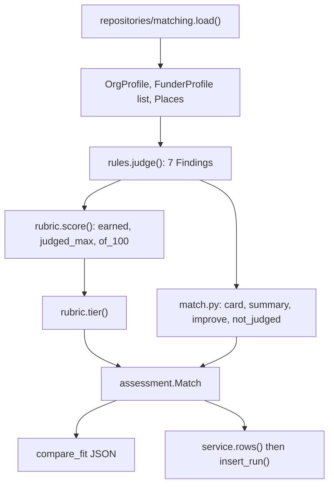
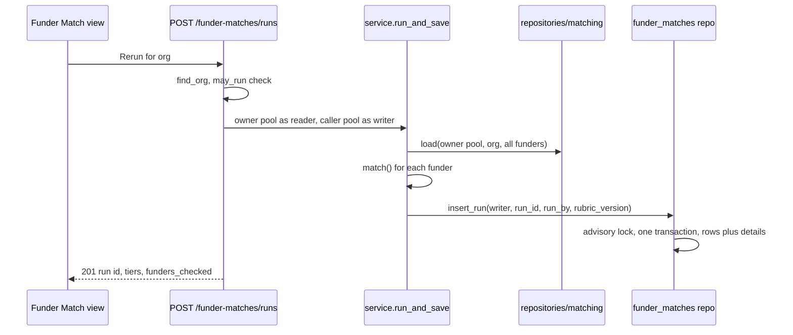

# Funder Match

Funder Match scores one organisation against funders under the **match-v2** rubric. **No model is involved in judging.** The same recorded rows always give the same score. A model's only job, in Ask, is to repeat what the tool returns. The rubric is pure Python over two in-memory profiles, and the result is saved or returned as JSON.

The code lives in `backend/app/matching/`. The SQL that fills the profiles is in `backend/app/repositories/matching.py`. Saved-run persistence is in `backend/app/repositories/funder_matches.py`.

## Where to change what

| You want to change | Edit | Why |
|---|---|---|
| How a criterion is judged (what counts as a shared theme, a held credential, a fit of grant size) | `matching/rules.py` | `rules.py` judges, and it also holds the spelling sets (`AUDIT_DOC_TYPES`, `HELD`, `LAPSED`, `SECTION_135_TYPES`). A new spelling seen in data is a one-line change there. |
| A point value, a maximum, a tier threshold, a fiscal-year window | `matching/rubric.py` | `rubric.py` only counts: `CRITERIA`, `THEME`, `GEOGRAPHY`, `STRONG`/`MEDIUM`, `FUNDING_*`, `CAPACITY_*`. |
| Card wording, the summary, tier words | `matching/match.py` | The write-up is built from templates, not generated text. |
| Which rows are read | `repositories/matching.py` | `rules.py` does not do I/O. |

`matching/CLAUDE.md` is now a short pointer: it says the facts (criteria, points, tiers, saved runs) live on this wiki page, the rules and decisions live in `docs/ARCHITECTURE.md` §5, a rule change goes in `rules.py`, a point value or tier in `rubric.py`, and `make wiki-update` should be run afterwards so this page is refreshed. If you change the arithmetic in a way that alters scores, consider whether `RUBRIC_VERSION` (`"match-v2"`) should change, because saved runs record the version they were made under.

## The pipeline

One `match()` call per org and funder pair, shown from profile loading to the two outputs.

### 1. Profile loading

`matching.load(pool, org_id, funder_ids, timeout_ms=5000)` reads everything in one read-only transaction: `SET TRANSACTION READ ONLY` plus `SET LOCAL statement_timeout`. These are the same guards as the SQL tools, because the pool is shared with the checkpointer, which writes. It returns `(OrgProfile | None, list[FunderProfile], Places)`.

- **Funder scope.** `funder_ids=None` means every funder. The same `(%(ids)s IS NULL OR col = ANY(%(ids)s))` plan serves one pair or the whole registry, so the query count is fixed.
- **Taxonomy.** A `Taxonomy` is built from `tags` of kind `domain`, `theme`, `sub_theme` and `csr_sector`, plus `tag_links` to Schedule VII clauses. A tag brings its ancestors (sub-theme, theme, domain). A sub-theme brings only its own clauses. A theme reaches every clause its sub-themes do. Darpan `sector` tags are left in the database and never read.
- **Org side.** It reads its own tags and every programme's tags, locations, identifiers (`org_identifiers`), financials, document types, and the `funder_activity` lines naming it as `partner_org_id`.
- **Funder side.** Its own tags, plus the domain, theme and clause classification of each of its `funder_activity` lines, so a classified spend line says what the funder funds. Places come from `funder_locations` plus `footprint` activity lines. The `registered` role goes to `registered_ids`, because where a funder is registered is not where it gives. Spend lines carry an amount and fiscal year. The "Its own bar" and "Disqualifiers" paragraphs of its `funder_eligibility` document become `bars`.
- **`may_run(pool, user_id, org_id)`.** It returns true for staff, or an `admin` or `steward` of that org. It mirrors the RLS insert rule below.

### 2. Rules (`rules.py`)

`judge()` returns one `Finding` per criterion in the rubric's fixed order. Each wraps a `Criterion` (code, points, note, cites) with the card line, `improve` actions and `not_judged` text.

| Criterion | Max | How it is judged |
|---|---|---|
| theme | 25 | Finest shared grain wins: theme or sub-theme 25, Schedule VII clause 15, domain 10. If no programme carries the shared grain, points are capped at `THEME_NO_PROGRAMME` (15) and an action says how to raise them. `domain-others` is excluded from the domain grain, so a side whose only theme is "Others" counts as not recorded. |
| geography | 15 | Shared district 15, shared state 12 (a district's state is its parent), funder gives across India 6, funder region containing an org state 6. Zero when both sides have places and none are shared. Unknown when a side has none, or when a funder region has no recorded member states, because it can neither match nor rule out. |
| population | 15 | All or nothing: any shared population tag gets 15, both sides recorded with none shared gets 0, otherwise unknown. |
| eligibility | 20 | Counts held items among 12A, 80G, audited accounts (three audited years or three audit documents), and CSR Form 1 only when the funder is `corporate_csr`/`corporate_foundation` or `section_135_bound`. Points are `20 × held / counted`. Lapsed or expired credentials count as missing. Conflicting rows or an unreadable registry are `unreadable`, so they are left out of the count and listed in `not_judged`. A "claimed" credential counts as held and says so. The funder's own bar paragraphs are listed in `not_judged` for human review and never scored. |
| relationship | 10 | A confirmed partner line from this funder gets 10. A line with status `unconfirmed` gets 5. No line gets 0, with an action to record contact. |
| funding_size | 10 | Needs a funder grant range and the org's latest `total_income`, else unknown. The smallest grant at or below income gets 10, up to `FUNDING_STRETCH` (2×) income gets 5, above that 0. |
| capacity | 5 | Spend recorded in the last three completed Indian fiscal years (April start): 5 for all three years, 3 for some, unknown for none. |

Two invariants make the results trustworthy:

- **Unknown is never zero.** A criterion with `points=None` is excluded from both earned and possible points. The summary says it was "left out rather than scored as zero". The rule is the same in every criterion: absent data is `None`, and only a recorded mismatch is `0`.
- **A judged verdict must cite its rows.** `Criterion` validates that points are within `0..max`. It also requires `cites` markers such as `[org:9]`, `[funder:7]` or `[activity:3]` whenever points are set. The only exception is a zero for relationship, where the finding is that nothing is recorded. `status` (`met` at 80% of max, `partial`, `fail`, `unknown`) is a computed field of points, so it cannot disagree with the arithmetic.

### 3. Rubric, score and tiers (`rubric.py`)

`score()` returns `None` when neither `theme` nor `geography` earned any points. With no shared place or theme there is nothing to score on, and the pair is **not scored**. Otherwise `of_100 = round(100 × earned / judged_max)`. Tiers are `strong` at 75 or more, `medium` at 55 or more, `weak` below that, and `not_scored` when there is no score.

`assessment.Match` computes `score` and `tier` from its criteria and rejects a criteria list that is not every rubric criterion, once, in rubric order. A not-scored match gets a single card line ("No shared place or theme recorded") and no `improve` actions. Otherwise the card has up to two best "fit" lines and the two biggest "gap" lines.

## Saved runs

A run is read as the owner and written as the caller, under that caller's RLS.

`service.run_and_save(reader, writer, org_id, run_by)` reads as the owner, so every runner judges identical inputs regardless of who they are. It writes as `writer`, under that writer's RLS. It then returns the run id, time, rubric version, funders checked and a tier count.

`rows()` turns each match into a `funder_matches` row (nullable `score`, `card` JSON) and a `funder_match_details` payload. The detail holds the summary, criteria, score, `not_judged` and `improve`. Not-scored rows carry empty criteria and empty `not_judged`.

`funder_matches.insert_run` writes all rows of one run in one transaction. It first takes `pg_advisory_xact_lock(4104, org_id)`, so only one run per org is written at a time. Every row shares one `run_at`, which is the transaction's `now()`. A rerun adds a new `run_id` and never edits old rows.

### Schema and RLS (`db/migrations/0042_funder_matches.sql`)

- `funder_matches` has one row per org, funder and run (`UNIQUE (run_id, funder_id)`) and an index on `(org_id, run_at DESC)`. `score` is `smallint` 0–100, with NULL meaning "checked, nothing to score on". `run_by` is NULL for `make match`. `rubric_version` is stored per row. `funder_match_details` is keyed by `match_id` and holds the `detail` JSON.
- **Append-only.** `authenticated` gets only `SELECT, INSERT`. There is no `UPDATE` or `DELETE` grant, so a saved run cannot be edited by any role.
- **Read policy.** A row is readable when `org_id IN app.my_org_ids()` or the caller is staff. A detail row is readable exactly when its match is visible.
- **Insert policy.** `org_id IN app.my_match_org_ids()` (the new `SECURITY DEFINER` function listing orgs where the user is `admin` or `steward`) or staff, and `run_by = app.user_id()`. A detail insert is allowed only beside a match the caller wrote. So a plain member reads results but cannot run. A caller cannot forge another user's `run_by`.
- `make match` connects as the owner and passes `run_by=None`, which bypasses RLS and so is not subject to these policies.

See [Auth, roles and RLS](auth-roles-rls.md) for `app.my_org_ids()`, `app.is_staff()` and the caller pool, and [Data and migrations](data-and-migrations.md) for migration numbering.

## Where it is consumed

- **Ask: `compare_fit(org_id, funder_ids=None)`** (`agent/tools/matching_tools.py`). It checks `matching.may_run` for the chat user (`chat_user_id`) before reading anything. A caller who may not run gets the text "compare_fit refused", and the tool description tells the agent to report that plainly and never rebuild a match from `db_query`. It loads, runs `match()` per funder and returns JSON with `rubric`, `funders_checked`, ranked `matches` (score descending, nulls last), and per-match card, summary, seven criteria, `not_judged` and `improve`. With `funder_ids` omitted it acts as a shortlist: only scored funders are listed, and the rest go into `not_scored`. `nothing_in_common_recorded` is a real non-fit, while `funder_has_nothing_recorded` (no places or themes at all) is unknown, never a non-fit. All errors are returned as `compare_fit failed: …` strings, because a raise would abort the agent run. `build.py` registers it as the one exception to "all database access goes through `db_query`", because the checklist is fixed and so the queries are. See [Ask Sangam](ask-sangam.md).
- **REST** (`api/routes/funder_matches.py`, prefix `/funder-matches`):
  - `GET ?org=` returns the org's latest run, ranked, with tier counts and each funder's `prev_score` from the run before. It returns 404 when the org is unknown or unreadable, so a stranger cannot tell an unrun org from a hidden one.
  - `GET /{match_id}/detail` returns one match's full reasoning, and 404 when RLS hides it.
  - `POST /runs?org=` returns 201 with a run summary. It returns 404 for an unseen org and 403 for someone who can read but not run. It calls `service.run_and_save(owner, pool, …, principal.id)`.
- **`make match [ORG=<slug>]`** runs `python -m app.matching.run` (`matching/run.py`) in the backend container. It saves a run for every org, or one by slug or id, as the owner with `run_by` NULL, and prints funders checked and tiers.
- **UI.** The Ask workspace's Funder Match view (`frontend/features/ask/views/FunderMatchView.tsx` and `funder-match/MatchCard.tsx`) lists the latest run on the shared list pattern. It offers strong, medium and all buckets with weak and not-scored folded, a score delta against `prev_score`, lazy-loaded detail per card, and a Rerun button that posts a run and reloads. See [Frontend](frontend.md).

## Unfinished: proposals

Each match card has a "Start a proposal" action, but proposals are only the first part of a feature. Per `docs/CHANGELOG.md`, screens and steps 1–2 exist and are kept in the browser (`localStorage`). Proposal drafting, the section editor and assemble/polish/.docx export are listed as not yet done, and no backend code reads or writes proposals. A `proposals` table exists (migration `0009`, with grants and RLS), but it is unused and the SQL catalog keeps it in `KNOWN_EXCLUDED`.

## Version history

match-v1 (earlier) judged theme on Darpan `sector` tags. match-v2 (2026-10-11, #161) compares the theme taxonomy tree. Only the theme criterion and `RUBRIC_VERSION` changed, and old saved runs keep their stored `rubric_version`. `docs/features/2026-10-07-funder-matching-in-code.md` describes the original design (profiles, rules, one tool call). It is partly superseded: its `scoring.py`, gates and `readiness` are gone, replaced by `rubric.py` and `match.py`.

## Tests that matter

- `backend/tests/test_matching_rules.py` covers each rule's met, partial, fail and unknown path with pure fixtures. That includes the theme grains, programme cap, Others handling, geography levels, credential edge cases (claimed, lapsed, unreadable, untyped funder), funding size, the three-fiscal-year capacity window, and the taxonomy ancestor and clause rules.
- `backend/tests/test_funder_match_runs.py` covers the saved-run row shape (scored and unscored), the run route's 201, 403, 404 and 401 cases, the list route's ordering, tiers and `prev_score`, and that `compare_fit` refuses before it reads any data.
