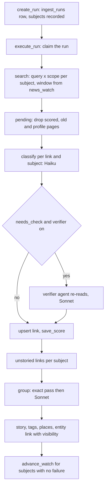

# Media & Signals

Media & Signals turns web news about Registry organisations and funders into **stories** that readers can filter and cite. The backbone is fixed code in `backend/app/ingest/news/`. Model calls are used only where judgement is needed: scoring one link against one subject, grouping links into stories, writing a headline, and (optionally) re-reading a borderline match. The visibility bars, the watermarks and deduplication stay in code. The design record is `docs/features/2026-10-12-media-signals-agentic.md`. Where it differs from the code, this page follows the code.

Related pages: [Sangam Import and Scout](sangam-import-scout.md) (the agent that starts a pull), [Ask Sangam](ask-sangam.md) (the `news-brief` skill and the SQL catalog), [Data and migrations](data-and-migrations.md) (migration `0044_news.sql`) and [Frontend](frontend.md).

## Entry points

| Entry | How it reaches the pipeline |
|---|---|
| Scout's `run_import_now` with `sources="tavily_news"` | `pipeline_tools.run_import_now` calls `_news_pull`, which calls `pipeline.select`, `create_run`, then `execute_run` with `Deps.from_settings`. The caller must be staff. A pull is only started when `tavily_news` is named, so an empty `sources` never starts one. |
| `plan_import` and `GET /ingest/news-runs/plan` | Read-only. Both go through `pipeline.select` and `pipeline.plan_for`, so Scout, the approval card and the CLI show the same plan line. |
| `make news-pull ORG=<slug> FUNDER=<slug> [CONFIRM=1]` | Runs `python -m app.ingest.news.run`, which uses the same `plan_for`, `create_run` and `execute_run` as Scout. |
| `make news-visibility` | Runs `run --visibility`, which calls `store.recompute_visibility` to rewrite visibility from stored scores after a bar or rule changes. |
| `make news-seed` | Loads saved pulls from `seed/data/news.json` by slug. |

Details that matter when calling these:

- `run_import_now` takes `feeds`, a comma-separated list from `fcra`, `csr_trends` and `ngo_north_east`. With no names, only those feeds are pulled, so "FCRA news only" means `funders=""` and `feeds="fcra"`. With names, the feeds are pulled as well. An unknown feed key is refused by `chosen_feeds`, not dropped. The plan route returns HTTP 422 for it.
- `years` and `limit` are ignored by the news pull. A news pull runs alone: other sources named in the same call get a `refused` run item with the reason "a news pull runs alone". `run_import_now` checks for `tavily_news` first, then for `funder_calls` (the open-calls pull, which is not part of Media & Signals and likewise runs alone), and only then falls through to the catalog adapters.
- No names and no feeds means "everyone": every non-hidden Registry record plus all three topic feeds. `make news-pull` prints the plan first and refuses an everyone-pull unless `CONFIRM=1`. It also refuses an `ORG` or `FUNDER` slug that matches nothing, so a typo cannot widen into everyone.
- `gdelt` and `india_csr` are parked. Asking for one by name records a `refused` item carrying the reason from `runner.PARKED`. Their code is gone.

## Pipeline

One news pull from run row to watermark. The diamond is the optional verifier hook, active only when `NEWS_VERIFY_MAX` is above zero.

### Run row and claim

`create_run` writes an `ingest_runs` row with `requested_sources=['tavily_news']`. Its `subjects` array holds `org:<id>`, `funder:<id>` and `feed:<key>` entries. "Everyone" is written as the sentinel `all`, never inferred from an empty list, and `_parse` refuses a run that names nobody. The same call first marks any news run still `running` and older than 35 minutes as failed, because the function limit is 1800 s.

`execute_run` refuses a run that is not a news run. It returns the summary of a run that is no longer `running`. Otherwise it claims the run atomically by setting `claimed_at` where it is null. A second concurrent execute raises `RunBusy`. A claim older than `STALE_CLAIM` is swept to `failed`. `_finish` only updates a run that is still `running`, so a swept run is never turned back into `finished`.

### Search and windows

`feeds.queries_for` builds up to four quoted queries per organisation or funder. They use the name, a district variant for short or one-word names, and aliases or spellings from `namesakes.json`. Topic feeds use their own fixed query lists. `scopes_for` searches each query twice: once on the open web and once restricted to an allowlist of domains. Organisations use the CSR and North East outlets. Topic feeds use that list plus national outlets.

`tavily_news.search` calls Tavily's `/search` with `topic=news` and `search_depth=advanced`. It retries three times, drops Facebook URLs, and keeps a snippet of at most 1000 characters. Article text up to 8000 characters is used for classification and is not stored.

`windows.window_days` gives a newcomer (no `news_watch` row) 90 days. Otherwise it gives the days since `searched_through`, plus one. `stale_floor` is the date before which an item is old news for that subject. Items before it are kept as scored links but never become stories.

A subject whose search fails is added to a `failed` set. `SearchFailed` after retries and any classification or story failure both do this. Its watermark is not advanced, so the next run retries it. If every subject's search failed, the run finishes as `failed` with "every search failed" rather than reading as a last pull. A newcomer also gets `store.lookback` links already stored that name it.

### Classification and model tiers

| Stage | Model | Setting |
|---|---|---|
| Scout supervisor, which plans and starts a pull | Opus | `MODEL` (`claude-opus-5-5`) |
| Per-link entity and topic classification, headline writing | Haiku | `UTILITY_MODEL` (`claude-haiku-4-5`) |
| Story grouping | Sonnet, using `json_schema` structured output, since forced tool calls are unsupported on that tier | `RESEARCH_MODEL` (`claude-sonnet-5-5`) |
| Verifier agent | Sonnet, falling back to `MODEL` when that differs | `RESEARCH_MODEL` |

`_pending` drops duplicate URLs, profile pages (employer reviews, job boards, bare social accounts), items dated before the floor, and anything already scored for this subject at the current `PROMPT_VERSION` (`signals-v2`). Each remaining pair gets one structured call. An entity subject gets `EntityVerdict`: `on_target`, `match`, `confidence`, `content_kind`, `is_news`, `stance`, `signal_type`, region, sector tags and a summary. A feed subject gets `TopicVerdict`. Validators coerce stray enum values to a fallback so one odd word does not lose the item.

Cost and time are capped. `news_max_classify` (2000 per run) refuses the overflow as `refused` items and holds those subjects' watermarks. Classifications run `news_parallel_classify` at a time. Each verdict is stored as soon as it lands, so a killed run keeps what it paid for. A topic item that names Registry records (`registry_named`) is also scored for those records.

The date of a link comes from its post ID (LinkedIn, Instagram, X), then the publisher's date, then the date in the text (`_date`). A publisher date is ignored on social URLs and when it cannot be parsed. `links.py` holds these URL helpers: outlet and `source_type`, the profile-page filter, post-ID dates and the weak-title test.

### Optional verifier

The verifier is **off while `NEWS_VERIFY_MAX=0`**, which is the default in `config.py`. `Deps.from_settings` builds the verifier only when `news_verify_max > 0`. Without it, behaviour is the plain Haiku path.

When it is on, `_Checks.settle` runs after `classify_entity`, for entity subjects only. It runs only if `bars.needs_check` is true:

- the story is news, and
- either `news_verify_low` (0.35) ≤ match < the public match bar (0.7), or the stance is negative and the listed bar (0.6) ≤ match < the negative bar (0.9).

The check has its own budget:

- Each check spends from `news_verify_max`.
- It runs behind a gate of `news_parallel_verify` (2).
- It has a run-wide deadline of `news_verify_seconds` (600), measured from the start of classification, and a per-check timeout of 120 s.
- Over budget, out of time, a timeout, an exception or no structured answer all keep the first read. Each is logged as a `news_verify` run item with status `refused`.
- Otherwise the item is `matched`, or `updated` if the match moved by more than 0.15. An updated item records the old and new values of `on_target`, `match`, `confidence` and `stance`.

`verify.build_verifier` makes a deep agent with `create_deep_agent`. It uses the research model and a prompt from `prompts/verify.md`. Its tools are `read_page` and `search_public_sources`, plus the filesystem floor (`read_file`) that the harness adds. It has no subagents, no checkpointer and no write tools. `ReadingLimit` allows `news_verify_page_limit` (3) page reads, and `call_limit` allows `news_verify_call_limit` (8) model calls. The agent returns a slim `Check`: `on_target`, `match`, `confidence`, `stance`, an `evidence` line of at most 200 characters, and `evidence_url`. This is merged onto the first read with `verified=True`.

The key safety rule is in `verify()`. A check that raises the match or confidence, or flips `on_target` to true, is applied only if `read_page` actually returned text for the page named in `evidence_url`. Otherwise the first read's values stay and the evidence is annotated "raise not applied: no page read". A page cannot talk its way to a higher score unread. Because the verdict is the schema-validated `EntityVerdict` for one pair, injected page text can at most move one score, and the bars are applied afterwards in code.

The verified verdict is stored through the normal `save_score` under the same `PROMPT_VERSION`. A pair scored before the verifier was turned on is not re-checked, unless the prompt version is bumped. The plan line includes "up to N checks" and their cost only when `news_verify_max` is above zero.

### Stories and visibility bars

`_build_stories` works from stored scores, not from the run's memory. `store.unstoried` returns on-target links scored for the subject with `match` at or above the listed bar that are not yet in a story for that subject. A crash therefore resumes cleanly. Feeds are processed first so that a topic story already exists when an entity link for a named record needs it.

`group.group` does an exact pass first, joining links by URL key or title key. It then asks Sonnet to merge the rest, together with stored stories from the same window. Any model failure falls back to the exact pass. A group holds at most one stored story. A link that another subject already placed in a story joins that story. Headlines come from the main link's own title, or are written by Haiku when the title is weak. Each story is written inside one transaction, whole or not at all. That covers main link, places, sector tags and the entity link.

The bars live in `Settings`, never on a screen, and `bars.visibility` applies them to an entity link:

| Level | Match | Confidence | Extra conditions |
|---|---|---|---|
| `public` | ≥ 0.7 | ≥ 0.9 | story is news |
| `public`, negative stance | ≥ 0.9 | ≥ 0.95 | story is news |
| `listed` | ≥ 0.6 | ≥ 0.8 | |
| `hidden` | below the listed bar | | |

A non-news item with no date is always `hidden`. A topic story is `listed` only when its match is ≥ `news_topic_match` (0.75), its confidence clears the listed bar, and it is news, dated and not `international`. Once a topic story is listed it stays listed.

`store.upsert_entity_link` only overwrites an existing link when the new `(match, confidence)` is at least the old pair, so a re-scored link cannot silently lose rank. A link staff has hidden (`hidden_by` set) stays hidden. `recompute_visibility` skips hidden-by-staff rows for the same reason.

When every subject is done, `advance_watch` moves `news_watch.searched_through` to today for each subject that had no failure.

## Storage

Migration `db/migrations/0044_news.sql` creates:

| Table | Role |
|---|---|
| `news_stories` | One row per event: headline, summary, `is_news`, `topic`, `scope`, `feed`. Topic stories also carry `topic_match`, `topic_confidence` and `visibility`. |
| `news_links` | One row per unique URL, with the outlet, `source_type`, provenance columns and `story_id`. Only a snippet is stored. |
| `news_link_scores` | One score per `(link, org or funder or feed, prompt_version)`, with the verdict as `jsonb`. "Already seen" means "already scored for this subject". |
| `news_story_entities` | Links a story to an org or funder, with `match`, `confidence`, `stance`, `signal_type` and `visibility`. Staff hides set `hidden_by` and `hidden_at`. |
| `news_story_locations`, `news_story_tags` | Place and sector joins. |
| `news_watch` | Per subject `searched_through`. No row means a first run goes back 90 days. |

It also adds `ingest_runs.claimed_at`.

Row-level security makes each reader see only what the bars allow. Signed-out readers see `news_story_entities` rows with `visibility = 'public'`. Signed-in readers see `public` and `listed` rows, and staff see all. A signed-in reader also sees a listed topic story. `news_link_scores` and `news_watch` are readable by staff only. The pipeline writes as the owner pool, and hiding goes through a staff route.

## Exposure to Ask Sangam

`backend/app/agent/tools/sql/catalog.py` is the allowlist for Ask's `db_query`. It catalogues `news_stories`, `news_links`, `news_story_entities`, `news_story_locations` and `news_story_tags`, with `news_stories.id` and `story_id` columns citing `[news:N]`. `news_link_scores` and `news_watch` are in `KNOWN_EXCLUDED` as pipeline state, and so are `ingest_runs` and `ingest_run_items`. Verifier evidence in the score `jsonb` is therefore not reachable from Ask. `tests/test_sql_catalog.py` pins both sets.

The `news-brief` skill (`backend/app/agent/skills/news-brief/SKILL.md`, loaded via rule 13 of `agent/instructions.md`) reads `news_story_entities` joined to `news_stories`. It uses only `visibility = 'public'`, `is_news` stories from the last 30 days by default. It reports zero results as "Nothing on <name> in Sangam's news since <date>", where the date is the latest `news_links.fetched_at`, and never says "no news". For a story with a negative stance, or a topic of `fcra` or `governance`, it gives the story's main link (`news_links.url` where `id = main_link_id`) as it is beside the line, so the reader can check the article. Ask cannot read the page, so the skill never says what the article cites. It writes three to five lines, each ending in `[news:N]`. It states match and confidence as High, Medium or Low, never as numbers.

## REST routes

- `GET /ingest/news-runs/plan` (staff only, writes nothing) takes `names` and `feeds`. It returns subjects, newcomers, searches, checks, cost, matched and unmatched names, and feed labels. Names that match nothing plan nothing, not everyone.
- `GET /news/stories` (`routes/news_stories.py`, SQL in `repositories/news_stories.py`) takes `bucket` (`org`, `funder` or `general`), `area` (`mine`, `north_east`, `all`; it defaults to `all` for staff and `mine` for everyone else), filters (`topic`, `sentiment`, `source`, `since`, `q`) and a keyset `cursor`, with `limit` from 1 to 50. It runs as the caller, so RLS applies. It orders by match, then confidence, then date, returns counts for all three buckets (capped at 501, shown as "500+"), and adds `last_pull`. `last_pull` is the latest finished news run, read through the owner pool because `ingest_runs` is not readable as the caller. The `org` bucket shows only the caller's organisations unless the caller is staff. The `general` bucket shows listed topic stories filtered by "my area". In the `org` and `funder` buckets the sentiment filter is that organisation's own stance.
- `GET /orgs/{slug}/news` and `GET /funders/{slug}/news` are the public profile feeds. They return only `public` entity links of news stories, newest first, for any organisation.
- The profile endpoints `GET /orgs/{slug_or_id}/profile` and `GET /funders/{slug_or_id}/profile` (`routes/profiles.py`) embed the same `entity_news` read as `news`, plus press and social `stories` counts from `public_sql.story_counts`. A failed news read leaves that list empty rather than failing the profile.
- `POST /news/stories/{id}/hide` (staff) sets one entity link to `hidden` and stamps who and when. It needs exactly one of `org_id` or `funder_id` (otherwise 422), and answers 404 when no such link exists.

Background and hidden stories reach no list, not even staff's. A malformed cursor is a 400.

## UI surfaces

- The Media & Signals view (`frontend/features/ask/views/media/MediaView.tsx` and `StoryCard.tsx`) shows three bucket cards (`org` "My organisations", `funder` "Funders", `general` "General"), filters, search and the last pull date. It builds one `/api/news/stories` query from the state and pages it with `useCursorList` at 10 per page. Details:
  - `area` is sent on every bucket, so the General card counts the same area its list shows. It defaults to `all` for staff or a user with no organisation, and to `mine` otherwise. The Area and Topic pickers appear only on General. The Organisation and Funder pickers appear only when there is more than one choice. The Funder choices are the funders seen so far in the scrolled list.
  - Sentiment, Source and When (default last 30 days) apply to every bucket. Counts at 501 or more show as "500+".
  - A non-staff user with no linked organisation sees an explanatory card in place of the `org` list, and no request is made.
  - Staff get an `onHide` handler on each card. It posts to `/api/news/stories/{id}/hide` with `org_id` or `funder_id` and drops the row from the list.
- The Registry profile tab "News & social" shows only public stories. `OrgProfileTabs.tsx` (Overview, Programmes & places, Funding, News & social, Research & sources) and `FunderProfileTabs.tsx` (Mandate, Giving, Reach, News & social, Research & sources) in `frontend/features/registry/profile/` each keep the active tab in the URL through `useUrlTab`. Both mount `NewsSocial.tsx` with `profile.news` as `stories`, `profile.stories` as `counts` and the record name. It splits stories into press and social by `channel`. Press items list the main link and "Also reported by" copies. Social posts are grouped by platform, with a six-month bar chart of posts per month. Headers use the SQL counts, not the length of the listed stories. The older `InTheNews.tsx` and `ProfileTabs.tsx` no longer exist.
- The Scout approval card (`frontend/features/ingest/components/ImportApproval.tsx`) is rendered through `useInterrupt` while the agent is paused on `run_import_now`. It has three variants chosen from the paused call's `sources`: a news card ("Pull the latest news?") when `tavily_news` is named, an open-calls card when `funder_calls` is named, and a generic "Write this import to the catalog?" card otherwise. Only the news card calls the plan route. Its `NewsLine` fetches `/api/ingest/news-runs/plan` with the paused call's `funders` and `feeds`, and shows who is covered (everyone, matched names, topic feeds, unmatched names), the searches, any checks and the cost. If that fetch fails it says so and notes that approving still runs the pull. The open-calls card computes its own line from the funder names, with no plan endpoint.

## Tests

- `backend/tests/test_news_pipeline.py` (integration, needs Postgres) covers the run mechanics:
  - repeat pulls score only what is new;
  - a failed search holds its watermark;
  - one run cannot be executed twice;
  - stale claims and never-executed runs expire;
  - the classification cap holds the watermark;
  - a failed story build is retried without reclassifying;
  - a story write is all or nothing.
- `test_news_store.py`, `test_news_stories_sql.py` and `test_news_rls.py` cover stored scores, visibility recompute, keyset paging, "my area" and who can see which rows.
- `test_news_runs_routes.py` drives the plan route with `pipeline.select` and `plan_subjects` patched. It pins four behaviours: no names plans everyone (records counted apart from topic feeds), names are reported as matched or unmatched, names that match nothing plan nothing, and non-staff get 403. It also pins that the old form routes (`POST /ingest/news-runs` and `.../{id}/execute`) are gone (404 or 405). A pull can only start from Scout or the CLI.
- `test_news_chat_pull.py` covers Scout's side. The goal and `started_by` reach `create_run` with `org_ids=None` for an everyone-pull, and another named source (such as `india_csr`) gets a `refused` item. It also pins that `runner.runnable_for` leaves `tavily_news` out unless it is named. The plan line names records, searches, cost and how many subjects go back 90 days.
- `test_news_run_cli.py` covers the CLI refusals.
- `backend/tests/test_cov_pipeline_news.py` is a fake-pool unit suite for `pipeline.py`, `verify.py` and `run.py`, with no Postgres. It covers:
  - run creation, parsing, claim and summary handling;
  - a full pull, and every-search-failed ending the run `failed`;
  - the classification cap and a failed scope holding the watermark;
  - the verifier gate `_Checks.settle`: no verifier or no borderline match keeps the first read, over-cap, out-of-time, errored or verdictless checks are logged `refused`, and a moved match is logged `updated` or `matched` with old and new values;
  - `build_verifier` being read-only (two tools, `Check` as response format);
  - the no-page-read rule in `verify` (a raise is dropped and annotated, a raise backed by a read page is applied) and `_read` needing a successful read of that URL;
  - story grouping against stored stories, and a failed story being recorded while others continue;
  - `Deps.from_settings` building the verifier only when `news_verify_max` is above zero;
  - `_hit_date` ignoring unparsable publisher dates and any publisher date on a social URL;
  - the CLI paths: `--visibility`, an everyone-pull refused without `CONFIRM=1`, and a chosen org.
- The integration pipeline test's `_deps` leaves the verifier off by default, so the verifier's behaviour against a real database is not exercised.

## Operating notes

- To turn the verifier on, set `NEWS_VERIFY_MAX` (the plan suggests 40) and read `ingest_run_items` rows of kind `news_verify`. The 600 s deadline caps verification time, and the remaining pairs keep the Haiku verdict.
- Changing `PROMPT_VERSION` re-scores everything. Changing a bar needs only `make news-visibility`.
- `TAVILY_API_KEY` comes from `Settings` only. Without it, searches fail and the run ends `failed`.
- Extension points: new topic feeds go in `feeds.FEEDS` and the `topic` check values. Namesake notes go in `namesakes.json`, which also feeds `profile_for` and so every classification and verification. A new bar or rule belongs in `bars.py`, followed by `make news-visibility`.
