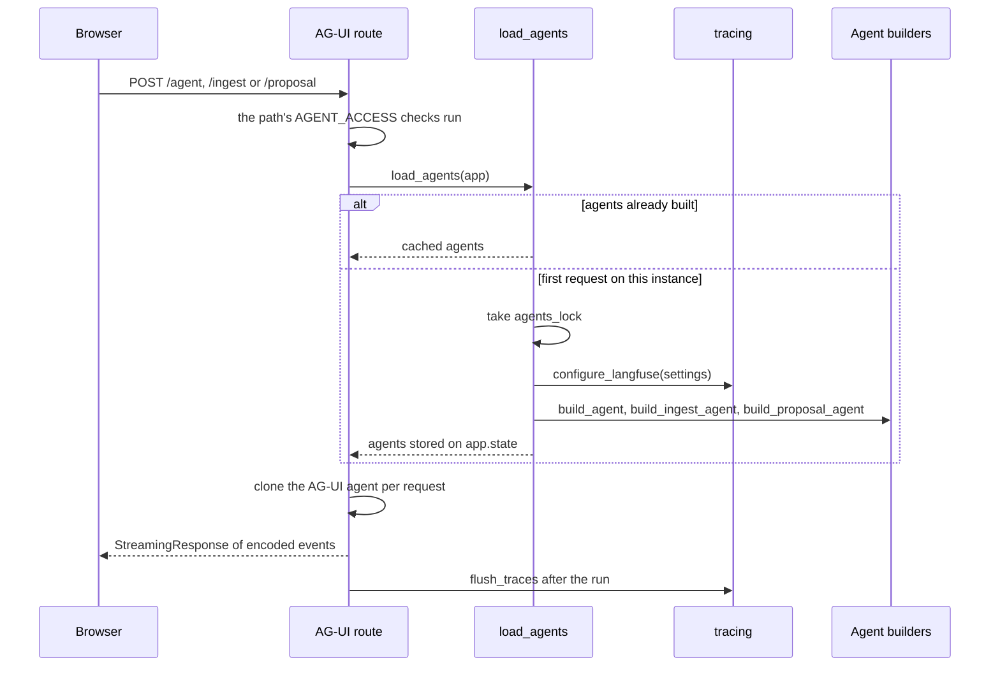

# Platform

The platform is the cross-cutting backend layer that every feature runs on. It does not own any one feature's behaviour. It owns:

- how the ASGI app is built;
- where configuration and defaults live;
- what happens at boot and shutdown;
- when the three agents (Ask, Import, proposal) are constructed;
- how runs are traced;
- how the backend is deployed;
- how every PR is checked (CI, coverage, dependency review), which is separate from deploying.

The agents themselves are covered in [Ask Sangam](ask-sangam.md) and [Sangam Import](sangam-import-scout.md). Identity and row-level security are covered in [Auth, roles and RLS](auth-roles-rls.md). Vendor setup is in [Deploy and vendors](../operations/deploy-and-vendors.md), [Environments](../operations/environments.md) and [Deploying by hand](../workflows/deploying-by-hand.md).

## App factory and routers

`backend/app/main.py` exposes `app = create_app()`, the ASGI entrypoint (`app.main:app`). `create_app(settings=None)` takes optional settings so tests can build a variant. It does the following:

- **Logging and docs.** It configures logging and creates `FastAPI(title="Sangam API")` with the lifespan from `build_lifespan(settings)` and the `OPENAPI_TAGS` ordering. FastAPI's own OpenTelemetry tracing is disabled with `telemetry={"tracing": False}`. Langfuse drops HTTP spans, but as parents they would leave each agent run without a trace root.
- **Middleware order.** `AuthMiddleware` is added first and `CORSMiddleware` second, so CORS wraps auth. Preflights are answered before auth runs, and auth's 401s still carry CORS headers. The allowed origins come from `Settings.origins` (comma-separated `allowed_origins`). `allowed_origin_regex` admits Vercel preview hostnames and is passed as `None` when blank, because an empty pattern would match every origin.
- **Routes and error handling.** It mounts `api_router`, maps a Postgres `InsufficientPrivilege` error to `403 {"detail": "Not allowed"}`, and defines `GET /health`.

`AuthMiddleware` is plain ASGI, not `BaseHTTPMiddleware`, because buffering would break chat streaming. It skips non-HTTP scopes and the open paths `/health`, `/docs`, `/docs/oauth2-redirect`, `/redoc` and `/openapi.json` (`_OPEN_PATHS` in `core/security.py`). For every other request it resolves the caller once (`resolve_principal`: with `SUPABASE_URL` unset everyone is the seeded dev user; with it set, no header is anonymous, a Supabase token is verified against the project's JWKS, and `Bearer dev` works only when `DEV_AUTH` is on), answers a bad token itself with a JSON 401/409, and stores the principal plus `db_role` (`anon` or `authenticated`) and `db_claims` on the request state. `get_caller_pool` turns those into a `CallerPool` (anon with empty claims when the middleware did not run), which `PoolDep` hands to routers. Each `connection()` opens a transaction and runs `set_config('role', ...)` and `request.jwt.claims` with `SET LOCAL` semantics, so RLS applies, the settings end with the transaction even on error, and the connection returns to the shared pool as the owner (see [Auth, roles and RLS](auth-roles-rls.md)). Identity code and agent tools take the owner pool (`OwnerPoolDep`, `get_pool()`), and Ask Sangam's SQL reads its caller from the `agent_caller` context variable.

`backend/app/api/router.py` is the single mount point. It builds one `APIRouter(prefix="/api")` and includes the per-resource routers: orgs, org_members, funders, profiles, registry, funder_matches, proposals, partner_lines, partner_groups, programs, rfps, contacts, scores, meta, news_stories, documents, ingest, news_runs, me and threads. `OPENAPI_TAGS` fixes the order resources appear in the docs. Routes outside `/api` are `/health` from the factory and the three AG-UI chat routes `/agent`, `/ingest` and `/proposal` (with their `{path}/health`) that the lifespan registers.

## Settings and model tiers

`backend/app/core/config.py` defines a pydantic-settings `Settings` class loaded from the environment and `.env` (unknown keys ignored). `get_settings()` is `lru_cache`d. It is the only place defaults are written.

**Blank means default.** A `mode="before"` validator turns an empty or whitespace string into the field's declared default for the four model settings and for `max_parallel_research`, `research_page_limit`, `research_model_call_limit`, `ask_model_call_limit` and `db_pool_max_size`. docker-compose forwards `${VAR:-}` as `""`, and a hand-edited `.env` line with nothing after `=` does the same. Without the validator an int field would refuse to parse and the container would not boot. `DEV_AUTH=""` is likewise read as off.

### Model tiers

There are three work tiers plus an audit model. Each is a `provider:model_name` spec resolved through LangChain's `init_chat_model`.

| Tier | Setting | Default | Used by |
|---|---|---|---|
| Strong | `MODEL` | `anthropic:claude-opus-5-5` | Ask Sangam's main agent (`agent/build.py`) and the Import supervisor (`ingest/agent.py`). It is also the last fallback for every subagent and the model the researcher escalates to. |
| Research | `RESEARCH_MODEL` | `anthropic:claude-sonnet-5-5` | The `entity-researcher` and `vault-reader` subagents, the news pipeline's grouping model, and the optional news verifier. Researchers run up to `MAX_PARALLEL_RESEARCH` at once, so this tier carries most of an import's tokens. |
| Utility | `UTILITY_MODEL` | `anthropic:claude-haiku-4-5` | The `catalog-writer` and `workbook-reader` subagents, the research rubric and cheap summarizer, `run_import_now` extraction, `live_status`, and the news classifiers and headlines. |
| Audit | `SQL_AUDIT_MODEL` | `anthropic:claude-haiku-4-5` | Ask's post-answer SQL audit, added as `answer_audit(...)` middleware only when the value is non-empty. |

Details that matter when changing these:

- Ask and the Import supervisor share `MODEL`. There is no separate Ask model, and the plan in `docs/features/2026-10-09-model-tiers.md` lists extended-thinking budgets as out of scope.
- `SQL_AUDIT_MODEL=off` is normalised to an empty string, which disables the audit. It costs one extra model call per SQL turn, which is why it sits on the cheapest tier.
- To run a tier on the main model, set it to the same spec as `MODEL`. The researcher's escalate-after-failed-save middleware is only added when `research_spec != settings.model`.
- Agents fall back across tiers through `fallback(primary, *candidates)` middleware, which adds one `ModelFallbackMiddleware` using the first candidate spec that differs from the primary, and nothing when all match. The writer and workbook-reader try research and then strong (so a utility spec equal to the research spec falls through to strong). The researcher and vault-reader fall back from research to `MODEL`. The Import supervisor falls back from strong to research, and Ask's agent also falls back from `MODEL` to `RESEARCH_MODEL`.
- Deployed backends read their Vercel environment, and that beats the code defaults. Set or clear the four model variables on `sangam-backend` before deploying (see the [Deploy and vendors](../operations/deploy-and-vendors.md) page).

### Other settings that shape the platform

- **Database.** `database_url` holds both app data and LangGraph checkpoints. `db_pool_max_size` defaults to 10, sized for a Supabase project with 60 connections minus reserved ones across several deployed instances. `db_gate_slots` is `max(2, pool - 3)`. Concurrency gates sit under the pool, because the checkpointer writes on every graph step through the same pool and a gate equal to the pool size would starve it.
- **Agent limits.** `recursion_limit` is 200. Every middleware hook is its own graph node, so a single model-and-tool cycle costs several steps, and LangGraph's default of 25 is exceeded by a SQL turn. Each subagent gets its own budget of these steps. `ask_model_call_limit` (25, `ASK_MODEL_CALL_LIMIT`) caps the model calls one Ask question may make through `model_call_cap`, which ends a runaway turn long before `recursion_limit`. `max_parallel_research` is 8. `research_page_limit` and `research_model_call_limit` are optional hard stops.
- **Feature switches derived from config.** `auth_enabled` is true when `supabase_url` is set; otherwise every request is the seeded dev user. `storage_enabled` needs both the Supabase URL and the service key. `graph_enabled` needs `neo4j_uri` and an OpenAI key. `langfuse_enabled` needs both Langfuse keys.
- **SQL tool.** `sql_timeout_ms`, `sql_max_rows` and `sql_max_attempts` bound the text-to-SQL tool.
- **News pipeline.** The `news_*` thresholds and costs live here, never in a screen. The verifier is off while `news_verify_max` is 0.
- **Egress guard.** `core/egress.py` has `guarded_client()`. Every outbound request, including each redirect hop, is refused if the host is loopback, private, link-local, internal, or resolves to such an address. A check that cannot decide refuses. The check also rejects non-http(s) URLs, `localhost`, single-label hosts, hosts that do not resolve, and numeric forms such as `2130706433` or `0x7f.1`. IPv6 addresses that embed an IPv4 one (mapped, 6to4, Teredo, NAT64) are judged by the inner address. Its callers are Import's `download_file` tool (`agent/tools/files.py`), the robots.txt and access checks in `ingest/access.py`, and the RFP call pull (`ingest/calls/pull.py`). Ask no longer fetches model-supplied URLs, because `fetch_url` was removed (M4, #247).

### MCP settings are dead

`github_pat`, `github_mcp_url`, `playwright_mcp_url`, `mcp_servers` and `github_tool_allowlist` are read only by `app/agent/tools/mcp.py`. Nothing under `backend/app` imports that module or calls its `load_mcp_tools`, so setting them has no effect on the running agents. The agent builders in `agent/build.py` and `ingest/agent.py` pass their own `TOOLS` lists. Treat the MCP settings as unwired until something calls `load_mcp_tools`.

## Lifespan and lazy agent loading

`backend/app/core/lifespan.py` owns everything with a startup and shutdown. Boot is deliberately split in two. The lifespan keeps only what REST needs. The agent stack is built later, on first use: the first post to `/agent`, `/ingest` or `/proposal` (each route calls `load_agents`), or the first REST route that calls `get_graph`. The REST callers today are the Import route in `routes/ingest.py` (`ingest_graph`) and `saved_messages` in `routes/threads.py`, which serves Ask's thread messages (`ask_graph`) and the proposal chat's in `routes/proposals.py` (`proposal_graph`).

**Boot, in order** (inside one `AsyncExitStack`, so shutdown unwinds in reverse):

1. Create the shared psycopg pool (`make_pool`: min 1, `autocommit`, `prepare_threshold=0`, dict rows), open it, and publish it as `app.db.pool.pool` for REST endpoints and agent tools.
2. Run `_verify_sql_catalog`. If the SQL tool's catalog disagrees with the database, it logs each `SQL catalog drift:` problem and raises `RuntimeError`, so **the app refuses to boot on catalog drift**. Tables that exist but are in neither the catalog nor `KNOWN_EXCLUDED` are only logged at info level. They stay invisible to the agent until someone decides.
3. Open the Graphiti graph, which logs and does nothing when the graph is not configured.
4. Open the Postgres checkpointer (`AsyncPostgresSaver.setup()`, idempotent DDL).
5. Set `app.state.settings`, `checkpointer`, `agents = None` and an `agents_lock`, then register a route for every path in `AGENT_NAMES`: `/agent`, `/ingest` and `/proposal`.
6. Log boot timings: process age from `/proc`, connect plus catalog time, total boot, the model, the research concurrency, the pool size and the gate.

On shutdown the lifespan flushes and shuts down Langfuse, but only if tracing is enabled and the agents were actually built. It then clears `db_pool.pool`.

**First use.** All three agents are built together by `load_agents(app)` under `agents_lock`, once, and cached on `app.state.agents`. The trigger is whichever comes first: a post to `/agent`, `/ingest` or `/proposal` (the AG-UI route calls `load_agents`), or a REST route that calls `get_graph` (`routes/ingest.py` and `routes/threads.py` do, and the latter also serves the proposal chat). `load_agents` returns `None` outside a lifespan:

1. `configure_langfuse(settings)` runs first. Building the client is what registers the mask, and a handler created earlier would bind to an unmasked client.
2. `build_agent` builds Ask's graph, `build_ingest_agent` builds Import's and `build_proposal_agent` builds the proposal copilot's (see [Ask Sangam](ask-sangam.md) and [Sangam Import](sangam-import-scout.md); the proposal agent is the one behind `/api/proposals`).
3. Each graph is wrapped in a `SessionScopedAGUIAgent`. `/agent` is named `sangam_agent`, `/ingest` is `sangam_ingest` and passes `emit_subagent_events=True` so each researcher's steps arrive attributed to its run, and `/proposal` is `sangam_proposal` and passes `emit_raw_events=False`. All three receive `config={"recursion_limit": ...}`.
4. The Langfuse and LangSmith status is logged. A configured-but-failing backend logs a warning, because a silently disabled tracer looks the same as a working one.

The build is synchronous on purpose, since imports and graph compiles are not safe to move off the event loop. The whole thing is logged as "Agents built on first use".

Caption: the first chat request on an instance builds all three agents under a lock. Later requests reuse them and clone the AG-UI wrapper per request. A REST route that calls `get_graph` triggers the same build when no chat has happened yet.

**The routes.** `_add_agent_route` registers its own `POST` for each path in place of the library's `add_langgraph_fastapi_endpoint`, which needs the built agent at registration time, plus a `GET {path}/health` route that `make smoke` checks. The wrapper is cloned per request because the LangGraph agent keeps per-run state on the instance.

**Per-route chat access.** Who may post is set by `AGENT_ACCESS`, a dict keyed by path. `_add_agent_route` looks the path up directly, so a path missing from it fails at boot instead of falling back to another route's checks. All of them require sign-in (anonymous is 401) and claim the thread in the `threads` table:

| Path | Dependencies | Effect |
|---|---|---|
| `/agent` | `ask_access` | Signed in; the thread is new or yours (someone else's is 404, staff included). Also sets `agent_caller` so Ask's SQL runs as this caller (`anon`/`authenticated`) rather than the owner, and starts a fresh `caveats_given` set for the turn. |
| `/ingest` | `require_scout`, `chat_access` | Staff or a steward of an org (403 otherwise), then the same thread-ownership check. Import keeps the owner pool because it writes the catalog. |
| `/proposal` | `proposal_chat_access` | The thread id must parse as a proposal chat belonging to the caller, on an org the caller can read (else 404); a reader who cannot edit the proposal gets 403. It claims the thread with `use_case="proposal"` and sets `chat_proposal` from the thread, never from the model. |

`_own_thread` and `proposal_chat_access` also set the `chat_user_id` and `chat_scope` context variables (a `CallerScope` of org roles) that the tracing hook and agent tools read; outside a chat request they are unset, which tools treat as no access. A body that fails validation skips the check and is answered by the endpoint's own 422.

**Invariant for REST code.** No REST module may import agent code at module top level. A REST cold start must not pay for `deepagents`, model clients, `copilotkit` or Langfuse. The existing routes follow this:

- `threads.py` imports `ag_ui_langgraph.utils` inside the function that needs it, since that import takes about 0.5 s.
- `documents.py` and `ingest.py` import agent tool modules and `live_status` lazily.
- `integrations/storage.py` owns `_safe_name` so it does not import the agent's file tools.
- Routes that need a compiled graph call `get_graph(app, "ask_graph" | "ingest_graph" | "proposal_graph")`. It builds the agents if no chat has happened yet, and returns `None` outside a lifespan.

The cost is a trade: the first request that needs an agent on a fresh instance pays the deferred imports and build (about 1.4 s measured locally).

## Tracing with Langfuse

`backend/app/integrations/tracing.py` wires Langfuse (SDK v4) and a few AG-UI behaviours. Telemetry is built never to take the app or a turn down. Failures are logged and the app continues untraced.

**Enabling.** Tracing is on only when both `LANGFUSE_PUBLIC_KEY` and `LANGFUSE_SECRET_KEY` are set. `configure_langfuse` builds the client once with the mask and a span filter, and takes the environment and release from `LANGFUSE_TRACING_ENVIRONMENT` or `VERCEL_ENV`, and `LANGFUSE_RELEASE` or `VERCEL_GIT_COMMIT_SHA`. It then verifies two things that would otherwise fail silently:

- **Mask check.** The client's `_mask` must be `mask_payload`. Langfuse shares resources per public key and the first construction wins, so a client built earlier would leave masking off. On mismatch it logs an error and reports tracing as not live.
- **Credential check.** `auth_check()` must succeed. Wrong keys for the host would otherwise be rejected with a 401 on a background thread that nobody reads, so it logs that traces will be dropped and points at `LANGFUSE_HOST`.

**Trace roots and names.** `trace_config(settings, name, tags)` returns the `run_name` and, when enabled, a Langfuse callback handler plus metadata (`langfuse_trace_name`, and tags `sangam`, the agent's own tags and `settings.model`). The name is set even with tracing off so graphs are not all called "LangGraph". Each graph passes its own name, since a trace's name is all that is shown before opening it:

| Graph | Trace name | Extra tags |
|---|---|---|
| Ask Sangam | `sangam_ask` | `ask` |
| Sangam Import | `sangam_import` | `import`, `research`, the research and utility specs |
| News verifier | `sangam_news_verify` | `news`, `verify`, the research spec |

`TRACE_NAME = "sangam_agent"` is only the default when no name is passed.

**The handler.** A subclass of the SDK's `CallbackHandler` adds the following:

- **Observation types.** The graph and each subagent are typed `agent`. The `answer_audit.after_agent` hook is an `evaluator`. Everything else is a `chain`.
- **Root input and output.** The root input is the last human question, and the root output is the final replies that called no tool. When a turn stopped for approval it appends "Waiting for a person to approve: ...".
- **Parenting.** It re-parents runs whose parent the handler never saw onto the LangGraph node run.
- **Cancellation.** A cancelled turn (browser disconnect) is closed with a "cancelled: client disconnected" message and no error level.

**What is exported.** `export_span` keeps Langfuse's default filter, so FastAPI HTTP spans are dropped, and also drops empty middleware hook spans (`PatchToolCallsMiddleware`, `SkillsMiddleware`, `sql_retry_limiter`, `RunSources` and `DropFilesOnExit`, `before_` or `after_` `agent` or `model`). These never call a model, and unlisted hooks are kept because dropping a parent would orphan its children.

**Masking and clipping.** `mask_payload` runs over every input and output. It always clips strings to `MAX_IO_CHARS` (4,000). When `LANGFUSE_MASK_TOOL_RESULTS` is true, it also redacts warehouse rows. Redaction is shape-aware: it cuts after a `columns: ` header (`db_query`) or an `as stored:` line (`db_profile_column`) and leaves the query, caveats and sources above the cut intact. It is also applied in `on_tool_end`. A failing mask sends the payload unmasked, so a mask bug cannot drop a batch. The tests pin this behaviour, including that bare SQL and prose survive and that nested payloads are masked.

**Sessions, users and SQL spans.**

- `SessionScopedAGUIAgent.prepare_stream` maps the AG-UI `thread_id` to `langfuse_session_id`, the chat user (`chat_user_id`) to `langfuse_user_id`, and the run id to `agui_run_id`. Without the mapping each turn is an orphan trace.
- It de-duplicates tool results the browser re-sends under its own ids.
- It addresses a legacy resume to one open interrupt through `key_resume`, which is needed because parallel Import writers pause together and LangGraph refuses an unaddressed resume.
- `run()` flushes Langfuse in a thread in a `finally`, because a serverless function freezes once it has answered.
- `sql_span` and `traced_fetch` record each SQL statement as a `retriever` observation under the current tool span, with the dedented SQL, its params and the row count. `score_answer` attaches scores such as `answer_audit` to the current turn's trace.

**LangSmith** needs no wiring. `langsmith_status()` only reports at boot whether it is on, off, or misconfigured.

**Recursion limit is carried twice.** `build_agent` binds `recursion_limit` to the graph, and the lifespan also passes it as the AG-UI agent's `config`. AG-UI builds each request's config with `ensure_config`, which stamps LangGraph's default of 25 and overrides the graph-bound value. Removing the `config=` argument in `_build_agents` would silently bring the 25-step cap back. A test pins both the trap and the fix, and the setting stays at least 150.

**Focused tests.** `backend/tests/test_tracing.py` covers:

- run naming with tracing off, and handler binding to the configured client;
- graceful degradation when the SDK is broken;
- session, user and run metadata, and survival of graph-level tags;
- SQL spans, masking and clipping, and cancelled turns;
- the bad-credentials error message;
- recursion-limit propagation;
- `key_resume` and parallel pauses;
- a guard that every documented `LANGSMITH_*`, `LANGFUSE_*` and `SUPABASE_*` variable in `.env.example` is forwarded by `docker-compose.yml`.

## Deploy topology

Two Vercel projects deploy from one repository: the frontend (`sangam`, root `frontend`) and the backend (`sangam-backend`, root `backend`, a FastAPI function). Postgres, Auth and Storage are Supabase in `ap-south-1`. Neo4j is optional.

- **Both `vercel.json` files** set `git.deploymentEnabled: false` and `regions: ["bom1"]`. Nothing deploys on push. The only deploy is `.github/workflows/deploy.yml`, which has a `workflow_dispatch` trigger and is run by hand (see [Deploying by hand](../workflows/deploying-by-hand.md)). CI (below) runs on every PR but deploys nothing. `bom1` puts both functions next to the database in Mumbai.
- **`backend/vercel.json`** also sets `functions."app/main.py".maxDuration` to 1800 seconds, which long Import and news runs depend on. It also defines a cron on `/health` every five minutes (`*/5 * * * *`). The cron keeps one instance warm and does nothing for several calls arriving at once.
- **Function limit coupling.** The news verifier budget (`news_verify_seconds`, 600) is chosen so a pull still ends inside the 1,800 s function limit. The frontend's chat route must carry the same maximum duration.
- **Local run.** docker-compose forwards the environment to the backend container, and a test guards that forwarding for the tracing and Supabase variables.

## CI and PR checks

Two workflows check every pull request. Neither deploys anything.

**`.github/workflows/ci.yml`** runs on every `pull_request` and every push to `master`, with `contents: read`, a `concurrency` group per ref that cancels superseded runs, and a `timeout-minutes` cap on each job. It has four independent jobs:

| Job | What it runs |
|---|---|
| `backend-lint` | `uv sync --frozen`, then `ruff check . --output-format=github` in `backend/` (Python 3.12). Only `ruff check`; the ruff formatter is not enforced. |
| `backend-unit` | `pytest -m "not integration" --cov --cov-report=xml`, then uploads `backend/coverage.xml` to Codecov with the flag `backend-unit`. |
| `backend-integration` | A `pgvector/pgvector:pg17` service container on port 5433 (the same image as docker-compose). It applies `db/init/*.sql` with `psql`, runs `python -m app.db.migrate` (with `MIGRATIONS_DIR` pointing at `db/migrations`), `seed.seed` and `seed.taxonomy_seed`, then `pytest -m integration --cov -rs`, and uploads with the flag `backend-integration`. |
| `frontend` | Node 22, `npm ci`, `npm run lint`, `npx tsc --noEmit` and `npm run build`. |

Details that matter when changing it:

- **The integration job is meant to run, not skip.** `-rs` lists skips, because a test that skips for "Postgres not reachable" means a broken job. It deselects `test_preserved_row_counts` and `test_documents_sequence_advanced` in `tests/test_migration_integrity.py`, which check a restore of the original dump (96 documents) that `make seed` never creates.
- **Coverage upload uses OIDC.** Both test jobs have `id-token: write` and pass `use_oidc` as true except on fork PRs, so no token is stored. A fork falls back to tokenless upload.
- **Dependencies are locked.** Python jobs use `uv sync --frozen`, so a stale `uv.lock` fails the job. The dev group in `backend/pyproject.toml` pins `ruff==0.16.8` and adds `pytest-cov`.
- **Ruff config.** `[tool.ruff]` uses line length 110 and `py312`. Lint ignores `B008` (FastAPI's `Depends()` idiom), `RUF012` (class-level constants) and `UP046` (PEP 695 needs 3.12, while `requires-python` is 3.11). Coverage is measured on `app` with branch coverage and relative file paths.

**Codecov thresholds** live in `codecov.yml`. It merges the two uploads into one report per commit, with `carryforward: true` for each flag. The project status uses `target: auto` with a 1% threshold, so a PR fails if it lowers total coverage by more than 1% against the base commit. The patch status requires 70% of the lines a PR adds or changes. A `fixes` rule maps `app/` to `backend/app/` because `coverage.xml` paths are relative to `backend/`. The PR comment is condensed (header, diff, flags, files).

**`.github/workflows/dependency-review.yml`** runs `actions/dependency-review-action@v4` on every PR with `fail-on-severity: high` and posts its summary as a PR comment only on failure. It fails a PR whose lockfile changes add a package with a high or critical advisory. It checks only what the PR changes, and already-open alerts stay in Security → Dependabot.

**Plan versus code.** `docs/features/2026-10-16-ci.md` was revised in review. Its original design had a self-hosted `coverage` job with `diff-cover` and a `fail_under` ratchet. The shipped design uses Codecov instead, so there is no `coverage` job. The plan's second milestone (a Dependabot config, a Claude review workflow, a PR template and CODEOWNERS) has no matching files under `.github/`: only `ci.yml`, `dependency-review.yml` and `deploy.yml` exist. The plan also lists branch-protection rules and other GitHub settings as manual work, and a workflow file cannot show whether they are on. The CHANGELOG records only CI and the Dependency review check as shipped. The test tiers CI runs are described in [Testing overview](../testing/overview.md).

### Makefile targets

The `Makefile` is local tooling and deploys nothing. Bare `make` runs `help`, which is built from the `##` comments. `ENV=local|staging` picks the database for the DB-touching targets (staging points your machine at the managed database). `make up` starts Postgres, runs `migrate` and then builds the other containers. Other targets that matter here:

- **`make evals`** runs the golden-question evals on the host venv through the real agent. It costs money. `TAG=canary|cost` selects a subset and `K=<case>` runs one case through pytest `-k`. It sets `LANGFUSE_TRACING_ENVIRONMENT=eval` and the release to the short git sha, so eval traces stay apart from real traffic. Evals are not part of CI.
- **`make smoke`** is the end-to-end check of the running stack. It is not a CI step.
- **`make wiki`, `wiki-update`, `wiki-fix` and `wiki-deploy`** drive OpenWiki (pinned to `openwiki@0.7.2`). `wiki-update` rewrites only pages whose evidence changed.

## Performance

`docs/features/2026-10-10-page-load-performance.md` records the measurements behind the current shape:

- **Distance was the first cost.** Originally both functions ran in `iad1` against a Mumbai database, and each round trip cost about 200 ms. Moving to `bom1` (#148) took warm `/api/funders` from 1.2 s to 0.2 s.
- **Cold starts dominate.** A cold backend call took 8–12 s, from the runtime dependency install (2–4 s) plus imports, connect and the catalog check. About two-thirds of the import time was the agent stack. This is why agent building moved off the boot path (PR 7, lazy `load_agents`), taking a local `import app.main` from 1.84 s to roughly 0.3–0.4 s.
- **Fewer calls per page.** Profile pages use one aggregate endpoint each (`GET /api/orgs/{slug}/profile`, `GET /api/funders/{slug}/profile`, #179), because a page waits for its slowest call and each parallel call can land on a fresh cold instance. `GET /api/ingest/overview` does the same for the Import page.
- **Caching.** Signed-out reads use Next's data cache (`revalidate: 300`) and signed-in reads stay `no-store`, because RLS decides what they see (#180). The `/health` cron is the keep-warm measure.
- **Not done.** The 2–4 s dependency install remains because `graphiti-core` stays in the bundle (PR 2 was closed). Signed-in pages can still meet a cold start. Loading states and the JS trim are deferred. Check the "Not finished" table in [`docs/CHANGELOG.md`](../../docs/CHANGELOG.md) before assuming the plan doc matches the code.

### Ask efficiency: shared middleware and `compare_fit` sizing

`docs/features/2026-10-16-ask-efficiency.md` starts from one production trace of a "what does X do, where does it work, which funders fit it" question: $0.87, 141 s, 21 model calls and 26 tool calls. Its target is under $0.25, under 60 s and under 8 model calls and 8 tool calls. Two of the plan's causes are fixed in code that other agents share.

- **`compare_fit(org_id)` fits in the conversation.** Before, it returned every scored funder at full detail as one JSON line. That went past deepagents' 20k-token tool-result limit, was moved to `/large_tool_results/` as a one-line file the model could not page, and led to repeated `compare_fit` calls. Now `agent/tools/matching_tools.py` renders text, one fact per line. Without `funder_ids` it is a shortlist: the top `FULL_DETAIL_MAX` (10) strong or medium funders in full, every other scored funder on one line (score, tier, first gap), then the funders not scored. The header counts only scored funders. With `funder_ids` every named funder is shown in full with its summary. Unknown criteria stay "unknown" and are never folded into weak. `matching.may_run` still refuses anyone who is not staff, a steward or an admin. Errors come back as `compare_fit failed:` strings, never raised.
- **Tool-result clearing keeps the prompt cache stable.** `clear_old_tool_results()` in `agent/middleware.py` wraps `SteppedClearToolUsesEdit`. The trigger rose from 40k to `TOOL_RESULT_CLEAR_TRIGGER_TOKENS = 60_000` and the last `TOOL_RESULTS_KEPT = 5` results stay. Past the trigger it reclaims `ceil((tokens − trigger) / step) × step` from the oldest end, with `TOOL_RESULTS_CLEAR_STEP = 20_000`. What is sent stays under about 60k, and the set of cleared results (and so the cached prefix) changes once per 20k of growth instead of on every call. A fixed `clear_at_least` would reclaim the same amount forever. Results of `compare_fit` are in `NEVER_CLEARED`, because clearing them made the model call it again.
- **Blast radius.** The function is shared: Ask (`agent/build.py`), Sangam Import (`ingest/agent.py`) and the proposal agent (`proposals/agent.py`) all call it, so all three get the new trigger and stepping. The `compare_fit` exclusion does nothing in Import.
- **Eval measurement (M1).** `tests/evals/harness.py` has `RunStats` (tool calls by name, model calls, tokens). Cases can carry `max_calls` and `max_large_result_reads`, and with Langfuse keys the selected cases run once as a dataset experiment on `ask-golden`, under environment `eval` (see `make evals` above).

- **In-code budgets.** `CompareFitBudget` refuses a repeated `compare_fit` (same org and funder ids this turn) and any call past `MAX_COMPARE_FIT_CALLS = 3`, and `model_call_cap(settings.ask_model_call_limit)` ends a turn at 25 model calls. Both are built into Ask's middleware in `agent/build.py`.

**Status.** The CHANGELOG still lists M1 (evals) and M2 (`compare_fit` text and stepped clearing) as `(unmerged)`, although the code for both is present in the tree. M4 is merged and in the tree: `fetch_url` is gone, so Ask registers six tools, and `db_profile_column` errors count toward the five-attempt SQL limit. M3 and M5 have not landed: there is no `{{TABLE_MAP}}` in the prompt, no `__cite__` citation columns in the SQL validator, and the proposal agent has no prefill guard. Treat those planned changes (a table map in the prompt, automatic citation ids, one-row cell widening, caveats once per turn, moving the SQL echo to the tool artifact, a Pitch prefill guard) as plans only. The plan's Draft v2 status line does not say M4 shipped.

## Known regressions

- **`emit_raw_events` is back on for Ask and Import.** The CopilotKit-removal plan had the `SessionScopedAGUIAgent(...)` calls in `core/lifespan.py` pass `emit_raw_events=False`. With raw events off, one answer went from 1.69 MB to 107 KB (#167–#169). Then #178 removed that argument from the two existing agents. The `SessionScopedAGUIAgent` constructor defaults `emit_raw_events=True`, and `_build_agents` passes only `emit_subagent_events=True` for `/ingest` and nothing for `/agent`. So every AG-UI event on those two routes again carries a copy of the LangGraph event it came from, including run metadata such as `langfuse_user_id` and model settings. The plan doc found that no frontend file reads `rawEvent`. The newer `/proposal` agent is built with `emit_raw_events=False` and is not affected. The fix for the others is to pass `emit_raw_events=False` too. See the [CHANGELOG "Not finished" table](../../docs/CHANGELOG.md) and the Performance entry for #167–#169.

## Where to change things

- **A new REST resource:** add a router module under `api/routes`, include it in `api/router.py`, add an `OPENAPI_TAGS` entry, and import any agent code inside functions.
- **A new default or model tier:** edit `core/config.py` only, add the field to the blank-means-default validator if it is an int or a model spec, and forward the variable in `docker-compose.yml`. Set it in Vercel for deployed backends.
- **A new agent or trace root:** pass a distinct `name` and tags to `trace_config`, build the graph in `_build_agents`, wrap it in `SessionScopedAGUIAgent`, and register the path in both `AGENT_NAMES` and `AGENT_ACCESS`. A path without an access entry fails at boot.
- **A new table the SQL tool may read:** update the SQL catalog, or the lifespan's catalog check will refuse to boot.
