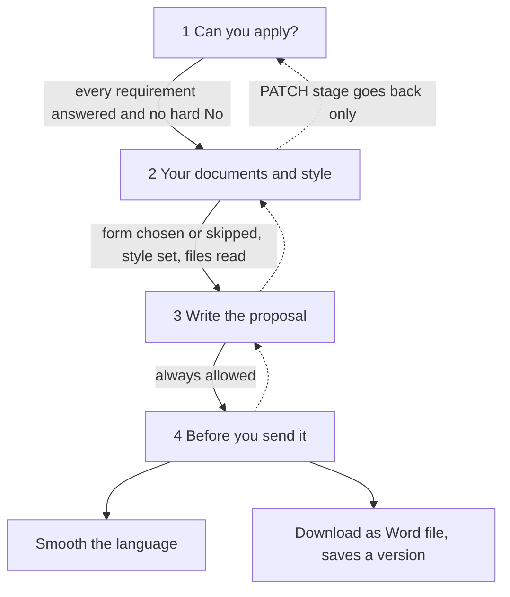
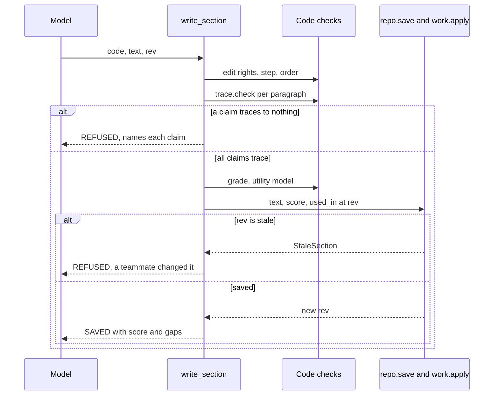

# Proposal Copilot (Sangam Pitch)

Sangam Pitch helps an NGO's team write one grant proposal to one funder, starting from a saved [Funder Match](funder-match.md) result. It is the third deep agent in the backend, after [Ask Sangam](ask-sangam.md) and [Import/Scout](sangam-import-scout.md). On screen it is "Sangam Pitch". The route, thread ids and code keep the name "proposal", as Scout's keep "ingest".

**Proposals are no longer browser-only.** A backend, a `/proposal` agent and a `proposals.work` column now exist. Everything the proposal screen and the agent edit lives in `proposals.work` (jsonb) and is recomputed into `proposals.summary`. The earlier `localStorage` store (key `sangam.proposals.v1`, from the first proposals screens) was replaced. The frontend keeps only `hadBrowserProposals()` in `frontend/features/ask/views/proposals/api.ts`, which detects drafts left in one browser by that older version. The older `proposals` table from migration `0009` was extended by `0048` with `work` and `summary`, and the backend reads and writes it now. Shipping order and dates are in the [changelog's Proposals section](../../docs/CHANGELOG.md).

The design rule is one sentence: **the agent proposes, code checks.** The model reads, drafts and asks. Code decides which step the proposal is in, what blocks leaving it, which facts are kept, when a question may be asked, whether a paragraph's numbers trace to a fact, whether smoothed wording changed a claim, and what the Word file contains. The code lives in `backend/app/proposals/`. Most modules there are pure functions over the `work` dict.

For the user-facing sequence, see [Proposal lifecycle](../workflows/proposal-lifecycle.md).

## Moving parts

| Piece | Role |
|---|---|
| `backend/app/api/routes/proposals.py` | REST resource: list, create from a saved match, read, rename, `PATCH /work`, `POST /advance`, `POST /polish`, `POST /versions`, `GET /messages`. |
| `backend/app/proposals/agent.py` | Builds the `/proposal` deep agent and the two reader agents. |
| `work.py` | The only way `proposals.work` changes (`apply`). |
| `steps.py`, `gates.py`, `readiness.py`, `rubric.py` | Steps and exit checks, step 1's requirements, "Before you send it" summary, the `proposal-v2` section rubric. |
| `facts.py`, `reliability.py`, `records.py`, `questions.py` | The fact list's rules, source colours, the registry re-check, the rules for asking. |
| `trace.py`, `grade.py`, `review.py`, `polish.py`, `assemble.py` | Trace check, 0 to 2 score, correction propagation, checked smoothing, Word file. |
| `readers.py`, `tools/*.py` | Parallel file readers, and the agent's tools. |
| `context.py`, `middleware.py` | The two context blocks told to the model on every call. |
| `backend/app/repositories/proposals.py` | Row access and `save`, which locks the row. |

## Entry points and who may do what

`/proposal` is registered beside `/agent` and `/ingest` in `app/core/lifespan.py`, as `sangam_proposal`. `AGENT_ACCESS["/proposal"]` is `proposal_chat_access`, and a path missing from that table fails at boot. The route sets `emit_raw_events=False`.

`proposal_chat_access` (in `app/core/security.py`) works on the thread id alone:

- Each person has their own private chat per proposal, with thread id `proposal-<proposal id>-<user id>`. A thread that is not the caller's own, or an org the caller cannot read, is a 404. Teammates never share a chat. A teammate's work reaches the agent only through `work.log`.
- A **member** gets 403: members read proposals and do not edit them or chat with the agent.
- It sets `chat_user_id`, `chat_scope` (a `CallerScope`) and `chat_proposal`.

**The model never names the proposal.** `chat_proposal` is a ContextVar set from the thread id. `context.current()` re-reads that proposal's row on every call and every tool call, so a save made on screen between two tool calls is seen. No tool takes a proposal id from the model.

**Caller-scope edit rule.** Staff, an org's admins and its stewards edit; members only read. The rule exists in three places that must agree:

- RLS in migration `0048_proposal_work.sql` (`proposals_insert` and `proposals_update` use `app.my_match_org_ids()` or `app.is_staff()`; `proposals_read` is unchanged).
- `CallerScope.can_edit_proposal(org_id)` in Python.
- The `can_edit` column in the repository's list and get queries.

Agent tools run on the owner pool, which skips RLS, so `require_edit(p)` is the check. Every tool that changes the proposal calls it first and returns `REFUSED: you can read this proposal…` otherwise. The screen's buttons are not the check. REST writes run on the caller's pool and are refused with 403 for a reader. See [Auth, roles and RLS](auth-roles-rls.md).

Migration 0048 also opens `documents_insert` to any role in the org (and staff) so a steward can upload files in step 2. See [Data and migrations](data-and-migrations.md).

## Storage: `proposals.work`

`work` is jsonb, `NOT NULL DEFAULT '{}'`, beside a `summary` jsonb. `create_proposal` builds the first `work` from the saved Funder Match run: stage 1, requirements, `earlier_phase`, the match id and score, the funder's newest `proposal_template` document if Sangam holds one, the default writing style, and empty `gates`, `sections`, `facts`, `questions`, `log` and `versions`. A proposal needs a saved match run: starting one without it is a 409. Starting is for the org's admins and stewards (403 otherwise). The list endpoint never reads `work`, only `summary`.

Main keys: `stage`, `requirements`, `gates`, `template`, `skipped_template`, `sources` (ticked document ids), `style`, `sections.<code>` (`text`, `rev`, `done`, `score`, `missing`, `untraced`, `needs_rewrite`), `facts.<kN>`, `questions.<qN>`, `readers`, `polished`, `versions`, `log`.

### One write path

`work.apply` is pure. `repositories.proposals.save` does `SELECT … FOR UPDATE` on the row, calls the supplied change function, and writes `work`, a recomputed `summary` and the title back. Every REST save and every agent write goes through it. `apply`:

1. Checks every change first and then applies them all, so nothing is half-applied. Allowed paths are a fixed set of regexes. Anything else is `BadChange` (400).
2. Requires a section change to carry the section's `rev`. A stale `rev` raises `StaleSection` (409), which names who changed the part last.
3. Increments each touched section's `rev`, and logs each change to `work.log` as `{at, by, via, run_id, path, from, to, facts, reason}`. `via` is `rest`, `agent`, `polish` or `version`.
4. Recomputes the part's `untraced` list when its text changes.

`via` also gates who may set a path:

| Path | Who may set it |
|---|---|
| `stage` | Forward only through `POST /advance` or `advance_step`. `PATCH` only goes back. |
| `sections.X.score`, `needs_rewrite`, `facts.kN.used_in`, new `facts.kN`, `questions.*`, `readers.*` | Only `via="agent"`. |
| `sections.X.missing` and `untraced` | Never from outside; derived by code. |
| `polished` | Only the polish route, `via="polish"`. |
| `versions` | Only the version route, `via="version"`, and only if the list grows by exactly one entry numbered `len(list)`. |
| `facts.kN.status` | A person may set `proposed`, `confirmed` or `rejected`. `corrected` appears only with the fact that replaces it. |
| `facts.kN.correct` | A person's correction. `apply` expands it into a new `you_said` fact with `supersedes` and marks the old one `corrected`. |

REST typing is more lenient than the agent. A person's own edit to a part's text is not blocked by the trace check. Code stores any figure, place or name no cited fact holds in the part's `untraced` list, and step 4 shows it under Fix first. A person's edit also recomputes which facts each part uses, clears `done`, and, when the text changed, clears `needs_rewrite`, `score` and `missing` (they described other text). The save route grades the text once when a part is marked Done.

## Steps and exit checks

The proposal has four stages in `work.stage`. The names are `steps.STAGES`, which mirror the frontend's `steps.ts`.

Caption: the four stages, what code requires to leave each, and the two finishing actions on the last stage; dotted arrows are the back moves `PATCH` allows.

`steps.exit_check(stage, work)` returns what is missing, in words; empty means the step can be left. REST `POST /advance` and the agent's `advance_step` both call it inside the row lock. REST answers 409 `{message, missing}`. The tool returns `NOT YET: to leave this step, …`.

- **Step 1:** every requirement has an answer (`yes`, `will_have`, `no`), and no hard requirement is `no`.
- **Step 2:** a funder form chosen or "Sangam's usual order" chosen, a non-empty style, and "Write the first draft" pressed (`work.readers` is non-empty). No reader may still be running, unless it started more than 30 minutes ago, which counts as dead. A failed file does not hold up step 3.
- **Step 3:** always leavable. The summary's Fix first list is where readiness is judged.
- **Step 4:** the last step.

Writing tools also refuse early: `steps.too_early` allows `add_facts` and `read_files` from step 2, and `ask_user`, `write_section` and `suggest_edit` from step 3. Sections are written in dependency order (`rubric.DEPENDS_ON`: A2 and A3 before A4, A4 before A5 and A6, A5 before A15, every other section before the Summary A1). `steps.may_write` waives this for the part the person has open on screen.

## Step 1: requirements from the match

`gates.build` reads the saved Funder Match detail (pure; the caller loads it). It produces a requirement for 12A, 80G, audited accounts and, for Section 135 funders, CSR Form 1. CSR Form 1 is the only hard requirement because it is law for Section 135 money. It also adds one soft "funder's own requirement" per `not_judged` line starting "The funder's own bar". `earlier_phase` comes from the match's relationship points and adds section F4. The person answers on screen. The agent explains but never answers for them.

## Facts

Facts live in `work.facts` (ids `k1`, `k2`, …), cited in text as `⟦k7⟧`. There is no facts table. Each fact has an origin, and `reliability.tier` gives its colour from the origin alone: registry and vault are green, web and derived are amber, `you_said` has its own colour. Status is `proposed`, `confirmed`, `corrected` or `rejected`. Only the first two are "live" and can be cited or fill a gap.

`add_facts` is the agent's only way to add facts, and code checks the source first:

- **registry:** it needs an `[org:N]`, `[activity:N]` or `[score:N]` marker. `records.check` re-reads the registry rows with the same fixed text the read tools show and requires the value's numbers to appear in the marked row.
- **vault:** the document must be one of the files ticked in `work.sources`, and `vault.check_findings` must accept the quote. A reader may cite only the one file it was given.
- **web:** an http link and at least 20 characters quoted from the page.
- **derived:** it names the facts it is worked out from.
- **you_said:** never added here. Only `ask_user` stores what a person says.

A fact with the same origin, source, subject and value returns the existing id, so a retried turn adds nothing. New facts arrive `proposed`; the person confirms them on screen. Ids are allocated inside the row lock.

## Questions: one at a time, by rule

`ask_user` pauses the graph with a LangGraph `interrupt` of type `proposal_question`, and a card appears above the chat. `questions.may_ask` is the one gate:

- Not before step 3. On step 3 only about the part the person has open on screen.
- One open question per person. A gap already open with a teammate is refused.
- Its reason must be warranted by the fact list. **missing**: the section has that strong element and no live fact fills it. **disagree**: two live facts about the same kind, subject and period, from equally strong sources, with different values. **org_call**: only the organisation can decide it (programme, amount or gate).
- A question lives in `work.questions` with `asked_of`, because each chat is private and the answer belongs to the shared proposal.

The reply resumes the run as a card pick or typed text. `questions.classify` sorts typed text as answer, question back or skip with one utility-model call. A failed call counts as a question back, so nothing is written from a reply not understood. An answer becomes a confirmed `you_said` fact and the question `answered`. A skip parks the question, and it can be asked again of whoever opens that part next.

## Readers

`read_files` is the agent's only reading tool for step 2, and code does the rest (`readers.py`). Under the row lock, `_claim` finds what is pending: every ticked file and the funder's side that is not `done`. It marks them `running` in `work.readers`. If a non-stale reader is still running, the call is refused with who started it and when ("Busy"). This is the one lock in the feature, and it applies to reading only, never to chatting. Then `asyncio.gather` runs one reader per file plus one for the funder, bounded by `max_parallel_research`.

- Each reader is a separate deep agent built once with the proposal agent (`research_model`, `checkpointer=False`, with `tool_errors` and `RunSources` middleware). The evidence reader has `read_vault_document`, `read_brief` and `add_facts`. The funder reader has `read_brief`, `list_funder_documents`, `read_funder_document`, `read_template` and `add_facts`.
- Neither has a web tool and neither can ask the person anything. A file's reader can open only that file, through `RunSources` and `run_sources.CURRENT` set inside its own task. The funder's reader opens none of the org's files.
- Each reader clears the inherited run config, so its steps do not stream into the person's chat.
- Outcomes are written back per reader (`done` or `failed`, with a one-line reason). "Try again" re-reads only what failed. One file's failure never stops the others. A saved link with no stored file is marked failed with a reason.

`read_brief` returns only public brief facts. A private source's words never leave the proposal they were read for.

## Writing: trace check, then grade

`write_section(code, text, rev)` goes in this order:

1. `require_edit`, `too_early`, text length (at most 12,000 characters), the section exists, and `may_write` (dependency order).
2. **Trace check** (`trace.check`, pure, shared with polish and suggest). Per paragraph, every number, rupee amount (lakh and crore are compared as rupees), place (a state or known district, from `locations`) and partner or person name must appear in a live fact that the same paragraph cites as `⟦kN⟧`. Years, FY ranges and Schedule VII clauses need no fact. A gap written `[Add: what is missing]` is not a claim. Citing a fact that does not exist, or was corrected or set aside, is refused. A refusal names each untraced claim, and the model fixes it or makes it a gap.
3. **Grade** (`grade.grade`, one utility-model call): which of the section's strong elements are missing. None missing scores 2, one scores 1, more scores 0. A grader failure never blocks the save. The text is saved unscored.
4. **Save** through `work.apply` at the `rev` the model read, with each cited fact's `used_in` updated. A teammate's save in between is refused by name.

Caption: the checks `write_section` runs before and during a save, and where each refusal is returned to the model.

Sections A6, A15 and F1 (`MUST_SCORE_2`) are told to be rewritten once if they score below 2. That is a nudge in the tool's reply, not a counter.

`suggest_edit(code, now, better, why)` is for improving one passage. `now` must appear exactly once. The wording is trace-checked before the person sees it, and only claims that are newly untraced block it, so a problem the part already had does not. It pauses with a `proposal_suggestion` interrupt. "Use this" saves through the same `_store` path at the part's rev at that moment. Keeping their own wording returns `KEPT`. Typed feedback returns `FEEDBACK`.

## Review, readiness and corrections

A correction or "Don't use it" goes through `review.follow` inside `apply`. A sentence citing the corrected fact gets the new value if the old value appears word for word and the fix adds no untraced claim. Otherwise the part is marked `needs_rewrite`, and only a later `write_section` that fully traces clears the flag. Facts derived from the changed fact go back to `proposed`, so the person checks them again.

`readiness.summary(work)` is recomputed on every save. It lists **Fix first**, which stops `ready`:

- an unanswered requirement, or a hard requirement answered No;
- unwritten parts;
- a part needing a rewrite;
- a part with untraced claims;
- A6, A15 or F1 below 2, or a core part scoring 0;
- a used fact still `proposed`;
- an unsettled disagreement.

It also lists **Worth checking**, which never blocks: a score of 1, a requirement answered "will have it before sending", a gap still to fill, and a parked question. `work.conflicts` is initialised empty and counted by readiness, but no code in `backend/app` currently writes to it.

## Polish and versions

- `POST /polish` makes one model call (`settings.model`) that smooths all written parts in the proposal's style. `polish.differences` compares `trace.extract` before and after (figures in rupees, places, names, gaps). If any claim is lost, added or changed, nothing is stored and the route returns 409 with what changed. A model failure is 502. The result is saved only by this route (`via="polish"`), with each part's `rev`. A part changed after smoothing goes into the output as written.
- `POST /versions` builds a `.docx` (Summary first, `⟦k⟧` marks removed, `[Add: …]` gaps highlighted), uploads it to the org vault at `<org id>/proposals/<id>/v<N>.docx`, and inserts a private `proposal_draft` document marked as AI-written. It appends `{n, title, document_id, at, by, facts_snapshot}` to `work.versions`. It needs storage enabled (503 otherwise), and a clash on the version number is refused.

## How the agent is assembled

`build_proposal_agent` calls `create_deep_agent` with the strong model (`settings.model`), a state backend and the checkpointer. Tools are the nine in `TOOLS` (`read_proposal`, `advance_step`, `read_match`, `read_org_record`, `add_facts`, `ask_user`, `read_files`, `write_section`, `suggest_edit`) plus `read_file` from the harness filesystem. A test pins that set. Middleware, in order:

1. harness `filesystem` (read-only floor);
2. `tool_errors` (backstop that answers the model when a tool raises);
3. `clear_old_tool_results`;
4. `fallback(model, research_model)`;
5. `cheap_summarizer` (utility model);
6. `ProposalContext`.

There is no deepagents `task` subagent. The two readers are separate graphs, built by `readers.build` while the proposal agent is built, and launched by `readers.read`. Their middleware is `filesystem` (no eviction), `tool_errors`, `RunSources` and a `fallback` that prefers `research_model`. The system prompt is `instructions.md`.

`ProposalContext` re-reads the proposal on each model call and puts two blocks into the system message:

- **Stable:** the proposal's names, step, requirement answers, form and each section's state. It carries no record text and no section text. It ends with a cache breakpoint only for Anthropic models.
- **Live:** what blocks this step, whether the person can edit, what they have open on screen, parts marked for rewriting, "Changed outside this chat" (the last five `work.log` entries made by anyone but this chat's agent, including the person's own clicks), file readings, and waiting questions and unconfirmed facts. It is never saved.

The screen state arrives as client input through the AG-UI context ("What the person is looking at"). It sets focus only, and a part code the server does not know is dropped. The screen line is also appended to the latest human message in the request, because a long chat's older turns otherwise outweigh the system prompt.

### Failure semantics

Agent tools are written never to raise. Each catches its failures and returns an error string (`REFUSED:`, `NOT YET:`, `<tool> failed: <ExceptionName>`), so the model reads the refusal and adjusts. The `tool_errors` middleware is the backstop: a tool that still raises answers the model with `<tool> failed: <ExceptionName>` (the type only, since a raw message can carry SQL, paths or keys) instead of ending the run. The only exception passed through is LangGraph's `GraphBubbleUp` in `ask_user` and `suggest_edit`, which is the pause itself. Nothing is half-saved: `apply` validates every change before making any. A stopped turn loses only the section in progress, because each section saves on its own.

## Plan versus code status

The plan is `docs/features/2026-10-14-proposal-copilot.md`. Its own status line ("Draft v3 … first version trimmed") is not a reliable guide. The shipped milestones (M2 to M8, including `suggest_edit` and writing in place) are listed in the [changelog's Proposals section](../../docs/CHANGELOG.md), which is the place to check for what has landed. Its "Not finished" table has no row for the copilot, so none is declared partial. One row there, for `2026-10-10-list-pages-proposals-media.md`, still says "No proposals backend", which no longer matches the code (migration `0048` and `backend/app/proposals/`).

The plan's §11 "Later" list is what is left, and it is unbuilt. It includes freshness in fact colours, more reasons to ask, `flag_conflict`, a changed-file check, a promise check in polish, the funder form's limits, and a web-searching landscape reader. Code differs from the plan in places. For example, there is no `StageGate`, `AskGate` or `ProposalSources` middleware: those checks live inside the tools and `ProposalContext` is the only proposal middleware. The plan's "three steps" are four stages in code. A `you_said` fact is stored only by `ask_user`.

## Tests

Backend tests cover the code-only safeguards and run without model calls:

- `tests/test_proposals_work.py`: allowed paths, atomic apply, `rev` conflicts, logging.
- `tests/test_proposal_agent.py`: the own-chat access rules (member 403, stranger 404), `advance_step`, context blocks, and the nine-tools-plus-`read_file` set.
- `tests/test_proposal_facts.py`: tiers, question rules, per-origin fact checks.
- `tests/test_proposal_readers.py`: reader tools carry no web or ask tool, per-file source isolation, pending and Busy logic.
- `tests/test_proposal_writing.py`: trace, order, scoring, typed parts.
- `tests/test_proposal_review.py`, `test_proposal_suggest.py` and `test_proposal_finish.py`: review, suggestions, polish check.

See [Testing overview](../testing/overview.md).

## Changing it safely

- Add a path or a rule in `work._check` and `apply`, never as a separate write. Anything that edits `proposals.work` must go through `repo.save` and `work.apply`.
- A new write tool must call `require_edit` first, return strings instead of raising, and check its step with `steps.too_early` (add it to `FIRST_STAGE`).
- A new rubric section belongs in `rubric.py` (`RUBRIC_VERSION = "proposal-v2"`), with its place in `DEPENDS_ON`.
- Anything the screen shows to a person is in words. Codes and markers stay in `work` and the agent's context.
- A new origin of facts needs an entry in `reliability.ORIGINS` and a check in `facts.problem`.
- Any change to the trace check also changes the polish check, since both use `trace`.
