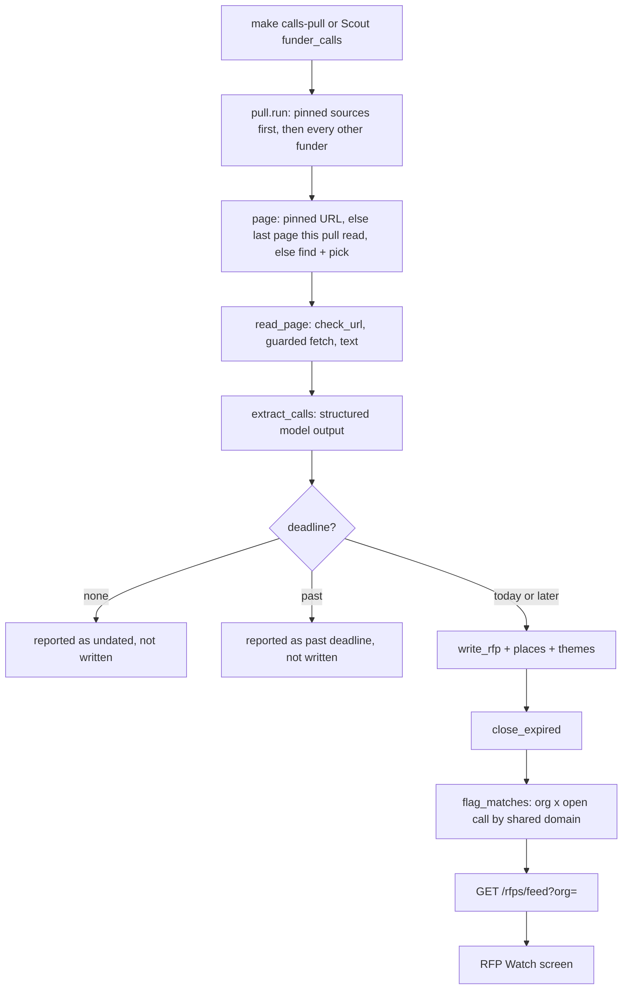

# RFP Watch (open calls)

RFP Watch tells an NGO about **open calls for proposals** from funders Sangam already knows, while there is still time to apply. It has four parts:

- a fixed, non-agent **pull** (`backend/app/ingest/calls/`) that finds a funder's calls page, reads it, extracts the calls and writes the open ones to `rfps`;
- a rule-based **match** that fans each open call out to organisations sharing a theme domain (`rfp_matches`);
- the **`/rfps` routes**, whose `GET /rfps/feed?org=` is the screen's only read;
- the **RFP Watch screen** in Ask, plus a staff-only **Scout** task that starts the pull.

The design record is `docs/features/2026-10-15-rfp-watch.md` (M1–M3) and `docs/features/2026-10-19-rfp-watch-scout.md` (M4). The changelog's "RFP Watch" section lists M1 (#228) through M4 (#246) as shipped.

**Not finished** (changelog "Not finished" row): the **staging exit gates** and the **design-system sync of the Ask page** are still open. RFP Watch's styles are `.rfp-*` classes, but the sync has not happened. Treat the staging behaviour described in the plan as unverified.

## End-to-end flow

One pull from page discovery to the screen. Any step that cannot proceed for a funder becomes a "NEEDS A LOOK" report line instead of aborting the run.

## The pull (`backend/app/ingest/calls/`)

`run.py` is the CLI behind the make targets; `pull.py` holds the logic. There is **no agent**: the same steps run for every funder, and the model is used only for two narrow structured calls.

| Step | Where | What it does |
|---|---|---|
| Choose the page | `pull.pull_one` | Uses, in order: the pinned URL for that funder, the page this pull last read a call from, or discovery. |
| Find | `find.candidates` | Candidates are pages Import already cited (`documents` / `document_links`, no PDFs, up to 20), the funder's website, and one Tavily search restricted to the funder's own domain. Only candidates on the funder's own host are kept, so an aggregator's copy of a call is never used. |
| Pick | `extract.pick_page` + `prompts/pick.md` | The model returns one candidate URL or null (annual reports, CSR policies, news and single-project pages are not calls pages); a URL it was not given is discarded. |
| Read | `pull.read_page` | `check_url` (robots.txt and the source registry) first, then a fetch through `guarded_client` with the importer's user agent. PDFs are refused; HTML goes through `trafilatura`; under 200 characters of text counts as unreadable ("may need a browser to render"). A pinned feed is parsed as RSS items into plain lines. |
| Extract | `extract.extract_calls` + `prompts/extract.md` | One structured-output call per page (first 30,000 characters). It lists calls with title, deadline, optional `url`, rupee band, states, domains, themes (codes from the fixed taxonomy; unknown codes are dropped) and eligibility lines. The prompt excludes procurement tenders, jobs, programme descriptions and always-open forms, asks for at most three themes, reads rupee bands only (no currency conversion), and says to use only what the page states (a month-only or missing date stays null, a passed date is still listed so the pull can report it). Titles under four characters are dropped. The version tag is `PROMPT_VERSION = "calls-v1"`. |
| Write | `pull._write` → `writer.write_rfp` | Deduplicates on `(funder_id, title, deadline)` and keeps provenance (`source_url`, `source_name`, `fetched_at`, `content_hash`, `extractor_version`). The first place and theme go through `write_rfp`; further places go to `rfp_locations`, further themes to `rfp_tags` as secondary, inferred tags. Themes also add the call's `domain` tags, so a call with no theme still reaches orgs in its field. |

Date handling follows the Indian calendar (`Asia/Kolkata`). A call with **no deadline** is only reported as "no date", and one whose deadline has **passed** is only reported as "past deadline"; neither is written. Only calls due today or later become `rfps` rows.

### Run shape

`pull.run` selects funders whose `registry_status` is not `hidden` (optionally filtered by slug), reports pinned slugs that Sangam does not have, and runs funders under an `asyncio.Semaphore(PARALLEL)` with `PARALLEL = 4`, pinned funders first. The CLI opens a pool of `PARALLEL + 1` connections. Each funder's writes share one transaction; one funder's exception becomes its own report line. After all funders it runs `close_expired` (open calls with a past deadline become `closed`) and `flag_matches`, then prints a summary: funders read, calls written, expired calls closed, funders needing a look, new matches, and how many member orgs have no theme.

`close_expired` compares against the database's `current_date`, while the pull and matching use the Indian date; near midnight the two can disagree by a day.

### Reuse on a re-run

A funder's starting page for a re-run is `source_url` of its newest `rfps` row **with `extractor_version = 'calls-v1'`** (`pull._funders`). A call that Scout's research wrote names a report, not a calls page, so it is never reused. In short, **a re-run reuses only pages the pull itself read.** The same `calls-` prefix defines the feed's `last_pulled`.

### Pinned sources and "Needs a look"

`pinned.json` lists funders whose calls page is always read first, each with a hand-checked URL, an optional `feed` flag and a `note` of what a person found. Discovery never replaces a pinned URL, and on failure the note is appended to the report so a known dead end is not rediscovered. As of the recorded checks, each of the pinned sources hits a dead end of one of these kinds: a page that sends no text without a browser, a refusal to automated requests, a robots.txt that disallows all paths, no dated call, or no apply page. They are expected to land under "NEEDS A LOOK" rather than produce rows, and an empty feed is an expected result, not a bug. Many calls are annual, so a pull out of season finds few open ones.

A funder lands under **NEEDS A LOOK** (`Outcome.look`) when:

- it has no website and no page Import cited ("nowhere to look");
- none of the candidate pages looks like a calls page (with the Tavily failure, or a missing `TAVILY_API_KEY`, appended when that is why the search found nothing);
- the page could not be read: blocked by robots or the registry, HTTP error, fetch failure, PDF, or too little text;
- it is pinned but not in Sangam (the pull never creates a funder; add it with Import first);
- any unexpected exception occurred.

A slug that matches no funder and no pinned entry gets its own "nothing read" line.

**UNDP is permission-only.** The UNDP procurement-notices feed is pinned with `feed: true`, but `backend/app/ingest/data/sources/rfps.json` registers it as `crawl_only_with_permission` (robots.txt disallows every path, and its items are mostly procurement). `check_url` therefore refuses it with that reason and it appears under "NEEDS A LOOK". The RSS-reading code exists so that, if permission is granted, the extractor can keep only grant calls. `rfps.json` also registers other call-related sources (for example `funder_apply_pages`, which defers to each site's robots.txt) with their access rules; see [Sangam Import / Scout](sangam-import-scout.md) for how the registry gates reading.

## Storage

Calls live in the existing tables from the base schema, with no new table for RFP Watch:

- `rfps` (status `open` / `closed` / `removed`, deadline, rupee band, `eligibility`, provenance columns), with `rfp_locations` and `rfp_tags` for places and themes;
- `rfp_matches(rfp_id, org_id)` with `status`, `matched_by`, `match_notes` and `week_of` (added in `0010_signals.sql`).

**Migration `0049_rfp_match_saved.sql`** is the only RFP Watch schema change. It replaces the `rfp_matches_status_check` constraint so `status` may be `flagged`, `saved`, `reviewed` or `dismissed`. The original schema allowed only `flagged`, `reviewed` and `dismissed`. "Saved" is the new value; **"Not for us" stays `dismissed`**. See [Data and migrations](data-and-migrations.md) and [Writing a migration](../workflows/writing-a-migration.md) for conventions.

Access is row-level security from `0027_rls.sql`: `rfp_matches` rows are readable by the org's people and staff, and updatable only by members and admins of the org (`my_writable_org_ids`) and staff, so stewards and other roles read only. `0025` grants callers `UPDATE` only on this table. That is why matches are written up front by the pull: save and dismiss are updates to existing rows, never inserts.

## Matching (`repositories/rfps.flag_matches`)

`make calls-match` runs it alone, reading nothing and costing no model call; every pull also runs it last.

- A call's tags and an org's tags (its own `org_tags` plus its programmes' `program_tags`) are rolled up through `tags.parent_id` with a recursive CTE until they reach a tag of kind `domain`.
- One `INSERT … SELECT` creates a row for every **organisation that has members** and every call that is `open` with a deadline of today or later (IST) and shares a domain. It writes `matched_by = 'rules:domain'` and `week_of` as the Monday of the current week.
- It is `ON CONFLICT DO NOTHING`, so a re-run never touches an existing row's `status`: a saved or dismissed call stays that way.
- There is no score and no model. Orgs with members but no domain tag cannot match anything; the count is reported as `orgs_without_theme`.

## API (`api/routes/rfps.py`)

| Route | Notes |
|---|---|
| `GET /rfps` | Paged list with `status`, `deadline_before` and `tag` filters, ordered by deadline (nulls last). Any signed-in user. |
| `GET /rfps/feed?org=<slug>` | The screen's read; declared before `/{rfp_id}` so `feed` is not parsed as an id. Requires a user and runs as the caller, so RLS hides another org's matches and the feed comes back empty. Unknown org gives 404. |
| `GET /rfps/{id}`, `GET /rfps/{id}/matches` | Detail, and the orgs flagged for a call (404 when the call does not exist). |
| `PATCH /rfps/{id}/matches/{org_id}` | Body `status` in `flagged`, `saved`, `reviewed`, `dismissed` (anything else is 422) and optional `match_notes`. Stores the caller's user id as `matched_by`. 404 when no visible row matches the pair, which includes rows RLS does not let the caller update. |

`Feed` carries `org_id`, `org_name`, `can_act` (may this caller save or dismiss: the org's members and admins, and staff), the org's `domains`, `last_pulled` (newest `fetched_at` among `calls-` rows) and `items`. An item is included when it is **saved, whatever became of the call**, or when it is not dismissed and the call is open with a deadline of today or later. Items are ordered by deadline, and each carries its places and the themes shared with the org, rendered like "Livelihoods · Skilling for jobs" (a bare domain only when no theme under it is tagged).

The only route test, `backend/tests/test_rfps.py`, covers the PATCH happy path, an unknown pair (404) and an invalid status (422), with the repository stubbed. The pull, matching and feed have no focused tests. `backend/tests/evals/test_import_calls.py`, despite its name, is not about this pipeline: it checks the Import eval harness's tool-call budgets (subagent calls counted under their own name, `max_calls` failures such as a `run_import_now` budget of 0) on a scripted run with no model or database.

## The screen (`RfpWatchView`)

`frontend/features/ask/views/RfpWatchView.tsx` is mounted by `AskWorkspace` (see [Frontend](frontend.md) and [Ask Sangam](ask-sangam.md)). It follows these rules:

- **Data:** `getFeed` calls `/api/rfps/feed?org=` once per selected organisation (`useOrgChoices` supplies the picker); bucketing, search and the theme filter run client-side.
- **Buckets:** *For you* (open calls), *Closing soon* (within `SOON_DAYS = 30`) and *Saved*. In `CallCard`, a deadline of 14 days or fewer is flagged urgent.
- **Card:** funder, title, days left, rupee band, places, shared themes and a "Read the call" link, shown only for `http(s)` URLs (`safeHref`) because the URLs were extracted by a model. Actions are Save/unsave (`saved` ↔ `flagged`), **Not for us** (`dismissed`, labelled "Remove" on a saved closed call) and **Ask about this call**, which starts a new chat. When `can_act` is false the card shows a read-only line.
- **Empty states:** an org with no domains is told it has no theme, so nothing can match; an org with no open calls is pointed to Funder Match, since most CSR money moves without an open call.
- A dismissed call, or an unsaved one that has closed, is dropped from the local list the way the server would drop it; failures show an inline error.

## Running it

| Command or surface | Behaviour |
|---|---|
| `make calls-pull FUNDER=<slug>` | Pulls one funder (`--funder`, repeatable on the CLI). |
| `make calls-pull CONFIRM=1` | Pulls every funder. With neither `FUNDER` nor `CONFIRM` it prints a warning (about one search and two model calls per funder) and exits with status 2. |
| `make calls-match` | `flag_matches` only. |
| Scout (`/import`, staff only) | The "Check open calls" task card, and `run_import_now(sources="funder_calls")`, which has its own approval card naming the funders and the cost. |

The pull needs `TAVILY_API_KEY` for discovery (a missing key is reported, not fatal) and uses the configured `utility_model`. Tracing is flushed on exit.

### From Scout

`run_import_now` in `ingest/tools/pipeline_tools.py` gains a third mode beside the adapter import and the news pull; no new tool, subagent or interrupt was added. `funder_calls` is handled by `_calls_pull`:

- `staff_only` runs first, so stewards and members get a refusal string.
- Funder names are resolved case-insensitively by name or slug; unknown names become report lines, and if none resolve the tool returns a "nothing was read" message. An empty list means every funder.
- Other source keys named in the same call are reported as not run, since a calls pull runs alone.
- The report lines from `pull.run` are returned for the supervisor to relay; the supervisor never sees page text. The approval card is the confirmation, so there is no `CONFIRM` equivalent.
- Like the other agent tools, it never raises: any exception comes back as a `run_import_now failed: …` string.

On the frontend, `ScoutChat` has the card, `access.ts` limits it to staff, `ImportApproval` renders the "Check open calls?" card with a cost line, and `toolLabels.ts` labels the step "Open calls · <funders>". The agent's side is in `ingest/instructions.md` ("the adapter path"). For the broader Scout turn see [Sangam Import / Scout](sangam-import-scout.md) and [Import turn](../workflows/import-turn.md).

## Invariants and cautions

- The pull never creates a funder or organisation; it only reads funders already in Sangam.
- Reads always pass `check_url` first, so robots.txt and the access-rule registry apply; a permission-only source is refused rather than worked around.
- Only calls with a known, current deadline become rows, so rolling and undated programmes never appear.
- Matching is deliberately broad (a shared domain, not a theme score), so an Education org sees every open Education call.
- Save and dismiss rely on rows already existing and on RLS; if matching has not run for an org, there is nothing to update.
- Research calls written by Scout's research path are not part of this flow: they lack the `calls-` extractor version, so they do not set `last_pulled` or seed a re-run's page.
