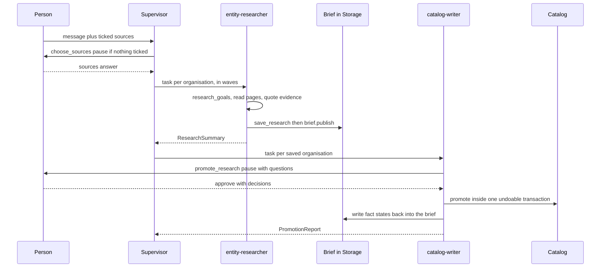
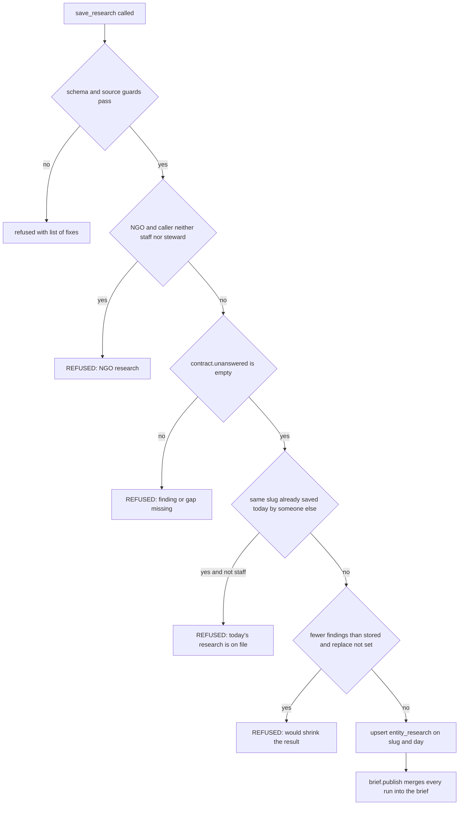

# Sangam Import / Scout

Sangam Import is a second LangGraph deep agent, separate from [Ask Sangam](ask-sangam.md). Ask reads the catalog. Import builds it. Users see it as **Scout** at `/import`. The backend and prompts call it "ingest", threads are named `import-<uuid>`, and the graph is built by `build_ingest_agent()` in `backend/app/ingest/agent.py`. Its Langfuse trace name is `sangam_import`.

The agent never writes SQL. It proposes typed findings, and fixed-SQL code in `app/ingest/` does every write. A test asserts that no tool name contains `query` or `sql`.

> **Source of truth.** `docs/INGEST.md` predates PRs #192–#197 and its header (lines 9–27) lists what is wrong in it. Trust the code, this page and `docs/ARCHITECTURE.md` §4. `backend/app/ingest/CLAUDE.md` says the same: facts about agents, tools, middleware and skills live in this page, rules and decisions live in `ARCHITECTURE.md` §4 and §6, and where `INGEST.md` disagrees, source and the wiki are right. A changed tool or flow means regenerating the wiki (`make wiki-update`). A changed rule means editing §4.

## The agents

One supervisor delegates to four subagents. Every subagent is `mode="isolated"` with its own context window. The reason is context, not speed: one broad research turn once read three PDFs across about twenty calls and never reached its report. An isolated subagent returns a conclusion, not its reading.

| Agent | Model tier | Tools | Role |
|---|---|---|---|
| supervisor | `MODEL` (strong) | `list_import_sources`, `plan_import`, `run_import_now`, `import_run_summary`, `pending_resolutions`, `choose_sources`, `funder_dossier`, `compare_with_catalog`, `coverage_report`, `record_registry_check`, `publish_brief`, plus `read_file`, `ls`, `task`, `write_todos` | Plans in waves of `MAX_PARALLEL_RESEARCH`. Has no web tools and researches nothing. |
| `entity-researcher` | `RESEARCH_MODEL` | `research_goals`, `funder_dossier`, `list_library_documents`, `read_library_document`, `read_source_rows`, `search_public_sources`, `read_page`, `fetch_document`, `read_document_pages`, `save_research`, plus `read_file` | One per organisation. Reads its pull skill, researches, then saves. Returns a thin `ResearchSummary`. |
| `vault-reader` | `RESEARCH_MODEL` | `list_vault_documents`, `read_vault_document`, `research_goals`, `save_vault_findings`, plus `read_file` | Reads one organisation's private Doc Vault files before the web. Has no web tools. |
| `catalog-writer` | `UTILITY_MODEL` | `promote_research`, `funder_dossier`, plus `read_file` | Promotes one saved organisation, reads the catalog back, reports a `PromotionReport`. Cannot research. |
| `workbook-reader` | `UTILITY_MODEL` | `read_workbook`, plus `read_file` | Lists the organisations named in picked staff spreadsheets so the supervisor can launch one researcher per name. |

Key design points:

- **Tool lists are fixed and pinned by tests.** `test_ingest.py` checks that the instructions name every supervisor tool and that each subagent prompt names every tool its spec declares. It also checks that every `@tool` in `app/ingest/tools/` is registered somewhere, and that registered tools live only in that package. `test_harness.py` compiles the graph, asserts the four compiled subagents by name, and compares the real tool sets of the entity-researcher, the vault-reader and the catalog-writer to exact literals (the workbook-reader has no literal there). Separately, the check on the `task` tool's advertised list only asserts that `entity-researcher` and `catalog-writer` are present and `general-purpose` is absent. It does not check an exact set.
- **Every subagent carries its own `filesystem(...)` middleware.** An isolated subagent builds its own middleware stack, so the parent's restricted filesystem never reaches it. Left to the library, each subagent would get all eight filesystem tools, including writes against a backend whose `/skills/` route is real disk. `app/agent/harness.py` therefore exposes only `read_file` on subagents. The supervisor also keeps `ls`, which is how it recovers a stale skill path. `install()` also disables deepagents' `general-purpose` subagent. That subagent would otherwise carry the supervisor's whole tool list, including `run_import_now` and `promote_research`.
- **The supervisor writes almost nothing.** Its only writes are `record_registry_check` (a staff member's manual registry check) and `run_import_now` (the adapter bulk pull). `research_goals` is deliberately left to researchers, because it requires an `entity_kind` and refuses `unknown`.
- **Prompts are markdown beside the code.** `instructions.md` is the supervisor prompt and `prompts/*.md` are the subagent prompts. The only substitution is `{{MAX_PARALLEL_RESEARCH}}`. It is rendered from the `Settings` the graph was built with, so raising the setting changes what the model is told, and a test pins this.
- **Tools never raise.** Failures come back as strings (`REFUSED: …`, `… failed: <ExceptionType>`). Where a failure could quote a confidential cell or file, only the exception type is returned.

## Middleware

Most of Import's middleware is in `app/ingest/middleware.py`. `StaffLastLock` and `SaveQuestions` are defined in `app/agent/middleware.py`, beside Ask's own middleware, but only Import uses them: `build_ingest_agent` is their sole caller and Ask does not.

| Middleware | On | What it does |
|---|---|---|
| `CallerNote` | supervisor | Appends one line saying who the run works for and what they may do. Tools still enforce it. |
| `TickedSources` | supervisor | Reads the sources the person ticked from AG-UI context, tells the model, and overwrites the arguments of its `choose_sources` call with them. |
| `ChosenSources` | supervisor | Refuses every `task` launch until `choose_sources` has been answered, then publishes that answer to the subagent through the `run_sources.CURRENT` context variable. Unreadable state fails closed. |
| `RunSources` | researcher, vault-reader, workbook-reader | Refuses any pulling tool outside what the person chose. A subagent running outside a `task` reads nothing. |
| `SaveRefusal` | researcher, vault-reader | Turns a pydantic error on `save_research` or `save_vault_findings` into a short list of fixes. It also accepts a payload sent as a JSON string. |
| `StaffLastLock` | researcher | Once `read_source_rows` has been requested, only an allowlist of tools stays open. The aim is that an injected instruction on a web page cannot carry a staff row out in a URL or query. |
| `ReadingLimit` | researcher only | Caps page reads. Added only when `RESEARCH_PAGE_LIMIT` is set (it is not by default). The vault-reader and the catalog-writer have no reading limit. |
| `call_limit` | researcher, vault-reader, writer | Caps model calls. On the researcher and vault-reader it is added only when `RESEARCH_MODEL_CALL_LIMIT` is set (not by default). The writer always has a limit of 12 calls (`WRITER_MODEL_CALL_LIMIT`). The workbook-reader has neither limit. |
| `EscalateAfterFailedSave` | researcher | After one malformed save, the rest of the run uses the strong model. Added only when the research model differs from `MODEL`. |
| `fallback` | all | On a failed call, switches to the next tier's model. |
| `ResearchRubric` | researcher | A utility-model grader checks the save and summary against `prompts/research_rubric.md`, with at most one revision. It skips grading when a call limit ended the run. |
| `cheap_summarizer` | supervisor, researcher | Same thresholds as the agent's own model, but summaries are written by the utility model. |
| `DropFilesOnExit` | vault-reader | Deletes every file in the subagent's state as it ends, so offloaded vault text cannot flow back to the parent and on to a researcher. |
| `SaveQuestions` | catalog-writer | Pauses every `promote_research` (see below). |
| `run_plan` | supervisor | `TodoListMiddleware` with a short custom `write_todos` prompt. The plan survives summarisation. |

The vault-reader's filesystem is built with eviction off (`evict=False`), for the same reason `DropFilesOnExit` exists.

## Human-in-the-loop pauses

There are three pauses.

1. **`choose_sources`** is in `INTERRUPT_ON` with approve, edit and reject. Its `when` predicate, `ask_for_sources`, shows the card only if nothing was ticked before sending, because a tick is already the person's answer. Rejecting the card means public websites only (`WEB_ONLY`).
2. **`run_import_now`** is in `INTERRUPT_ON` with approve and reject. It is the supervisor's one bulk write.
3. **`promote_research`**, through `SaveQuestions` on the catalog-writer. The pause carries a preview of the funder's open questions, planned rows and a coverage line. The person's answers arrive as an `edit` whose args hold `decisions`. Any `decisions` the model wrote itself are overwritten, so only a person can set them.

The run resumes with `Command(resume={"decisions": [...]})` from the Import screen. The frontend side is described in [Frontend](frontend.md).

## One turn

Caption: the main path of an Import turn from sources to catalog. The vault-reader and workbook-reader steps, which run before the researcher, are omitted. See [Import turn](../workflows/import-turn.md) for the step-by-step flow.

Ordering rules that hold across a turn:

- `choose_sources` comes first and alone, except for a news pull or a `publish_brief` republish. The answer lives only in the checkpoint, as the tool message's artifact (`run_sources.chosen`).
- When the Doc Vault was picked, a `vault-reader` runs before the researcher. It hands back only concept names and ids, never file text, and the researcher is told which concepts are still missing.
  - `app/ingest/vault.py` reads three file types from an organisation's private `org-vault` uploads: PDF, Word (`.docx`) and `.xlsx`. Each line is cited by a marker: `[vault:<id>#p<page>]` for a PDF page, `[vault:<id>#para<n>]` for a Word paragraph and `[vault:<id>#<sheet>!<cell>]` for a workbook cell. Any other file type returns a "cannot be read here" message.
  - A read is capped at 24,000 characters (`MAX_CHARS`), so the text never needs evicting to a file. Continuation uses `start_page`, which counts paragraphs in a Word file. A PDF with no extractable text is reported as probably scanned, never guessed at.
  - `save_vault_findings` refuses the whole save unless every finding cites a document in that organisation's vault, by `https://org-vault.sangam.invalid/<id>` URL and its `[vault:<id>#…]` marker. Findings go to `vault_research`, one row per org per day, never to `entity_research`.
- When the request is about everyone in a staff file, a `workbook-reader` returns the names, and one researcher per name follows.

## The research contract

The researcher's contract is enforced in code, not only in prose.

1. **Typed findings.** `EntityResearch` (`research_records.py`) forbids extra fields. It rejects `complete` with no findings, `partial` or `wrong_entity` with no `stopped_reason`, and `unknown` kind alongside findings. It requires an NGO's programmes, metrics, contacts and partners to carry `source_type` and `evidence_tier`.
2. **Honest source labels.** `source_guards.py` requires a value from an aggregator or from the team's earlier research to be saved as `claimed`. The same check re-runs at promotion, and the fact is held if its table cannot mark a value claimed.
3. **`contract.unanswered()`** refuses a save in which a concept of the kind's list has neither a finding nor a gap. Yearly concepts need one per asked fiscal year, defaulting to the most recent three. Identity fields need a value or a gap, and `themes` is required.
4. **Pull skills.** The researcher reads `/skills/research/<kind>/SKILL.md` for the field list it must answer. Only the researcher sees them. Constraints never live in a skill, because loading a skill is the model's choice.

Caption: the checks a save passes before it lands. The tool then reports numbers found only inside quotes, so the researcher can add them as findings.

A save upserts `entity_research` on `(slug, researched_on)`. The one row per entity per day is shared, so only staff replace what someone else saved today. The number of findings may not shrink without `replace=true`. That rule exists because a short re-run once silently overwrote a long one.

## The brief is the record

The durable record for an organisation is its **published brief**, a markdown file at `source-archive/entities/<slug>.md` in Supabase Storage. **There is no brief table.** `entity_research` rows are per-run inputs. The brief is what promotion reads.

How `brief.py` works:

- **Hidden fact blocks.** Each fact line carries its typed finding in an HTML comment, `<!-- fact {json} -->`. `--` is escaped so a value cannot close the comment. `record()` reads facts and unplaced facts back from these blocks.
- **Merge by `fact_key`.** `build()` reads the published brief, then merges every research row for the slug on top. A later run replaces an earlier one for the same key unless the earlier source is strictly stronger (evidence tier first, then confidence). Ties go to the later run. A `wrong_entity` row adds nothing.
- **Unplaced facts.** A fact no field can hold goes in an `<!-- unplaced -->` block under "Stated, but Sangam has no field for it". It exists only in the brief.
- **Fact states.** After a save, `promote()` reports a state per fact. Each state is written back into the fact's block and shown as an "In Sangam:" line. The states are written, confirms, conflicts, waiting, kept, skipped, held and no column. A fact keeps its last state until it is promoted again.
- **Failure behaviour.** If Storage cannot be read, `build()` raises and the existing brief is left untouched. `save_research` still succeeds and reports the brief as unpublished. When Storage is not configured, `publish_markdown` is a no-op. Writing states back after a catalog commit is best-effort, and failure is only logged.
- **Private findings never enter the brief.** Findings whose `source_url` is on the reserved `sangam.invalid` domain (staff datasets and the Doc Vault) are filtered out of the brief, and the summary is replaced by a fixed private note.
- **`promotable()`** returns the newest row with every fact the brief holds, or would hold once all runs are merged. It also adds that row's own private findings, which the brief never holds. Findings without a `concept` (the pre-typed shape) are dropped, because nothing could write them.

## Saving and `promote()`

Saving has two entry points. The Review screen calls `POST /api/ingest/research/{slug}/save`. A chat request such as "save X" goes through the catalog-writer and `promote_research`. Both call `save_to_catalog()` in `tools/catalog_tools.py`.

For each organisation, `save_to_catalog()` opens one transaction:

`undo.start` → `promote()` → `_record_save` → `undo.finish`

It retries once on a `UniqueViolation`, which happens when a concurrent save inserted the same row between a look-up and its insert. After commit it writes fact states back into the brief. Without a slug only staff may promote everything. Others must name one organisation.

`promote()` in `promote.py` runs in this order:

1. **Source guards** hold findings before any branch runs:
   - Staff-dataset findings need a `[source:…]` cell marker for their own dataset. A figure must also match the cited cell in its unit (`staff_sources.hold_unmarked`, `hold_mismatched`).
   - Vault findings are checked by `vault.hold_at_promote`. For a funder only general facts pass, and for an NGO none do.
   - `source_guards.hold_at_promote` re-checks aggregator labelling.
   - Research saved under an older finding shape (below `TYPED_SINCE`) is not promoted. Re-running the research is the remedy.
2. **Kind branch.** `_promote_funder` or `_promote_org`, which reach different tables through different matchers.
3. **Funder path:**
   - Resolve the entity, preferring the one an earlier save wrote to.
   - Resolve the parent company (`_parent`). A parent that is not in the catalog is reported as held, never created.
   - Write the funder, then its tags.
   - Write a `documents` row for every public source a fact cites. A dry run skips this, because archiving moves storage objects that no rollback undoes.
   - Write the CSR years.
   - Write programmes parents-first.
   - Write the facts in `WRITE_ORDER`.
   - Write `document_links`.
4. **NGO path.** Same shape, with three differences. It resolves a parent body (`_org_parent`), which links only a parent Sangam already holds and otherwise reports the link as held, never a new row. It uses `ORG_WRITE_ORDER`. And every finding carries a tier. It has no CSR-year step. `gate` is set to `None` for orgs. They keep fill-blanks with evidence-tier ranking and report conflicts, and a name resembling a stored NGO becomes a Review question.
5. **Settling.** Every fact ends in exactly one state. `_unsettled` assigns "no column" or "held" with a reason to any fact no writer reached. Nothing is dropped silently.

## The writer and its Gate

`writer.py` is the only place Import writes, always with fixed SQL. It never overwrites a stored value with `NULL`. A funder's updatable columns are an explicit list, so hand-vetted columns are left alone.

When a `Gate` is set, every funder write falls into one of five cases:

| Case | Situation | Outcome |
|---|---|---|
| 1 | Same value | Counted as `same`, nothing to do. |
| 2 | Same row, source as recent or newer | Updates without asking. |
| 3 | Same row, older or undated source | Asks the person: update or keep. |
| 4 | Close but not exact name (checked by `close_names` against `CLOSE_MATCH` tables) | Asks the person: update, new or skip. |
| 5 | Nothing close | Inserts without asking. |

A change confined to provenance columns (`NOT_FACTS`) is the same fact re-read and never a question. Question ids are hashes of the case, table and named key, excluding database ids. An answer therefore survives between the plan and the apply, even when a programme only has a real id at apply time. `Gate(plan=True)` writes nothing. `compare_with_catalog`, `coverage_report` and the review card use it for dry runs. Unanswered questions are held, not saved.

## The matcher

`matcher.resolve_funder` tries, in order: CIN, exact name, alias, name variants, website domain, boilerplate and finally trigram. A CIN hit counts only if the names also look like the same organisation, because filings attach to a parent. The website step has the same requirement, since a company and its foundation can share a site.

Five match methods resolve and merge: `MERGEABLE` in `promote.py` lists `identifier`, `exact`, `alias`, `boilerplate` and `website`. Name variants such as a parenthetical abbreviation report as `alias`. A trigram match only proposes, and a person accepts it as a Review question. `resolve_org` follows the same ladder, and its identifier step skips `reg_no` because state-society registration numbers repeat across registrars. Names compare on their distinctive core after dropping words such as "Limited" and "Trust". A single-token core is not enough to treat two foundations as the same, so a company-versus-foundation difference is respected.

## Geography

`geography.py` resolves state and district names against a closed list: 28 states and 8 union territories, and the LGD districts seeded in `locations`. It is never allowed to invent a district.

- An unknown state is refused with a reason.
- A district with no state is refused.
- A district matches by normalised name, then alias.
- A near match is taken only when it clears `NEAR_FLOOR` (0.4), leads the runner-up by `NEAR_MARGIN` (0.15) and agrees on direction and size qualifiers such as north, rural and urban. Otherwise it is held for a person, and the reason names the alias CSV to extend.
- The only rows it may create are the country and a canonical state, and only under a real write. A preview returns `-1` instead.

## Undo and delete

`undo.py` is staff-only, and the routes enforce that.

- `start` inserts a `promotions` row and sets `sangam.promotion_id` for the transaction, which turns on the write log. Database triggers record `catalog_writes` only while it is set. `finish` stops logging and deletes the promotion if nothing was written.
- `undo()` replays `catalog_writes` newest first, in one transaction. It deletes inserted rows and restores updated rows from their logged `old_row`.
- It **refuses the whole undo**, returning HTTP 409 and changing nothing, if any row differs from how the save left it, is now referenced elsewhere, or sits in a table outside `LOGGED`. `LOGGED` lists 19 tables. Rows are compared as `jsonb` in SQL because a round trip through Python would turn numerics into floats.
- Undoing a creation unlinks `entity_research.resolved_funder_id` or `resolved_org_id` first, and clears `saved` once no live save of that research remains.
- `delete_research` removes the `entity_research` and `vault_research` rows for a slug, but returns `None` while a save of it stands, so a save must be undone before the research is deleted.

`test_import_undo.py` covers this: a logged save then its undo, refusal when a row changed since, restoring an update, amounts too precise for a float, writes outside a save not being logged, and a save that wrote nothing leaving no promotion.

## Access

Import is for Sangam staff and for stewards of an organisation. Within that group, some routes and tools are staff-only. For wider context see [Auth, roles and RLS](auth-roles-rls.md).

- **The Scout gate.** `require_scout` (`app/core/security.py`) returns 403 ("Scout is for stewards and Sangam staff") unless the caller is staff or steward of at least one organisation. It is a router-level dependency on every `/api/ingest` route, and `AGENT_ACCESS` in `app/core/lifespan.py` pairs it with `chat_access` for the `/ingest` agent endpoint. A signed-in member or admin who is not a steward therefore cannot reach Import at all. Ask uses `ask_access` instead, and its SQL runs as the caller.
- **Owner pool and `chat_scope`.** Agent tools run on the owner pool, so Postgres RLS does not apply. `chat_access` sets a `chat_scope` context variable holding a `CallerScope` (staff flag, org roles, steward list). `ingest/caller.py` reads it, and outside a chat request it yields a caller with no access. Each tool checks the scope itself:
  - `staff_only(tool)` returns a `REFUSED` string for `run_import_now`, `plan_import`, `import_run_summary`, `pending_resolutions`, `read_source_rows`, `read_workbook`, `publish_brief` and `record_registry_check`.
  - `can_read_org` gates Doc Vault tools. A file the caller cannot read gets the same answer as a file that does not exist.
  - `can_research_org` gates NGO research and saves to stewards and staff. Other roles research funders only.
  - `can_save_funder` needs a signed-in user.
- **Private findings are stripped for non-staff.** Staff-spreadsheet and vault findings are removed from research rows by `without_private` and are never rendered into the brief, which replaces the summary with a fixed private note when a run read private sources. `save_to_catalog` and the review, coverage and save routes read rows through the same caller-scoped filter, and a vault finding is visible only to a caller who can read that organisation.
- **Staff spreadsheets and Doc Vault.** Staff picks are refused for non-staff in `choose_sources`. Vault picks must belong to an organisation the caller can read and must exist in that organisation's vault. `RunSources` further limits reads to the picked ids.
- **Egress.** `access.check_url` runs before every research read and is never raising. In order:
  1. http(s) scheme only.
  2. No URL credentials.
  3. `private_address_refusal`, which blocks private, loopback, link-local and metadata addresses before and after DNS.
  4. The source registry's access rule. A held source is a dead end, and the message tells the agent not to look for another route.
  5. `robots.txt`. An unreadable file is not permission for an unclassified host, while a host a person has already classified keeps that decision. A 5xx response counts as unreadable, and a 4xx response as no restrictions.
  
  `robots.txt` itself is fetched with `guarded_client`. The page and document downloads use a client whose request hook runs `check_url` on every redirect hop before it is followed. Hosts that are readable but unclassified are recorded in `ingest_source_proposals`, best-effort. Newly read pages and documents are archived to the `source-archive` bucket.
- **Routes.** Behind the Scout gate, `overview`, `research` list, review, coverage and save use `request_scope` and are scoped to the caller. A non-staff list sees only what the caller saved plus research on NGOs they steward, with private summaries replaced and `promotion_id` and `saved_by` blanked. `overview` returns the whole Import page in one request and gives non-staff empty sources, runs, queue and proposals. The source registry (`/sources`, `/proposals`), runs, queue, workbooks list, undo and research delete are `require_staff`. Only staff receive a `promotion_id` from a save. A refused save is HTTP 403.

## Office text extraction

`app/ingest/office.py` is a pure bytes-to-text helper for Word and Excel files, shared by two callers:

- **Document upload.** `_extract` in `app/api/routes/documents.py` uses `docx_paragraphs` (paragraphs, with each table row as `a | b | c`, in document order) or `xlsx_markdown` (each sheet as a heading plus its first `SHEET_ROWS` = 200 rows) to fill `content_md` for a new upload. A damaged file leaves the text empty and the upload is still stored with its hash.
- **Vault reading.** `vault.docx_text` numbers `docx_paragraphs` for citation. Workbooks go through `staff_sources` rendering with a `vault` marker, so the vault-reader can page past the 200 rows an upload keeps.

## Skills

Skills live in `app/ingest/skills/` and ship with the code. The backend is a `CompositeBackend`: virtual state for everything, real disk for `/skills/` alone, in `virtual_mode` so path traversal cannot read the host.

- **What to pull** is `research/funder-intake-research` and `research/ngo-credential-research`. Only the researcher sees them, and a test pins the set.
- **What to produce** is `entity-record`, `funder-scan-for-fundraisers` and `ngo-brief-for-funders`.
- **What the catalog did** is `catalog-mapping` and `catalog-write-report`.

The supervisor indexes five skills. The subfolder keeps the pull skills out of its listing.

## Unfinished and stale

From the CHANGELOG "Not finished" table and `docs/INGEST.md`:

- The researcher-contract plan (`2026-10-13-import-researcher-contract.md`) shipped M1–M4. **M5**, a backfill of two organisations on staging, is not done.
- The programme-themes plan shipped steps 1–4. Step 5, `write_funder_tags_from_programs` (PR #172), is unmerged.
- The access plan shipped Phase 1. The CHANGELOG still says Ask's SQL and Import run on the owner pool, but the code has moved on: `ask_access` sets `agent_caller`, so Ask's SQL runs as the caller. Import deliberately keeps the owner pool, because it writes the catalog. This is why every Import tool checks scope itself.
- `2026-10-09-import-guided.md` shipped in #130, but its review follow-ups list is still open.
- `docs/INGEST.md` is out of date on the record (brief, not one row), the pauses, the tool modules (five), `StaffLastLock`, who may use Import (staff and stewards, via `require_scout`, not any signed-in user), the researcher's order, the matcher order, districts, the NGO path, undo's table count, the `/ingest` endpoint wiring, the source count (80, not 79) and the known gaps (the registry-check tool and `csr_sector_id` now exist).

## Where to change things

- **A supervisor or subagent tool.** Add the function in `app/ingest/tools/`, register it in `TOOLS` or a subagent's tool list, and name it in `instructions.md` or the subagent prompt. Update the literal tool-set tests in `test_ingest.py` and `test_harness.py`.
- **A new concept or field.** Edit `research_records.py` and `expectations.py`, then add a branch in `brief.headline`, a record type in `CONCEPT_RECORDS` and a writer in `writer.py` and `promote.py`.
- **A new logged table.** Add it to `undo.LOGGED` together with the migration's trigger.

Related: [Data and migrations](data-and-migrations.md), [Media and signals](media-and-signals.md), [Testing overview](../testing/overview.md).
