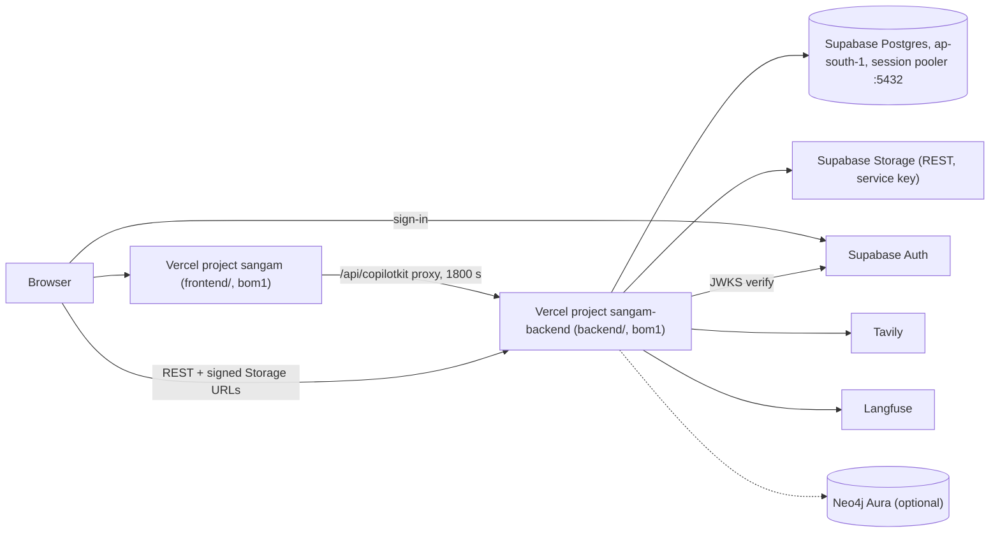

# Deploy and Vendors

Docker is for local development only. A deployed Sangam is two Vercel projects plus managed services, and each vendor has a few non-obvious constraints. This page collects them, and separates the GitHub automation that only *checks* code (CI, Dependency review, Codecov, Dependabot bumps) from the one workflow that *deploys* it. For environment variables and per-environment differences see [Environments](./environments.md); for the manual deploy procedure see [Deploying by Hand](../workflows/deploying-by-hand.md); for how the backend is assembled see [Platform](../architecture/platform.md).

## Checks versus deploys

Nothing deploys automatically, and nothing that runs automatically deploys.

| Workflow / service | Trigger | What it does | Deploys? |
|---|---|---|---|
| `ci.yml` (**CI**) | every pull request and every push to `master` | lint, tests, frontend build | No |
| `dependency-review.yml` (**Dependency review**) | every pull request | fails a PR whose lockfile changes add a package with a high or critical advisory | No |
| Codecov | uploads from the two backend CI test jobs | merges coverage and sets PR status checks | No |
| `deploy.yml` (**Deploy**) | `workflow_dispatch` only (Actions → Deploy → Run workflow) | `vercel deploy --prod` per project | Yes, by hand |

Migrations are not part of any of these: they are run by hand with `make migrate`.

### CI

`.github/workflows/ci.yml` opens with a comment that it deploys nothing. It has `contents: read` permission and a concurrency group `ci-<ref>` with `cancel-in-progress: true`, so a newer push to the same ref cancels the older run. Four jobs run in parallel:

- **`backend-lint`**: `uv sync --frozen` on Python 3.12, then `ruff check . --output-format=github` (ruff is pinned to `0.16.8` in `backend/pyproject.toml`).
- **`backend-unit`**: `pytest -m "not integration" --cov --cov-report=xml`, uploaded to Codecov with flag `backend-unit`.
- **`backend-integration`**: runs against a `pgvector/pgvector:pg17` service container on port 5433. It applies `db/init/*.sql`, then `app.db.migrate`, `seed.seed` and `seed.taxonomy_seed` (what compose init plus `make migrate` and `make seed` give locally), then `pytest -m integration -rs`, uploaded with flag `backend-integration`. `-rs` lists skips because a test skipping for "Postgres not reachable" would mean a broken job, not a pass. Two tests in `tests/test_migration_integrity.py` (`test_preserved_row_counts`, `test_documents_sequence_advanced`) are deselected: they check a restore of the original dump, which the seeder never creates.
- **`frontend`**: Node 22, `npm ci`, `npm run lint`, `npx tsc --noEmit`, `npm run build`.

Evals (the `eval` marker, which calls real models) are not run in CI. See [Testing overview](../testing/overview.md) for the tiers.

### Dependency review

`.github/workflows/dependency-review.yml` runs `actions/dependency-review-action@v4` on pull requests with `fail-on-severity: high` and `comment-summary-in-pr: on-failure`. It judges only what the PR's lockfile changes add; advisories already open stay in GitHub's Security → Dependabot alerts.

### Codecov

Both coverage uploads authenticate with GitHub OIDC (`id-token: write`, `use_oidc` is off for fork PRs, which fall back to a tokenless upload), so no Codecov token is stored. `codecov.yml` merges the two uploads into one report per commit (flags carry forward), and sets two statuses: **project** coverage may not fall more than 1% below the base commit (`target: auto`, `threshold: 1%`), and **patch** coverage (lines a PR adds or changes) must be at least 70%. A `fixes` rule maps `app/` to `backend/app/`, since `coverage.xml` paths are relative to `backend/`.

### Dependabot-driven bumps

`docs/CHANGELOG.md` records version bumps made in response to Dependabot alerts (2026-10-16): `next` 16.3.8, CopilotKit `~1.75.2`, `undici` and `katex` forced through npm `overrides` in `frontend/package.json`, and PyJWT 2.15.1. Those bumps land as ordinary pull requests, so they pass through CI and Dependency review like any other change, and are deployed only when someone runs Deploy. There is no `.github/dependabot.yml` in the repository (the plan in `docs/features/2026-10-16-ci.md` proposes one), so scheduling and grouping of Dependabot PRs is configured outside the repo, if at all. See [Platform](../architecture/platform.md) for the plan-versus-code discussion.

## Vercel

### Two projects, no automatic deploys

| Project | Root directory | Notes |
|---|---|---|
| `sangam` | `frontend` | Next.js app |
| `sangam-backend` | `backend` | FastAPI, framework preset `fastapi`, entrypoint `app/main.py` |

- Each project's `vercel.json` sets `"git": { "deploymentEnabled": false }`, so a push or merge never builds anything and there are no preview deployments. Production changes only when someone runs the manual **Deploy** workflow (`workflow_dispatch` only), which runs `vercel deploy --prod` against each project using the `VERCEL_TOKEN` secret. Each job is skipped when its directory is unchanged, except a manual run has no usable base ref and so deploys both. Runs are serialised per ref (`concurrency` group `deploy-<ref>`, `cancel-in-progress: false`), so a second run queues behind a deploy in flight rather than cancelling it.
- A `vercel.json` only works inside its project's **Root Directory** (`frontend/` or `backend/`); a copy at the repo root does nothing.
- `NEXT_PUBLIC_*` variables are inlined at build time, so changing one needs a fresh deploy, not just an environment edit.
- The Python bundle limit is 500 MB; the backend's dependency tree is roughly 256 MB. This is also why Supabase Storage is called over plain `httpx` rather than the `supabase` SDK, which would pull in extra client libraries.

### Region: `bom1`

Both `vercel.json` files pin `"regions": ["bom1"]` (Mumbai), next to the Supabase project in ap-south-1. At Vercel's default `iad1` every Postgres round trip crossed continents (~200 ms), so a 2 ms query cost over a second once `BEGIN`, `set_config` and `COMMIT` were counted. `curl -sI <backend>/health` should show `x-vercel-id: bom1::bom1`.

### Duration: 1800 s, and the two limits must match

`backend/vercel.json` sets `functions["app/main.py"].maxDuration` to `1800`. The frontend's `vercel.json` has no `functions` block; its long-running function is the CopilotKit proxy route `frontend/app/api/copilotkit/[[...slug]]/route.ts`, which declares `export const maxDuration = 1800`. Every Import turn streams through that route, and an 8-organisation Import takes 15-20 minutes, so:

- **Keep the two values equal.** If the proxy's limit were lower, Vercel would cut the stream while the backend was still working; if the backend's were lower, the run would be killed under a healthy proxy.
- 1800 s requires Vercel Pro's extended-duration setting.
- Long jobs also budget themselves under this ceiling: for example the news verifier's `news_verify_seconds` (600) exists so a pull still ends inside the 1800 s function limit.

If the CopilotKit proxy is ever removed (see [Frontend](../architecture/frontend.md)), the backend's `maxDuration` stays, because the browser would then stream straight from the backend.

### Keep-warm cron

`backend/vercel.json` defines a cron that calls `GET /health` every five minutes (`*/5 * * * *`). `/health` returns `{"status": "ok"}` and is one of the open paths that skip authentication. A request to a cold instance runs the lifespan (opens the Postgres pool, verifies the SQL catalog, opens the checkpointer and optional graph), so the cron keeps roughly one instance warm. It does nothing for concurrent bursts, which still start new instances. Agents themselves are built lazily on the first request that needs one, so a REST cold start does not pay for the agent stack.

## Supabase

One Supabase project supplies Postgres, Storage and Auth, in ap-south-1 (Mumbai).

### Postgres: use the session pooler on port 5432

- **Do not use the direct host.** `db.<ref>.supabase.co` resolves to IPv6 only, which Docker containers cannot reach, so connections hang rather than fail. The pooler has IPv4.
- **Use session mode (5432), not the transaction pooler (6543).** The transaction pooler breaks `pg_restore`. The backend's pool is also built with `prepare_threshold=0`, `autocommit=True`, so it does not depend on server-side prepared statements.
- The `STAGING_DB_*` block in `.env` is what `make migrate|seed|psql ENV=staging` uses to reach this database; use `sslmode=require` and percent-encode special characters in a URL password.
- The database holds application data **and** LangGraph checkpoints, so the role needs `CREATE` on `public`, and the `vector` and `pg_trgm` extensions must be available.
- **Connection budget.** The project allows 60 connections with 3 reserved. One process opens at most `DB_POOL_MAX_SIZE` (default 10), shared by REST, agent tools and the checkpointer; ten leaves room for about four backend instances plus the dashboard. Concurrency gates derive from it (`max(2, pool - 3)`), and raising `MAX_PARALLEL_RESEARCH` means raising the pool with it. See [Data and Migrations](../architecture/data-and-migrations.md).

### Auth

- The frontend signs in with Supabase using `NEXT_PUBLIC_SUPABASE_URL` and `NEXT_PUBLIC_SUPABASE_PUBLISHABLE_KEY`. Without them the public pages render but nobody can sign in.
- The backend verifies the access token against the project's JWKS (`<SUPABASE_URL>/auth/v1/.well-known/jwks.json`), accepting `ES256`/`RS256`, audience `authenticated` and issuer `<SUPABASE_URL>/auth/v1`.
- **`SUPABASE_URL` is also the auth switch.** Set, every request needs a valid token (no header is anonymous). Empty, every request is the seeded dev user (with `DEV_AUTH` on, `Bearer dev:<email>` can instead pick a seeded `@local.test` user, so each role can be tried locally). With `SUPABASE_URL` set, `DEV_AUTH=1` additionally accepts `Bearer dev` as the dev user; it is for local use and must never be set on a deployed backend. A malformed header or invalid token is a 401, and a valid token whose email is already linked to a different auth user is a 409. `SUPABASE_URL` is the project API URL (`https://<ref>.supabase.co`), not the database host. Roles and RLS are described in [Auth, Roles and RLS](../architecture/auth-roles-rls.md).
- Browser calls to the backend need CORS: `ALLOWED_ORIGINS` for exact origins, and optionally an anchored `ALLOWED_ORIGIN_REGEX`. An unanchored pattern would also match look-alike hosts.

### Storage

`backend/app/integrations/storage.py` is the only module that talks to Storage, using the REST API at `<SUPABASE_URL>/storage/v1` with the **service-role key** (`SUPABASE_SERVICE_KEY`). That key bypasses row-level security, so it stays server-side; browsers only ever receive signed URLs.

Buckets (private, created by `db/migrations/0020_storage_buckets.sql`; the staff bucket by a later migration):

| Bucket | Holds | Key shape |
|---|---|---|
| `source-archive` | documents research downloaded, kept so a fact survives its source URL dying; also rendered briefs at `entities/<slug>.md` | at fetch `<sha256(url)[:12]>/<sha256(bytes)>-<name>`; after promotion `funders/<slug>/<year>-<name>` |
| `org-vault` | what an organisation uploads about itself | `<org_id>/<uuid4>-<name>`; the leading `org_id` is what the RLS policy reads |
| `staff-sources` | staff-only workbooks, up to 100 MB | uploaded by script or dashboard |

Behaviour worth knowing:

- **Optional by design.** With `SUPABASE_URL` or `SUPABASE_SERVICE_KEY` unset, every call is a no-op that logs once; archived documents get a null `storage_path`, and the document upload routes answer 503. Nothing in research, promotion or the rest of the API changes.
- **Storage never raises into a run.** Failures log a warning and return `None`/empty; a Storage outage must not abort research or promotion. A duplicate upload counts as success because keys are content-addressed. Supabase reports a duplicate as HTTP 400 with `statusCode: "409"` in the body, so the code inspects the body, not only the status. Likewise a missing object can be 404 or 400 `not_found`.
- **Size and time limits.** Archive uploads over 50 MB are refused before sending; requests time out at 120 s. Signed download URLs last 10 minutes by default (briefs 1 hour); signed upload URLs are fixed by Supabase at 2 hours.
- **Why signed upload URLs.** Vercel Functions cap request bodies at a few MB, and annual reports are larger, so the backend authorises the caller and mints a URL; the browser sends the bytes directly to Storage. Because the backend never sees the bytes at that moment, vault keys use a uuid, not a content hash; `content_hash` is computed afterwards from bytes read back. `stat` confirms an upload landed before a `documents` row claims it did.
- **Path safety.** `split` returns `None` for any path not in a known bucket or containing empty/`.`/`..` segments, so only objects the app wrote can be turned into URLs.
- `docs/features/2026-09-30-supabase-storage.md` still says "planned, nothing built"; it is a design record. The code and migrations exist.

## Outbound fetch guard (egress)

`backend/app/core/egress.py` holds the address check, `private_address_refusal`, and `guarded_client()`, an `httpx` client whose request hook runs that check on **every hop including redirects**. It refuses non-http(s) URLs, `localhost`, single-label hosts, and any literal or resolved address that is not globally routable. It handles inet_aton forms (`2130706433`, `0x7f.1`), IPv4-mapped, 6to4, Teredo and NAT64 addresses, and resolves DNS before deciding. A check that cannot decide refuses. This matters on Vercel because the function can otherwise be steered at internal endpoints.

Where it is applied:

- `guarded_client` is used directly by the `download_file` tool (`agent/tools/files.py`), the robots.txt fetch in `ingest/access.py`, and the grant-calls pull (`ingest/calls/pull.py`). A hop it refuses raises `EgressRefused`, whose `REFUSED: ...` reply is returned to the caller.
- Import's `read_page` and `search_public_sources` do not use `guarded_client`. They call `check_url` (`ingest/access.py`), which runs `private_address_refusal` and then the source registry and robots.txt rules. `read_page`'s own client re-runs `check_url` on every redirect hop. Search results are labelled `READABLE` or `HELD` by the same check.
- Ask Sangam has no web tool, so it has no outbound fetch path. `backend/app/agent/tools/web.py` is only a thin Tavily search factory (`make_web_search`) used by Import; it does no URL guarding itself.

Refusals are final answers to the agent (`REFUSED: ...`), not obstacles to retry around.

## Tavily

`TAVILY_API_KEY` is optional and used in two places:

- Import's `search_public_sources` (via `langchain_tavily`). With no key it returns `SEARCH UNAVAILABLE` and tells the agent to ask the user for a URL. A failed search returns a text error rather than ending the run, and each result is labelled `READABLE` or `HELD` by `check_url`, the same source-access check (see above). The Tavily client itself comes from `make_web_search` in `agent/tools/web.py`.
- The Media & Signals collector (`adapters/tavily_news.py`) posts to `https://api.tavily.com/search` with `topic: news`, `search_depth: advanced`, up to 20 results, retrying three times 3 s apart. Total failure raises `SearchFailed` so the subject's watermark does not advance; Facebook URLs are dropped. Cost is budgeted per search (`news_search_cost_usd`). See [Media and Signals](../architecture/media-and-signals.md).

## Langfuse

Tracing (`backend/app/integrations/tracing.py`) turns on only when both `LANGFUSE_PUBLIC_KEY` and `LANGFUSE_SECRET_KEY` are set; the host defaults to `https://cloud.langfuse.com`.

- **Deployed traces are labelled automatically.** The environment falls back from `LANGFUSE_TRACING_ENVIRONMENT` to Vercel's `VERCEL_ENV`, and the release from `LANGFUSE_RELEASE` to `VERCEL_GIT_COMMIT_SHA`.
- **Masking and clipping.** Payloads are clipped to 4000 characters; `LANGFUSE_MASK_TOOL_RESULTS=1` redacts query result rows (SQL and counts stay). The mask must be attached when the first client is built, so `configure_langfuse()` runs before agents are built; if a client already exists without the mask, tracing is refused rather than leaking rows.
- **Configured on first agent use, not at process boot.** `configure_langfuse()` is called from `_build_agents` in `backend/app/core/lifespan.py`, which runs lazily on the first request that needs an agent (and the news run configures it for itself), so a cold REST-only instance never touches Langfuse. The "Langfuse tracing enabled/disabled/NOT tracing" log lines and the LangSmith status line therefore appear when agents are first built, not in the "Sangam backend ready" line.
- **Fails loudly but never fatally.** When it configures, it calls `auth_check()`; wrong keys or host would otherwise be dropped silently with a background 401, so it logs an error and disables tracing. Any other failure continues untraced.
- **Serverless flush.** A Vercel function freezes after answering, so each agent run and each news run flushes traces in a `finally` (`SessionScopedAGUIAgent.run`, `flush_traces`). On shutdown the lifespan also does a best-effort `shutdown()` of the client, but only if Langfuse is enabled and agents were built.
- AG-UI thread ids map to Langfuse sessions so a multi-turn chat is one session. FastAPI's own spans are off.
- LangSmith is independent and switched on by environment variables alone (`LANGSMITH_TRACING`, `LANGSMITH_API_KEY`); the boot log states which is missing.

## Neo4j Aura

The Graphiti knowledge graph is optional. It activates only when `NEO4J_URI` **and** `OPENAI_API_KEY` are set (Graphiti's extraction and embeddings use OpenAI). Locally that is the bundled `neo4j:5-community` container (`bolt://neo4j:7687`); deployed it is a hosted Neo4j Aura instance, or the graph is omitted. `open_graph` imports `graphiti_core` lazily, builds indices at startup and logs a reason when disabled, so the app boots without it. Nothing may live only in the graph: it is rebuilt from Postgres by `make graph-seed`.

## Checking a deployment

- `GET /health` on the backend returns 200 and `x-vercel-id` starts `bom1`.
- The boot log line ("Sangam backend ready") reports process age, connect time, model, research concurrency, pool size and gate slots. Whether Langfuse/LangSmith are on is logged later, when agents are first built ("Agents built on first use"); the graph's state is logged by `open_graph`.
- Frontend and backend `maxDuration` are both 1800.
- Backend env has `DATABASE_URL` (session pooler), `SUPABASE_URL`, `SUPABASE_SERVICE_KEY`, `ALLOWED_ORIGINS`; `DEV_AUTH` is unset.
