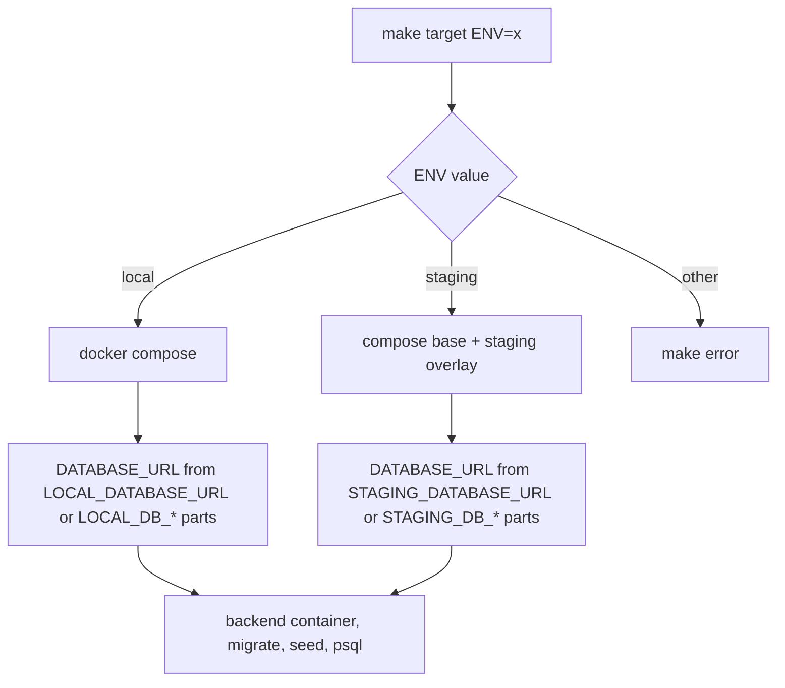

# Environments and Env Vars

Sangam has two *tooling* environments, `local` and `staging`, and they differ in exactly one thing: **which Postgres the local Docker stack and the Make targets talk to**. Docker is for local development only. A deployed Sangam is two Vercel projects whose variables come from their own dashboards; `.env` is never shipped anywhere (see [Vercel and Supabase Specifics](./deploy-and-vendors.md)). Nothing in this page deploys anything.

## What `ENV` does

`ENV` is a Make variable, default `local`. The Makefile maps it to a compose command and rejects any other value with an error.

| `ENV` | Compose command | Database used |
|---|---|---|
| `local` (default) | `docker compose` | The bundled `pgvector/pgvector:pg17` container, built from the `LOCAL_DB_*` block |
| `staging` | `docker compose -f docker-compose.yml -f docker-compose.staging.yml` | The managed Postgres named by the `STAGING_DB_*` block |

*One variable, `ENV`, chooses the compose file set, which in turn decides the `DATABASE_URL` every DB-touching container sees.*

### The overlay mechanism

`docker-compose.yml` defines the backend's `DATABASE_URL` from the `LOCAL_DB_*` parts (host `postgres`, port `5432`, user/password/db `sangam`, `sslmode=prefer` by default) or, if set, a full `LOCAL_DATABASE_URL`. It uses libpq keyword/value form rather than a URL, so a password containing `@ : / ? #` needs no percent-encoding. The legacy `POSTGRES_PASSWORD` is still honoured as a fallback.

`docker-compose.staging.yml` is an overlay that redefines only `services.backend.environment.DATABASE_URL`, from `STAGING_DATABASE_URL` or the `STAGING_DB_*` parts. `STAGING_DB_HOST`, `STAGING_DB_USER` and `STAGING_DB_PASSWORD` use compose's `:?` guard, so an empty staging block fails fast with a readable message instead of silently connecting to localhost. Port defaults to `5432`, name to `postgres`, and `sslmode` to `require`. If you use a URL, percent-encode `@ : / ? #` in the password.

Compose is the single source of truth for the connection string. `scripts/db-url.sh` runs `<compose> config --format json`, extracts the backend's `DATABASE_URL`, and prints compose's own error if a guard failed. The Makefile's `DB_URL` variable (lazy, so only evaluated by targets that use it) calls it. `make db-url` prints the resolved string, **password included**.

### What `ENV=staging` is, and is not

- It **deploys nothing**. It points local tooling (migrations, seeding, `psql`, doc rendering) at the managed database. The deployed frontend and backend run on Vercel with their own variables.
- `make up ENV=staging` runs *your* containers against the *shared* database. A research run from your machine then writes straight into the database the deployed app serves, with no undo.
- `STAGING_DB_*` are **local-tooling variables only**. The backend reads `DATABASE_URL` (`Settings.database_url`). Setting `STAGING_DB_*` on a deployed host does nothing.
- The staging role needs `CREATE` on the `public` schema, because that database holds application data **and** the LangGraph chat checkpoints, whose tables are created at boot. The instance needs the `vector` and `pg_trgm` extensions.
- Supabase's session pooler (port 5432), not the direct host, is the right target for Docker; see [Vercel and Supabase Specifics](./deploy-and-vendors.md).

### Which targets honour `ENV`

`make help` states it: `ENV` is honoured by `up`, `down`, `logs`, `seed`, `migrate`, `migrate-status`, `psql`, `client-docs`, the data-seeding targets that run through `$(COMPOSE)`, and the remote targets. It is **not** honoured by the `db-clean`, `db-reset`, `db-backup` and `db-upgrade` group, which call `require_local` and refuse to run for any other `ENV` because they shell into the bundled Postgres container. `db-init-remote` and `db-push-remote` do the opposite and refuse `ENV=local`; both also refuse to run if the target already has an `orgs` table.

`make staff-source` runs only with `ENV=staging`, because Storage is global (below). `make client-docs` and `make evals` run on the host venv; `client-docs` uses the published port `5433` for local rather than `$(DB_URL)`, whose host `postgres` exists only on the compose network.

## Pinned to local: `make up` and `make seed`

Migrations are not automatic, and the backend refuses to boot against an unmigrated database (`_verify_sql_catalog` raises when a catalogued table is missing). So the Makefile makes the local path safe and the staging path deliberate:

- `make up`: if `ENV=local` **and** the compose file defines a `postgres` service (that is, the `localdb` profile is active), it starts Postgres with `--wait`, runs `make migrate ENV=local`, then `docker compose up --build -d --wait`. Under `ENV=staging`, or with `COMPOSE_PROFILES` lacking `localdb`, it prints "not migrating" and skips the bootstrap step.
- `make seed`: `seed` depends on `migrate` only under `ENV=local` (a Makefile `ifeq`). Against staging, `make migrate ENV=staging` is a separate decision you take after a backup, because a managed instance can be many migrations behind. The seed itself runs `seed.seed` then `seed.taxonomy_seed` via `compose run --rm --no-deps backend`, using `run` rather than `exec` so `ENV=staging` is honoured.

For writing the migrations themselves see [Writing a Migration](../workflows/writing-a-migration.md); for first-run steps see [Quickstart](../quickstart.md).

## Storage is global, not per-environment

`SUPABASE_URL` and `SUPABASE_SERVICE_KEY` are not environment-scoped. With the backend on the local Postgres, `fetch_document` still archives the file into the cloud `source-archive` bucket, so the `documents` row is local while the object it names is not. Running `ENV=staging` puts both halves in the same place. This is why `staff-source` is staging-only and why local development without those two variables simply skips archiving (see Optional integrations below).

## Env var reference

All variables live in `.env.example` (copy to `.env`; compose reads it automatically). Reading `.env` itself is denied to coding agents by design; read `.env.example` for the names.

### Database

| Variable | Purpose |
|---|---|
| `LOCAL_DB_HOST/PORT/USER/PASSWORD/NAME/SSLMODE` | The six parts of the local connection. Defaults `postgres`, `5432`, `sangam`, `sangam`, `sangam`, `prefer` |
| `LOCAL_DATABASE_URL` | Optional full string; overrides the six parts |
| `STAGING_DB_*`, `STAGING_DATABASE_URL` | Same shape for the managed database; used only through `ENV=staging` |
| `COMPOSE_PROFILES=localdb` | Starts the bundled Postgres. Remove it to run against a managed database; nothing else changes |
| `DATABASE_URL` | What the backend actually reads (`Settings.database_url`; default is `localhost:5433`, for running outside Docker). Compose computes it; deployed hosts set it directly |

The Postgres container publishes `5433` on the host (container `5432`), and the backend publishes `8010` (container `8000`). The `depends_on` on Postgres is `required: false`, so the backend still starts when the bundled DB is switched off.

### Models

`MODEL` (default `anthropic:claude-opus-5-5`) reasons for Ask Sangam and the Import supervisor. `RESEARCH_MODEL` (`anthropic:claude-sonnet-5-5`) runs the entity-researchers, which consume most of an import's tokens. `UTILITY_MODEL` (`anthropic:claude-haiku-4-5`) handles fixed-shape work. `SQL_AUDIT_MODEL` (Haiku by default) runs a post-answer audit of each SQL answer and costs one extra model call per SQL turn; setting it to `off` (case-insensitive) disables it. Format is `provider:model_name` with `anthropic`, `openai` or `google_genai`.

Provider keys: `ANTHROPIC_API_KEY` is the one required key and must match `MODEL`'s provider; `OPENAI_API_KEY` and `GOOGLE_API_KEY` are optional. `OPENAI_API_KEY` is needed separately for the graph because Anthropic has no embedding models.

### Import concurrency and limits

- `MAX_PARALLEL_RESEARCH` (default 8): organisations researched at once. It bounds a wave, not the list size; larger lists run in waves.
- `DB_POOL_MAX_SIZE` (default 10): connections this process may open. Raise it together with `MAX_PARALLEL_RESEARCH`, because each researcher holds a pooled connection while its tools run. The ceiling is the database's (Supabase allows 60 connections, 3 reserved, shared by every deployed instance).
- `RESEARCH_PAGE_LIMIT`, `RESEARCH_MODEL_CALL_LIMIT`: optional per-researcher hard stops. Blank means no limit.

`Settings.db_gate_slots` is derived: `max(2, DB_POOL_MAX_SIZE - 3)`. The concurrency gates for SQL execution and ingest sit *under* the pool, because the LangGraph checkpointer writes on every graph step through the same pool and a gate equal to the pool size would starve it.

### Auth and the Supabase project

- `SUPABASE_URL` is the project API URL (`https://<ref>.supabase.co`), not the database host. **Setting it turns auth on**: requests must carry a Supabase access token. Empty means every request is the seeded dev user. Compose forwards `SUPABASE_URL` defaulting to `NEXT_PUBLIC_SUPABASE_URL`.
- `NEXT_PUBLIC_SUPABASE_URL` and `NEXT_PUBLIC_SUPABASE_PUBLISHABLE_KEY` serve the frontend's sign-in. Unset, public pages and the `/ask` preview still render but nobody can sign in. They are inlined at build time on Vercel.
- `DEV_AUTH` (default off): additionally accepts `Authorization: Bearer dev` as the dev user. Local only; never set on a deployed backend. `make smoke` sends that token, so it needs it set. It is only consulted when auth is enabled.

### Optional integrations (all degrade, none crash)

| Feature | Variables | When unset |
|---|---|---|
| Supabase Storage (document archive, org Doc Vault) | `SUPABASE_URL` + `SUPABASE_SERVICE_KEY` | Archiving is skipped and upload routes return 503; research and promotion run unchanged |
| Knowledge graph | `NEO4J_URI` + `OPENAI_API_KEY` (and `NEO4J_USER`, `NEO4J_PASSWORD`) | `graph_enabled` is false; `search_graph` tells the agent to use the DB tools |
| Web search | `TAVILY_API_KEY` | The agent's web-search tool is off |
| Langfuse tracing | `LANGFUSE_PUBLIC_KEY` + `LANGFUSE_SECRET_KEY`, `LANGFUSE_HOST`, `LANGFUSE_TRACING_ENVIRONMENT`, `LANGFUSE_RELEASE`, `LANGFUSE_MASK_TOOL_RESULTS` | Tracing is off unless **both** keys are set |
| LangSmith tracing | `LANGSMITH_TRACING`, `LANGSMITH_API_KEY`, `LANGSMITH_PROJECT`, `LANGSMITH_ENDPOINT` | Off; the boot log says which of the two is missing |

`SUPABASE_SERVICE_KEY` is the service-role key and bypasses row-level security, so it stays server-side: never `NEXT_PUBLIC_`, never sent to the browser. The browser receives short-lived signed URLs minted by the backend.

Langfuse specifics: `LANGFUSE_TRACING_ENVIRONMENT` separates local traces from deployed ones; unset, the client falls back to `VERCEL_ENV`, and the release falls back to `VERCEL_GIT_COMMIT_SHA`. The SDK validates credentials at start and `LANGFUSE_MASK_TOOL_RESULTS` redacts query results from the `db_query` span only (a reduction, not a guarantee). LangSmith reads its variables straight from the process environment; no code wires them, which is why they must be forwarded through compose.

Neo4j in the compose file is **pinned**: the backend service sets `NEO4J_URI=bolt://neo4j:7687` and the bundled credentials itself, and `EMBEDDING_DIM=768`. Changing the `NEO4J_*` lines in `.env` does not affect the local Docker backend; they matter for deployed hosts (Neo4j Aura).

### CORS

`ALLOWED_ORIGINS` (comma-separated exact origins, default `http://localhost:3000`) and `ALLOWED_ORIGIN_REGEX` (for Vercel hostnames an exact list cannot cover). Anchor the regex with `^` and `$`, or `https://sangam-x.vercel.app.attacker.com` would match. An empty regex is passed to the CORS middleware as `None`, because an empty pattern would match every origin.

### Frontend (compose-set)

`AGENT_URL` (`http://backend:8000/agent`, ends in `/agent`) is used by server components and the CopilotKit proxy; `NEXT_PUBLIC_API_URL` (`http://localhost:8010`) does not end in `/agent`. The asymmetry is deliberate. `make dev-frontend` instead points `AGENT_URL` at `http://localhost:8000/agent` and sources only the `NEXT_PUBLIC_SUPABASE_*` lines from `.env`.

### Settings with no `.env.example` entry

`Settings` also carries tunables that compose does not forward: the `NEWS_*` bars and cost figures for Media and Signals, `SQL_TIMEOUT_MS` (5000), `SQL_MAX_ROWS` (50), `SQL_MAX_ATTEMPTS`, `RECURSION_LIMIT` (200), `DOWNLOADS_DIR`, `GITHUB_PAT`, `GITHUB_MCP_URL`, `PLAYWRIGHT_MCP_URL`, `MCP_SERVERS` and `GITHUB_TOOL_ALLOWLIST`. Pydantic matches env names case-insensitively, so each is the upper-cased field name. Inside Docker they stay at their code defaults unless you add them to the compose `environment:` block; on Vercel set them in the dashboard.

## How blank values and defaults work

The rule: **`config.py` is the only place defaults are written, and a blank value means "use the default".**

- Compose forwards optional variables as `${NAME:-}`, so an unset variable reaches the container as an empty string, not as a missing variable. A hand-edited `.env` line with nothing after `=` does the same.
- `Settings._blank_means_default` is a `mode="before"` validator on `model`, `research_model`, `utility_model`, `sql_audit_model`, `max_parallel_research`, `research_page_limit`, `research_model_call_limit` and `db_pool_max_size`. If the value is a blank string it returns the field's declared default. Without it, an empty integer made the container refuse to boot.
- For `research_page_limit` and `research_model_call_limit` the declared default is `None`, so blank means no limit.
- `dev_auth` has its own validator: an empty string means `False`.
- Other string settings (for example `SUPABASE_URL`, `NEO4J_URI`) default to `""`, which is itself the "disabled" state, so blank and unset are equivalent there too.
- `SQL_AUDIT_MODEL=off` is converted to the empty string after validation, which the audit treats as disabled. Note the order: a *blank* value gets the Haiku default (audit on); only the literal `off` turns it off.
- `Settings` reads `.env` (`env_file=".env"`, `extra="ignore"`, so unknown keys are harmless) and `get_settings()` is `lru_cache`d, so values are fixed per process.

Feature switches are derived properties, not separate flags: `auth_enabled` (`SUPABASE_URL`), `graph_enabled` (`NEO4J_URI` and `OPENAI_API_KEY`), `langfuse_enabled` (both Langfuse keys), `storage_enabled` (`SUPABASE_URL` and `SUPABASE_SERVICE_KEY`).

### The forwarding trap

A variable absent from the compose `backend.environment` block never reaches the container, however it is set in `.env`, because `.env` is not mounted into the backend container (only `backend/app`, `seed` and `db` are). This is how LangSmith tracing once stayed silently dead. When adding a variable that must work in Docker, add it to the block as `${NAME:-}` and, if it is an integer or model name, include it in the blank-means-default validator.

## Local ports and running outside Docker

| Service | Host port |
|---|---|
| Frontend | `3000` |
| Backend (container `8000`) | `8010` |
| Postgres (container `5432`) | `5433` |
| Neo4j | `7474` (browser), `7687` (bolt) |

`make dev-backend` runs `uvicorn` on the host against `localhost:5433` with inline credentials and serves on `8000`; that is why `make dev-frontend` targets `8000` while `make smoke` defaults to `8010`. The migration runner needs `MIGRATIONS_DIR` outside Docker, since it defaults to the container path `/srv/db/migrations`. `make evals` sources `.env` quietly on the host venv and points `TEST_DATABASE_URL` at the local Postgres on `5433`.

## Safe-change checklist

- New backend setting: add the field with its default in `config.py`, add it to the compose `backend.environment` block as `${NAME:-}`, document it in `.env.example`, and add it to the blank validator if it is not a plain optional string.
- New per-environment database behaviour: change the `:?`-guarded overlay, not the Makefile, since `scripts/db-url.sh` and every `$(COMPOSE)` target read from compose.
- Anything destructive or schema-changing against a managed database must stay an explicit `ENV=staging` command, never a side effect of `up` or `seed`.

See also [Platform](../architecture/platform.md) for how settings feed the lifespan and app assembly.
