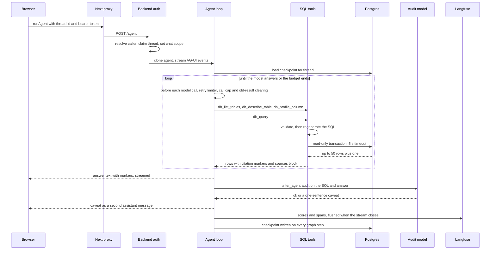

# One Ask Turn, End to End

A *turn* is one user question and everything the agent does until it stops. This page follows a single turn through every hop. It complements [Ask Sangam](../architecture/ask-sangam.md), which describes how the agent is assembled, and [Frontend](../architecture/frontend.md), [Auth, Roles and RLS](../architecture/auth-roles-rls.md) and [Platform](../architecture/platform.md), which cover the surrounding layers.

## The path at a glance

Caption: the main hops of one Ask turn. The loop repeats per tool call, and the checkpoint write happens throughout the run, not only at the end.

## 1. Browser: sending the question

- `ChatPane` (`frontend/features/ask/components/ChatPane.tsx`) calls `send()` from `useSangamChat`, which is `useAgentChat(threadId, "sangam_agent", "sangam-chat", ...)`. On the first send of a new chat it also saves the title to `localStorage` through `saveThread` (`titleFrom` trims it to 56 characters). The server later keeps its own title, taken from the first user message.
- `useAgentChat` (`frontend/lib/useAgentChat.ts`) registers a per-thread local agent (`sangam-chat-<threadId>`) that targets the backend graph `sangam_agent`. `send()` appends the user message to the agent and calls `copilotkit.runAgent`. A blank question is ignored, and `ChatPane` also refuses to submit while a run is in progress.
- `AgentProviders` configures `CopilotKitProvider` with `runtimeUrl="/api/copilotkit"` and an `Authorization: Bearer <Supabase access token>` header that follows Supabase auth state (`getSession` plus `onAuthStateChange`). Without a token the header is omitted. In the local dev-login mode (`DEV_LOGIN`: no `NEXT_PUBLIC_SUPABASE_URL` and `NEXT_PUBLIC_DEV_AUTH=1`) it sends `Bearer dev:<email>` instead, which the backend accepts only for seeded `@local.test` users.
- A reopened chat calls `fetchThreadMessages` (`GET /api/threads/{id}/messages`) to fill history. This happens only once the registered agent is ready, and only if the agent has no messages yet. A failed history load is swallowed. A 404 yields an empty chat.

## 2. The chat proxy

`frontend/app/api/copilotkit/[[...slug]]/route.ts` is a thin CopilotKit runtime. It maps `sangam_agent` to an `HttpAgent` on `AGENT_URL` (default `http://localhost:8000/agent`; in compose it is `http://backend:8000/agent`), `sangam_ingest` to the sibling `/ingest` URL and `sangam_proposal` to `/proposal` (see [Proposal Lifecycle](proposal-lifecycle.md)), all derived from the one env var. It uses an `InMemoryAgentRunner` and sets `maxDuration = 1800`, which is sized for Import turns of 15 to 20 minutes and must match `backend/vercel.json`. The proxy contains no auth or SQL logic: authentication and thread ownership are decided by the backend.

## 3. Backend: auth, thread ownership, route

Three things happen before the agent sees the request.

1. **`AuthMiddleware`** (`backend/app/core/security.py`) resolves the caller once per request and leaves it on the request state. It is plain ASGI, not `BaseHTTPMiddleware`, because buffering would break the chat stream. With `SUPABASE_URL` unset every request is the seeded dev user (the local-only `Bearer dev:<email>` form instead picks a seeded `@local.test` user when `DEV_AUTH` is on). When it is set, no header means anonymous, a valid Supabase JWT is that user, `Bearer dev` is the dev user only with `DEV_AUTH` on, and anything else is 401. The middleware also leaves the caller's Postgres identity (`anon` or `authenticated`, with token claims) on the request state. See [Auth, Roles and RLS](../architecture/auth-roles-rls.md).
2. **`ask_access`**, the dependency registered for `/agent` in `AGENT_ACCESS` (`/ingest` uses `require_scout` and `chat_access`, `/proposal` uses `proposal_chat_access`), requires a signed-in principal (anonymous gets 401). It calls `_own_thread`, which runs `threads.claim_thread`. A new thread id is claimed by the caller, and an existing owner's turn bumps `updated_at`. A thread owned by someone else returns **404** (not 403), and staff are not exempt: a turn checkpoints rows read as its caller, which the owner's next turn would replay. It then sets the `chat_user_id` and `chat_scope` context variables, which tools and tracing read because they see the run but not the request. Finally `ask_access` (unlike `chat_access`) sets `agent_caller` to the caller's database role and claims, so Ask Sangam's SQL runs as that caller, and resets `caveats_given` to an empty set, the per-turn memory of which tables' data caveats the model has already been given (section 5).
3. **`run_agent`** in `backend/app/core/lifespan.py` calls `load_agents`, which builds the agent graphs lazily, on first use, under an `asyncio.Lock`. The first post to an agent route does this, as does the first REST route that calls `get_graph`. A REST cold start on a route that does not need a graph never pays for deepagents imports. It clones the `SessionScopedAGUIAgent` per request, because `LangGraphAgent` keeps per-run state on the instance. It streams `agent.run(input_data)` through an AG-UI `EventEncoder` as a `StreamingResponse`.

At boot the lifespan builds the one shared psycopg pool with `make_pool` (defined in `backend/app/db/checkpointer.py`, sized by `DB_POOL_MAX_SIZE`, default 10), opens it and publishes it as `db.pool.pool`. It then runs `_verify_sql_catalog` (the process refuses to start if the SQL allowlist drifts from the database schema), opens the checkpointer with `open_checkpointer(pool)` and registers `/agent`, `/ingest` and `/proposal`. `open_checkpointer` runs no DDL: it only compares the database's `checkpoint_migrations` version with the one this langgraph expects, and raises `RuntimeError` ("... run make migrate") when they differ, so an unmigrated database fails the boot instead of racing concurrent cold starts.

## 4. The agent loop

`build_agent()` in `backend/app/agent/build.py` creates a deep agent with six tools (`db_list_tables`, `db_describe_table`, `db_profile_column`, `db_query`, `search_graph`, `compare_fit`) and the read-only `read_file` and `ls` skill readers. `fetch_url` was removed from Ask, so Ask fetches no model-supplied URL. Its system prompt is `instructions.md`, rendered by `render_prompt` in `backend/app/agent/prompt.py`, which substitutes the catalog's one-line-per-table `TABLE_MAP` for the `{{TABLE_MAP}}` placeholder (a plain `.replace`, since the file is full of braces). The model therefore starts with the list of readable tables, and `db_list_tables` only shows it again. Its checkpointer is the shared Postgres saver, and its graph config binds `recursion_limit` (default 200 graph steps, because each middleware hook is a node) and the Langfuse handler. Details of the tool list are in [Ask Sangam](../architecture/ask-sangam.md).

`SessionScopedAGUIAgent.prepare_stream` (`backend/app/integrations/tracing.py`) adds Langfuse metadata to the run config (`langfuse_session_id` is the thread id, plus the user id and AG-UI run id). It also drops duplicate tool results when the browser re-sends them under its own ids.

The checkpointer (`AsyncPostgresSaver` on the same pool as REST and the tools) writes on every graph step, keyed by thread id, and its tables are created by `make migrate`, not at boot. A follow-up question on the same thread resumes from the saved message list. Reloading a chat reads that state back through the graph (`aget_state`) after `can_open` has checked ownership on the owner pool (checkpoints are closed to callers, so access is decided before anything is read). `GET /api/threads/{id}/messages` returns 404 when the caller may not open the thread and 503 if the graph is not loaded.

The pool itself is tuned for serverless: `min_size=1`, `max_size=DB_POOL_MAX_SIZE`, `max_idle=300`, a connection health check on checkout (a thawed Vercel instance may hold sockets the pooler closed), `autocommit=True`, `prepare_threshold=0` and `dict_row` rows. A request that waits more than `DB_POOL_TIMEOUT_S` (10 s) for a connection fails rather than hangs, and `DB_CONNECT_TIMEOUT_S` (5 s) bounds opening a new one. `db_gate_slots` keeps tool concurrency at pool size minus 3 (minimum 2) so the checkpointer, which writes on every step, is never starved.

The prompt drives a fixed rhythm: discover with `db_list_tables`, read columns with `db_describe_table`, check stored spellings with `db_profile_column` before filtering on text, then write one `db_query`. Zero rows are reported as an answer, not retried with looser filters. Funder fit goes through `compare_fit` instead of SQL.

Middleware list that `build.py` passes to `create_deep_agent`, in order:

1. a filesystem middleware restricted to `read_file` and `ls` (skills only);
2. `tool_errors()`, a `ToolErrorMiddleware` backstop: a tool that raises past its own `try/except` answers the model with `<tool> failed: <ExceptionType>. Try another way...` (the type only, because a raw message can carry SQL, paths or keys) instead of ending the run;
3. `sql_retry_limiter`, a `before_model` hook that can jump to the end of the graph;
4. `model_call_cap(settings.ask_model_call_limit)`, a second `before_model` hook that can jump to the end: after 25 model calls (default) for one question it appends a fixed "ask a narrower question" message. It ends a runaway turn long before `recursion_limit` does;
5. `CompareFitBudget`, a tool-call wrapper that refuses, in code, a `compare_fit` with the same arguments as an earlier call this turn and any call past the third (`MAX_COMPARE_FIT_CALLS`). A call that adds `funder_ids` counts as different arguments. The refusal is an error `ToolMessage` telling the model to answer from the results it has;
6. `clear_old_tool_results`, a `ContextEditingMiddleware` holding one `SteppedClearToolUsesEdit`. It does nothing until the context passes 60,000 tokens (`TOOL_RESULT_CLEAR_TRIGGER_TOKENS`). Past that it clears the oldest tool results in whole 20,000-token steps (`TOOL_RESULTS_CLEAR_STEP`), always keeping the 5 most recent results (`TOOL_RESULTS_KEPT`) so follow-ups can refer back, and never clears `compare_fit` output (`NEVER_CLEARED`). The edit runs on a copy before each model call. What the model is sent therefore stays under the trigger however long the turn runs, and the cleared set, and so the cached prompt prefix, moves once per step instead of on every call. The earlier setting (trigger 40,000, no step) cleared a different result on every call past the trigger and broke the prompt cache each time. Sangam Pitch and Sangam Import call the same `clear_old_tool_results()`;
7. `fallback(settings.model, settings.research_model)`, a `ModelFallbackMiddleware` that tries `RESEARCH_MODEL` when a model call fails. It is omitted when both tiers are the same model;
8. `cheap_summarizer`, which replaces the agent's own summarizer with one that has the same thresholds but writes the summary on `UTILITY_MODEL`;
9. `answer_audit`, appended only when `sql_audit_model` is non-empty.

The two hooks that can jump to the end of the graph (`sql_retry_limiter` and the call cap) come before the hooks that do work. The filesystem middleware only adds tools, so its place is free. `tests/test_ask_budgets.py` pins the call cap, the `compare_fit` repeat and fourth-call refusals, the fallback and cheap summarizer in Ask's stack, and that the cap's "end" edge reaches `__end__` or an `after_agent` hook such as the audit. `tests/test_tool_errors.py` pins that Ask's stack holds exactly one `ToolErrorMiddleware`, and that a raising tool yields the exception type and never its message. `tests/test_agent_middleware.py` pins the clearing behaviour: nothing is cleared below the trigger, the sent size stays under the trigger for turns of 13 to 60 calls, the cache-break count is bounded by the number of 20k steps, the 40,000/no-step setting breaks the cache on most calls, and `compare_fit` survives while the latest five results stay.

`compare_fit(org_id)` is shaped to fit that budget: it replies in text, with up to 10 strong or medium fits in full detail (`FULL_DETAIL_MAX`) and every other funder on one line, so the reply stays under deepagents' 20,000-token tool-result eviction (see [Funder Match](../architecture/funder-match.md)). `compare_fit(org_id, funder_ids)` returns any of the one-line funders in full. The design draft `docs/features/2026-10-16-ask-efficiency.md` lists milestone 3 items for leaner SQL calls. Three of them are now in the code: the prompt's table map (above), an automatic citation id column (the validator adds a table's id when the model did not select it) and caveats given in full once per turn (section 5).

## 5. The SQL layers

`db_query(sql, purpose)` in `backend/app/agent/tools/sql_tools.py` is the only route to table data. A call passes through four layers (`catalog`, `validator`, `executor`, `render`) under `backend/app/agent/tools/sql/`:

| Layer | What it does |
|---|---|
| **Catalog** | The allowlist of readable tables and columns, with descriptions, foreign keys, known data defects, heavy columns, the citation kind of each id column, and source (provenance) columns. |
| **Validator** (`validate`) | Parses with sqlglot (postgres). Rejects over 8,000 characters, anything but exactly one query, writes anywhere in the tree, `INTO`, locking clauses, `WITH RECURSIVE`, CTEs that shadow a real table, cross-schema and catalog references, table functions in `FROM`, functions outside the allowlist (plus `generate_series`, `unnest`, `current_user`), placeholders, catalog-type casts and unknown columns. It also rejects output aliases starting with the reserved `__prov__` or `__cite__` prefixes. It qualifies and expands `*`, dropping heavy columns. It dedupes output names, then appends hidden `__prov__` source columns and `__cite__` id columns (below), clamps the limit and plans citations. What it returns is a **regenerated** statement, and only that statement executes. |
| **Executor** (`PsycopgExecutor`) | Takes a pooled connection under a semaphore (`db_gate_slots`, pool size minus 3, so the checkpointer is never starved). It opens a transaction, runs `SET TRANSACTION READ ONLY`, `SET LOCAL statement_timeout` (default **5,000 ms**), a 1 s lock timeout and a 10 s idle-in-transaction timeout. It then calls `set_caller` with the request's `agent_caller` (`anon` when unset), so the rest of the transaction runs as the caller's Postgres role and RLS applies. It fetches with a prepared statement, so the server itself refuses multi-statement input, and records an `agent-sql` span. |
| **Render** | Formats rows for the model: each cell is capped at 200 characters and the grid at 6,000 characters, with one exception: a single-row result may carry cells up to 2,000 characters (the model asked to read that row in full). Citation markers are prefixed to each row, the added id and source columns are removed from the row body, a deduped `sources:` block is built separately (at most 8 sources) so provenance never costs a data row, and output-budget, truncation and no-citable-column notices are added. |

The model sees a result shaped like this: a header (`N row(s). tables: ...`), a note that an empty result only means no rows this user may read, optional `adjusted:` rewrites and `caveats:` for known data defects, the `sources:` block, then `columns: ...` and the rows. A successful result does **not** echo the SQL. The regenerated statement travels as the tool message's artifact (`{"sql": ...}`, `response_format="content_and_artifact"`), which the audit reads, and only failures print an `executed: <sql>` line in the text. The caveats and sources sit above the `columns:` line on purpose, so trace masking (below) keeps them.

`caveats:` are per turn. `_caveats_for` gives a table's known data defects in full the first time a query or `db_profile_column` touches it in a turn and afterwards a one-line "as given earlier this turn" pointer that keeps the reminder that 0 rows is not "none exist". Outside a turn (`caveats_given` unset) every result gives them in full.

### Citations

Rows come out prefixed with markers such as `[org:12]` or `[funder:3]`. `CITE_COLUMNS` (derived from each catalog column's `cites`) covers primary keys and the foreign keys that point at them, and `_plan_citations` turns every projected column found there into a marker. The model no longer has to project the id: for a plain `SELECT`, `_add_cite_ids` appends a `__cite__<alias>__<column>` column for each table alias whose id is not already selected, the table's own id when it cites, otherwise one citing foreign key per kind (a `contacts` row cites both its org and its funder, an `org_tags` join row cites its org). Aggregates, `DISTINCT` and set operations get no added ids, so their rows carry no markers and the result says so ("query them plainly" is the prompt's rule 8). A grouping error on an added id is why the 42803 guidance suggests grouping by it or wrapping it in `min()`. The prompt requires every database fact to repeat its marker, and a figure computed from cited rows is labelled as computed.

Sources work the same way. For tables that carry a `source_url` (and optionally `source_name` and `fetched_at`; `PROVENANCE_COLUMNS` is derived from the catalog, with `news_links.url` as the one alias), the validator maps the columns the model projected and appends `__prov__` ones for the rest. `render_sources` removes them from the row body, dedupes the entries across rows and prints at most 8 (`MAX_SOURCES`) as `  table · url · name · YYYY-MM-DD`. Where no source is possible it prints `sources: none — <reason>` instead: a `UNION`, an aggregate, `DISTINCT`, or rows coming through a CTE or subquery.

In the browser, `useAgentChat` rebuilds `Turn` objects from the message stream. Each turn holds the question, trace steps (a tool call joined to its tool result by `toolCallId`, running until a result arrives) and the answer. The answer is every assistant message in the turn that has text and is not attributed to a subagent. `AnswerCard` runs `linkifyCitations`, which rewrites `[kind:id]` into `sangam://kind/id` links (skipping code spans), and renders each as a `CitationChip`. `CitationChip` resolves each target with `citationTarget` against an optional `RegistryIndex`. `org`, `funder` and `score` chips link to the Registry (an org or funder falls back to its raw id when the index lacks it), an `activity` chip links only when the index holds that partner line, and `grant` (retired), `news` and `graph` chips render unlinked. A `words` prop lets screens without codes, such as Sangam Pitch, show a name instead of the marker. The evidence rail (`EvidenceRail.tsx`) builds its list with `sourcesFor` in `features/ask/lib/sources.ts`, which parses the `sources:` block of each `db_query` result (the "fact" grain: lines of `table · url · name · date`, starting at `sources: <n>` and read while lines stay indented). The grammar is a backend contract pinned by `tests/test_sql_render.py`. `sourcesFor` also adds an "entity" source for each org, funder, activity or score named by a marker (from the registry index; a score is labelled as Sangam's own rubric), and dedupes on URL, or on label and detail when there is none. It still has a `fetch_url` branch (a "web" source from the step's own argument) even though Ask no longer registers that tool. The rail shows at most `MAX_SOURCES = 10` and renders the remainder as a count. Three helpers serve the query cards: `tablesRead` parses the `N row(s). tables: ...` header, `sourcesSkipped` parses the `sources: none — reason` line, and `executedSql` takes the `executed:` line when present (failures and older chats) and otherwise the model's own `sql` argument, because the validator's rewritten statement is an artifact that never reaches the browser.

## 6. Failure paths

| Situation | What happens |
|---|---|
| **Validator rejection** (multi-statement, write, unknown table or column, disallowed function, and so on) | Nothing reaches Postgres. `db_query` returns `db_query rejected: <message>`, written for the model with hints (did-you-mean, columns of the table, next step). The model is expected to fix the SQL and call again. |
| **Database error** | `explain_db_error` returns a multi-line `db_query failed: Postgres <sqlstate>.` message: the server's primary message, an optional `HINT:` line, an `executed: <sql>` line, the columns of the tables involved when that helps (unknown column, grouping or type errors) and a final SQLSTATE-specific `Next:` step, with a caret window on syntax errors. The whole message is cut at 1,500 characters. A connection-level failure (no SQLSTATE) gets the deliberately generic `db_query failed: the database is unreachable right now...` message, because the driver text can contain the DSN, and tells the model not to retry. A validator crash that is not a rejection returns `db_query rejected: the query could not be checked (...)`. |
| **5 s timeout** | `statement_timeout` cancels the query (SQLSTATE `57014`). The reply says the query exceeded its time limit and suggests narrowing the WHERE clause, a smaller LIMIT or aggregating. It counts as a failed attempt. |
| **50-row cap** | `sql_max_rows` defaults to 50 and the validator clamps it to a hard maximum of 200. A missing LIMIT is injected, an oversized one is clamped (both reported under `adjusted:`) and a smaller one is kept. The validator asks Postgres for one extra row to detect truncation. When truncated, the result says "Rows shown: N of N+ ... NOT a complete picture" and tells the model not to present the figures as totals. This is not a failure and does not count against the budget. |
| **Five failed SQL calls** | `sql_retry_limiter` counts tool results since the user's latest message that start with `db_query rejected:`, `db_query failed:`, `db_profile_column rejected:` or `db_profile_column failed:` (the `COUNTED` map in `middleware.py`; a wrong column in a profile call is the same failed attempt). At 5 it appends a fixed AI message asking the user to rephrase or name a table, and jumps to the end of the graph. The prompt tells the model the same number first, so the limiter is the deterministic backstop. The counter is the constant `MAX_SQL_ATTEMPTS`, which `test_prompt.py` pins against the prompt. The `sql_max_attempts` setting in `config.py` is not read by this code. `db_list_tables` and `db_describe_table` are not counted, so exploring with them is free. |
| **Model-call cap** | `model_call_cap` counts AI messages since the user's latest message. At `ask_model_call_limit` (default 25, `ASK_MODEL_CALL_LIMIT`) it appends a fixed message asking for a narrower question and jumps to the end, so the `answer_audit` hook still runs on the way out. |
| **`compare_fit` repeats** | `CompareFitBudget` returns an error `ToolMessage` ("refused a repeat" or "3 calls is the most for one question") instead of running the tool. A new question starts the count again. |
| **Recursion limit** | The turn is bounded by `recursion_limit` (200 graph steps), applied both on the graph and on the AG-UI agent config, because a config passed at invocation beats the one bound to the graph. |
| **Pool exhausted** | A query or checkpoint write that cannot get a connection within `DB_POOL_TIMEOUT_S` raises instead of waiting forever. The executor's semaphore (pool size minus 3) makes this rare for tools by leaving connections for the checkpointer. |
| **Checkpoint schema missing or stale** | Detected at boot, not mid-turn: `open_checkpointer` raises, the lifespan aborts and no turn is served until `make migrate` has run. |
| **Tool exceptions** | Tools catch their own errors and return strings, so the model sees the failure and adapts instead of the run aborting. `ToolErrorMiddleware` is the backstop for one that raises anyway; it returns only the exception type. A `GraphInterrupt` (a pause for a person) still passes through. |
| **Model failure** | When a model call fails, `ModelFallbackMiddleware` retries on `RESEARCH_MODEL`, unless it is the same model as `MODEL`. |
| **Client disconnect** | The Langfuse handler treats `asyncio.CancelledError` as control flow, ending the observation as "cancelled: client disconnected" rather than as an error. In the browser `stop()` calls `copilotkit.stopAgent`. |

## 7. The answer audit

When `sql_audit_model` is set (default `anthropic:claude-haiku-4-5`; the value `off` clears it), `answer_audit` runs as an `after_agent` hook. `audit_turn` collects the question, the SQL that ran (read from the `db_query` artifact, falling back to the `executed:` line that failures and older results carry), the last `db_query` result block and the final answer, and asks the cheap model for JSON on four checks: grain (counting the right entity), filters, false zeros and numbers matching rows. Inputs are clipped (question 1,000, SQL 3,000, result 2,000, answer 3,000 characters) and the reply is capped at 400 tokens.

- A `warn` with a caveat is appended as a **second** `AIMessage` prefixed with `⚠️`. The browser concatenates it into the answer. `collect_turn` skips messages that start with that prefix, so the caveat is never mistaken for the answer.
- The audit **never blocks**. No SQL ran or no answer exists: no call is made. The model is unresolvable, raises, or returns unparseable JSON: it is logged and the turn continues unaudited. A `warn` without a caveat is ignored. The caveat is advisory text appended after the answer has already streamed. It cannot withhold or rewrite that answer.
- Every audited turn gets an `answer_audit` score on the trace (1.0 for ok, 0.0 for warn), so a dashboard can show the rate and not only the failures. The audit span is typed `evaluator` in Langfuse.

## 8. Tracing and flushing

`trace_config` (called from `build_agent` with name `sangam_ask`, tag `ask`) attaches a Langfuse callback handler to the graph. `configure_langfuse` is called before the graph is built so that the masking hook is registered on the first client, and it logs loudly if credentials are invalid, since traces would otherwise drop silently. When Langfuse is not configured or fails, the config degrades to just `run_name` and the turn is unaffected.

- Root input is the question and root output is the replies that call no tool. Each SQL statement is a `retriever` span carrying the SQL and row count.
- `mask_payload` clips every payload to 4,000 characters. With `LANGFUSE_MASK_TOOL_RESULTS` on, row data below the `columns:` line is replaced by a redaction stub, while the header, caveats and sources stay. The executed SQL is still on the trace through the `retriever` span's input.
- Hooks that never call a model (`sql_retry_limiter`, `SkillsMiddleware` and similar) are filtered out of exports.
- `SessionScopedAGUIAgent.run` flushes traces in a `finally` after the stream ends, because a serverless function freezes once it has answered. Shutdown flushes again when Langfuse is enabled and the agents were built.
- LangSmith needs only environment variables, and the boot log states whether it is on or off.

## Where to look when changing it

- Changing a citation kind: update the catalog's `cites`, the prompt rules, `CITE_RE` and `citationTarget` in `frontend/features/ask/lib/citations.ts`, and the chip handling in `AnswerCard`.
- Changing the `sources:` line format, the `N row(s). tables:` header, or the `executed:` line a failure prints: `render.py`, `sql_tools.py`, `errors.py`, `sources.ts` and `test_sql_render.py` form one contract, and `audit.py` also reads the `executed:` line. `test_db_query.py` pins that a success carries the SQL only as the artifact and gives caveats once per turn.
- Changing the added id columns: `_add_cite_ids` and `_cite_columns_of` in `validator.py`, with the `__cite__` cases in `test_sql_validator.py`; `render_rows` hides them from the row body.
- Changing `REJECTED_PREFIX`, `FAILED_PREFIX` or their `PROFILE_` twins (`sql/errors.py`): this silently breaks the retry limiter, whose `COUNTED` map matches on them.
- Adding a tool whose failures should spend the attempt budget: add its prefixes to `COUNTED` in `middleware.py`.
- Tests that pin this flow: `test_sql_validator.py`, `test_sql_errors.py`, `test_sql_render.py`, `test_sql_integration.py`, `test_db_query.py`, `test_ask_budgets.py`, `test_tool_errors.py`, `test_agent_middleware.py`, `test_audit.py`, `test_tracing.py` (including the recursion limit, cancellation and masking), `test_access.py` (thread ownership, 401 and 404) and `test_prompt.py`.
- The SQL path executes on the application's shared pool, which connects as the owner (a superuser locally); `OwnerPoolDep` is that pool, which only identity code, thread ownership checks and the checkpointer take directly. REST routes take `PoolDep` instead, a `CallerPool` that wraps every connection in a transaction running as the request's caller (with a 15 s statement timeout), whereas Ask's tools, which run outside any request, read the caller from the `agent_caller` context variable. Each `db_query` transaction therefore switches to the caller's `anon` or `authenticated` role with `set_caller` (`SET LOCAL`, so it ends with the transaction and the connection returns to the pool as the owner, safe for the checkpointer). The guards are layered: the catalog allowlist, the validator, the read-only transaction and the caller's RLS. Because of RLS, an empty result means no rows this user may read, and the tool says so. The comment in `validator.py` still describes the connecting role as a superuser until a reader role lands, and `sql_reader_role` survives in `config.py` only as a comment, so the validator's function allowlist remains the guard against owner-level functions.
