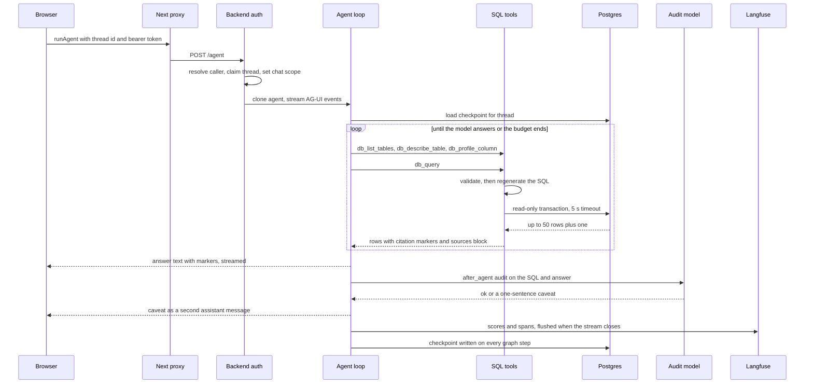

# One Ask Turn, End to End

A *turn* is one user question and everything the agent does until it stops. This page follows a single turn through every hop. It complements [Ask Sangam](../architecture/ask-sangam.md), which describes how the agent is assembled, and [Frontend](../architecture/frontend.md), [Auth, Roles and RLS](../architecture/auth-roles-rls.md) and [Platform](../architecture/platform.md), which cover the surrounding layers.

## The path at a glance

Caption: the main hops of one Ask turn. The loop repeats per tool call, and the checkpoint write happens throughout the run, not only at the end.

## 1. Browser: sending the question

- `ChatPane` (`frontend/features/ask/components/ChatPane.tsx`) calls `send()` from `useSangamChat`, which is `useAgentChat(threadId, "sangam_agent", "sangam-chat", ...)`. On the first send of a new chat it also saves the title to `localStorage` through `saveThread` (`titleFrom` trims it to 56 characters). The server later keeps its own title, taken from the first user message.
- `useAgentChat` (`frontend/lib/useAgentChat.ts`) registers a per-thread local agent (`sangam-chat-<threadId>`) that targets the backend graph `sangam_agent`. `send()` appends the user message to the agent and calls `copilotkit.runAgent`. A blank question is ignored, and `ChatPane` also refuses to submit while a run is in progress.
- `AgentProviders` configures `CopilotKitProvider` with `runtimeUrl="/api/copilotkit"` and an `Authorization: Bearer <Supabase access token>` header that follows Supabase auth state (`getSession` plus `onAuthStateChange`). Without a token the header is omitted. In the local dev-login mode (`DEV_LOGIN`: no `NEXT_PUBLIC_SUPABASE_URL` and `NEXT_PUBLIC_DEV_AUTH=1`) it sends `Bearer dev:<email>` instead, which the backend accepts only for seeded `@local.test` users.
- A reopened chat calls `fetchThreadMessages` (`GET /api/threads/{id}/messages`) to fill history. This happens only once the registered agent is ready, and only if the agent has no messages yet. A failed history load is swallowed. A 404 yields an empty chat.

## 2. The chat proxy

`frontend/app/api/copilotkit/[[...slug]]/route.ts` is a thin CopilotKit runtime. It maps `sangam_agent` to an `HttpAgent` on `AGENT_URL` (default `http://localhost:8000/agent`; in compose it is `http://backend:8000/agent`), `sangam_ingest` to the sibling `/ingest` URL and `sangam_proposal` to `/proposal` (see [Proposal Lifecycle](proposal-lifecycle.md)), all derived from the one env var. It uses an `InMemoryAgentRunner` and sets `maxDuration = 1800`, which is sized for Import turns of 15 to 20 minutes and must match `backend/vercel.json`. The proxy contains no auth or SQL logic: authentication and thread ownership are decided by the backend.

## 3. Backend: auth, thread ownership, route

Three things happen before the agent sees the request.

1. **`AuthMiddleware`** (`backend/app/core/security.py`) resolves the caller once per request and leaves it on the request state. It is plain ASGI, not `BaseHTTPMiddleware`, because buffering would break the chat stream. With `SUPABASE_URL` unset every request is the seeded dev user (the local-only `Bearer dev:<email>` form instead picks a seeded `@local.test` user when `DEV_AUTH` is on). When it is set, no header means anonymous, a valid Supabase JWT is that user, `Bearer dev` is the dev user only with `DEV_AUTH` on, and anything else is 401. The middleware also leaves the caller's Postgres identity (`anon` or `authenticated`, with token claims) on the request state. See [Auth, Roles and RLS](../architecture/auth-roles-rls.md).
2. **`ask_access`**, the dependency registered for `/agent` in `AGENT_ACCESS` (`/ingest` uses `require_scout` and `chat_access`, `/proposal` uses `proposal_chat_access`), requires a signed-in principal (anonymous gets 401). It calls `_own_thread`, which runs `threads.claim_thread`. A new thread id is claimed by the caller, and an existing owner's turn bumps `updated_at`. A thread owned by someone else returns **404** (not 403), and staff are not exempt: a turn checkpoints rows read as its caller, which the owner's next turn would replay. It then sets the `chat_user_id` and `chat_scope` context variables, which tools and tracing read because they see the run but not the request. Finally `ask_access` (unlike `chat_access`) sets `agent_caller` to the caller's database role and claims, so Ask Sangam's SQL runs as that caller.
3. **`run_agent`** in `backend/app/core/lifespan.py` calls `load_agents`, which builds the agent graphs lazily, on first use, under an `asyncio.Lock`. The first post to an agent route does this, as does the first REST route that calls `get_graph`. A REST cold start on a route that does not need a graph never pays for deepagents imports. It clones the `SessionScopedAGUIAgent` per request, because `LangGraphAgent` keeps per-run state on the instance. It streams `agent.run(input_data)` through an AG-UI `EventEncoder` as a `StreamingResponse`.

At boot the lifespan opens the shared psycopg pool, runs `_verify_sql_catalog` (the process refuses to start if the SQL allowlist drifts from the database schema), opens the checkpointer and registers `/agent`, `/ingest` and `/proposal`.

## 4. The agent loop

`build_agent()` in `backend/app/agent/build.py` creates a deep agent with seven tools (`db_list_tables`, `db_describe_table`, `db_profile_column`, `db_query`, `search_graph`, `fetch_url`, `compare_fit`) and the read-only `read_file` and `ls` skill readers. Its system prompt is `instructions.md`. Its checkpointer is the shared Postgres saver, and its graph config binds `recursion_limit` (default 200 graph steps, because each middleware hook is a node) and the Langfuse handler. Details of the tool list are in [Ask Sangam](../architecture/ask-sangam.md).

`SessionScopedAGUIAgent.prepare_stream` (`backend/app/integrations/tracing.py`) adds Langfuse metadata to the run config (`langfuse_session_id` is the thread id, plus the user id and AG-UI run id). It also drops duplicate tool results when the browser re-sends them under its own ids.

The checkpointer (`AsyncPostgresSaver` on the same pool as REST and the tools) writes on every graph step, keyed by thread id. A follow-up question on the same thread resumes from the saved message list. Reloading a chat reads that state back through the graph (`aget_state`) after `can_open` has checked ownership.

The prompt drives a fixed rhythm: discover with `db_list_tables`, read columns with `db_describe_table`, check stored spellings with `db_profile_column` before filtering on text, then write one `db_query`. Zero rows are reported as an answer, not retried with looser filters. Funder fit goes through `compare_fit` instead of SQL.

Middleware wired in `build.py`, in order:

1. a `FilesystemMiddleware` restricted to `read_file` and `ls` (skills only);
2. `sql_retry_limiter`, a `before_model` hook that can jump to the end of the graph;
3. `clear_old_tool_results`, which clears older tool output once context passes 40,000 tokens and keeps the 5 most recent results so follow-ups can refer back;
4. `answer_audit`, appended only when `sql_audit_model` is non-empty.

## 5. The SQL layers

`db_query(sql, purpose)` in `backend/app/agent/tools/sql_tools.py` is the only route to table data. A call passes through four layers (`catalog`, `validator`, `executor`, `render`) under `backend/app/agent/tools/sql/`:

| Layer | What it does |
|---|---|
| **Catalog** | The allowlist of readable tables and columns, with descriptions, foreign keys, known data defects, heavy columns, the citation kind of each id column, and source (provenance) columns. |
| **Validator** (`validate`) | Parses with sqlglot (postgres). Rejects over 8,000 characters, anything but exactly one query, writes anywhere in the tree, `INTO`, locking clauses, `WITH RECURSIVE`, CTEs that shadow a real table, cross-schema and catalog references, table functions in `FROM`, functions outside the allowlist (plus `generate_series`, `unnest`, `current_user`), placeholders, catalog-type casts and unknown columns. It qualifies and expands `*`, dropping heavy columns. It dedupes output names, adds provenance columns, clamps the limit and plans citations. What it returns is a **regenerated** statement, and only that statement executes. |
| **Executor** (`PsycopgExecutor`) | Takes a pooled connection under a semaphore (`db_gate_slots`, pool size minus 3, so the checkpointer is never starved). It opens a transaction, runs `SET TRANSACTION READ ONLY`, `SET LOCAL statement_timeout` (default **5,000 ms**), a 1 s lock timeout and a 10 s idle-in-transaction timeout. It then calls `set_caller` with the request's `agent_caller` (`anon` when unset), so the rest of the transaction runs as the caller's Postgres role and RLS applies. It fetches with a prepared statement, so the server itself refuses multi-statement input, and records an `agent-sql` span. |
| **Render** | Formats rows for the model: each cell is capped at 200 characters and the grid at 6,000 characters. Citation markers are prefixed to each row, a deduped `sources:` block follows (at most 8 sources), and truncation and no-citable-column notices are added. |

The model sees a result shaped like this: a header (`N row(s). tables: ...`), optional `adjusted:` rewrites and `caveats:` for known data defects, an `executed: <sql>` line, the `sources:` block, then `columns: ...` and the rows. The `executed:` line and the sources block sit above the `columns:` line on purpose, so trace masking (below) keeps them.

### Citations

Rows come out prefixed with markers such as `[org:12]` or `[funder:3]`. A marker exists only if the model projected the table's id column, and `CITE_COLUMNS` covers primary keys and the foreign keys that point at them. The prompt requires every database fact to repeat its marker. Aggregates carry no marker, and a figure computed from cited rows is labelled as computed.

In the browser, `useAgentChat` rebuilds `Turn` objects from the message stream. Each turn holds the question, trace steps (a tool call joined to its tool result by `toolCallId`, running until a result arrives) and the answer. The answer is every assistant message in the turn that has text and is not attributed to a subagent. `AnswerCard` runs `linkifyCitations`, which rewrites `[kind:id]` into `sangam://kind/id` links (skipping code spans), and renders each as a `CitationChip`. `CitationChip` resolves each target with `citationTarget` against an optional `RegistryIndex`. `org`, `funder` and `score` chips link to the Registry (an org or funder falls back to its raw id when the index lacks it), an `activity` chip links only when the index holds that partner line, and `grant` (retired), `news` and `graph` chips render unlinked. A `words` prop lets screens without codes, such as Sangam Pitch, show a name instead of the marker. The evidence rail's `sourcesFor` (`features/ask/lib/sources.ts`) parses the `sources:` block and the `executed:` line from `db_query` results, which is a backend contract pinned by `tests/test_sql_render.py`. It also adds `fetch_url` arguments and the entities named by markers.

## 6. Failure paths

| Situation | What happens |
|---|---|
| **Validator rejection** (multi-statement, write, unknown table or column, disallowed function, and so on) | Nothing reaches Postgres. `db_query` returns `db_query rejected: <message>`, written for the model with hints (did-you-mean, columns of the table, next step). The model is expected to fix the SQL and call again. |
| **Database error** | `explain_db_error` returns `db_query failed: Postgres <sqlstate> ...` with the executed SQL, a caret on syntax errors and a SQLSTATE-specific next step. A connection-level failure (no SQLSTATE) gets a deliberately generic message, because the driver text can contain the DSN, and tells the model not to retry. |
| **5 s timeout** | `statement_timeout` cancels the query (SQLSTATE `57014`). The reply says the query exceeded its time limit and suggests narrowing the WHERE clause, a smaller LIMIT or aggregating. It counts as a failed attempt. |
| **50-row cap** | `sql_max_rows` defaults to 50 and the validator clamps it to a hard maximum of 200. A missing LIMIT is injected, an oversized one is clamped (both reported under `adjusted:`) and a smaller one is kept. The validator asks Postgres for one extra row to detect truncation. When truncated, the result says "Rows shown: N of N+ ... NOT a complete picture" and tells the model not to present the figures as totals. This is not a failure and does not count against the budget. |
| **Five failed `db_query` calls** | `sql_retry_limiter` counts tool results starting with `db_query rejected:` or `db_query failed:` since the user's latest message. At 5 it appends a fixed AI message asking the user to rephrase or name a table, and jumps to the end of the graph. The prompt tells the model the same number first, so the limiter is the deterministic backstop. The counter is the constant `MAX_SQL_ATTEMPTS` in `middleware.py`, which `test_prompt.py` pins against the prompt. The `sql_max_attempts` setting in `config.py` is not read by this code. Only `db_query` is counted, so exploring with the discovery tools is free. |
| **Recursion limit** | The turn is bounded by `recursion_limit` (200 graph steps), applied both on the graph and on the AG-UI agent config, because a config passed at invocation beats the one bound to the graph. |
| **Tool exceptions** | Tools catch their own errors and return strings, so the model sees the failure and adapts instead of the run aborting. |
| **Client disconnect** | The Langfuse handler treats `asyncio.CancelledError` as control flow, ending the observation as "cancelled: client disconnected" rather than as an error. In the browser `stop()` calls `copilotkit.stopAgent`. |

## 7. The answer audit

When `sql_audit_model` is set (default `anthropic:claude-haiku-4-5`; the value `off` clears it), `answer_audit` runs as an `after_agent` hook. `audit_turn` collects the question, the `executed:` SQL, the last `db_query` result block and the final answer, and asks the cheap model for JSON on four checks: grain (counting the right entity), filters, false zeros and numbers matching rows. Inputs are clipped (question 1,000, SQL 3,000, result 2,000, answer 3,000 characters) and the reply is capped at 400 tokens.

- A `warn` with a caveat is appended as a **second** `AIMessage` prefixed with `⚠️`. The browser concatenates it into the answer. `collect_turn` skips messages that start with that prefix, so the caveat is never mistaken for the answer.
- The audit **never blocks**. No SQL ran or no answer exists: no call is made. The model is unresolvable, raises, or returns unparseable JSON: it is logged and the turn continues unaudited. A `warn` without a caveat is ignored. The caveat is advisory text appended after the answer has already streamed. It cannot withhold or rewrite that answer.
- Every audited turn gets an `answer_audit` score on the trace (1.0 for ok, 0.0 for warn), so a dashboard can show the rate and not only the failures. The audit span is typed `evaluator` in Langfuse.

## 8. Tracing and flushing

`trace_config` (called from `build_agent` with name `sangam_ask`, tag `ask`) attaches a Langfuse callback handler to the graph. `configure_langfuse` is called before the graph is built so that the masking hook is registered on the first client, and it logs loudly if credentials are invalid, since traces would otherwise drop silently. When Langfuse is not configured or fails, the config degrades to just `run_name` and the turn is unaffected.

- Root input is the question and root output is the replies that call no tool. Each SQL statement is a `retriever` span carrying the SQL and row count.
- `mask_payload` clips every payload to 4,000 characters. With `LANGFUSE_MASK_TOOL_RESULTS` on, row data below the `columns:` line is replaced by a redaction stub, while the query, `executed:` line and sources stay.
- Hooks that never call a model (`sql_retry_limiter`, `SkillsMiddleware` and similar) are filtered out of exports.
- `SessionScopedAGUIAgent.run` flushes traces in a `finally` after the stream ends, because a serverless function freezes once it has answered. Shutdown flushes again when Langfuse is enabled and the agents were built.
- LangSmith needs only environment variables, and the boot log states whether it is on or off.

## Where to look when changing it

- Changing a citation kind: update the catalog's `cites`, the prompt rules, `CITE_RE` and `citationTarget` in `frontend/features/ask/lib/citations.ts`, and the chip handling in `AnswerCard`.
- Changing the `sources:` or `executed:` line format: `render.py`, `sources.ts` and `test_sql_render.py` form one contract.
- Changing `REJECTED_PREFIX` or `FAILED_PREFIX` (`sql/errors.py`): this silently breaks the retry limiter, which matches on them.
- Tests that pin this flow: `test_sql_validator.py`, `test_sql_errors.py`, `test_sql_render.py`, `test_sql_integration.py`, `test_audit.py`, `test_tracing.py` (including the recursion limit, cancellation and masking), `test_access.py` (thread ownership, 401 and 404) and `test_prompt.py`.
- The SQL path executes on the application's shared pool, which connects as the owner (a superuser locally). Each `db_query` transaction therefore switches to the caller's `anon` or `authenticated` role with `set_caller` (`SET LOCAL`, so it ends with the transaction and the connection returns to the pool as the owner, safe for the checkpointer). The guards are layered: the catalog allowlist, the validator, the read-only transaction and the caller's RLS. Because of RLS, an empty result means no rows this user may read, and the tool says so. The comment in `validator.py` still describes the connecting role as a superuser until a reader role lands, and `sql_reader_role` survives in `config.py` only as a comment, so the validator's function allowlist remains the guard against owner-level functions.
