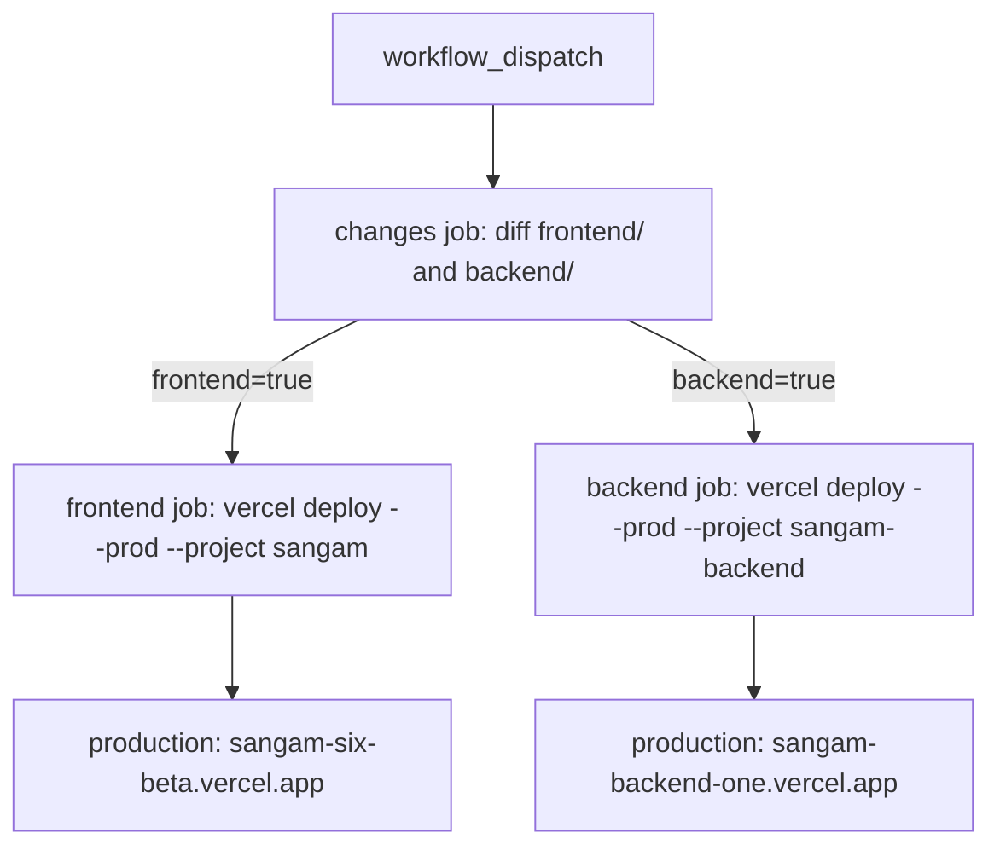

# Deploying by Hand

**Nothing deploys automatically.** A merge to `master` builds nothing, a push to any branch builds nothing, and there are no preview deployments. Two things enforce this:

- `frontend/vercel.json` and `backend/vercel.json` both set `"git": { "deploymentEnabled": false }`, which turns off Vercel's Git integration for each project.
- `.github/workflows/deploy.yml` is the only path to production, and its only trigger is `workflow_dispatch`.

Before the Git integration was turned off, every push to any of twenty branches built both projects: 40 deployments in one day ([CLAUDE.md](../../CLAUDE.md)). Deploys were first moved into a workflow and git deploys disabled in #71, #72 and #76, and the workflow was made manual-only in #106 ([CHANGELOG](../../docs/CHANGELOG.md)).

For vendor-level facts (regions, Supabase, Storage) see [Vercel and Supabase Specifics](../operations/deploy-and-vendors.md). For the topology see [Platform](../architecture/platform.md), and for variables see [Environments](../operations/environments.md).

## Running a deploy

1. Make sure the code you want shipped is on the branch you will dispatch from. The repo's guidance is to run it on `master`.
2. If the change includes a migration, apply it first. See [Order with migrations](#order-with-migrations).
3. In GitHub go to **Actions → Deploy → Run workflow** and pick the ref. The job checks out that ref, so what is deployed is whatever that ref contains, not necessarily `master`.
4. Watch both jobs finish, then run the [post-deploy checks](#post-deploy-checks).

The workflow needs one secret, `VERCEL_TOKEN`. `VERCEL_ORG_ID` (the Vercel team) is hard-coded in the workflow's `env` block because it is an identifier, not a credential. Each job names its project with `--project` instead of an opaque project id. The workflow has `contents: read` permission only.

### CI does not gate or trigger a deploy

`.github/workflows/ci.yml` is a separate workflow that runs on every pull request and every push to `master`. Its header says it deploys nothing ("that stays deploy.yml, by hand"). It runs four jobs: backend lint (`ruff check`), backend unit tests (`pytest -m "not integration"` with coverage), backend integration tests against a `pgvector/pgvector:pg17` service, and the frontend (`npm run lint`, `tsc --noEmit`, `npm run coverage`, then `npm run build`). The integration job builds its database the way a local stack does: it applies `db/init/*.sql`, then `python -m app.db.migrate`, then the seeds, and it deselects two migration-integrity tests that need a restore of the original dump. The test jobs upload coverage to Codecov over OIDC. A newer push to the same ref cancels the earlier CI run (`cancel-in-progress: true`), the opposite of Deploy's queueing.

Nothing links CI to Deploy. `deploy.yml` does not wait for CI and does not check that it passed, so a dispatch on a red or unchecked ref deploys anyway. Before dispatching, look at the CI result for the commit you are shipping (the CI badge in the [README](../../README.md) shows the state of `master`).

## What the workflow does

The diagram shows the three jobs. The `frontend` and `backend` jobs each depend only on `changes`, so they run in parallel and nothing orders one before the other.

### The `changes` job and what it diffs

The `changes` job checks out with `fetch-depth: 0` and decides, per directory, whether to deploy. It compares `github.event.before` to `github.sha` using `git diff --quiet` over `frontend/` and over `backend/`, and writes `frontend=true|false` and `backend=true|false` as job outputs.

**A manual run never has a base to diff against.** `workflow_dispatch` events carry no `before`, and the script treats an empty value, an all-zero SHA, or a SHA that is not a known commit as "no usable base ref". It then sets both outputs to `true`. So when run by hand, **both projects always deploy**. This matches the repo's own instructions ("it deploys both projects"). The per-directory diff only matters for an event that does supply `before`, which this workflow no longer has. Changes outside `frontend/` and `backend/` (for example `db/` or `docs/`) would not trigger a deploy even under the diff.

### The deploy jobs

- Each runs `npm i -g vercel@latest`, then `vercel deploy --prod --yes --project <name> --token="$VERCEL_TOKEN"`.
- Both are bound to the GitHub `production` environment, with a URL shown on the run: `https://sangam-six-beta.vercel.app` (frontend, project `sangam`) and `https://sangam-backend-one.vercel.app` (backend, project `sangam-backend`).
- There is no `--prebuilt`, so **Vercel builds the code remotely** with the build environment configured on the Vercel project. The workflow's runner never builds anything.
- The CLI runs from the repo root. Each Vercel project's own **Root Directory** setting (`frontend` or `backend`) picks the subdirectory, and that is also where Vercel reads `vercel.json` from. A `vercel.json` at the repo root would do nothing.
- Project environment variables come from the Vercel dashboards, not from GitHub or `.env`. See [Environments](../operations/environments.md).

### Concurrency

The workflow uses `concurrency: group: deploy-${{ github.ref }}` with `cancel-in-progress: false`. A second dispatch on the same ref queues behind the running one, and a production deploy is never cancelled mid-flight. Dispatches on different refs are in different groups and can run at the same time.

## Order with migrations

**The workflow does not migrate.** Migrations are never applied by a deploy, a build or `make up` against a managed database. They are an explicit separate step: `make migrate ENV=staging` (see [Writing a Migration](./writing-a-migration.md)). `ENV=staging` here only points your local tooling at the managed database. It deploys nothing, and it is the same database the deployed app serves.

`ENV=staging` selects the `docker-compose.staging.yml` overlay, which sets the backend container's `DATABASE_URL` from the `STAGING_DB_*` block in `.env` (host, port, user, password, name, `sslmode` defaulting to `require`), or from `STAGING_DATABASE_URL` if you set that instead. The overlay uses `:?` guards, so an empty block fails with a readable message rather than quietly connecting to localhost. The role needs `CREATE` on the `public` schema and the `vector` and `pg_trgm` extensions ([.env.example](../../.env.example)). Avoid `make up ENV=staging` as a deploy step: it runs your own containers against the shared data, and `make up` skips its automatic migrate for any ENV other than `local`.

Run migrations **before** dispatching the deploy:

1. `make migrate-status ENV=staging` to see what is pending, then back up if it is a destructive change. Migrations are forward-only and run in filename order, each in one transaction.
2. `make migrate ENV=staging`.
3. Dispatch the Deploy workflow.

Why this order:

- The backend refuses to boot against a schema it does not match. The lifespan runs `_verify_sql_catalog`, which raises `RuntimeError` when the SQL tool's allowlist (`catalog.py`) disagrees with the database. Deploying code that expects a table or column before migrating gives a backend that fails on cold start.
- Migrations are additive by default, so an already-running older backend keeps working on a migrated schema. That is what makes migrate-then-deploy safe. A destructive migration breaks that assumption, so plan it as a two-step change.
- The one rollout order the repo spells out (for the auth plan) is migrations, then backend, then frontend. The workflow does not enforce backend-before-frontend, because it starts both jobs together. If a frontend change depends on a new backend endpoint, deploy backend alone first (see below) or expect a short window where they disagree.

### The wiki is deployed separately

`make wiki-deploy` is a third, unrelated manual deploy. It is not part of `deploy.yml`. It exports `openwiki/` as a static site with `openwiki visualize --export` into a temp directory named `sangam-wiki`, then runs `vercel deploy --prod --yes --scope team-t4d-projects` on it, so the directory name becomes the Vercel project `sangam-wiki`. It runs from your machine and needs a one-time `npx vercel login`. The Deploy workflow never touches it, and dispatching the workflow does not republish the wiki ([CLAUDE.md](../../CLAUDE.md) lists the published URL).

### Deploying only one project

The dispatch form has no inputs, so there is no switch for one project. The `changes` job has no way to produce a single-project result for a manual run. To ship just one, you would have to run the Vercel CLI yourself with the same `vercel deploy --prod --project ...` command, and that needs the token and a linked checkout. The documented, supported path is the workflow, which deploys both.

## Function limits to keep in mind

- **`maxDuration` is 1800 s on both sides.** `backend/vercel.json` sets `functions["app/main.py"].maxDuration` to `1800`. The frontend sets the same value in code, in `frontend/app/api/copilotkit/[[...slug]]/route.ts` (`export const maxDuration = 1800`), because every Import turn streams through that proxy and a large Import takes 15–20 minutes. Keep the two equal. A lower proxy limit cuts the stream while the backend still works, and a lower backend limit kills the run behind a healthy proxy. 1800 s needs Vercel Pro's extended-duration setting.
- **Region `bom1`** on both projects, next to the Supabase database in Mumbai.
- **Python bundle limit is 500 MB.** The backend's dependencies are about 256 MB, so adding a heavy dependency is a deploy risk. This is why Storage is called over plain `httpx`.
- **Request bodies are capped at a few MB** on Vercel Functions, which is why large uploads go straight from the browser to Supabase Storage on signed URLs.
- **`NEXT_PUBLIC_*` is inlined at build time.** Changing one in the Vercel dashboard has no effect until the frontend is redeployed. Dispatch the workflow again. It deploys both projects regardless.
- **Backend env changes apply on the next deploy.** The backend reads its Vercel environment, which overrides the code defaults, so set or clear variables (model tiers, `DATABASE_URL`) before you dispatch.
- **Keep-warm cron.** `backend/vercel.json` also defines a cron that calls `GET /health` every five minutes (`*/5 * * * *`) to keep roughly one backend instance warm.

## Post-deploy checks

Both jobs reporting green only means Vercel accepted the build. Then check:

1. `curl -sI https://sangam-backend-one.vercel.app/health` returns 200 with an `x-vercel-id` that starts `bom1::`. `/health` is an open path, so no token is needed. It also proves the lifespan got through its checks, including the SQL catalog verification, because a cold instance runs the lifespan before answering.
2. The backend's boot log reports pool size, gate slots, and whether tracing and the graph are on. Look for `SQL catalog drift` errors if the backend does not come up, since that is the migrations-not-applied signature.
3. Open the frontend (`https://sangam-six-beta.vercel.app`) signed out. Public pages should render, and `/import` should redirect to sign in.
4. Sign in and load a data-backed page (the registry). This exercises the frontend-to-backend path and the database.
5. For a change that touches chat or Import, run one short Ask turn. The proxy to the backend has the 1800 s ceiling, so that path is the one a limit mismatch breaks.
6. Confirm the backend env still has `DATABASE_URL` (session pooler), `SUPABASE_URL`, `SUPABASE_SERVICE_KEY` and `ALLOWED_ORIGINS`, and that `DEV_AUTH` is unset.

`make smoke` is not a production check. It defaults to `localhost` URLs and authenticates with `Bearer dev`, which only works when `DEV_AUTH` is on, and that must never be set on a deployed backend. See [Vercel and Supabase Specifics](../operations/deploy-and-vendors.md#checking-a-deployment) for the full checklist.

## Rolling back

The workflow has no rollback step. Vercel keeps earlier deployments, and the dashboard can promote one, but a promoted backend is still running against whatever schema you migrated. Migrations are forward-only, so a code rollback after a destructive migration is not safe. This is the reason to keep schema changes additive.

## Failure modes

| Symptom | Likely cause |
|---|---|
| Backend returns 500 or fails on cold start right after a deploy | Migrations were not applied first, so the catalog check fails. Run `make migrate ENV=staging`. Redeploy only if the code also needs it. |
| A changed `NEXT_PUBLIC_*` value is not visible | Env edited without a fresh frontend deploy. |
| Long Import runs cut off at a fixed time | The two `maxDuration` values differ, or extended duration is not enabled on the Vercel plan. |
| Run is waiting and nothing happens | An earlier dispatch on the same ref is still running. Deploys queue and are not cancelled. |
| Pushing or merging did not deploy | By design. Dispatch the workflow. |
