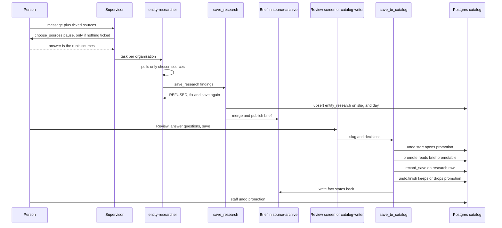

# One Import Turn: choose_sources to Undo

Sangam Import (on screen: Scout) researches one funder or NGO per subagent, stores cited findings, merges them into a per-organisation **brief**, and only later moves the brief into catalog tables. This page follows one organisation through that path in order. It marks every place where the turn is refused or pauses for a person. For the agent roster, roles and RLS, see [Sangam Import / Scout](../architecture/sangam-import-scout.md), [Auth, roles and RLS](../architecture/auth-roles-rls.md) and [Frontend](../architecture/frontend.md). For the catalog tables that `promote()` writes, see [Data and migrations](../architecture/data-and-migrations.md).

The central idea is that **research and catalog are two separate steps**, and the **brief is the record that sits between them**. `save_research` writes findings (`entity_research` row plus the brief). Only `save_to_catalog` writes catalog rows, and it reads the brief, not one research run (`brief.promotable`). The news and open-calls pulls are a separate branch of `run_import_now` that skips this path; see [Side branch: the open-calls pull](#side-branch-the-open-calls-pull-funder_calls).

## The turn at a glance

*Order of one turn: sources are chosen, the researcher saves findings (with refusals), the brief is published, the save transaction runs, and staff may undo.*

## 0. Opening the Import screen

Before any turn, `ImportView` loads its panels with a single `GET /api/ingest/overview`, because separate calls could each land on a cold backend instance. The route (open to staff and stewards through `require_scout`) returns the caller's memberships, their research list (25 rows), and their Doc Vault files. For staff it also returns the source registry, recent runs, the name queue and source proposals. Anyone else gets those four as empty lists.

- **Role decides what is shown.** `accessOf(o.me)` derives staff and steward access, and until the overview answers the screen uses `NO_ACCESS`, so nothing can be run. "Team tools" (sources, run history, proposals) render only for staff.
- **Research list scope.** Staff see every row. Anyone else sees what they saved plus research on NGOs they steward, with private sources dropped from `sources_read`, a summary written from private findings replaced by `PRIVATE_NOTE`, and `promotion_id` and `saved_by` blanked (`_public`).
- **Vault listing is best-effort.** `_vault` lists up to 100 documents per membership organisation and keeps only private ones (`is_public` false, with an org). If listing fails it logs a warning and returns an empty list, so Import still opens without Vault files. These files feed the sources card.
- **Spreadsheet card.** `GET /api/ingest/workbooks` (staff only) lists `.xlsx` files so the card can show them at the first pause. It accepts only the `staff-sources` bucket, the same rule `choose_sources` applies to a pick, and answers 422 for any other bucket.
- After an undo or delete, `ImportView` reloads only the research list (`/api/ingest/research?limit=25`), not the whole overview.

## 1. choose_sources: the first pause

- The supervisor must call `choose_sources` first and alone (`pipeline_tools.choose_sources`). It takes `web`, `library`, `vault_org`, `vault_docs` and `staff_paths`. The result is an artifact that `run_sources.Sources` turns into the run's allowed sources. The person's answer replaces the model's proposal.
- **When it pauses.** `INTERRUPT_ON["choose_sources"]` has a `when=ask_for_sources` condition. The sources ticked in the right rail go out as AG-UI context (`TICKED_SOURCES`). If any were ticked, `TickedSources` appends a note and rewrites the model's `choose_sources` arguments to exactly the ticks, so **no card shows**. With nothing ticked, the run pauses on `SourcesCard`, and the person can approve, edit or reject.
- **Refusals inside the tool:**
  - staff spreadsheets requested by a non-staff caller;
  - Doc Vault files the caller cannot read, or that are not in that org's vault;
  - nothing chosen at all.
  
  Each returns `REFUSED:` with no artifact, so the choice stays unanswered. Staff paths are validated and registered as `documents` rows.
- **Reject means web only.** `run_sources.chosen()` reads the latest `choose_sources` ToolMessage. An artifact gives that `Sources`. An error status (the person rejected the card) gives `WEB_ONLY`. No answer yet gives `None`. The answer exists only in the checkpoint's messages.
- **Enforcement is two-sided.** `ChosenSources` on the supervisor refuses every `task` call until the choice is answered, failing closed on unreadable state. It also sets the `CURRENT` context variable around each subagent. `RunSources` is in the middleware stack of the entity-researcher, workbook-reader and vault-reader (`build_ingest_agent`); the catalog-writer has none, because it holds no pulling tool. Each refuses any pulling tool outside the choice:
  - web tools when web is off;
  - library tools when library is off;
  - `read_source_rows` and `read_workbook` unless `documents=` is a subset of the picked spreadsheets;
  - vault tools outside the picked files.
  
  Only `PULLING` tools are ever refused. A subagent outside a `task` has `CURRENT = None` and reads nothing.

## 2. Research

The supervisor plans (`write_todos`), reads `funder_dossier` to see what the catalog already holds, and launches one isolated `entity-researcher` per organisation, in waves bounded by `MAX_PARALLEL_RESEARCH`. If vault files were chosen, a `vault-reader` runs first. If workbooks were picked, a `workbook-reader` returns the names so that one researcher per name can follow. See [Sangam Import / Scout](../architecture/sangam-import-scout.md) for the roster. The research-specific mechanics are:

- The researcher's tools are `research_goals`, `funder_dossier`, library, workbook-row, web and PDF readers, and `save_research` (`RESEARCHER_TOOLS`). It has no catalog-write tool.
- Every web read passes `check_url` (source registry plus robots) before the fetch and again on every redirect (`_client` hook). A `REFUSED:` there is final. `search_public_sources` marks hits `READABLE` or `HELD`, and a held hit is a dead end.
- `read_page` and `fetch_document` archive what they read to the `source-archive` bucket. Later, `promote()` turns each cited source into a `documents` row from that archive.
- The researcher's middleware stack adds `SaveRefusal`, `RunSources`, the staff-last lock (`StaffLastLock`), an optional `ReadingLimit` (researcher only) and model-call limit, model fallback, an escalation to the strong model after a malformed save, and a rubric grader that allows one revision. Page and call limits are unset by default.

### Doc Vault files and Word/Excel text

An organisation's private files can enter a run only if the person picked them in `choose_sources`. They are read by the `vault-reader`, never the researcher, so vault text never shares a context with web tools (`backend/app/ingest/vault.py`).

- **Which files count.** A Vault document is a `documents` row with `NOT is_public` and a `storage_path` under the `org-vault` bucket. `vault.in_vault` checks picked ids against that org. `list_vault_documents` and `read_vault_document` use the owner pool, so each checks `can_read_org` itself. A file the caller may not read and one that does not exist get the same answer. A run's picked org is the only vault it may list.
- **What can be read.** `vault.read` downloads at most 50 MB and handles `.pdf`, `.docx` and `.xlsx`. Anything else, or a document with no stored file, returns a plain explanation. Each read is capped at `MAX_CHARS` (24,000), with a note on how to continue.
- **Citation markers.** Every line is cited as `[vault:<id>#p<page>]`, `[vault:<id>#para<n>]` or `[vault:<id>#<sheet>!<cell>]`. A scanned PDF with no text range is reported as such rather than guessed at.
- **Office extraction.** `office.py` is pure (bytes in, text out). `docx_paragraphs` returns paragraphs and table rows as `a | b | c` in document order, keeping a merged cell once. `xlsx_markdown` renders each sheet as a heading plus its first `SHEET_ROWS` (200) rows. The same helpers produce `content_md` when a document is uploaded (`documents._extract`, which stores `None` text but still a hash if a file is damaged), and the vault reader's `.docx` pages by paragraph while `.xlsx` goes through `staff_sources`.
- **Saving.** `save_vault_findings` refuses the whole save, writing nothing, unless every finding has a vault `source_url` (`https://org-vault.<private domain>/<id>`), names a document in that org's vault, and quotes that document's `[vault:<id>#…]` marker. NGO research needs `can_research_org`. Findings go to `vault_research`, one row per `(slug, researched_on, org_id)`, never into the shared `entity_research` row.
- **Promotion holds.** `_research_rows` strips vault URLs from `entity_research` findings. It adds an org's `vault_research` findings only for a writer or person, and only for orgs the caller can read. At promote, `vault.hold_at_promote` keeps only the funder's general facts (`PROMOTABLE`: identity, CSR year, stated geography, eligibility guideline, RFP, programme). The org's own facts are shown on Review but held back, and an NGO's vault findings are never promoted.

## 3. save_research: where saves are refused

`save_research` is the only tool on this path that writes, and it writes findings, not catalog rows. It should be called once, last. It returns `REFUSED:` text, rather than raising, in these cases, in this order:

1. **NGO by a non-steward.** `entity_kind == "org"` and the caller is neither staff nor a steward. The researcher is told to report in its summary instead.
2. **Unanswered fields.** `contract.unanswered()` finds a field of the kind's contract with neither a finding nor a gap. Yearly concepts need one answer per asked fiscal year (default: the recent years), and identity concepts also need `themes`. Statuses other than `complete` and `partial`, and kind `unknown`, are exempt. A gap must be `not_stated`, `blocked` or `not_reached`, with a reason.
3. **Another person's row.** A non-staff caller would overwrite a same-day row saved by someone else. The reply tells the researcher to report `saved=true` with the existing slug.
4. **A shorter save.** The stored row for that slug and day has more findings than the offer, and `replace=true` was not passed.

On success, one transaction upserts `entity_research` keyed on `(slug, researched_on)`, recording `researched_by`. The reply tells the researcher to report `slug` and `saved=true`. It also flags numbers that appear only inside quotes (`quoted_only`) so the researcher can add them as findings. Failures from a save that cited staff sources return the exception type only, so no confidential cell text reaches logs or the model.

## 4. Brief publish

Right after the upsert, `save_research` calls `brief.publish()`. It does not wait for `make client-docs`.

- **The brief is the record.** It is a markdown file at `source-archive/entities/<slug>.md`. There is no brief table. Each fact line carries its typed finding in a hidden `<!-- fact {json} -->` block, and facts no column can hold go in `<!-- unplaced {json} -->` blocks. Both are read back by `brief.record()`.
- **Merge rule.** `build()` reads the published brief and merges every `entity_research` row for the slug into it (`rows_for`). Findings are keyed by `fact_key`, which uses per-concept identity fields from `_SAME_FACT`. A later run replaces an earlier one unless the earlier source is stronger, compared by evidence tier and then confidence. `wrong_entity` rows add nothing. A fact the latest run did not find is not dropped. Private (staff and vault) findings never enter the public brief, and a summary written from them is replaced by `PRIVATE_NOTE`.
- **Fail-safe.** If Storage cannot be read, `build()` raises, `save_research` logs a warning, and the brief is left as it was. The findings are saved either way. With Storage unconfigured, the upload is a no-op and the reply says the brief appears in `docs/entities/<slug>.md` after `make client-docs`. The text `brief is published` appears only when it actually was, and the Import UI's milestone strip matches that phrase (`test_storage.py` pins it).
- **Re-publish.** `publish_brief` (staff only, on the supervisor) re-renders one slug or all of them, for research saved before publishing existed or after a renderer change.
- Research older than the typed finding shape (`TYPED_SINCE`) renders in the brief but carries a note that it cannot be promoted. It has to be re-run.

## 5. Review and save: the save_to_catalog transaction

Saving happens two ways. Both call the same function, so the same guards and the same undo apply:

- **Review screen:** `POST /api/ingest/research/{slug}/save`. `ScreenReview` posts the person's `decisions`, and `GET /api/ingest/research/{slug}/review` fills the card.
- **Chat:** the `catalog-writer` subagent (tools `promote_research` and `funder_dossier`, utility model, capped at `WRITER_MODEL_CALL_LIMIT` = 12 model calls) calls `promote_research`. `SaveQuestions` in its middleware pauses every call with the planned rows, coverage line and the funder's open questions. Only the person's `edit` can set `decisions`, and anything the model writes there is dropped. An empty slug is still approved, but its questions are held, not asked.

`save_to_catalog(slug, caller, decisions)` does the following:

1. **Role gate.** A non-staff caller must pass one slug. For a funder, `can_save_funder()` is required. For an NGO, the org must already be held (resolved, or matched by a mergeable method), and the caller must be able to research it. Otherwise it raises `SaveRefused`. That is HTTP 403, or a `REFUSED:` reply in chat. No research rows raises `LookupError`, which is 404.
2. **Read the record.** `_research_rows` takes the newest row per entity and swaps in the brief's facts via `brief.promotable()`. Non-staff callers do not get private findings, and vault findings are added only for a writer or person.
3. **One transaction per organisation**, with one retry if a concurrent save raises `UniqueViolation`:
   1. `undo.start` inserts a `promotions` row (research id, slug, `promoted_by`) and sets `sangam.promotion_id` locally, which turns on the write log for the rest of the transaction.
   2. `promote()` writes the catalog.
   3. `_record_save` stores what the save wrote on the research row (`saved`, `saved_at`) with before/after counts. Afterwards a plan reads every row as `same`, so this is the only record of what the profile held before.
   4. `undo.finish` clears the setting. If `catalog_writes` has no entry for the promotion, the promotion row is deleted and `promotion_id` is `None`. The route returns `promotion_id` to staff only.
4. After commit, `_publish_states` writes each fact's end-state back into the brief. A failure there is only logged, because the catalog is already committed.

### What promote() does

`promote()` runs the kind's branch (`_promote_funder` or `_promote_org`). The model never writes SQL. Fixed-SQL writers in `writer.py` do. A funder's `Gate` sorts each fact into five cases: same value, newer source (update), older or undated source (ask), close name (ask update, new or skip), and new (insert). An NGO fills blanks and reports conflicts, and asks only about a trigram-close name. `Gate(plan=True)` writes nothing, and that is what `compare_with_catalog`, coverage and the Review card use.

Before the branch, the guards hold findings:

- research saved under a pre-typed shape is turned away with "re-run the research";
- unmarked or cell-mismatched staff figures are held;
- vault findings and private sources are held at promotion.

For a funder the order is:

1. Resolve the entity, preferring the one an earlier save linked.
2. Write the funder and its tags.
3. Write a `documents` row for every public source a fact cites.
4. Write CSR years.
5. Write programmes parents-first, with spend lines as `kind='component'` programmes.
6. Write the remaining facts in `WRITE_ORDER`.
7. Write `document_links` and link the research row to the entity.

Step 1 also resolves the parent company (`_parent`) before the funder is written. The NGO path has the same shape with three differences: it resolves a parent body (`_org_parent`) rather than a parent company, it writes in `ORG_WRITE_ORDER`, and it has no CSR-year step. In both, a parent that is not already in the catalog is reported as held and never created.

### Fact end-states

Every fact ends in exactly one state. `_unsettled` guarantees this: a fact no writer reached becomes `held` with the reason, or `no column` when Sangam has no table for its concept.

| State | Meaning in the brief |
|---|---|
| `written` | Saved in Sangam (covers writer statuses added, updated and planned) |
| `confirms` | Sangam already holds this value (matched) |
| `waiting` | A question is open for a person |
| `conflicts` | Sangam holds another value and a person decides |
| `kept` | A person kept Sangam's value |
| `skipped` | A person skipped it |
| `held` | Not saved, with a reason (guard, unmatched name, unanswered question) |
| `no column` | Sangam has no field for it yet |

`waiting`, `conflicts`, `held` and `no column` are listed under "Not in Sangam yet" in the brief. A fact keeps its last state until it is promoted again.

## 6. Undo (staff)

- `POST /api/ingest/promotions/{id}/undo` (staff only) calls `undo.undo()`. It locks the promotion and refuses if it is already undone. It then replays `catalog_writes` newest-first in one transaction, deleting what the save inserted and restoring `old_row` for what it updated. Table names are checked against `LOGGED`, which holds 19 tables.
- **All or nothing.** Each reversal requires that the row still equals the logged `new_row`. Otherwise `UndoRefused` rolls everything back ("a row has changed since this save"), and a row now referenced elsewhere is refused too. The route maps this to 409. `test_a_row_changed_since_refuses_the_whole_undo` pins it.
- After success, the promotion is stamped `undone_at`/`undone_by`. A reversed funder or org insert first unlinks `resolved_funder_id`/`resolved_org_id` on the research. The research reads as unsaved again (`saved = NULL`) once no live save of it remains.
- `DELETE /api/ingest/research/{slug}` (`undo.delete_research`) removes research that was never saved, or whose saves were all undone. It returns 409 while any save stands. The UI offers undo and delete in `ResearchedRecently`.
- Undo reverses catalog rows only. It does not rewrite the brief's fact states.

## Pause points

| Pause | Where | Condition |
|---|---|---|
| `choose_sources` card | `INTERRUPT_ON` | Only when nothing was ticked before sending |
| `run_import_now` approval | `INTERRUPT_ON` | Every call, whatever `sources` holds: adapter writes, the news pull and the open-calls pull (`funder_calls`, with its own card). Not part of the per-organisation research path |
| `promote_research` approval | `SaveQuestions` on the catalog-writer | Every call, carrying open questions |
| Review card | `/import` screen | Saving straight from the screen with `POST .../save` |

On the frontend, `useRunPause` records the tool a run stopped on from the interrupt event, and `StepBar` shows Start, Working, Review and Done.

## Side branch: the open-calls pull (`funder_calls`)

Not every Import turn researches an organisation. `run_import_now` is the supervisor's one bulk write, and besides the adapter import it has two fixed pulls: the news pull (`tavily_news`) and the open-calls pull (`funder_calls`) that feeds [RFP Watch](../architecture/rfp-watch.md). `run_import_now` is one of the supervisor's own `TOOLS` (the `pipeline_tools` adapter group), not a tool of any subagent, so the pull runs in the supervisor's turn without a `task` call. That is why `ChosenSources`, which guards only `task`, and the subagents' `RunSources` never see it. A pull skips the whole research path above: no `choose_sources`, no researcher, no `save_research`, no brief, no `promotions` row and so no undo. The instructions tell the supervisor to call `run_import_now(goal, funders=<names, or empty for every funder>, sources="funder_calls")` straight away when staff ask for open calls, RFPs or calls for proposals, to relay the totals and every "NEEDS A LOOK" line with its reason, and never to research a call by hand when the pull is what was asked (`instructions.md`, "The adapter path").

1. **Start (frontend).** The staff-only "Check open calls" task card (`ScoutChat`, shown only when `access.ts` grants `calls`) fills the composer with `leadIn("calls")`. `isPull(task)` is true for `news` and `calls`, so `ScoutChat` and `ScoutRail` do not ask for sources first: a pull reads no chosen sources.
2. **Pause.** `INTERRUPT_ON["run_import_now"]` allows approve and reject, with no `when` condition, so every `sources` value pauses. `ImportApproval` reads the paused call's `goal`, `funders`, `years`, `sources` and `feeds` (`pausedImport`) and `Card` picks a variant from `sources`, testing `funder_calls` first, then `tavily_news`, then the generic card.
3. **The open-calls card.** It is titled "Check open calls?" and shows the funders named (or "Every funder in Sangam") with "about 1 search and 2 small model calls per funder". That line is built in the browser by `callsLine`; there is no plan endpoint for calls, unlike the news card, which calls `/api/ingest/news-runs/plan`. The buttons are "Check the calls" (approve) and "Don't check" (reject, nothing runs). Decisions are sent as `{ decisions: [{ type: "approve" | "reject" }] }`.
4. **Run (backend).** After approval `run_import_now` refuses non-staff (`staff_only`) and an empty goal. It tests `tavily_news` first and `funder_calls` second, before falling through to the adapter import. `_calls_pull` resolves the named funders case-insensitively by name or slug. Unknown names become report lines, and if none resolve it returns "nothing was read". Other source keys in the same call are reported as "not run, a calls pull runs alone". It then returns the report lines from `calls.pull.run`, which the supervisor relays. The pull never creates a funder.
5. **Failure.** The tool returns a `run_import_now failed: …` string rather than raising.

Rejecting any `run_import_now` card writes nothing. The per-funder pipeline, the matching of calls to NGOs, and the staging gates belong to [RFP Watch](../architecture/rfp-watch.md); the news pull and its card are covered in [Media and signals](../architecture/media-and-signals.md).

## Unfinished and caveats

- **Owner pool.** Import tools run on the owner pool, so RLS does not apply to them. `scope()` supplies the run's caller (nobody outside a chat request), and each gated tool checks it itself: `staff_only` on staff-only tools, `can_read_org` on Doc Vault tools, `can_research_org` in `save_research`, and `_may_save` on the save path. A new Import tool that reads or writes caller-specific data must make the same check.
- **Plan status.** `docs/CHANGELOG.md` ("Not finished") lists what the plans still owe:
  - researcher contract M5 (backfilling KABIL and Axis on staging) is not done, while M1 to M4 (#194 to #197) have shipped;
  - programme themes step 5, `write_funder_tags_from_programs` (PR #172), is unmerged, and no backend code defines it;
  - the "review follow-ups" of `2026-10-09-import-guided.md` are still open;
  - RFP Watch M1 to M4 have shipped, with only the staging exit gates left;
  - the fix that moves Ask's SQL off the owner pool is on an unmerged branch.
- `docs/INGEST.md` predates the brief-as-record work. Where it disagrees with `docs/ARCHITECTURE.md` section 4, section 4 is right.

## Where to change things

- The sources contract lives in `run_sources.py`. A new pulling tool must be added to one of its `*_TOOLS` sets, or it is never refused.
- A new fact concept needs entries in the finding model, `brief.headline`, `_SAME_FACT` and `ORDER`, and a writer branch in `promote.py`. Without a writer branch it is reported as `no column`.
- A new catalog table that `promote()` writes must be logged by a trigger and added to `undo.LOGGED`, or undo refuses it as "not a catalog table".
- Tests to read: `test_import_sources.py` (pauses and source enforcement), `test_import_undo.py` (start, finish and undo, including no-op saves and the screen path), `test_import_roles.py` (role gates on save), and `test_storage.py` (the published-brief message).
