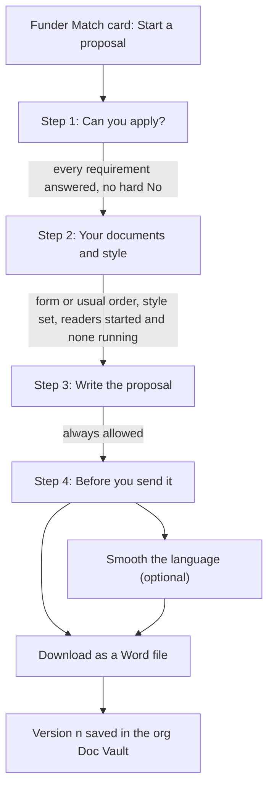
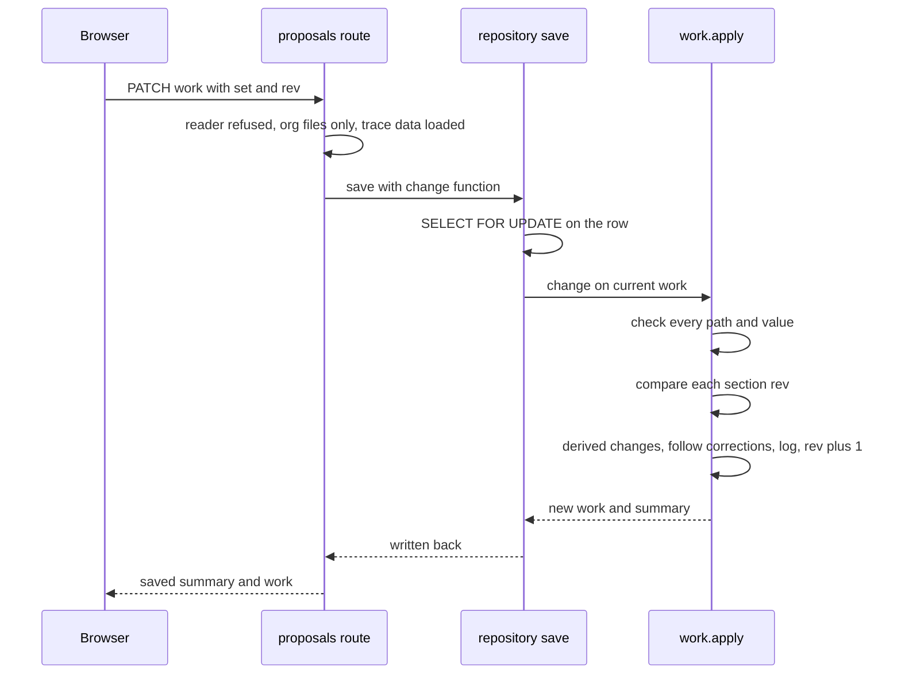

# One proposal, end to end

This page follows a single proposal in the order things happen. At each step it names what code refuses. The model never decides any of these: it proposes, and code checks. For the design behind that rule, see [Proposal Copilot](../architecture/proposal-copilot.md). For milestone status (what shipped and when), see the [changelog](../../docs/CHANGELOG.md) rather than this page. Proposals and RFP Watch are both switched on in the browser (see [Availability](#availability-the-coming_soon-switch)); how they relate is in [RFP Watch and proposals](#rfp-watch-and-proposals).

Two writers share one record, `proposals.work` (jsonb):

- The **screen** writes through REST: `PATCH /proposals/{id}/work`, `POST /advance`, `POST /polish`, `POST /versions`.
- **Sangam Pitch**, the agent in each editor's own chat, writes through tools.

Both end in `work.apply` ([`backend/app/proposals/work.py`](../../backend/app/proposals/work.py)), inside a row lock taken by `repositories/proposals.save` (`SELECT … FOR UPDATE`). So the allowed-path check, the section `rev` check and the change log are the same for both.

The flow of the four steps and the buttons at the end. Moving back is a PATCH of `stage`; moving forward is only `POST /advance` or the agent's `advance_step`.

## Availability: the `COMING_SOON` switch

Whether people can reach proposals at all is a front-end switch, not a backend one. `COMING_SOON` in [`frontend/features/ask/lib/comingSoon.ts`](../../frontend/features/ask/lib/comingSoon.ts) is a set of workspace views shown as "Coming soon". It is currently **empty** (`new Set<WorkspaceView>([])`). `"proposals"` left it first (the 2026-10-16 changelog entry), and `"rfpwatch"` has since left it too, so both features are on for everyone. The changelog's note that RFP Watch "stays Coming soon" describes that earlier moment, not the current set. One set drives every place a feature appears:

| Place | Name in the set (off) | Not in the set (now) |
|---|---|---|
| Sidebar (`Sidebar.tsx`, "Use Cases" list) | Item flagged `soon` | Normal "Proposals" and "RFP Watch" items; Proposals shows the count of the caller's proposals from `useProposals()` |
| Main area, Proposals (`AskWorkspace.tsx`) | `ComingSoonView` with a description | `ProposalsView`, remounted on a new `key` whenever Funder Match opens a specific proposal or a funder's list |
| Main area, RFP Watch (`AskWorkspace.tsx`) | `ComingSoonView` with a description | `RfpWatchView`, given the caller's orgs, `onAsk` (opens a new chat seeded with a question) and `onFunderMatch` (switches to the Funder Match view) |
| Funder Match card (`MatchCard.tsx`) | A disabled "Start a proposal" button with a "Coming soon" tag | `ProposalAction`: Start a proposal, Continue or View proposal, "Start another", or "Proposals (n)" |
| Funder Match filters (`FunderMatchView.tsx`) | No "Proposal" filter | A "Proposal" filter: any status, "Has a proposal", "No proposal yet" |

To turn a feature off again, add its name back to the set; to turn one on, delete it. Because the Proposals and RFP Watch branches in `AskWorkspace.tsx` each test the set separately, the two features can be switched independently.

The switch hides screens only. The `/proposals` routes enforce their own access rules (see below), so the check for who may start or edit is still done by the server. Inside `ProposalAction`, the `mayStart` flag decides whether the person sees the start buttons or only "View proposal →", so a member who cannot start still sees proposals already begun for that funder.

## 0. Starting from a Funder Match card

The button lives on the card in `frontend/features/ask/views/funder-match/MatchCard.tsx` (a live button only while `"proposals"` is not in `COMING_SOON`, which is the current state). It first asks for a name (default "<funder> proposal") and then calls `startProposal` in `proposals/api.ts`, which sends `POST /api/proposals` with the org slug, the funder id and a name. The route (`create_proposal`) refuses in this order:

| Condition | Response |
|---|---|
| Org not found, or caller cannot read it | 404 |
| Caller is not an admin or steward of the org (`may_run`) | 403, "Starting a proposal is for the organisation's admins and stewards." |
| The funder is not in the org's **latest saved** Funder Match run (`repo.match_for`) | 409, "Run Funder Match first" |

If it passes, `new_work` builds the initial `work` document at `stage: 1`:

- **Requirements** come from `gates.build` over the saved match detail, so they say what the match judged (see [Funder Match](../architecture/funder-match.md)). They are 12A, 80G and audited accounts, plus **CSR Form 1** when the funder is a Section 135 type or `section_135_bound`. CSR Form 1 is the only `hard` requirement. Each line the funder lists as "The funder's own bar" becomes an extra, non-hard `bar{n}` requirement that Sangam does not check.
- `earlier_phase` is true when the match's relationship criterion has points. It adds the F4 "Earlier phase results" section.
- `template` is pre-filled from the newest `proposal_template` document Sangam holds for that funder, if any.
- `style` starts as `rubric.default_style(org name)`. `sections`, `facts`, `questions`, `log` and `versions` start empty.

A proposal is readable by the org's people and staff. It is writable by org admins, stewards and staff (`can_edit` in the repository's column list, mirrored by `CallerScope.can_edit_proposal`). See [Auth, roles and RLS](../architecture/auth-roles-rls.md).

The seed list for this page named `start.ts` and `store.ts` under `views/proposals/`. Neither exists any more: the server holds the state. `api.ts` has a leftover `hadBrowserProposals()` check for the old browser-only store (`localStorage` key `sangam.proposals.v1`), from when proposals were kept in one browser only. Today proposals live in the `proposals` table (migration 0009), which the proposals routes and `repositories/proposals.py` read and write under a row lock; `localStorage` is no longer where they are stored. See [Data and migrations](../architecture/data-and-migrations.md).

## RFP Watch and proposals

RFP Watch (`RfpWatchView.tsx`, see [RFP Watch](../architecture/rfp-watch.md)) lists open calls for the caller's organisation in three buckets: For you, Closing soon (within `SOON_DAYS` = 30) and Saved. A proposal is **not** started from a call. There is no code path from a `CallCard` to `POST /api/proposals`, and the proposal's `work` holds no reference to an RFP call. The two features meet in the browser through navigation:

- **"Ask about this call"** (`onAsk`) calls `newChat(question)` in `AskWorkspace`, which opens a fresh Ask chat seeded with "Help me decide whether <org> should apply to <funder>'s call …", with the due or closed date. It does not touch a proposal.
- **"See funders who fit you"** and **"Try Funder Match"** (`onFunderMatch`) switch the view to Funder Match. That is where **Start a proposal** lives (see [step 0](#0-starting-from-a-funder-match-card)), and it needs a saved Funder Match run that includes the funder.
- In the other direction, Funder Match's `nav.open` and `nav.list` call `openProposals`, which switches to the Proposals view and remounts it on a new key.

Save and "Not for us" on a call use the RFP feed's own status (`setStatus`) and are available only when the feed's `can_act` is true. They do not change any proposal.

## 1. Step 1, "Can you apply?": the gates

Each requirement is answered on screen as `yes`, `will_have` or `no`, with `PATCH /work` and a path such as `gates.csr1`. `work._check` refuses a gate key that is not one of this proposal's requirements, and any value outside `yes | will_have | no | null`.

`steps.exit_check(1, work)` is the one source of "what stops this step", shared by `POST /advance`, the agent's `advance_step` and the screen's "To continue" line. It lists:

- `answer <label>` for each unanswered requirement, and
- `<label> is needed by the funder` for a hard requirement answered `no`.

A non-hard `no` does not block. It shows under "Worth checking" later. The agent explains these but never answers a gate for the person. Only the screen sets `gates.*`.

## 2. Step 2, "Your documents and style"

The person does three things here, all via PATCH:

1. **The funder's form.** Either `template` (an uploaded form or the one Sangam holds, `{document_id, url, from, read_at}`) or `skipped_template: true` for Sangam's usual order. `_check` requires a template to be null or an object with an integer `document_id`. When the template carries `questions`, `rubric.sections_for` adds each one as a section on the "This funder" tab. These have no strong elements, so they are never graded.
2. **Files to read.** `sources` is a list of document ids. `_save` refuses (422) any id that is not one of the org's own documents (`documents_repo.org_document_ids`). The screen also refuses to tick a link that has no stored file.
3. **Writing style.** Text of at most 4,000 characters.

### Readers: "Write the first draft"

The button sends the fixed chat message "Write the first draft." (or "Read the files again."), and the agent calls `read_files`. Tools are gated by step in code: `steps.FIRST_STAGE` makes `add_facts` and `read_files` usable from step 2, and `ask_user`, `write_section` and `suggest_edit` from step 3. `too_early` refuses earlier calls, so the prompt is not the check. Every writing tool also calls `require_edit`, so a read-only member's agent run is refused even if the screen's buttons were bypassed.

`readers.read` ([`readers.py`](../../backend/app/proposals/readers.py)) is launched by code, not by the model:

- **Claim under the row lock.** `pending()` lists each ticked file, the funder's side and, when public research is built, the `public` reader, whenever they are not yet `done`. So "Try again" re-reads only what failed. If any reader is `running` and not stale, it raises `Busy` and the tool returns `REFUSED: <who> started reading the files N min ago…`. `_claim` marks every pending key `running` inside the same `repo.save` lock, so two people pressing at once get one run and one refusal. If nothing is pending, the tool says every ticked file has been read. A `running` reader older than 30 minutes (`steps.READING_STALE`) is treated as dead, because a run lasts at most 1800 s.
- **One reader per key, in parallel**, bounded by a semaphore sized from `max_parallel_research` (default 8). Each reader gets its own `run_sources.Sources`, set inside its task: a file's reader may open only that document, the funder reader opens none of the org's files and has no web access, and only the `public` reader has web access. Readers run as separate agents with no checkpoint, so their steps do not stream into the person's chat. A reader's `add_facts` calls are checked against the file it was given.
- **Public research** exists only when a search key (`tavily_api_key`) is configured. Without one, `BUILT.public` is `None` and `pending` never lists it. Its task is built from the registry's public rows and the match only (places, themes, programmes, SDGs, and the sections it may serve), never from a file or the fact list. A `PublicGuard` refuses any search naming the organisation, and records the text of every page it reads.
- **Failures are per reader.** A ticked document that is only a saved web link (no stored file) fails with "upload the file to read it". A file the reader reports as `UNREADABLE:` or any exception marks that reader `failed` with a one-line reason, and the others carry on.
- Each outcome is written to `work.readers.<key>` through `work.apply` (`via="agent"`). The key is a document id, `funder` or `public`. Only the agent may set `readers.*`.

Facts that readers add pass `facts.problem` and, for registry facts, a re-check against the cited row (`records.check`). They arrive `proposed`, coloured by origin. Facts the person states are never added by `add_facts`. Only `ask_user` stores them (as `you_said`, already `confirmed`). Facts added by public research get a stricter check (`facts.off_page`) and are stamped `found_by: "public"`: they must be `web` facts for sections A2, A3, A4, A14 or F1 only, must give the year they are for, and must quote word for word from a page read in that run, with every number of the value present in the quote.

The screen polls the proposal every 5 s while any reader is `running` (and, for an editor at step 2 or later, while the chat is mid-turn, because readers are claimed mid-turn), so teammates see progress without sharing a chat. `Reading` in `ProposalShell.tsx` lists each file, the funder's side and public research with ✓ Read, Reading… or the failure reason and "Try again", counting facts per reader (`found_by` tells the funder's web facts from public research).

`exit_check(2, work)` refuses to move on until a template or `skipped_template` is chosen, a style is set, readers have been started at least once ("press Write the first draft"), and none is still running. A `failed` reader does not block.

## 3. Step 3, "Write the proposal"

`exit_check(3, …)` is empty: the person may always go on to step 4. What is gated is what gets written, and how.

### Questions, one at a time

`ask_user` opens a card (a LangGraph `interrupt`) and waits for the reply. `questions.may_ask` refuses:

- any question before step 3, or about a part that is not the one on screen,
- a second open question for the same person, or a question about a gap a teammate was already asked and has not answered,
- a reason that the fact list does not warrant: `missing` needs a real strong element with no live fact, `disagree` needs two live facts about the same thing and period from equally strong sources that differ, and `org_call` is limited to programme, amount or gate.

The reply is sorted as an answer, a question back or a "later" (`questions.classify`, with a failed classifier counting as a question back). An answer becomes a confirmed `you_said` fact and marks the question `answered`. "Later" parks the question for whoever opens that part next.

### Writing a part: the trace check

`write_section` refuses, in this order: not an editor; before step 3; an unknown section code; empty text or more than 12,000 characters; a section out of order; then any claim that does not trace.

- **Order** (`steps.may_write`, from `rubric.DEPENDS_ON`): A4 needs A2 and A3, A5 needs A4, A6 needs A4, A15 needs A5, and A1 (the Summary) needs every other section. The reply is `NOT YET: …`. The part the person has open on screen is exempt.
- **Trace check** (`trace.check`, also used by polish): in each paragraph, every number, rupee amount (lakh and crore are normalised, within a 0.5% tolerance), known district or state, and partner or person name must appear in a **live** fact that the same paragraph cites as `⟦k7⟧`. Citing a fact that does not exist, or one the person set aside or corrected, is also a problem. Years, financial-year ranges and Schedule VII clauses need no fact. A claim with no fact may be written as a gap, `[Add: what is missing]`. The refusal lists each untraced claim (eight shown) and tells the model to cite, rephrase or make it a gap.
- **Grade, then save.** Only text that traces is graded by one cheap model call (`grade.grade`: the strong elements the text misses, 0 to 2). Grading never blocks a save: if it fails the score is simply empty. The part is saved as its next `rev`. A teammate's change since the model read it is refused (`REFUSED: <name> changed <part> since you read it`), and the model must read it again and build on their text. If A6, A15 or F1 scores below 2, the reply tells the model to rewrite it once from the facts or mark the missing piece as a gap. Once graded, those three stay under Fix first until they reach 2.

`suggest_edit` is for wording changes. It quotes one passage that must appear exactly once, and it refuses wording that adds an untraced claim (a problem the part already had does not count). It shows a before/after card, and only saves if the person chooses to use it. Choosing their own wording returns `KEPT`.

### Typing a part yourself

A person's own typing goes through REST, and the trace check is **not** a refusal there. `work.apply` computes `untraced` after the save instead (`trace.unsourced`), so the screen shows "No source yet: …" and the readiness review lists it under "Fix first". The editor (`WriteCard.tsx`'s `PartEditor`) lets the person cite by number (`[1]`), debounces saves by 1.5 s, and keeps the rev it last saw.

Because a person's edit changes what was graded, `work._after_typing` (REST only) does these things:

- recompute each fact's `used_in` for that part,
- clear `done`,
- clear `needs_rewrite` when the text changed,
- drop the old score and `missing`.

Pressing **Done** sends `sections.<code>.done = true`. `routes._grade_done` then grades the text in the request, trusting only the result of code's own call. It skips grading when the rev sent is stale, the text is empty, or the same text was already graded. `score`, `needs_rewrite`, `missing`, `untraced` and `used_in` cannot be set by a person at all: `_check` refuses them over REST.

## PATCH /work and the section `rev`

This is the one write path for the screen.

Every change is checked first, then all are applied together. One bad path refuses the whole save. The shape of the refusal decides the status code:

| Refusal | Status and body |
|---|---|
| Caller can read but not edit (also if RLS lets no row through) | 403, "You can read this proposal…" |
| `BadChange`: a path or value outside the allowed shapes, such as `summary`, `log`, an unknown gate or section, a bad status, or `nothing to change` | 400 |
| A section path without its `rev` in the request | 400, "a change to section X carries its rev" |
| `StaleSection`: the `rev` sent is not the section's current `rev` | 409 with `{message, section, current, changed_by}` |
| Advance with something missing | 409 with `{message: "Not yet.", missing: […]}` |
| A source id that is not the org's own file | 422 |

What the allowed paths are, in short: `title`, `gates.*`, `stage` (only backwards over PATCH), `template`, `skipped_template`, `sources`, `style`, `sections.<code>.text|done`, `facts.<k>.status|correct`, plus agent-only paths (`score`, `needs_rewrite`, `used_in`, new facts, questions, readers) and the code-only `polished` and `versions` paths.

How `rev` behaves:

- It is **per section**, so two people editing different parts never clash. Each save that touches a section raises its `rev` by exactly one, including saves that only toggle `done` or that a correction carried into the text.
- A stale save returns what is there now and who changed it last, found from the log (`last_change`). The editor then shows their text in the box and keeps the person's own text underneath to copy from ("Ravi changed this a moment ago"). `ProposalShell.run` reloads the proposal.
- Corrections follow the text. Setting `facts.<k>.correct` becomes two changes: a new fact with the person's value, and the old fact marked `corrected`. `review.follow` then rewrites each sentence that cites the old fact word for word, only when that adds no untraced claim. Any citing part that could not be fixed is marked `needs_rewrite`, and facts derived from the old one go back to `proposed`. These code-made changes carry no rev of the person's.
- Every applied change is appended to `work.log` with who, when, `via` (`rest`, `agent`, `polish`, `version`), path, short from and to values, and the facts involved. Long values are cut to 200 characters in the log only.
- `readiness.summary` is recomputed on every save and written to `proposals.summary`, so the list stays current.

## 4. Step 4, "Before you send it": the readiness review

`readiness.summary` builds two lists, in plain words (labels, never codes):

- **Fix first** (stops `ready`): unanswered gates, a hard requirement answered `no`, parts not yet written, parts marked for rewriting, claims with no source, a must-score-2 part below 2, a core part scored 0, facts that are used in the text and still `proposed`, and unsettled conflicts.
- **Worth checking**: `will_have` and non-hard `no` answers, parts scoring 1, gaps still to fill (`[Add: …]`), and parked questions.

`ready` is true only when Fix first is empty. The person confirms the facts the text uses ("Confirm all"), and may correct or set aside any. The agent explains lines but never confirms or corrects a fact for them. "Rewrite those parts" sends a fixed message to the agent, which reads each part again and rewrites it as in step 3, so the same trace check applies.

`ready` does **not** gate the Word file: the download works with gaps left and highlights them. It is a review aid, and the person decides.

Step 4 is the last step: `exit_check(4, …)` returns `["this is the last step"]`.

## 5. Polish, then the Word file

### Smooth the language

`POST /polish` (editors only) refuses in this order:

1. Nothing written: 409 (`differences: []`).
2. The model call fails (`polish.smooth`, structured output over every written part in the proposal's style): 502.
3. Code compares the claims before and after with `polish.differences`, using `trace.extract` (every figure, rupee amount, place, name, gap and year): 409 with a human-readable list, such as `Budget: 4.2 crore became 42 lakh`, `dropped 2026` or `Context and target area: left out`. Comparison is by which claims appear, not how often, so "the same 2026 survey" may become "that survey" once 2026 has been said.

Only if nothing moved is the result saved, with `via="polish"`, as `work.polished = {parts, revs, at, by}`. The path is code-only: any other writer is refused. The original text is never overwritten. `polished.revs` records the section rev each smoothed part was made from.

`assemble.final` uses the smoothed text for a part only when the part's current `rev` still equals the recorded one. A part changed since goes out as written, and the screen says how many.

### Download as a Word file, and versions

`POST /versions` (editors only) refuses in this order:

1. Storage is not configured (`storage_enabled` off): 503.
2. Nothing written: 409.
3. Upload to the org's Doc Vault fails: 502.

Otherwise it:

- builds the file with `assemble.docx`: title, a byline "For <funder> from <org> · version n · date", a heading per part (Summary first), source marks and bold markers removed, and each `[Add: …]` gap highlighted yellow,
- uploads it as `<org>/proposals/<id>/v<n>.docx`, with `n = len(versions) + 1`,
- inserts a private `proposal_draft` document marked as written with AI (`insert_draft`),
- appends a version entry with a `facts_snapshot` of the facts the text cites, and saves it with `via="version"`.

The `versions` path is guarded: only that route may set it, and it must be exactly the held list plus one entry numbered `len + 1`. If two people save in the same moment, the second gets 400 "someone saved a copy at the same moment; try again". The file and document row are made before this check, so the check does not prevent the upload; it prevents two entries claiming one number.

The browser then asks `GET /api/documents/{id}/file` for a short-lived link and opens it, so each download is also listed on the screen as a version that can be downloaded again. Sangam never sends anything to the funder: the person downloads, reads and sends it themselves.

## Per-editor chat threads

Each editor has a private chat about each proposal. The thread id is `proposal-<proposal id>-<user id>` (`repo.chat_thread`), and `GET /proposals/{id}` returns the caller's own `thread_id`.

- **Access.** The `/proposal` agent route is guarded by `proposal_chat_access`. A thread that is not the caller's own, or an org the caller cannot read, is 404. A reader who cannot edit is 403. Otherwise the thread is claimed for the caller (`use_case="proposal"`). The server sets the run's proposal id from the thread, so the model never names a proposal. The screen shows no chat panel to a read-only member.
- **History.** `GET /proposals/{id}/messages` rebuilds the caller's own messages from the `proposal_graph` checkpoint, or returns an empty list if the thread was never opened.
- **What the agent knows.** `ProposalContext` re-reads the proposal on every model call and adds two blocks: a cached "This proposal" block (names, step, requirement answers, section states) and a fresh "Right now" block (what stops this step, whether the person can edit, the step and part on screen, any selection). The screen supplies the on-screen part through `useAgentContext`.
- **Teammates reach it only through the log.** Changes made on screen, by a teammate or by the person, appear as "Changed outside this chat", newest five. The part editor and the step 2 progress follow the proposal itself, not the chat.

For how a chat turn is streamed in general, see [One Ask Turn](ask-turn.md). Import uses a similar pause mechanism ([One Import Turn](import-turn.md)). For how the frontend wires chat and views, see [Frontend](../architecture/frontend.md).

## Failure modes at a glance

| Where | What happens |
|---|---|
| Start before a saved Funder Match run includes the funder | 409, run Funder Match first |
| Continue with gates unanswered or a hard `no` | 409 `{missing}`; the button is disabled with the same words |
| Continue from step 2 while readers run, or before starting them | 409 `{missing}` |
| Someone else is reading the files | `read_files` returns `REFUSED` naming them; it finishes on its own |
| A reader that died (over 30 minutes `running`) | Treated as stale: no longer blocks, and is read again next time |
| A file the reader cannot read (scan, link) | That file is `failed` with a reason and "Try again"; others are unaffected |
| Public research cites a page it did not read, a misquote, or searches for the org | The fact or search is refused; no web fact is kept without an exact quote |
| Agent writes a part out of order | `NOT YET`; the on-screen part is exempt |
| Agent text with an untraced number, place or name | `REFUSED`, nothing saved; fix, cite or make it a gap |
| Person types an untraced claim | Saved, shown as "No source yet", and lands in Fix first |
| Two people edit the same part | 409 `StaleSection` with current text and who changed it; the agent is told to read again |
| Model fails to grade | Save goes through; the score stays empty |
| Smoothing changes any figure, place, name, gap or year | 409 with the differences; nothing kept |
| Smoothing model fails | 502, try again |
| Word download: no storage, nothing written, upload fails | 503, 409, 502 |
| Two people save a version at once | 400 "same moment", try again |
| A read-only member | 403 on every write and on the chat; the screen hides the controls |

## Tests that pin this down

- `backend/tests/test_proposals_work.py`: paths outside the allowed shapes are refused, nothing is half-applied, a section change needs its `rev`, a stale section returns what is there and who changed it, `rev` goes up once per save and unrelated sections do not clash, every change is logged, a step goes back over PATCH but forward only by advance, and the summary is recomputed.
- `backend/tests/test_proposal_finish.py`: the polish check passes the same claims in new words and refuses a changed figure, year, place, name or gap or a part left out. Only code can save `polished` or a `versions` entry, and a repeated version number is refused.
